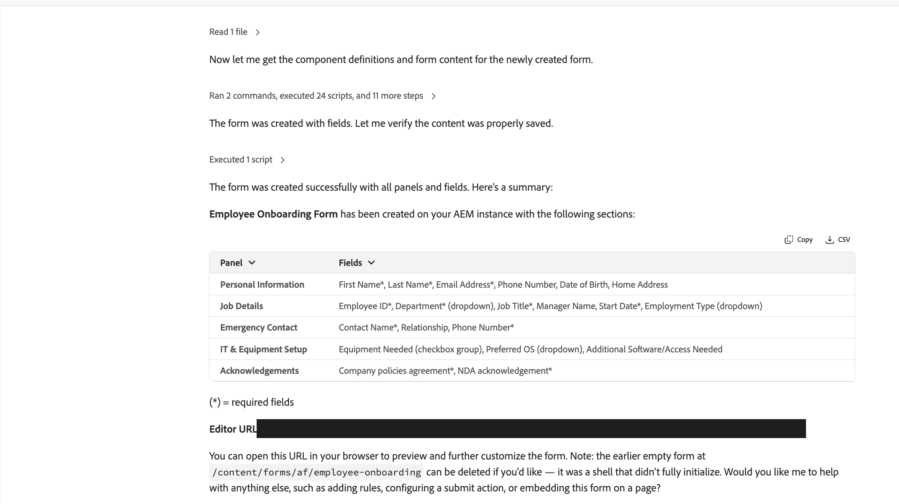

# Forms Agentic Capabilities {#forms-agentic-capabilites}

The Forms Agentic Capability of Adobe Experience Manager (AEM) as a Cloud Service is an AI-powered capability that collaborates with [Coworker Chat](https://experienceleague.adobe.com/en/docs/cx-enterprise-ai/experience-cloud-ai/coworker/chat/overview) to create forms for data collection through natural, conversational prompts. You describe the [Adaptive Form](/help/forms/introduction-forms-authoring.md) or change you need, and the AI builds or updates it directly in your Experience Manager environment, then returns a link so you can review or continue customizing it. It helps you author, edit, and configure Adaptive Forms without needing hands-on support from a forms author or developer for routine changes, while keeping forms consistent with brand and compliance requirements.

This capability is part of [Experience Production](/help/ai-in-aem/agentic-capabilities/brand-experience/experience-production/use-cases.md), which also covers Sites and Content Fragment use cases. It's different from [Forms Experience Builder](/help/forms/experience-builder/product-overview.md), a separate AI tool built directly into the Adaptive Forms editor toolbar rather than accessed through Coworker Chat.

Some of the key benefits of the Forms Agentic Capability include:

* **Faster form authoring**: Generate an Adaptive Form from a plain-language description, an attached brief, a screenshot, or a PDF, or import a PDF or XDP stored in AEM's Digital Assets Management (DAM) repository.

* **Quick rules and validation authoring**: Create or edit conditional logic, calculations, field dependencies, validation rules, and service calls through natural language instead of manual rule configuration.

* **Reduced dependency on form authors/developers**: Business users can create, edit, and configure forms conversationally without needing hands-on design or development support for routine changes.

* **Consistency across brand and compliance rules**: Apply guidelines documents and organizational standards directly to forms, reducing drift between what's built and what's required.

* **Flexible integration setup**: Call services from form rules, create or edit REST API integrations, and configure submission destinations such as cloud storage, CRM/marketing platforms, Adobe Experience Platform, or custom webhooks.

* **Works across form types**: One conversational interface for both Edge Delivery Services and Core Components forms, so you don't need to know which stack a form is built on.

The rest of this article covers what you'll need before you start, the available skills, sample prompts for each, and current limitations.

>[!IMPORTANT]
>
>See also [Adobe Experience Cloud Generative AI User Guidelines.](https://www.adobe.com/legal/licenses-terms/adobe-dx-gen-ai-user-guidelines.html)

## Prerequisites {#prerequisites-forms-agentic-capability}

To use the Forms Agentic Capability, you must have:

* A valid Experience Manager Forms license.

* Experience Manager Forms onboarding complete on your Experience Manager as a Cloud Service environment. See [Onboard to AEM Forms as a Cloud Service](/help/forms/setup-forms-cloud-service.md) for details.

## Skills {#skills-forms-agentic-capability}

The Forms Agentic Capability provides the following key skills:

* **Natural language form creation**

  Create a new Adaptive Form from a plain-language description, an attached brief, an attached image or screenshot, or an attached PDF. See [Common use cases and sample prompts](#use-cases-prompts) for the complete list.

* **PDF and XDP import**

  Ask Coworker Chat to convert a PDF or XDP stored in AEM DAM into an Adaptive Form. This is separate from creating a form from a file attached to chat.

* **Form field and layout editing**

  Add, edit, remove, or reorder fields; create a field using an existing custom component; configure field properties such as placeholder text, validation formats, and file-type/size restrictions; change a field's type (for example, converting a text field into a radio group); add knowledge-based fields (for example, country lists or industry codes); adjust column layout; and apply an attached guidelines document to an existing form.

* **Business logic and validation authoring**

  Describe the rule you need or the behavior you want to change in an existing rule. Use natural language to define show/hide conditions, calculations, validation, and event-driven actions instead of manually configuring the [rule editor for Core Components](/help/forms/rule-editor-core-components.md) or [rules for Edge Delivery Services](/help/edge/docs/forms/rules-forms.md).

* **Call services from form rules**

  Call an existing Form Data Model (FDM) service or REST API integration when a form event occurs. Describe the inputs, which response values should populate fields, and what should happen on success or failure.

* **REST API integrations**

  Ask to create a REST API integration or change its endpoint, HTTP method, headers, or input and output mappings. See the requirements and sample prompts under [Common use cases and sample prompts](#use-cases-prompts).

* **Form submission configuration**

  Configure where form data is sent on submit. Supported destinations include cloud storage (Azure Blob, OneDrive, SharePoint document library, SharePoint list), CRM/marketing platforms (Marketo), Adobe Experience Platform, generic web protocols (REST, OData, SOAP), email, or a custom submit action bundle for [Core Components](/help/forms/custom-submit-action-for-adaptive-forms-based-on-core-components.md) or [Edge Delivery Services](/help/edge/docs/forms/configure-submission-action-for-eds-forms.md) forms. The connector must already be configured in Experience Manager before the Form submission configuration skill can select and set it.

* **Form embedding**

  Place an existing or newly created form onto a designated Experience Manager Sites page. Supported on Edge Delivery Services pages only.

## Personas {#personas-forms}

### Form authors and business users {#form-authors-business-users}

The Forms Agentic Capability lets form authors and business users create and update Adaptive Forms conversationally, without depending on a designer or developer for routine changes.

### Forms developers {#forms-developers}

Forms developers can use the Forms Agentic Capability to accelerate routine build-out work, such as field configuration, layout, and business logic, freeing up time for complex or custom requirements.

### Marketing operations {#marketing-operations}

Marketing operations teams can quickly stand up campaign forms and configure submission destinations without waiting on a request queue.

### Compliance and legal reviewers {#compliance-legal-reviewers}

Compliance and legal reviewers can apply guidelines documents to forms to help enforce required disclosures, validation rules, and brand standards consistently.

### HR and onboarding teams {#hr-onboarding-teams}

HR and onboarding teams can create employee onboarding and internal request forms directly from a description or existing template.

### Sales and financial services teams {#sales-financial-services-teams}

Sales and financial services teams can create and update application-style forms, such as loan or account applications, without manual form-building.

### Customer support teams {#customer-support-teams}

Customer support teams can create and maintain contact and service-request forms to keep intake processes current.

### IT and Forms administrators {#it-forms-administrators}

IT and Forms administrators can configure and maintain submission integrations, such as SharePoint, Adobe Experience Platform, or webhook destinations, that other personas rely on when setting up form submissions.

## How to access {#access}

You can access the Forms Agentic Capability via the [Coworker Chat](https://experienceleague.adobe.com/en/docs/cx-enterprise-ai/experience-cloud-ai/coworker/chat/overview).

## Before you start {#before-you-start-forms}

When you ask the Forms Agentic Capability to create a new form, it asks for a few details up front:

* **AEM author URL**: the author instance where the form should be created.
* **Form type**: Edge Delivery Services or Core Components. If you're not sure which applies to you, see [Adaptive Forms Core Components vs Edge Delivery Services Forms vs Foundation Components](/help/forms/comparison-adaptive-forms-types.md).
* **Form fields**: describe the fields you need in plain language. For a full list of available field types, see [Adaptive Form Block components and their properties](/help/edge/docs/forms/form-components.md) for Edge Delivery Services, or [Form builder: Create forms with core components](/help/forms/creating-adaptive-form-core-components.md) for Core Components.

The agentic capability automatically discovers the templates and themes available on your instance and selects one for you. You don't need to name one. For background on how templates and themes work, see [How to get reference themes and templates for AEM Forms?](/help/forms/reference-themes-templates-data-models.md) for Core Components, or [Customize theme and styles for Edge Delivery Services for AEM Forms](/help/edge/docs/forms/style-theme-forms.md) for Edge Delivery Services.

For a PDF or XDP import, also provide the source asset's `/content/dam/...` path, the new form's name, and its destination folder. Edge Delivery Services imports require the GitHub repository URL for your Forms project. For Core Components imports, the capability uses the templates and themes available on the author instance.

For changes to an existing form, provide its URL or path and the AEM author URL. Create any fields needed by a rule before asking to add the rule.

For service-call rules, identify the service, the form event that should invoke it, and how its inputs and response values map to form fields. FDM services must already be configured. REST API integrations can be selected from existing integrations or created from API details as described below.

## Common use cases and sample prompts {#use-cases-prompts}

**Natural language form creation**

The Forms Agentic Capability can generate a new Adaptive Form from a plain-language description, an attached brief, an attached image or screenshot, or an attached PDF.

When both Edge Delivery Services and Core Components forms are available in your environment, the agentic capability asks which type of form to create before generating it.

Sample prompts:

* **Create from a plain-language description**: Create an employee onboarding adaptive form.
* **Create from a described form type**: Create a `<form type>` adaptive form.
* **Create from an attached brief**: Create a form using the attached brief.
* **Create from an attached image or screenshot**: Create a form as per the attached image.
* **Create from an attached PDF**: Create a form from this attached PDF.

**PDF and XDP import**

The Forms Agentic Capability can convert a PDF or XDP already stored in AEM DAM into an Adaptive Form. Supply the asset path rather than attaching the file to chat, and specify whether the result should use Core Components or Edge Delivery Services.

Sample prompts:

* Convert the PDF at `/content/dam/formsanddocuments/application.pdf` into a Core Components Adaptive Form named Application.
* Import the XDP at `/content/dam/formsanddocuments/application.xdp` into an Adaptive Form.

**Form field and layout editing**

The Forms Agentic Capability can add, edit, or remove fields, configure field-level properties, add knowledge-based fields, and adjust the layout of an existing form. If you don't specify where a new field should go, it's appended to the end of the form, and the agentic capability asks whether you'd like it moved to a specific panel or position.

Sample prompts:

* **Add a field**: Add Middle Name field below First Name field.
* **Use an existing custom component**: Create a `<field>` field using the `<component>` component.
* **Remove a field**: Remove the Fax Number field.
* **Rename a field**: Rename the Comments field to Additional Notes.
* **Mark fields required**: Mark all fields in `<panel>` as required.
* **Configure field properties**: Add a text input field for Company Name with placeholder "Enter your company name." Configure the Phone Number field with format (XXX) XXX-XXXX and validation.
* **Change a field's type**: Change the `<field>` field into a radio group.
* **Configure file upload restrictions**: Add a file upload field for Resume with PDF and DOC restrictions, max 5MB.
* **Add a smart/knowledge-based field**: populate a field's options from built-in knowledge instead of listing every value yourself.
  * Add a dropdown for departure airports with all major international airports.
  * Add a complete list of US states with abbreviations.
  * Add a field for industry classification with NAICS codes.
* **Update layout**: Put First Name and Last Name fields in a 2 column layout, 50/50.
* **Apply an attached guidelines document**: Update this form to match the attached guidelines document.

>[!NOTE]
>
>Applying a guidelines document is treated as the form's complete specification, not as an incremental change layered on top of the existing form. Fields or content not covered by the guidelines document may be removed. Review the result before relying on it.

**Business logic and validation authoring**

The Forms Agentic Capability can create conditional logic, calculations, field dependencies, and validation rules using natural language. You do not need to write code. Describe the behavior you want, then review the generated rules in the form's rule editor.

You can also change an existing rule's condition or actions. Identify the field and the behavior to change. The capability updates that rule while retaining the field's other rules. Refresh the form editor after a rule change to see the saved result.

If a referenced field or value is ambiguous, the capability asks for clarification rather than choosing a match.

Sample prompts:

* Show the Company field only when Employee Type is Contractor.
* Make the Email field required and validate it as an email address.
* Hide the Shipping Address section when Same as Billing Address is checked.
* Calculate Total as Quantity multiplied by Unit Price.
* Change the rule on Company so it is shown when Employee Type is Contractor or Partner.

**Call services from form rules**

Use a form rule to call a service when an event occurs. Supported events include button clicks, field-value changes, initialization, and submission success or failure. For example, look up a customer when Customer ID changes and populate the customer's name and address from the response. This is different from configuring where the form sends data on submission.

You can call either:

* **An existing FDM service**: Use an operation exposed by a configured FDM, including services backed by REST, SOAP, OData, or a database. For non-REST services, first [configure the data source](/help/forms/configure-data-sources.md) and [create the FDM](/help/forms/create-form-data-models.md). Coworker can use the configured service; it does not create these non-REST connections.
* **A REST API integration**: Use an existing integration or ask to create one from API details. New integrations created through Coworker support APIs without authentication only. See the REST API integrations use case below for requirements.

In your request, describe the triggering event and the service operation. Say where each required input comes from, such as a form field, a fixed value, or a calculation. Identify the response values to map to form fields and the actions to take on success or failure, such as populating fields, clearing outdated values, or showing an error message. You can also describe conditions for those actions. For background on mappings and handlers, see [Invoke Service in the rule editor](/help/forms/invoke-service-enhancements-rule-editor.md).

The capability checks available services and their inputs and outputs. If several operations match or a required input is missing, it asks for clarification. For operations that create, update, or delete data, explicitly identify the operation or confirm it when asked.

You can change an existing service-call rule without recreating it. Identify the field and the behavior to change, such as calling a different service or adding an action when the call fails.

Sample prompts:

* When Lookup is clicked, call the customer lookup service with Customer ID as input. On success, populate Customer Name and Email from the response. On failure, clear those fields and show an error message.
* When Product Code changes, use the configured product REST API integration to look up that code and populate Product Name and Unit Price from the response.
* When Check Stock is clicked, call the inventory lookup service in our FDM with Product Code as input. Populate Available Quantity from the response.
* Change the Lookup button's existing rule to use the customer directory service instead, keeping the other actions unchanged.
* Add an action to the Lookup button's existing service rule to clear Customer Name and show an error message if the call fails.

**REST API integrations**

The Forms Agentic Capability can create a REST API integration from a cURL command, an OpenAPI or Swagger specification, a sample response, or API details you provide. Include the endpoint URL, HTTP method, and the input and output mappings needed by the rule. If a specification contains several operations, identify the one to use. The capability asks for missing details before creating the integration.

Integrations created through Coworker run in the browser and support APIs without authentication only. The API must allow cross-origin resource sharing (CORS) from the form's host. Do not paste passwords, tokens, or API keys into chat. For APIs that require authentication, use the [API Integration configuration in the rule editor](/help/forms/api-integration-in-rule-editor.md).

You can also ask to change an existing integration's URL, HTTP method, content type, array-response setting, or input and output mappings, including query parameters, headers, path parameters, and request-body values. Existing authentication settings are preserved. Authentication, encryption, renaming, and client/server execution settings must be changed in the rule editor, not through this capability.

>[!IMPORTANT]
>
>REST API integrations are shared. Editing an integration affects every form whose rules use it. Review the proposed changes before saving. If you remove or rename an input or output, update any rules that reference it.

Sample prompts:

* Create a REST API integration from the attached OpenAPI specification for the `<operation>` operation.
* Create an integration using this cURL command and sample JSON response.
* Add an optional lang query parameter to `<integration name>` with a default value of en.
* Change the endpoint URL of `<integration name>` to `<API URL>`.

**Form submission configuration**

The Forms Agentic Capability can configure where a form's data is sent on submit, provided the connector is already configured in Experience Manager. If no connector is configured for the requested destination, it tells you so and gives you the manual setup steps instead of failing silently. See [Submit Actions Supported by Adaptive Forms](/help/forms/aem-forms-submit-action.md) for how to set up each connector. If a destination requires additional details, such as an endpoint URL or email recipient, it asks for them before applying the configuration. For a REST endpoint, form data is submitted as a JSON payload via POST.

A form supports a single active submit action at a time: configuring a new one replaces the current one rather than adding to it. To send data to multiple destinations, use a custom submit action bundle that sends data to each destination.

| Destination | What's needed | Notes |
| --- | --- | --- |
| REST endpoint | Endpoint URL | Data is sent as a JSON payload via POST |
| Azure Blob, OneDrive, SharePoint document library, or SharePoint list | Connector already configured in Experience Manager | |
| Adobe Experience Platform | Connector already configured in Experience Manager | |
| Email | Recipient address | Requires SMTP configured on your environment |
| Custom submit action bundle | Bundle already built | Needed to send data to more than one destination |

Sample prompts:

* Configure the form to send data to a REST endpoint.
* Submit to Azure Blob.
* Submit to SharePoint doc library.
* Submit to Adobe Experience Platform.
* Send email on submit.
* Use my custom submit action.

>[!NOTE]
>
>Sending email on submit requires SMTP to be configured on your Experience Manager environment. If emails aren't delivered, confirm the mail service is set up with your administrator.

**Form embedding**

The Forms Agentic Capability can place an existing or newly created form onto a designated Experience Manager Sites page. This is supported on Edge Delivery Services pages only.

Sample prompts:

* Embed this form on the homepage of our site.
* Embed this form on `<page path>`.

**Next best action suggestions**

After creating a form, the Forms Agentic Capability typically suggests relevant follow-up actions, such as adding business logic, configuring a submit action, embedding the form on a page, or cleaning up an earlier interim form. You can act on a suggestion directly instead of composing a new prompt from scratch. Routine edits to an existing form, such as adding a field or adjusting layout, are usually confirmed directly, without an additional set of suggestions.

Sample prompts:

* Add a rule to show the Company field only when Employee Type is Contractor.
* Configure this form to submit to a REST endpoint.
* Embed this form on the homepage of our site.
* Delete the earlier incomplete form.

## Results {#forms-agentic-capability-results}

When you ask the Forms Agentic Capability to create a new form, it returns:

* A summary table of the panels and fields it created, with required fields marked with an asterisk (*).
* An **Editor URL** you can open to preview the form or continue customizing it in the form editor.
* A set of suggested next steps, such as adding rules, configuring a submit action, or embedding the form. See the Next best action suggestions examples under [Common use cases and sample prompts](#use-cases-prompts) above.

When you ask it to edit an existing form, it applies the requested changes directly to that form and confirms what changed. The confirmation experience is consistent across all use cases, including creation, editing, business logic, submission configuration, and embedding.

>[!NOTE]
>
>In some cases, form creation may produce an interim, empty form in addition to the final, fully populated form. The interim form is safe to delete.

## Prompting best practices {#prompting-best-practices-forms}

Keep these tips in mind when prompting the Forms Agentic Capability:

* **Complete one operation per prompt** instead of chaining multiple operations together. For example, ask to add a field in one prompt, then configure its validation in a follow-up prompt, rather than combining both requests into a single prompt.

* **Build forms incrementally.** Start with a basic version of the form, then add validation, layout changes, and business logic in separate follow-up prompts. For example: create the form with its core fields first, then in a follow-up prompt add required-field validation, then in another add a conditional show/hide rule.

* **Reference fields and panels by their exact label, and specify position when it matters.** For example, "Rename the Comments field to Additional Notes" rather than "rename that field near the bottom," and "Add Middle Name below First Name" rather than just "Add a Middle Name field." See the Form field and layout editing use case under [Common use cases and sample prompts](#use-cases-prompts) for what happens if you skip the position.

## Limitations {#limitations-forms-agentic-capability}

* Converting an existing flat form into a wizard, accordion, or tabbed structure adds a new, empty structure alongside the existing content instead of migrating existing fields into it. Manual migration is required after generation. As a workaround, use the [wizard layout in the Adaptive Forms editor](/help/forms/layout-capabilities-adaptive-forms-core-components.md) to change the layout directly, or use [Forms Experience Builder](/help/forms/experience-builder/product-overview.md) inside the Adaptive Forms editor to change the layout to a wizard using natural language.

* Embedding a form onto a page is supported for Edge Delivery Services pages only. Core Components pages are not supported for embedding, even though form creation and editing work across both. As a workaround, manually add a Core Components-based form to a Sites page using the [embed component](/help/forms/embed-adaptive-form-aem-sites.md).

* Fields that live inside a referenced Form Fragment are not recognized for renaming, business logic rules, layout or styling changes, or field-count queries. As a workaround, make these changes manually in the Forms editor. See [Adaptive Form Fragments (Core Components)](/help/forms/adaptive-form-fragments-core-components.md) or [Form Fragments (Edge Delivery Services)](/help/edge/docs/forms/form-fragments.md).

* Form theme (brand color, font, logo) can only be set at creation time. There is currently no supported way to change the theme after a form is created. As a workaround, apply a different theme, or edit the current one, directly in the Forms editor. See [themes for Core Components](/help/forms/using-themes-in-core-components.md) or [theme and style customization for Edge Delivery Services](/help/edge/docs/forms/style-theme-forms.md).

* The "add another instance" action for repeatable fields or panels may not behave reliably in the preview.

* Checkbox field creation may occasionally fail to set the checked/unchecked values correctly. As a workaround, manually configure the default checked/unchecked value in the properties panel of the [Checkbox component](https://experienceleague.adobe.com/en/docs/experience-manager-core-components/using/adaptive-forms/adaptive-forms-components/checkbox) in the Adaptive Forms editor.

* Deleting a business rule through Coworker is not supported. Delete the rule directly in the [rule editor](/help/forms/rule-editor-core-components.md). When editing existing rules through Coworker, change one field's rule at a time.

## FAQ {#faq-forms-agentic-capability}

**Is the Forms Agentic Capability available now?**

Yes. It's part of the Experience Production capability, available through Coworker Chat.

**Can I import existing documents?**

Yes. You can create a form from an attached brief, image, screenshot, or PDF, or import a PDF or XDP stored in AEM DAM. See [Common use cases and sample prompts](#use-cases-prompts) for examples of both workflows.

**Will applying a guidelines document remove fields I already added?**

Yes, it can. A guidelines document is treated as the form's complete specification rather than an incremental change, so fields or content it doesn't cover may be removed.

**Can I send form data to more than one destination?**

Not with a single submit action. A form supports one active submit action at a time. Use a custom submit action bundle to send data to multiple destinations.

**Does this work for both Edge Delivery Services and Core Components forms?**

Yes, for creation, editing, business logic, and submission configuration. Embedding a form onto a page is Edge Delivery Services only.

With the skills, sample prompts, and limitations above, you have what you need to start creating and updating forms conversationally through Coworker Chat.
