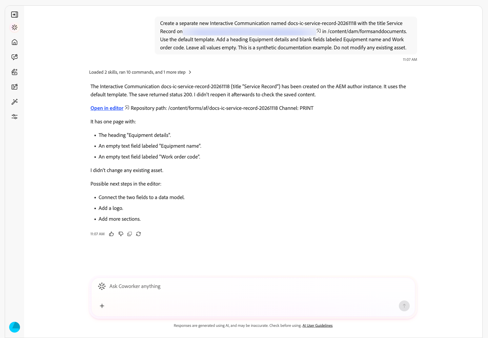
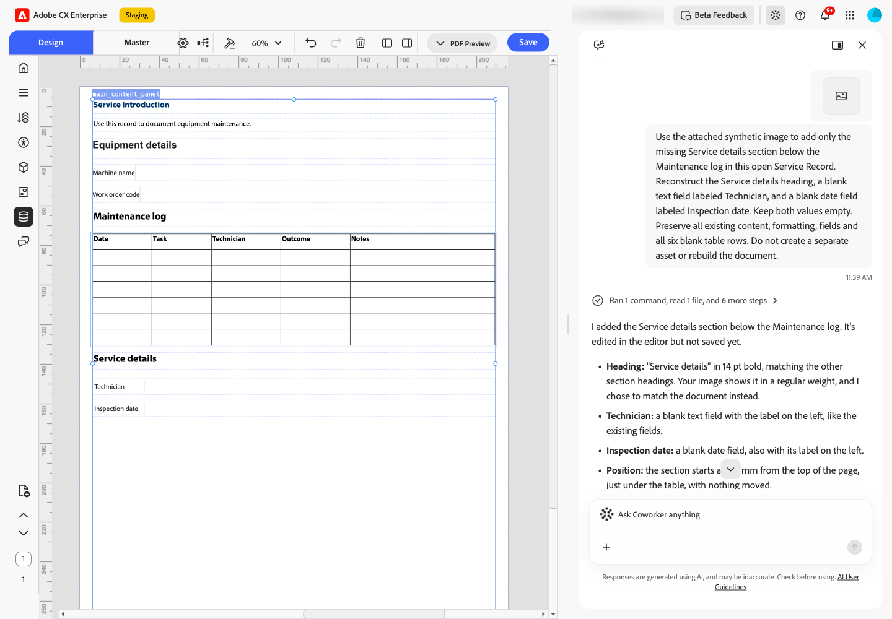
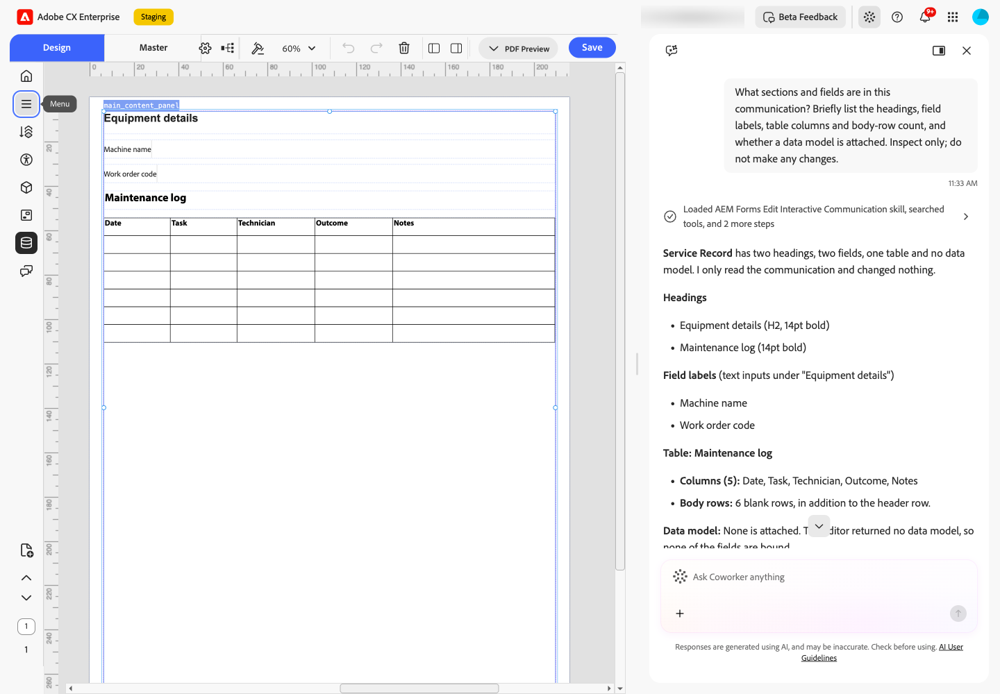
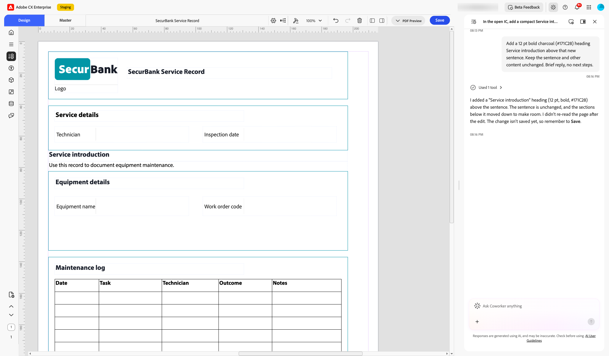
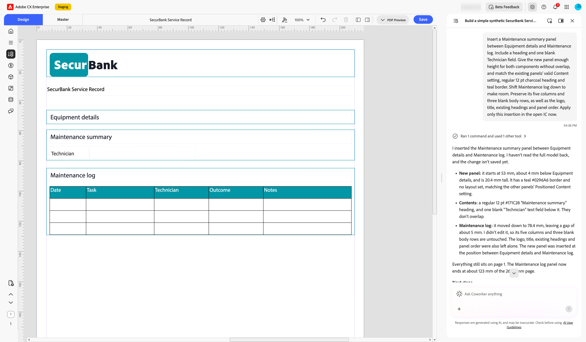
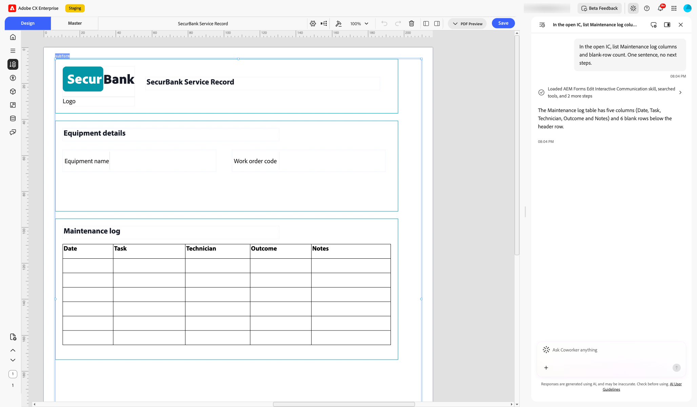
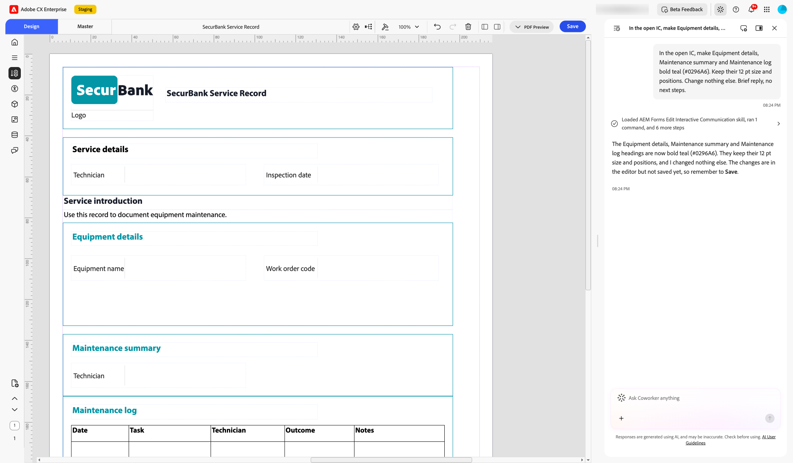
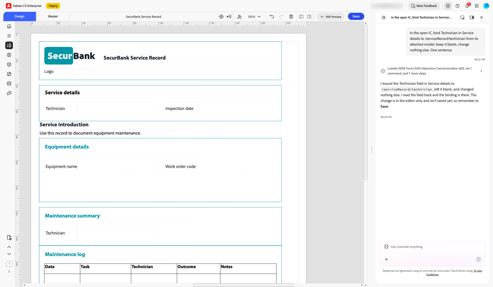
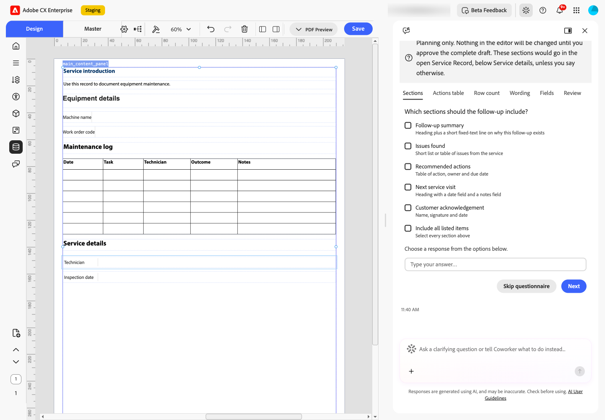

# Interactive Communications agentic capabilities {#ic-agentic-capabilities}

Create and update [Interactive Communications (IC)](/help/forms/interactive-communication/introduction.md) in Adobe Experience Manager (AEM) Forms by telling Adobe CX Enterprise Coworker what you need in plain language, then refine the result through conversation. Start from a description, an approved brief, an enabled template, a PDF, or an image. Request bulk changes or insert sections between existing panels, then review and save the result in the IC Editor.

Use these capabilities for documents such as account statements, renewal notices, and service records. For example, you can add a maintenance log to an existing service record and bind its fields to an attached data model. This article focuses on the print, or Document of Record, channel, rather than the data-collection forms covered in [Forms agentic capabilities](forms-use-cases.md).

>[!NOTE]
>
>Have a question or a use case you'd like to discuss? For help understanding or using Interactive Communications in Coworker, or to share feedback, email [aem-forms-ea@adobe.com](mailto:aem-forms-ea@adobe.com).

## Prerequisites {#prerequisites-ic}

To use these capabilities, you need:

* An AEM Forms as a Cloud Service environment with Interactive Communication authoring and permission to create or edit the intended assets. See [Getting started with the IC Editor](/help/forms/interactive-communication/getting-started.md).
* Coworker access with the Interactive Communication capabilities enabled for your environment.
* The intended communication open in a connected IC Editor session for live editing.
* A form data model containing the required fields for data-binding requests. See [Configure data binding](/help/forms/interactive-communication/configure-data-binding.md).

For general environment setup, see [Onboard to AEM Forms as a Cloud Service](/help/forms/setup-forms-cloud-service.md).

>[!IMPORTANT]
>
>See also [Adobe Experience Cloud Generative AI User Guidelines.](https://www.adobe.com/legal/licenses-terms/adobe-dx-gen-ai-user-guidelines.html)

## Skills {#skills-ic}

The capabilities are organized around two skills:

* **Communication creation.** Create a new IC using the default template, an enabled named template, an approved brief, an image, or a PDF.
* **Communication authoring.** Inspect the open IC, add or update sections and components, change supported styles, edit tables, and configure supported data bindings. Source-based requests can also reconstruct content in the open IC.

Both skills can ask about missing content choices before making changes. For example, a request to add a transaction section does not specify which columns, how many rows, or which data source to use. Coworker asks you to resolve those choices and approve the complete proposed scope.

## Personas {#personas-ic}

The two author personas below correspond to different authoring permissions and user-group memberships. They do not require a handoff between different people: the same person can perform both kinds of authoring when assigned to the required groups. For group setup, see [Configure users](/help/forms/setup-forms-cloud-service.md#config-users).

{width="20"} **Communication authors (IC Author)**

Members of the `forms-users` group create letters and statements from supplied content, add document sections, and revise wording or field labels without configuring every component individually.

{width="20"} **Template authors**

Members of the `forms-users` and `template-authors` groups define reusable headers, footers, layouts, and default styling that establish a communication's look and feel. Review data-model bindings and content and layout locks when preparing a template for reuse. Use Coworker to make supported changes to a template already open in the editor.

Editing a template is a separate task from editing a document that uses that template; document requests do not authorize changes to the source template.

Business users, forms developers, marketing operations teams, customer support teams, and compliance and legal reviewers can use these capabilities when their work involves customer communications. For example, supply approved wording for a renewal notice or request a targeted change to a service record. Review generated content before use; these capabilities do not establish legal or regulatory compliance.

## How to access {#access-ic}

Choose how to begin based on your task:

| Your task | Starting context |
| --- | --- |
| Create a communication | Open [Coworker](https://experienceleague.adobe.com/en/docs/coworker/content/chat/overview) and describe the new IC you want to create. Name the enabled template to use, if applicable. |
| Edit a communication | Open the intended IC in the IC Editor, select **[!UICONTROL CoWorker Chat]** {width="20"} in the application header, and describe the changes you want to make. |

When you start a conversation from the IC Editor, requests apply to the open communication, not to a separate new asset.

## Before you start {#before-you-start-ic}

Be clear about which communication should change:

* **For a new IC**, provide its name, title, target environment, and destination folder. Name the template if you want to use one, or ask which enabled templates are available.
* **For the open IC**, name the section or field to change and describe the desired result. Coworker uses the current editor context rather than asking you to identify the document by a repository ID.
* **For source-based work**, attach the image or PDF and state whether to create a communication or update existing content. For updates, identify what should be added, changed, or preserved.

To attach a source, select the **[!UICONTROL Add]** icon {width="20"} in Coworker and choose **[!UICONTROL Attach file]**.

When providing content, distinguish fixed text from fields a recipient completes. For example, "Print the instruction Contact the service desk" differs from "Add a blank field labeled Contact details." Supply approved declarations and other controlled wording verbatim.

If a brief leaves material choices open, review the complete proposed content before approving the build. Selecting suggested items is not the same as approving editor changes.

## Common use cases and sample prompts {#use-cases-prompts-ic}

Explore the capabilities below, then use the sample prompts as starting points. Replace section and field names with those in your communication.

### Create an Interactive Communication {#create-communication-ic}

Create a new IC from the starting material you have:

| Starting point | Creation capability |
| --- | --- |
| Description | Describe the communication and the content you need in natural language, or start with an empty IC. |
| Brief | Supply an approved brief with the required sections, wording, and fields. If choices remain open, review the proposed content before approving creation. |
| Enabled template | Create an IC directly from an enabled named template. Ask Coworker which templates are available if needed. |
| PDF | Attach an existing PDF and use its content and layout as the starting point for a new IC. |
| Image | Attach an image of the document design to reconstruct its content in a new IC. |

You do not need to open an existing IC to create one. Review reconstructed text and layout when starting from a PDF or image; see [Build an IC from an image or PDF](#build-from-source-ic) for source requirements and the template-plus-source workflow.

Sample prompts:

* **Start empty:** Create a new IC named securbank-service-record, titled SecurBank Service Record, in the securbank folder. Use the default template.
* **Discover templates:** Which enabled Interactive Communication templates are available on my AEM environment?
* **Use a named template:** Create a separate new IC titled Quarterly Statement from the Quarterly Statement template.
* **Use a brief:** Create a separate new service record with a heading Service details and blank fields labeled Equipment name, Technician, and Inspection date. Leave all values empty.

If a named template is unavailable, Coworker offers available alternatives rather than silently substituting one. For background on template authoring, see [Create an Interactive Communication template](/help/forms/interactive-communication/create-interactive-communication-template.md).

After creation, open the IC in the editor to review and refine it. The SecurBank example below includes subsequent branding and content edits.

### Build an IC from an image or PDF {#build-from-source-ic}

Provide an image or PDF when requesting a new communication. To update an existing IC from a source, open it in the IC Editor and use Coworker Chat to describe the content to reconstruct. The requested source content is compared with the document before changes are proposed. A request to add content does not authorize clearing or rebuilding the entire communication.

To start from a template, ask Coworker to create a new IC from an enabled template and open the result in the IC Editor. Select **[!UICONTROL CoWorker Chat]**, attach the image or PDF, and request changes to editable document content, not to the source template.

Sample prompts:

* **Create a communication:** Create a separate new IC from the attached PDF.
* **Add missing content:** Add only Service details from this image below the header. Keep Technician and Inspection date blank; shift lower panels and preserve existing content.
* **Limit the scope:** Update only the service introduction to match the attached PDF. Leave the equipment details and the rest of the communication unchanged.
* **Use a template with an image:** In this IC created from the Service Record template, add only the missing Service details section from the attached image. Preserve the existing content, template headers and footers, and content and layout locks.
* **Use a template with a PDF:** In this IC created from the Service Record template, update only the editable body content of Service details to match the attached PDF. Preserve the template headers, footers, and locked content. Do not modify the source template.

Image and PDF workflows depend on usable source extraction. Review reconstructed text, component types, tables, and pagination; these examples do not promise an exact visual replica.

### Inspect the current communication {#inspect-communication-ic}

Ask about the open document before planning an edit. Coworker can inspect its structure, fields, bindings, and available lock information. A successful read does not by itself establish permission to edit every component.

Sample prompts:

* In the open IC, summarize section order, input fields and table size in three bullets. No IDs or measurements.
* Which parts of this document are locked?
* Which equipment detail fields already have data bindings?

### Add or edit document content {#edit-content-ic}

Add headings, fixed text, entry fields, choices, and grouped sections, or update existing labels and content. Specify the intended position and which existing content must remain unchanged. Bulk operations in these examples target multiple components within the open IC, not multiple communication assets.

Sample prompts:

* **Add text:** Add this text above Equipment details: Use this record to document equipment maintenance. Preserve existing content.
* **Add its heading:** Add a 12 pt bold charcoal (#171C28) heading Service introduction above that sentence. Keep the sentence and other content unchanged.
* **Rename a field:** Rename the Equipment name field label to Machine name. Keep its value and data binding unchanged.
* Add a Service window choice with Morning, Afternoon, and Overnight as the only options. Allow one choice and leave it unanswered.
* Add a blank Signature field and a blank Date field below the approved declaration. Do not prefill either field.
* **Delete a field:** Remove the obsolete Fax number field, leaving the rest of Contact details unchanged.
* **Bulk rename:** In Equipment details, rename the Equipment name field label to Machine name and the Work order code field label to Job reference. Preserve both fields' values and data bindings, and leave all other labels unchanged.
* **Bulk delete:** Remove only the Fax number and Pager number fields from Contact details. Preserve the section and every other field.

Deletion and changes to template-owned content remain subject to editor protections. If any target in a bulk request is blocked or its permissions are unclear, Coworker reports the restriction rather than silently changing only the eligible fields. See [Limitations](#limitations-ic) before requesting changes to locked or referenced content.

### Insert content between panels {#insert-between-panels-ic}

Add a section between existing panels without rebuilding the communication. Identify the panels before and after the insertion point, describe the new content, and specify what must remain unchanged.

In a positioned layout, Coworker shifts the sections below the insertion point to make room. The shifts cascade through subsequent sections, and Coworker creates a page if needed while preserving the existing content and order.

Sample prompts:

* **Insert between panels:** Insert Maintenance summary between Equipment details and Maintenance log with one blank Technician field. Match existing styling; shift lower panels and preserve content and bindings.
* **Clear a default value:** Clear only the Technician value in Maintenance summary. Keep its label and all other content unchanged. Read back the value.
* **Insert above an existing section:** In the positioned layout, add a Maintenance summary section above Equipment details with a blank Technician field. Shift the sections below it to make room, creating a page if needed. Preserve their content and order.
* **Append on a new page if needed:** Add a Follow-up notes section with one blank Notes field at the end of the open IC. If the last page has no space, create the next page and place the section there.

Insertion remains subject to layout and content locks. Review new field values, affected panels, and page breaks before saving. Page creation here is a Coworker authoring action, not a change to the editor's manual text-overflow settings.

### Create or update a table {#edit-table-ic}

Describe the column order, header, number of body rows, and whether cells should display supplied content or accept input. State explicitly when rows should remain blank.

Sample prompts:

* Add Maintenance log below Equipment details: Date, Task, Technician, Outcome, Notes. Use a bold header and six blank body rows.
* Add one blank body row at the end of Maintenance log.
* Remove the Notes column from Maintenance log.

For manual table authoring, see the [Table component](/help/forms/interactive-communication/table.md).

### Change layout or appearance {#change-layout-ic}

Request supported changes to typography, color, spacing, and component placement. Use **bulk update** to apply specified changes to multiple components in the open IC in one request. Name every target or define the target group precisely, and state which properties to change rather than asking for an undefined brand refresh. Bulk updates apply within one communication, not across multiple IC assets.

Sample prompts:

* Make the Service introduction heading 12 pt, bold, and charcoal (#171C28). Change nothing else.
* **Bulk update:** Make Equipment details, Maintenance summary and Maintenance log bold teal (#0296A6). Keep their 12 pt size and positions; change nothing else.
* Put the Technician and Work order code fields side by side in Maintenance summary.
* Change only the background fill of Maintenance summary to light gray (#F0F0F0).

Layout and content locks can restrict these changes. If a target is blocked or its permissions are unclear, Coworker reports the restriction rather than silently updating only eligible components. Review the rendered result, especially when text length or placement affects page flow. For inserting sections and handling the resulting shifts, see [Insert content between panels](#insert-between-panels-ic).

### Bind fields to existing data {#bind-data-ic}

Coworker can add content to the open IC from supported scalar fields and simple groups in its attached data model, or bind existing components to those fields. This workflow does not attach or replace the model or generate repeating tables from arrays.

A data model describes the available data structure; it does not supply permission to invent customer values or transaction records.

Sample prompts:

* Show the fields available in this communication's attached data model.
* Bind Technician in Service details to /serviceRecord/technician from the attached model. Keep it blank; change nothing else.
* Bind the Customer name field to the Customer name property in the attached data model.
* Add the Customer name and Renewal date fields from the attached data model in a Customer details section. Bind each field to its corresponding model property.
* **Build from the attached model:** In the open IC, create a Service details section using the supported nonrepeating fields in the attached serviceRecord model. Bind each field to its corresponding model property, leave values blank, and preserve existing content. Show me the proposed field list before making changes.

Coworker needs an unambiguous match to a supported model field. Repeating groups, arrays, and unsupported data types are not covered by this model-driven authoring workflow. See [Configure data binding](/help/forms/interactive-communication/configure-data-binding.md) for the manual workflow.

The example below uses a synthetic model with the string property `/serviceRecord/technician`, not a live customer data source.

### Develop content through guided discovery {#guided-discovery-ic}

Start with a business goal when you have not decided the content. Coworker can suggest section contents, ask about unresolved choices, and present a complete recap for approval before editing.

Sample prompts:

* In the open IC, plan a SecurBank service follow-up. Suggest sections; wait for my approval before building.
* Keep the agreed Maintenance summary section, but replace the proposed preference choices with a single blank Notes field. Show the revised whole plan before making changes.
* Pause this draft. Keep our agreed content, but do not add anything to the editor yet.

## Results {#results-ic}

The expected result depends on the workflow:

| Request | Expected result |
| --- | --- |
| Create a new IC | A creation confirmation and an editor link for the new communication. |
| Edit the open IC | Changes on the live editor canvas and a summary of what changed. You still need to save. |
| Discuss an underspecified brief | Questions, recommendations, and a proposed scope for approval. Discussion alone does not change the document. |
| Request a blocked or unsupported change | An explanation of the restriction, not a successful-edit confirmation. |
| Request an outcome already present | A report that no change was needed, rather than duplicate content. |

After a live edit, inspect the affected sections and select **[!UICONTROL Save]** in the IC Editor to persist accepted changes. For print-output review, follow [Generate PDF preview](/help/forms/interactive-communication/generate-pdf-preview.md) and check wrapping, table content, page breaks, and data values.

## Prompting best practices {#prompting-best-practices-ic}

Use these practices to make requests precise:

* **Identify the communication to change.** For edits, open the intended IC before starting the conversation.
* **Keep each request focused.** Add a section first, then request a separate formatting or binding change when needed.
* **Use exact labels and positions.** Say "Add Inspection date below Work order code" rather than "add another date near the top."
* **State preservation requirements.** Specify whether existing wording, formatting, bindings, and unrelated sections must remain unchanged.
* **Describe the recipient's action.** Distinguish fixed text, a blank response, independent selections, and a single choice from several options.
* **Specify table details.** Include column order, the number of body rows, and whether values should remain blank. Count the header separately.
* **Provide authoritative content.** Supply actual data sources and approved wording rather than asking Coworker to invent records, amounts, dates, or declarations.
* **Review before accepting.** Check the proposed scope, then inspect the resulting document and save accepted live-editor changes.

## Limitations {#limitations-ic}

These capabilities have the following limitations:

* **Live edits are not saved or published automatically.** Coworker changes the open editor state. Save accepted changes yourself; publishing is outside these authoring skills.
* **Locks and ownership still apply.** Coworker does not unlock components or change a source template to bypass a blocked document edit. Editing an already-open template is a separate workflow with its own permissions.
* **Fragment insertion is not supported through Coworker.** Add reusable fragments manually through the IC Editor's existing fragment tools. See [Create an Interactive Communication fragment](/help/forms/interactive-communication/create-interactive-communication-fragment.md).
* **Conditional rules and XFA scripts are draft-and-review only.** The current IC editor authoring tools do not attach or execute generated rules or scripts. Do not apply Adaptive Forms rule-authoring instructions to an IC. Use the [IC Rule Editor](/help/forms/interactive-communication/use-the-rule-editor.md) for supported manual rule configuration.
* **Data-model-driven authoring has a limited scope.** It uses supported nonrepeating scalar fields and simple groups from an attached model. It does not install or replace a schema, infer missing bindings, or automatically generate repeating tables from arrays.
* **Source conversion requires usable evidence.** Unreadable sources or unavailable extraction services block reconstruction. A PDF or image is not evidence that a printed value is editable, selected, or connected to live data.
* **Other attachment formats need conversion.** For source-based creation, provide a PDF or supported image instead of a Word, Excel, or PowerPoint file, or paste the content as a brief.
* **Shared content can affect multiple pages.** Header and footer changes must respect template ownership and every affected page. A request to change one page does not authorize changing protected shared content elsewhere.

## FAQ {#faq-ic}

These questions summarize supported authoring capabilities and the review steps needed to use them.

**What can I use to create an IC?**

Start from a description, an approved brief, an enabled template, a PDF, or an image. You can also create an empty IC. Start creation in Coworker; requests started from the IC Editor update the open communication instead of creating a separate asset.

**Can I update several components in one request?**

Yes. Bulk updates can change supported styles on multiple named components, rename several fields, or remove specified fields within the open IC. Identify the targets and preservation requirements. These operations do not update multiple IC assets or bypass component protections.

**Can I insert a panel between existing panels?**

Yes. Specify the insertion point and the new panel's content. In a positioned layout, Coworker shifts subsequent sections to make room and creates a page if needed. Review the resulting panel order and pagination before saving.

**Can Coworker create and edit tables?**

Yes. Specify the columns, header, and number of body rows to create a table. You can also add a blank row or remove a column. State when cells should remain blank rather than contain sample records.

**Can Coworker use the attached data model?**

Yes. Coworker can bind existing fields to supported model properties or add content from nonrepeating scalar fields and simple groups in the attached model. Identify the intended fields and review their bindings; this workflow does not attach or replace the model or generate repeating tables from arrays.

**Can Coworker help me plan the content?**

Yes. Begin with a business goal and review suggested sections and content choices. Coworker can refine the plan with you before building. Resolve material choices and approve the complete proposed scope before editor changes begin.

**How do I keep my edits?**

Review the changed content and select **[!UICONTROL Save]** in the IC Editor. Coworker edits are not saved or published automatically. For restrictions on locked content, fragments, and executable rules, see [Limitations](#limitations-ic).

To begin, choose the starting context in [How to access](#access-ic).
