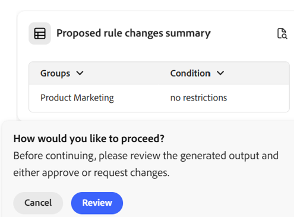
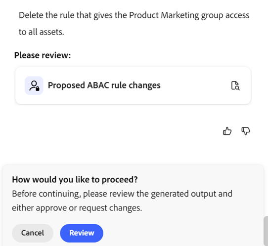
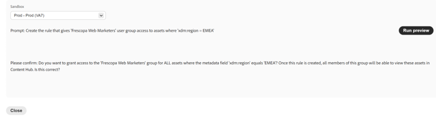

# Brand Governance Agentic Capabilities {#brand-governance-agentic-capabilites}

The Brand Governance Agentic Capability of Adobe Experience Manager (AEM) as a Cloud Service collaborates with [Coworker Chat](https://experienceleague.adobe.com/en/docs/cx-enterprise-ai/experience-cloud-ai/coworker/chat/overview) to safeguard brand integrity and compliance. It enforces security, regulatory, and brand policies to ensure every interaction and activation adheres to established standards.

## Use cases {#use-cases}

A range of use-cases are covered.

| Use Case | Description | Skill(s) | Application | Sample Prompts |
| --- | --- | --- | --- | --- |
| Full brand context lookup | Retrieve the cascade-resolved brand rules and verticals for a brand | enterprise-context | Adobe Experience Manager (AEM)  | "Give me the full brand context for this brand" "What verticals exist for this brand?" "Resolve the owning brand for this asset path" |
| Create or update brand rules | Add or modify a brand-context rule for a claim-type vertical | enterprise-context | Adobe Experience Manager (AEM) | "Add a new disclaimer rule for the pharma vertical" "Update rule #42 to require a citation" |
| Guideline & segment lookup | Retrieve detailed brand guidelines, scoped by segment, market, or category | enterprise-context | Adobe Experience Manager (AEM) | "What are the tone-of-voice guidelines for this brand?" "List the claim categories used in the health vertical" |
| Evaluate content against brand guidelines | Evaluate a published/authored page, text block, or image against configured brand checks | aem-governance | Adobe Experience Manager (AEM) | "Evaluate this landing page against SecurBank guidelines" "Does this tagline pass our tone-of-voice checks?" |
| Check configuration | List all configured checks (guidelines) for one or every brand | aem-governance | Adobe Experience Manager (AEM) | "List every check configured for SecurBank" "What guidelines apply to this URL?" |
| Brand inventory discovery | List and identify all configured brands for the organization | aem-governance | Adobe Experience Manager (AEM) | "List all brands configured" "What guidelines apply to this URL `http://frescopa-coffee`" |
| Audit AEM permissions | Explore configured permission policies, ACLs, and inheritance rules for group, or service account at a given path | aem-governance | Adobe Experience Manager (AEM) | "Audit Amit's access under `/content/folder`" "What can this service account do at this path?" "Show the access policies applied to this content path `/content/`" |
| Debug AEM permissions | Debug / understand permission policies, ACLs, and inheritance rules. | aem-governance | Adobe Experience Manager (AEM) | "Why can principal admin write `/content/folder/us` on `https://author/` ?" "Why can't sample-author write in `/content/dam` on `https://author`" |
| Show all existing Content Hub ABAC rules | Display all Content Hub ABAC rules, specify the tenant or environment whose rules you want to view. If multiple tenants or environments are available, indicate which one to use | aem-governance | Adobe Experience Manager (AEM) | "Show all existing Content Hub ABAC rules" |
| Create a Content Hub rule  | Create a new rule in Content Hub, specify the user group that should be granted access and the metadata condition for asset visibility (for example, group name and property or value such as `./metadata/globalAvailability EQUALS` "All Users") | aem-governance | Adobe Experience Manager (AEM) | "Create a Content Hub rule" |
| Update an existing rule in Content Hub | Update a rule in Content Hub, specify which rule you want to update and what changes you want to make. For example, provide the group name, metadata condition, or the specific modification you wish to apply. | aem-governance | Adobe Experience Manager (AEM) | "Update an existing rule in Content Hub" |
| Delete a rule in Content Hub   | Delete a rule in Content Hub, specify which rule you want to delete. For example, provide the group name or the metadata condition associated with the rule you wish to remove. | aem-governance | Adobe Experience Manager (AEM) | "Delete a rule in Content Hub" |
| Show available groups and metadata properties to set rules in Content Hub  | The agent shows the existing user groups and asset attributes configured in the selected environment  | aem-governance | Adobe Experience Manager (AEM) | "Show available groups and metadata properties to set rules in Content Hub" |
| Create a rule that gives the Product Marketing group access to all assets.  |  | aem-governance | Adobe Experience Manager (AEM) | "Create a rule that gives the Product Marketing group access to all assets. " |
| Delete the rule that gives the Product Marketing group access to all assets. |  | aem-governance | Adobe Experience Manager (AEM) | "Delete the rule that gives the Product Marketing group access to all assets." |
| Create the rule that gives 'Frescopa Web Marketers' user group access to assets where 'xdm:region = EMEA' |  | aem-governance | Adobe Experience Manager (AEM) | "Create the rule that gives 'Frescopa Web Marketers' user group access to assets where 'xdm:region = EMEA'" |