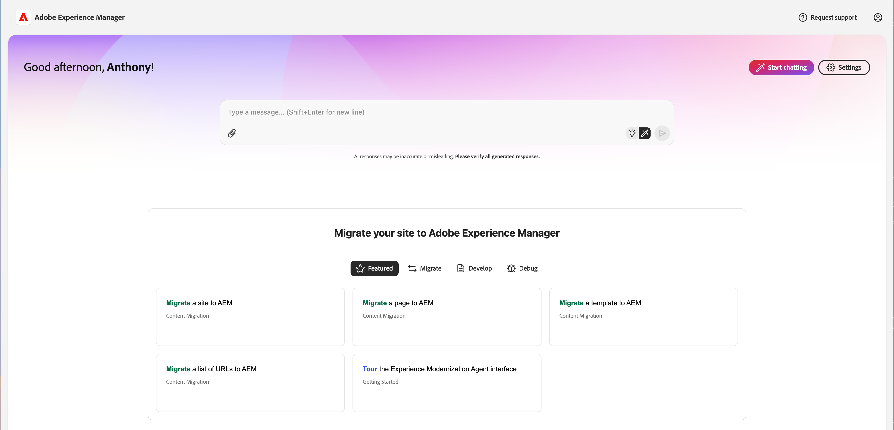
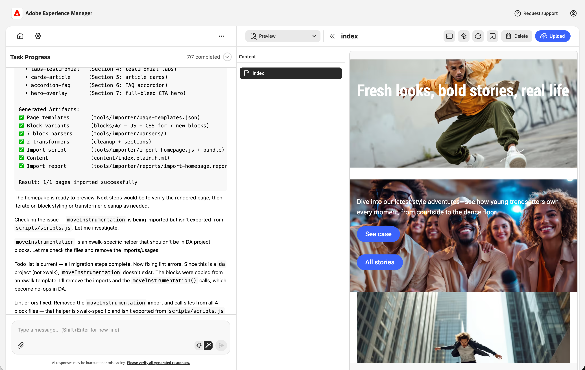
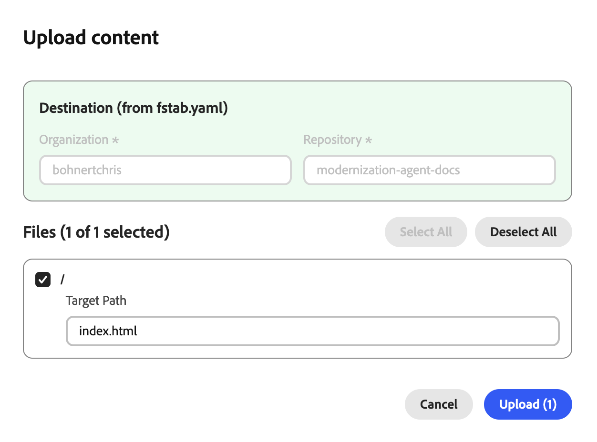
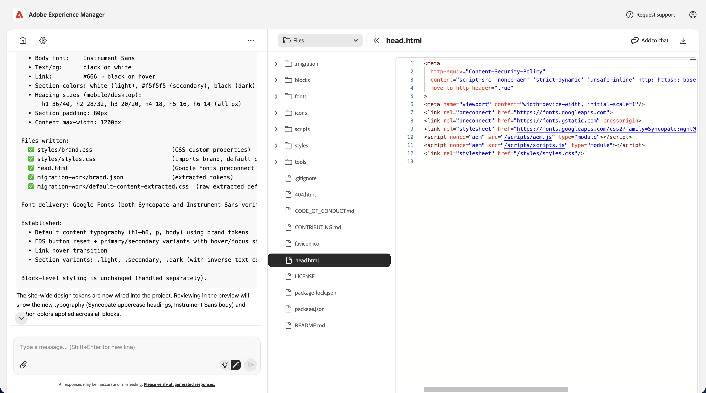
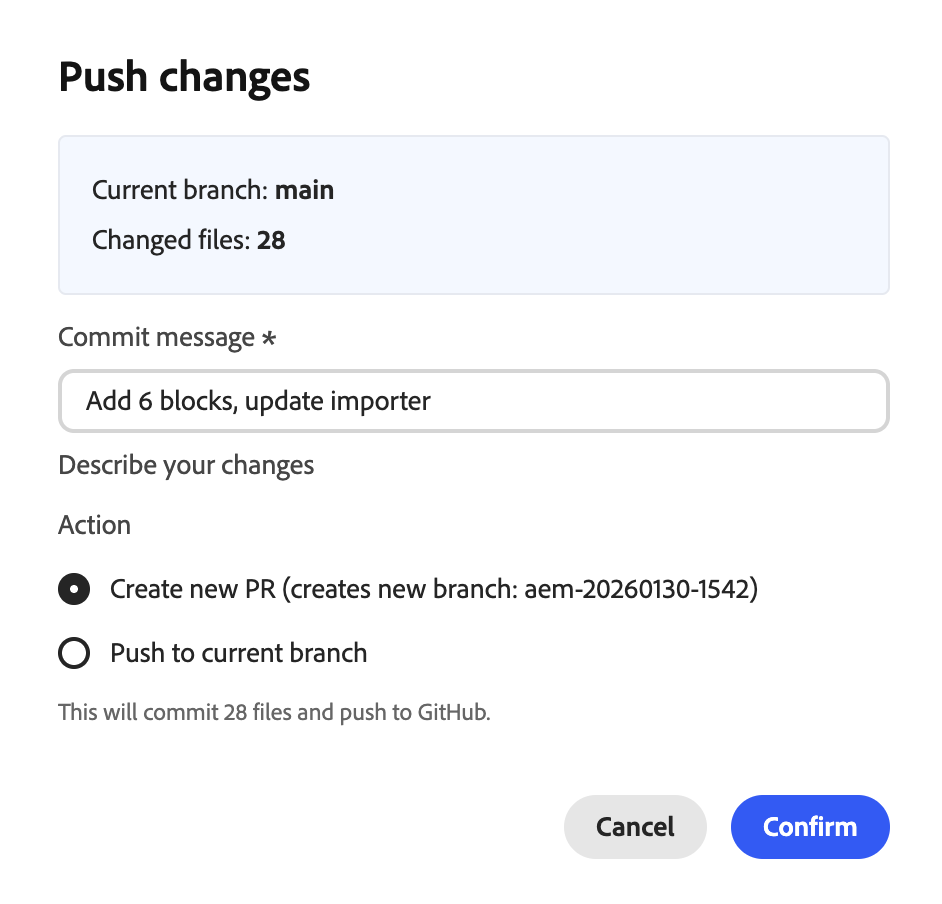
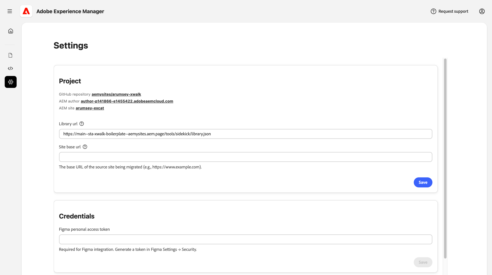
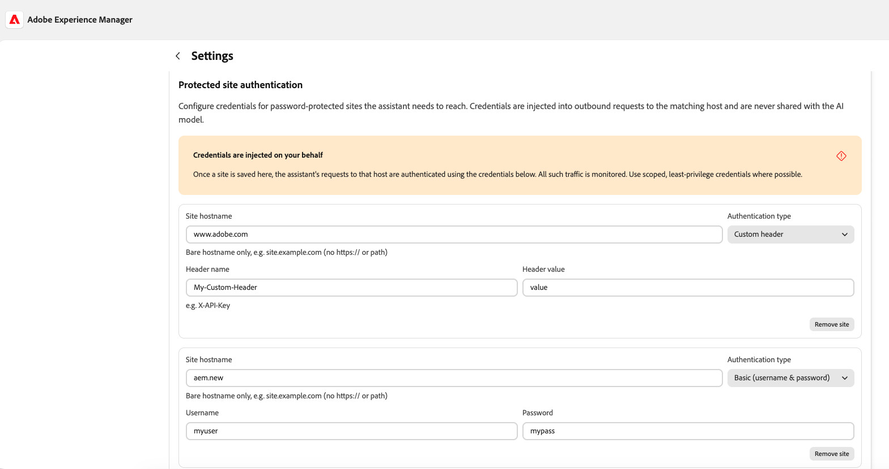

# Experience Modernization Console {#console-reference}

The Experience Modernization Console is the web interface for the Experience Modernization Agent: the browser UI where you work with the agent. This reference describes its views, controls, and settings. The console works on a hosted copy of your project, which these docs call the console workspace. It is unrelated to Experience Workspace, the authoring UI; see [Names You May See](overview.md#names).

>[!NOTE]
>
>To use the Experience Modernization Console, request access through your Adobe account manager. See [Access and AI Credit Usage](getting-started.md#access).

## Overview {#overview}

The Experience Modernization Console is a hosted, AI-assisted development environment for Edge Delivery Services, at [`aemcoder.adobe.io`.](https://aemcoder.adobe.io) The page header shows the title **Adobe Experience Manager**. After you connect your GitHub project, you can start prompting changes in natural language without any further setup or local environment configuration. If you are new to the console, ask the agent in the chat for a tour of the console.

>[!TIP]
>
>If you are interested in getting started right away with the console, check out the document [Getting Started with the Experience Modernization Agent.](getting-started.md)

## Capabilities {#capabilities}

Core capabilities of the console:

* Interactive chat panel, where you describe tasks to the agent and its skills in natural language
* Previews of the console workspace and of the preview site, so that you can check changes visually before and after you upload them
* Content file browser and [content views](#content-view) that show a page as a rendered preview, a document, Markdown, JCR XML, or HTML, so that you can check its content structure and conversion as well as its appearance
* Content upload to the document-based repository that authors edit in [Experience Workspace](https://www.aem.live/docs/ew/about), or package creation and upload for [Experience Manager authoring](getting-started-aem-authoring.md#upload-content), according to project configuration. Experience Workspace replaces Document Authoring, and the console still uses that name in some labels. See [Where Content Is Stored and How Authors Edit It](overview.md#content-storage).
* Code browser and diff viewer, so that you can review exactly what changed before you push
* GitHub integration with the ability to create pull requests from changes, so that agent changes go through your usual code review
* [Site planning](#project-view), to inventory a source site and group its pages into templates before you migrate
* [Optional capabilities](#optional-capabilities) that you turn on per project when a task needs them

Review changes before saving to a shared destination. A code push is a Git commit to your repository; a content upload writes to Experience Workspace or the author instance. They are separate operations. The console pushes to a new pull request or directly to the current branch, so your repository's branch protection decides which changes need review. Plan mode changes how the agent works in the conversation, not what the repository or the site accepts. See [Control over Changes](evaluate.md#security-control).

For complete procedures, choose [a way to start](getting-started.md#first-outcome), [production migration](production-migration.md), [restyling](restyling.md), or [block development](block-development.md).

## Navigation {#navigation}

After signing into the console at [aemcoder.adobe.io,](https://aemcoder.adobe.io) use the [home page](#home-page) to start work or continue in the [chat page](#chat-page). Confirm the active project and branch before making changes.



### Menu Bar {#menu-bar}

The top menu bar provides:

* An **Adobe Experience Manager** title on the left that links to the Home Page when selected
* A **Demo site** button when you are working in the [demo site](getting-started.md#demo-mode). It explains that work there isn't saved and that the demo can't push code to GitHub or content to Experience Workspace. Use **Switch site** to connect your own site.
* A **Request support** button that sends a problem or question to the team that builds the agent. On the Auto mode pages, the button is **Get help**. See [Request Support](#request-support).
* An **Account** button on the right for switching to dark mode and signing out of the console

The console also shows notices at the top of the page, such as service status and [**What's new**](#whats-new) for the latest release. Chat, Home, and Settings adapt to phone and tablet screens. On a phone, the chat page shows only the chat. On a tablet, it shows one panel at a time; switch between the chat and the workspace in the header. On wider screens, both panels show side by side.

## Home Page {#home-page}

The **Home** page is your starting point for using the console.

* At the top is a [prompt input](#prompt-input) for making requests of the console.
* Below the prompt panel are suggested prompts for getting started with your project.
* A **Start chatting** button that takes you to the [chat page](#chat-page).
* A **Settings** button to access the [project settings](#settings-page) page

### Prompt Input {#prompt-input}

The prompt input provides controls for interacting with the AI.

* **Plan / Execute modes** (light bulb and magic wand icons): Toggle between planning and execution modes, respectively.
  * **Plan mode**: The agent analyzes your request and proposes an approach without changing files. It ends with a plan that includes a checklist of steps. Use it for multi-page, shared-code, or otherwise risky changes, so that you can review and adjust the approach before anything changes. Select **Execute plan** to switch to Execute mode and carry out the plan, or start a new one. Plan mode is available at any time, including before you plan or catalog a site. Only you switch modes; the agent can't switch them itself.
  * **Execute mode**: The agent performs the request and can make actual file changes.
  * Planning is optional and is not an enforced approval gate. Before execution, state the allowed scope and whether upload, push, or publication is authorized.
* **Attach files** (paperclip icon): Upload and attach files to the prompt for additional context, such as reference designs, screenshots, or specifications. The agent sees attached images in JPEG, PNG, GIF, or WebP format. You can also attach text files, and Word, PowerPoint, and Excel files; the agent receives their text and embedded images. Each file can be up to 10 MB; PDF files aren't accepted. Check attachments for passwords, tokens, and personal data first. See [Keep Secrets Out of the Chat](prompting-guide.md#secrets).
* **Prompt queue** (clock icon): Additional prompts can be queued up to be automatically executed once the current prompt has completed, so that you can line up follow-up tasks without waiting.
* **Previous prompts**: In an empty prompt input, use the up and down arrow keys to recall earlier prompts. A draft you have started is not overwritten.
* **Prompt hints**: Where enabled, the console points out when a prompt is missing details, such as the page or the result you expect, and can suggest a clearer prompt. You decide whether to use the hint. Prompts suggested by the console are not flagged unless you reword them. Configure hints under **Prompt coach** in [Settings](#settings-page).

## Chat Page {#chat-page}

The [**Chat** page](https://aemcoder.adobe.io/chat) is the main interface for interacting with the agent. This page is split into a resizable [chat panel](#chat-panel) and [workspace panel.](#workspace-panel)

## Chat Panel {#chat-panel}

The chat panel allows you to view and continue your conversation with the agent. The chat panel includes the chat message history and a [prompt input](#prompt-input) for making additional requests of the console.

The chat panel header includes links for navigating to the [Home](#home-page) and [Settings](#settings-page) views and chat actions.

* **Chat actions**
  * **Clear chat**: This removes all messages and starts a new conversation. It can't be undone, and it is not a code or content rollback. The transcripts of the agent's sessions stay in your console workspace until you select **Reset workspace**. Before clearing, ask the agent to record important decisions in the [project instruction files](project-instructions.md) that it reads in every conversation, and download the chat if you want to keep it.
  * **Download chat**: This downloads the conversation history as a Markdown file, which you can keep as a record of what was asked. See [Trace What the Agent Did](evaluate.md#audit-trail).

The conversation is saved with your console workspace. When you reload the page or return later, the chat history reloads. Prompts that you recall with the arrow keys last only as long as the browser tab.

### Optional Capabilities {#optional-capabilities}

Core skills, such as site planning, page migration, bulk import, and header, navigation, and footer migration, are always available. Other capabilities are optional add-ons. Each add-on is off by default and is turned on per project, which keeps the agent lighter and faster for projects that don't need it.

* When your request needs an add-on, the agent offers to turn it on and asks for your confirmation first. The add-on is available from your next message.
* You can also ask for an add-on directly, for example "Enable the forms migration capability", or describe your task and accept the agent's offer.
* To see which add-ons are on, ask the agent, for example "Which add-ons are enabled for this project?" To turn one off, ask in the same way. The Settings page has no add-on controls yet.

| Add-on | ID | What it is for |
|---|---|---|
| Figma import | `excat-figma@excat-extended` | Migrating blocks and creating pages from Figma designs. See [Create a Block from Figma](prompting-guide.md#figma-block-migration). |
| Guided redesign (Stardust) | `stardust@excat-extended` | Redesigning several pages of a site to a new design direction, step by step, and checking the result. See [Guided Redesign](restyling.md#guided-redesign). |
| Design craft | `impeccable@excat-extended` | Applying frontend design-quality guidance, such as typography, spacing, and visual hierarchy, to design work. Turned on automatically with guided redesign, and usable on its own. |
| Project documentation | `project-management@excat-extended` | Generating project and handover documentation as PDF guides. See [Project documentation](project-documentation.md). |
| Forms migration | `forms-excat@excat-extended` | Migrating the source's forms with two or more fields to the form block of Edge Delivery Services for Adobe Experience Manager Forms. Built for organizations that license Experience Manager Forms: the add-on needs no license, but the form block does. Its field inventory also helps with other form platforms. See [What the Forms Add-on Does](block-development.md#forms-add-on). |
| Commerce pages | `excat-commerce@excat-extended` | Detecting product detail and product listing pages and migrating them to pages whose commerce blocks load the product data from the catalog. Built for storefronts on Adobe Commerce, with document-based persistence. See [Commerce Pages](block-development.md#commerce-pages). |
| Block library setup | `excat-block-library@excat-extended` | Setting up the library that authors use to find and insert your blocks. See [Block deliverables](block-development.md#block-deliverables). |
| Edge Delivery Services troubleshooting | `excat-support@excat-extended` | Diagnosing site problems on demand, such as blocks that don't render or changes that don't appear. See [Debug a Problem](prompting-guide.md#debugging). |
| Modern web guidance | `modern-web-guidance@excat-extended` | Applying current web-platform best practices, for example for fonts, loading performance, accessibility, and layout, when the agent writes CSS and JavaScript. |

The add-ons on offer can change between releases. If the agent says that it can't do something, ask whether an add-on covers it.

#### Turn On Add-ons for the Whole Project {#persist-add-ons}

The agent saves the add-ons that you turn on in the `.agents/settings.json` file at the root of your repository. The file lists each add-on by its ID:

```json
{
  "enabledPlugins": {
    "excat-figma@excat-extended": true,
    "forms-excat@excat-extended": true
  }
}
```

Push this file with your code. Every workspace that checks out the repository, including your team members' workspaces and new conversations, then starts with the same add-ons, without asking for them again. You can also ask the agent to change the file, or edit it in your Git repository and pull the change into the console. To turn an add-on off, set its value to `false` or remove its line. A change takes effect from your next message.

## Workspace Panel {#workspace-panel}

The workspace panel displays working content and code for the connected project, not necessarily every remote page on the site. Its view picker determines the available actions.

### Know Which Result You Are Viewing {#preview-states}

| Result | What it establishes | What remains to check |
|---|---|---|
| Console preview of workspace content | The working content renders with the current code in the console workspace. | Upload, remote authorability, and the preview site. |
| Static design preview | A design or prototype renders. | Conversion to authorable content, if required. |
| Remote authoring content | Documents in Experience Workspace or JCR pages on the author instance have been saved. | Edit/save/reopen, the matching code version, and preview. |
| Preview site (`*.aem.page`) | Saved content renders with the code branch in that URL. | Release acceptance and publication. |
| Published site (`*.aem.live`) | The release is visible on the live destination. | Post-release checks and monitoring. |

### How the Preview Works {#how-preview-works}

The console preview isn't an Experience Manager environment. It runs the [AEM CLI](https://www.aem.live/developer/cli-reference) (`aem up`) in your workspace: the same local development server that developers run on their own computers. It serves your workspace's code with the content pages in your workspace. Anything else that a page requests, such as a fragment or a spreadsheet that isn't in your workspace, comes from the preview site of the workspace's current branch, `https://{branch}--{site}--{organization}.aem.page`.

The result can differ from the preview site after you upload, because Edge Delivery Services processes content that the console preview shows as it is. When it previews a page, it ingests the content and keeps only the structure of [sections, blocks, and default content](https://www.aem.live/developer/markup-sections-blocks). Extra elements such as `span` tags, data attributes, and inline styles are removed. See [Bring Your Own Markup](https://www.aem.live/developer/byom). The console preview reproduces a few of these steps, such as wrapping a standalone image or link in a paragraph and adding heading IDs, so it comes close, but it doesn't remove anything.

Watch for these differences:

* **Markup that Edge Delivery Services removes:** Inline styles, `span` elements, data attributes, and other markup outside that structure show in the console preview but disappear on `aem.page`. Keep pages to semantic content, and put styling in the project's CSS. The project's JavaScript can still restructure the page in the browser, which works the same in both places.
* **Content from the preview site:** Fragments, spreadsheets, and other files that aren't in your workspace show the version last previewed on the branch's preview site.
* **Images:** An image can show in the console preview and still be broken on `aem.page` if it didn't upload correctly. Upload the page again.
* **Experience Manager authoring projects:** The upload converts each page into JCR content that must fit the project's component models. The preview shows the page before that conversion. Check the converted structure in the **JCR XML view** before you upload, and the page in the Universal Editor after.

To check the delivered page, upload it, preview it, and open it on the branch's `aem.page` URL. See [Console Preview Differs from the Site](troubleshooting.md#preview-differs).

### Content Views {#content-view}

The **Content views** show the selected page in different forms, so that you can check each aspect of the result. A collapsible file browser lists the pages of your site:

* Pages in your workspace show as files.
* Pages that exist only in the content destination show a cloud icon. In document-based projects, these are the pages in Experience Workspace. In other projects, including Experience Manager authoring projects, they are the pages that have been previewed or published. Opening a cloud page downloads it into your workspace.

* **Preview** (document with magnifying glass icon) renders the selected page from your workspace's current code and content. Use it to check the page as visitors see it. It doesn't update the authoring environment or your Git repository. See [How the Preview Works](#how-preview-works).
* **Document view** (document icon) shows the underlying document-based content structure. Use it to check how content is organized into sections, blocks, and default content.
* **HTML view** (code icon) shows the raw HTML. Use it to debug rendering and block decoration.
* **Markdown view** (paragraph icon, Experience Manager authoring) shows the underlying Markdown content structure. Use it to check the content before conversion.
* **JCR XML view** (data icon, Experience Manager authoring) shows the resulting JCR XML content structure. Use it to check what will be imported into the author instance.



The following actions are available in the content views:

* **Refresh** icon to reload the preview panel's rendering of the console workspace copy. It doesn't fetch content from Experience Workspace. To replace the console's copies with the saved documents, use **Sync** > **Pull** > **Content**. To replace a single page, delete its local copy and open the page again.
* **Viewport** menu to view the rendered page at **Responsive** width (the default, which fills the panel) or at a fixed **Desktop**, **Tablet**, or **Mobile** size
* **Inspect mode** (select icon) to add elements of the page to your prompt for additional context. The agent receives the selected element's HTML and its position on the page, and limits its changes to that element.
* **New window** (open in icon) to open the preview URL in a new tab (for a full desktop preview)
* **Edit in Experience Workspace** (document-based projects) opens the selected page in the Experience Workspace visual editor in a new tab, previewed with the console workspace's current branch. If the page has local changes that are not yet uploaded to Experience Workspace, the console first offers **Upload & Edit**, so that you don't edit an older version. Experience Manager authoring projects use the Universal Editor instead.
* **Delete** removes the selected page from the console workspace, one page at a time. It can't be undone, and it does not delete uploaded, previewed, or published content. If the page exists in the content destination, it appears again with the cloud icon, and opening it downloads the saved version. You can't delete a cloud page. See [Remove Pages](troubleshooting.md#remove-pages).
* **Errors** button (Experience Manager authoring) opens a modal window to view the errors on the selected page.
* **Upload content** opens the destination-specific upload or package dialog. Check destination paths and overwrite implications before proceeding.



After an upload to Experience Workspace (Document Authoring), the results dialog shows which files were uploaded and lets you preview, or preview and publish, the uploaded pages on the preview and live sites. This runs as a tracked job: it continues if you leave the dialog, and **View Details** in the notification reopens its results. Retry failed pages from the results. If no page previews successfully, nothing is published.

Content changes made by the agent stay in the console workspace until you upload them or explicitly ask the agent to update Experience Workspace. Turning on [agent permissions](#settings-page) does not approve uploads or publication.

### Sync Menu {#sync-menu}

Sync connects your [independent console workspace](overview.md#independent-workspace) to your project's Git repository and content destination. Pushing code and pushing content are separate operations, and you choose which changed files or pages to send. Changes that you leave in the console workspace don't affect the project.

The **Sync** button in the workspace header shows a badge with the number of pending changes. Open it to move content and code between the console workspace and their remote locations: Experience Workspace or the author instance for content, and your Git repository for code.

|Section|Item|What it does|
|---|---|---|
|**Push**|**Content**|Opens the upload dialog, the same as **Upload content**, where you select the pages to upload to Experience Workspace (Document Authoring) or the author instance. Each upload replaces the saved version of the page, including changes that others made to it. It does not commit anything to Git. Shows how many pages are pending, or **Up to date**, and a progress bar while pushing.|
|**Push**|**Code**|Opens **Stage changes** and then **Push changes** for the changed files; see [Changes actions](#changes-actions). Requires the [AEM Code Connector](https://github.com/apps/aem-code-connector) GitHub app; the menu offers **Install AEM Code Connector** if it is missing.|
|**Pull**|**Content**|Document-based projects only. Downloads your Experience Workspace (Document Authoring) pages over the console workspace copies, including local edits. Pages that exist only in the console workspace are kept. This cannot be undone.|
|**Pull**|**Code**|Pulls the latest commits of the workspace's current branch from your Git repository. Unavailable while the console workspace has uncommitted files; push or discard them first. If your changes conflict with the remote changes, the console cancels the pull and leaves your work as it was; see [If Someone Else Changed the Branch](getting-started.md#push-conflicts). To pull another branch, switch to it first with **Switch branch**.|

Sync is disabled in the demo site. Push and pull tell you when your Experience Workspace (Document Authoring) session has expired.

### Code Views {#code-view}

The **Code views** provides tools for browsing your project files and managing code changes. The view includes a file browser for an overview of your code files or changes as diffs, and a preview area for viewing the selected file or changes.

* **Files** to browse the code files in the current workspace
* **Changes** to view the diffs of files changes created by your work on the project

>[!NOTE]
>
>The file views don't show files and folders at the root of the repository whose names start with a dot, such as `.github/`, `.claude/`, or `.hlxignore`. The exceptions are `.gitignore`, `.agents/`, and folders that the agent manages. You can't stage or push changes to hidden items from the console. The agent can push them when **Allow LLM to use my git credentials** is on in [**Settings**](#settings-page); ask it to commit and push the change. Otherwise, edit them in GitHub or in a local clone, then pull the code into the console. Pulling includes hidden items. This matters for [project skills](project-instructions.md#custom-skills), which belong in `.claude/skills/`.



#### File Actions {#file-actions}

* **Add to chat** adds the selected file (or selected lines  from the file) to the chat panel for context.
* **Download** download the selected file to your local file system

#### Changes Actions {#changes-actions}  

* **Add** (+ icon) to stage the changed file
* **Discard** (arrow icon) to discard the changed file
* **Delete** (trash icon) to delete the unstaged file
* **Refresh** (refresh icon) to refresh the list of changes
* **Switch branch**: Switches branches within the same repository

To push code, use **Sync** > **Push** > **Code** in the [Sync menu](#sync-menu). The **Stage changes** dialog lets you choose the files, and the **Push changes** dialog asks for a commit message and whether to create a new pull request or push to the current branch; see [Push Code Changes](getting-started.md#push-code-changes) for what each option does. To pull the latest code, use **Sync** > **Pull** > **Code**. Code actions are unavailable in the demo site, when GitHub is not connected, or until the AEM Code Connector is installed; the console tells you which applies. Pushed code shows on that branch's preview and live URLs straight away, and merging into `main` changes the live site's code immediately. See [How Changes Go Live](overview.md#code-content-lifecycle).

Stage only the files intended for the push. Review the diff, run project checks, and choose a new PR or a current-branch push according to repository policy. Verify the resulting PR or branch commit. Pushing code does not upload content, and discarding local code does not undo remote content writes.



Additional GitHub project actions can be performed on the [settings page](#settings-page).

### Project Views {#project-view}

The **Project views** help you plan the migration of an existing site.

* **Planning** to review and refine the templates, pages, and blocks identified by the [site catalog](site-catalog.md), so that you can migrate and check one sample page per template before you import the rest

For details, see [The Planning View](site-catalog.md#planning-ui).

## Settings Page {#settings-page}

The [**Settings** page](https://aemcoder.adobe.io/settings) allows you to manage basic settings of the console and is broken up into the following sections. Enter credentials here, never in the chat. See [Keep Secrets Out of the Chat](prompting-guide.md#secrets).



If you make a change to any value in any section, select **Save** to save those changes to the individual section. For agent permissions, site authentication, and credentials, the button shows **Applying...** until the change takes effect. Select the back icon to return to your previous view.

* **Project** allows you to view and edit project settings such as managing your GitHub connection and customizing the library URL.
  * **Connect / Reconnect**: Initiates GitHub authentication
  * **Switch site**: Opens a different site and repository in the console workspace. The current site's files and chat are kept for when you switch back.
  * **Logout**: Disconnects from GitHub and revokes the agent's access to your GitHub credentials
  * **Library URL** - This URL points to a `library.json` file that defines the blocks available to authors, their variations, and example content.
  * **Site base URL** - The origin URL of the website being migrated
* **Agent permissions** - Control what the agent may access on your behalf. Each permission is off until you turn it on and save it. The agent uses a permission without receiving the credential itself. See [Security and Data Handling.](evaluate.md#security)
  * **Allow LLM to use my Adobe credentials for admin.hlx.page, Document Authoring, and repositories hosted outside GitHub** - In the **Adobe IMS permissions (admin.hlx.page & Document Authoring)** section. When enabled, the agent can read site configuration and metadata, read Experience Workspace (Document Authoring) content, and push to and pull from repositories hosted outside GitHub, using your Adobe credentials. `admin.hlx.page` is the admin API of Edge Delivery Services; `hlx` comes from Helix, the project name under which its architecture was developed. This does not approve publishing: the console stops the agent from uploading, previewing, or publishing unless your current message asks for it or you agree when the agent asks. The check reads your words, so it can't catch every phrasing; limit who can publish with the site's publish role.
  * **Custom IMS Token (optional)** - Provide a token for the agent to use instead of your session token. IMS is Adobe's identity service, which issues the token for your Adobe ID session. Prefer the token of a service account, also called a technical account, over a personal token where possible, so that the agent's access doesn't depend on your own account. Leave the field empty to use your session token; the section shows which token is in use.
  * **Allow LLM to use my git credentials** - Where available, lets the agent push to and pull from your GitHub repositories on your behalf. If you don't see this setting, it isn't available to you yet; push the agent's changes yourself with **Sync** > **Push** > **Code**. When it's on, the agent can push to any repository and branch that your GitHub credentials can write to, including `main`. Your repository's branch protection still applies. This grants elevated access, so give the agent its own token.
  * **Custom Git Token (optional, recommended)** - A personal access token for the agent to use instead of the workspace's Git credential. Create a fine-grained token scoped to only the repositories that the agent needs. Leave the field empty to use the workspace's existing credential.
* **Credentials** allows you to specify a personal access token for Figma so the [agent can read your Figma designs.](prompting-guide.md#figma-block-migration) The Figma import add-on reads them through a Model Context Protocol (MCP) server, and the token is added to its requests to Figma without the agent receiving it. Figma issues and governs the token. It is unrelated to the design tokens, such as colors and spacing, that the agent reads from your designs.
  * The token requires the following read-only scopes:
    * `file_content:read`
    * `file_metadata:read`
    * `library_assets:read`
    * `library_content:read`
    * `team_library_content:read`
    * `file_dev_resources:read`
    * `projects:read`
  * [See the Figma documentation](https://help.figma.com/hc/en-us/articles/8085703771159-Manage-personal-access-tokens) for more information about setting up personal access tokens.
* **Protected site authentication** - Configure a custom request header, HTTP Basic authentication, or bearer authentication so that the agent can read source pages that require sign-in or a secret header, or call another service that needs a key, such as an API. See [Protected Site Authentication](#protected-site-authentication) for setup instructions, and [Credentials for Other Services](#other-services).
* **Prompt coach** - Where available, controls the [prompt hints](#prompt-input) shown when a prompt is missing details, such as the page or the result you expect.
  * **Show prompt hints** turns the hints on or off.
  * Further options can check prompts on your device, which downloads a model to your browser. Turning such an option off removes the downloaded model.
* **Support** summarizes the information that a support request shares with the team that builds the agent.
  * **Request support** - Select it to open a [support request](#request-support) without leaving the console.
* **Danger zone** contains settings that can revert your console workspace.
  * **Reset workspace** - Ends the session, disconnects GitHub, and permanently deletes the open project's chat history, the transcripts of its agent sessions, and its code, including changes that you haven't committed or pushed. This can't be undone. Code that you pushed and content that you uploaded stay in their remote locations; a reset doesn't restore remote content.

Figma access also depends on the token owner's access to the selected file and the capability being enabled for the project. Store tokens only in credential settings, not prompts or project documentation.

### Protected Site Authentication {#protected-site-authentication}

Many sites show some pages only to signed-in visitors, keep a staging copy behind a password, or have a CDN that only lets through requests carrying a secret header. Use **Protected site authentication** to let the agent read such a source site when it accepts a custom request header, HTTP Basic authentication, or bearer authentication. You can then migrate those pages the same way as public pages.

The source site must be reachable from the agent's hosted environment on the internet and configured to accept the authentication method you provide. This feature does not provide access through a VPN, does not bypass a firewall, and does not complete interactive sign-in flows such as single sign-on (SSO) forms or multi-factor authentication. If your source is only reachable on a private network, ask its administrator for an internet-reachable staging or origin host that accepts one of the supported methods.

>[!IMPORTANT]
>
>This functionality is not intended for use with personally identifiable information (PII) or real end-user data. Use source content and test accounts that do not contain this data.

To configure access:

1. Open **Settings** in the Experience Modernization Console and find **Protected site authentication**.
1. Select **Add site**.
1. Enter the **Site hostname**, such as `staging.example.com`. Enter only the hostname, without `https://` or a URL path.
1. Select an **Authentication type** and enter the corresponding values.

   | Authentication type | Values to enter |
   | --- | --- |
   | Custom header | **Header name** and **Header value**, as required by your source website. For example, the header name might be `X-API-Key`. |
   | Basic (username & password) | **Username** and **Password** for HTTP Basic authentication. |
   | Bearer authentication | The bearer token accepted by your source website. |

1. Select **Save** in the **Protected site authentication** section. The section shows **Applying...** until the change takes effect, which can take up to about two minutes.
1. Ask the agent to scrape or migrate the source website using its URL as usual.



Once saved, credentials are added to outbound requests to the matching hostname only and are not shared with the AI model. Enter credentials only in these settings, not in chat prompts. Content retrieved from the source website is used by the agent for the requested task.

Use scoped, least-privilege credentials, preferably a dedicated account with read-only access to the source content. Each hostname can be configured only once. Configure additional hostnames separately if the source website loads protected content from other hosts, such as an asset domain.

Verify one representative protected page before you start a catalog or batch run, and check that captures show the page content rather than a sign-in page.

To remove access, select **Remove site** for the entry, then **Save**. Remove the entry when the migration is complete.

#### Credentials for Other Services {#other-services}

The same settings work for any service that the agent calls while it works, not only for source sites. Add an entry for the service's hostname, such as `api.example.com`, with the header or token that the service expects. You can add as many entries as you need, one for each hostname. The console adds the credential to every request that the agent makes to that hostname, including requests from the scripts and commands it runs. The AI model doesn't receive the credential, but the agent sees the service's responses.

* Tell the agent that a credential is set up for the hostname and what the service is. The agent isn't informed about the entries in **Settings**, so it doesn't know about them otherwise.
* The hostname must match exactly. Add `www.example.com` and `api.example.com` as separate entries. IP addresses and `localhost` can't be used.
* The console adds a fixed header to each request. Services that expect a token in the URL, or a request signed for each call, need another approach.
* Hosts that the console already authenticates, such as GitHub and Figma, keep using the console's own credentials.
* Use a token with only the access that the task needs, and remove the entry when you no longer need it.

These credentials serve the agent's work in the console. Your published site can't use them: a key that the live site needs belongs in a server-side service. See [Connect Services and Applications](block-development.md#integrations). For an example that connects the agent to a chat tool, see [Example: Updates in Slack](prompting-guide.md#slack-updates).

### Request Support {#request-support}

When something doesn't work as you expect, or you have a question that these pages don't answer, tell the team that builds the agent. Your request goes straight to that team, which looks into it and follows up by email. For a meeting with subject-matter experts or the product team, ask your Adobe customer success manager or account team. See [The Team Behind the Agent](evaluate.md#adobe-team).

1. Select **Request support** in the menu bar or on the Settings page. On small screens, the button shows only its icon.
1. Optionally choose a **Topic**: **Layout / design**, **Missing content**, **Agent stuck**, or **Something else**.
1. In **What went wrong?**, describe the problem in up to 2,000 characters. Name the affected page, what you expected, what happened instead, and when. Don't include passwords or tokens.
1. Optionally select recent prompts to attach, so that the team can see what you asked. None is attached unless you select it.
1. Select **Send**.

The request shares your name, email address, Adobe user and organization IDs, session ID, project name, and preview URL, and the Git host if you use GitHub Enterprise. That gives the team everything it needs to find your session's conversation and logs. Before your console workspace is set up, a request shares only your name, email address, and organization. You can send one request a minute.

When the conversation suggests that you're stuck or frustrated, the prompt coach may offer help under **Need a hand?** Select **Contact support** to open the same request, or **No thanks** to carry on.

On the Auto mode pages, the button is **Get help**. Use it to ask for more pages or more concurrent migrations, or to ask anything about Auto mode. Describe what you need in **How can we help?** and select **Send**. This request shares only your name and email address, and the team replies by email.

## What's New and Release Notes {#whats-new}

When a new version of the console is released, a **What's new** notice at the top of the page lists its highlights. Expand it to see the list, or dismiss it. It reappears for the next release.

For details of each release, see the [Experience Modernization Agent release notes.](/help/release-notes/modernization-agent/current.md)
