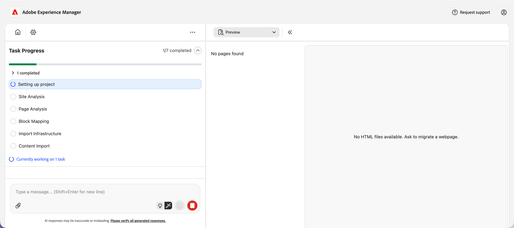
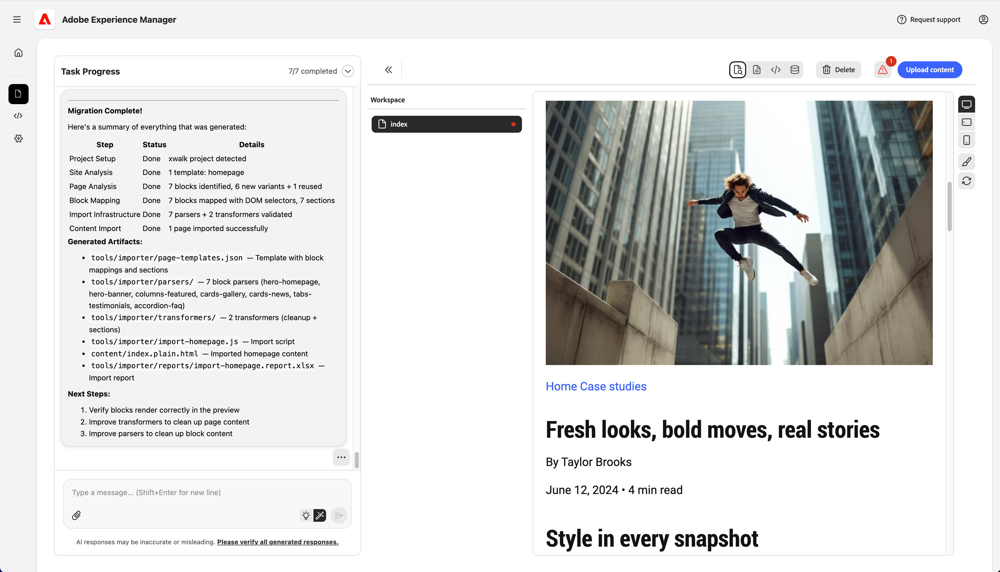
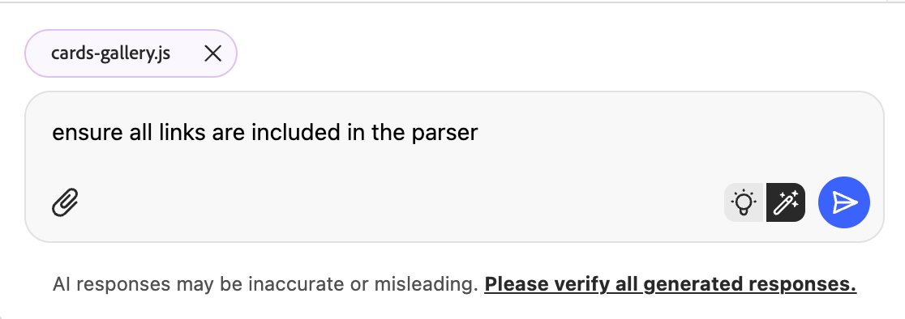
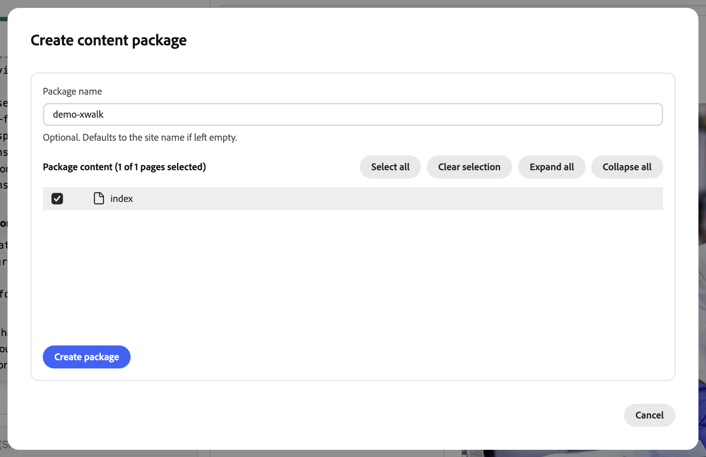
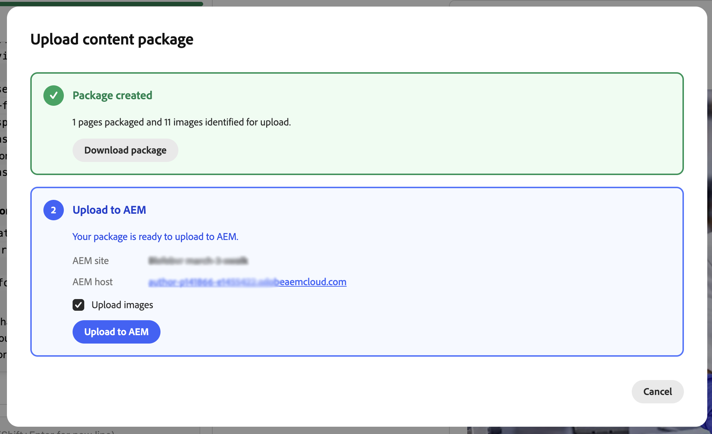
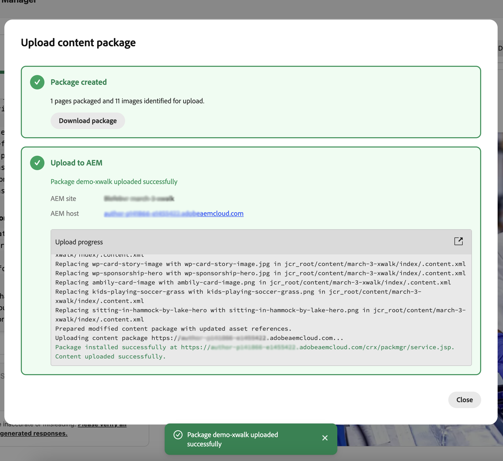

# Getting Started with the Experience Modernization Agent for AEM Authoring Projects {#getting-started-aem-authoring}

>[!NOTE]
>
>This path is Edge Delivery Services (EDS) on top of the JCR stack: content is stored in AEM's Java Content Repository (JCR) on your AEM as a Cloud Service author instance, authors edit it with the Universal Editor, and EDS delivers the pages. For new implementations, Adobe strongly recommends document-based persistence with Experience Workspace instead, including for large sites. See [Where Content Is Stored and How Authors Edit It](overview.md#content-storage).

Use this workflow when a requirement depends on content staying in the AEM repository. The [Universal Editor](/help/implementing/universal-editor/introduction.md) is Adobe's visual editor for content in AEM. This is not a migration to HTL-based delivery, and the source website's technology does not determine your persistence target.

You need console access, repository permissions, and permission to create or update content and assets on the target AEM author instance. Record the AEM host, site identifier, page root, DAM destination (the AEM Assets folder for images and files), code repository, and working branch before importing. A document-based auto-mode preview is not a substitute for this setup.

## Create Your Edge Delivery Services Project Repo {#create-repo}

For a new project:

1. Use the [`aem-block-collection-xwalk`](https://github.com/adobe-rnd/aem-block-collection-xwalk) repository as your template rather than the document-based boilerplate. Templates for AEM authoring have `xwalk` (crosswalk) in their names.
1. Verify that `fstab.yaml`, the file that points EDS to the site's content source, refers to your AEM host, Git owner, and Git repository. Review and commit the configuration to the branch used for setup.
   * See [Configure content source](/help/implementing/cloud-manager/edge-delivery/configure-content-source.md) for instructions.
1. Follow the [Universal Editor tutorial](https://www.aem.live/developer/ue-tutorial) to set up your repo.
   * Stop when you are asked to create a site in AEM.
1. For this new-project setup, remove the template's `paths.json` and commit the change. Do not remove an existing site's path mappings without reviewing their purpose and replacement.
1. Add the [AEM Code Connector](https://github.com/apps/aem-code-connector/installations/select_target) app to your repo.
   * This allows the console to inspect your code.

For an existing JCR-backed EDS project, reuse its configuration and content models. Do not recreate the site or replace its repository with the template. Confirm [code synchronization and repository access](getting-started.md#prepare-repo) without repeating the document-based setup.

## Create a New Site in AEM {#create-site}

1. In the AEM Sites console, select **Create** > **Site from template**.
1. Select the **AEM Site with Edge Delivery Services Template**.
   * Don't see it listed? [Install the template.](https://github.com/adobe-rnd/aem-boilerplate-xwalk/releases)
1. For this template setup, keep the **name** of the site (not the title) as provided.
   * The site name is used as the unique identifier.
   * The title can be changed for display.
1. Click **Create**.
   * You are redirected to the Sites page.
   * Refresh the page if the new site does not appear immediately.

Skip site creation if the target site already exists. Confirm its identifier and destinations instead; do not rename a live site to fit an example.

## Continue with the Standard Getting Started Steps {#continue}

Once setup is complete, connect the project and migrate one representative page. These are shared console actions, not a second repository setup.

Follow these steps from the standard guide.

1. [Open the Experience Modernization Console](/help/ai-in-aem/agents/brand-experience/modernization/getting-started.md#open-console)
1. [Connect Your Site](/help/ai-in-aem/agents/brand-experience/modernization/getting-started.md#connect-repo)
1. [Start Prompting](/help/ai-in-aem/agents/brand-experience/modernization/getting-started.md#start-prompting), explicitly requesting JCR-backed AEM authoring output.

For example: "Migrate only `https://www.example.com/about` to the agreed page root in this AEM authoring project. Preserve content and links. Reuse the project's block models and validate JCR conversion. Do not upload, push, or publish."

Once you complete those steps to migrate the content, continue with the following steps.

## Validate Content {#validate-content}

Validate the selected page in the content panel. Use **Markdown view**, **JCR XML view**, and **Errors** to check content and conversion. Use **Add to chat** to target fixes to a page, parser, or transformer. Parsers and transformers are the import scripts that EMA generates: a parser converts one block's source HTML, and a transformer cleans up the whole page.

In AEM authoring projects, each block also has a model: configuration that defines the fields authors edit for that block in the Universal Editor. Ask the agent to check that the source block models, component definitions, and generated aggregate configuration agree. Update the source configuration through the project's generation workflow rather than fixing only a generated file. Check field mappings and authoring hints, page paths, image references, and the intended site/DAM destinations.

An HTML preview can look correct while the converted content is not authorable. Resolve conversion errors on a representative page before creating a larger package.

## Upload Content {#upload-content}

Package upload writes remote AEM content. Confirm the selected pages, host, site, page root, and asset destination with the target owner. Preserve existing content before replacing it; local validation does not make an overwrite safe.

1. Make sure you are in a **Content** view and click the **Upload content** button on the top-right.
1. In the **Create content package** dialog, choose the pages to include in the package.
   * Optionally enter a **Package name** (defaults to the site name if left empty).
   * Use **Select all**, **Clear selection**, **Expand all**, or **Collapse all** to manage the list.
1. Click **Create package**.

   

1. After the package is created, the **Upload content package** dialog shows that the package is ready.
   1. You can **Download package** to save it locally, or proceed to upload.
   1. Under **Upload to AEM**, confirm the **AEM site** and **AEM host** (pre-filled from your project settings).
      * Optionally leave **Upload images** checked to include images.
   1. Click **Upload to AEM**.

   

1. The dialog shows upload progress as pages and assets are sent to AEM. Review the upload log, including individual failures, before closing the dialog.

   

For a failed package or image upload, retain the log and selected paths. Correct conversion, credentials, permissions, or destinations as indicated, then retry the affected scope. A package download alone does not import content into AEM. Confirm which pages and assets arrived before retrying to avoid unintended replacements.

If the AEM as a Cloud Service environment is hibernated, the upload dialog and Settings say so and link to the Developer Console. De-hibernate the environment there, then retry the upload. See [De-hibernate a sandbox program from the Developer Console.](/help/implementing/cloud-manager/getting-access-to-aem-in-cloud/hibernating-environments.md#de-hibernation-introduction)

Review and [push the matching code and configuration](getting-started.md#push-code-changes) through your project's repository policy. This is separate from package upload.

## Validate Authoring and Preview {#preview-site}

1. In AEM Sites, locate the imported page under the agreed site root.
1. Open it in the Universal Editor. Verify that expected fields and blocks can be selected and edited, not merely rendered.
1. Change representative text and an image, save, and reopen the page. Confirm that the content and asset references persist.
1. Use the project's configured EDS preview workflow (preview pages are served on `*.aem.page`). Verify the page against the intended code branch and check responsive layout, links, and images.
1. For production, complete the [site acceptance checks](production-migration.md#acceptance) and follow your AEM/EDS publication process.

Successful package upload, successful authoring, preview, and publication are distinct checkpoints. If editing fails, revisit model mappings and generated configuration; do not accept a static preview as completion.

Record the uploaded package, paths, code revision, author/preview URLs, remaining errors, and recovery owner in the [handover](project-documentation.md#portable-handoff). Code rollback does not restore JCR pages or DAM assets; recover those separately using the target environment's approved process.

## Additional Resources {#additional-resources}

* [Getting Started with the Experience Modernization Agent](getting-started.md) - Full workflow including console, prompting, upload, and preview
* [Experience Modernization Console](console.md) - Console reference
* [Universal Editor tutorial](https://www.aem.live/developer/ue-tutorial) - Set up an AEM authoring and Universal Editor project
* [`aem-block-collection-xwalk`](https://github.com/adobe-rnd/aem-block-collection-xwalk) - Template repository for AEM authoring and Universal Editor projects
