# Getting Started with the Experience Modernization Agent {#getting-started}

The Experience Modernization Agent builds and changes Edge Delivery Services sites with you. You describe what you want in the Experience Modernization Console, and the agent imports pages, styles them, and writes the code. This guide takes you from access to a first page that you can edit, preview, and publish.

In Edge Delivery Services, a site's code (blocks, styles, and scripts) lives in a Git repository, and its content lives in a separate content source that authors edit. The platform combines the two into fast pages. To learn more, see the [platform overview](/help/edge/overview.md).

There are two ways to start:

* **Auto mode, then Make it yours.** Give Auto mode your website's URL. It migrates a few pages, including their design, on its own and emails you when it's done. Then transfer the result to a site that you own, and continue in the console.
* **From a repository.** Create a new site from the AEM boilerplate, or from the commerce boilerplate for a commerce storefront, or bring the Edge Delivery Services site you already have. Connect it in the console, then ask the agent to import pages or to change the site.

For a full-site release, use the [production migration guide](production-migration.md) after validating representative pages.

This guide covers document-based persistence. Content is stored in the document-based content repository, and authors edit it visually in Experience Workspace, the visual authoring UI for Edge Delivery Services. Adobe strongly recommends this setup for new implementations.

If your content must be stored in the JCR of an Adobe Experience Manager author instance and edited with the Universal Editor, see the [guide for that setup](getting-started-aem-authoring.md) for the steps that differ. If these terms are new to you, read [Understand Your Project](overview.md#project-foundations) and [Where Content Is Stored and How Authors Edit It](overview.md#content-storage) first. Older articles may call the platform Helix or Franklin, the project names under which its architecture was developed.

## Access and AI Credit Usage {#access}

To use the Experience Modernization Console, request access through your Adobe account manager. Sign in with an Adobe ID that belongs to your company's Adobe organization; see [Open the Experience Modernization Console](#open-console). Auto mode opens at [`aemcoder.adobe.io/auto`](https://aemcoder.adobe.io/auto) and needs no request through your account team: if your account doesn't have it yet, select **Sign up** on that page, and you receive an email when your access is available. See [Start with Auto Mode](#brand-trial).

Being able to sign in to the console does not by itself establish your organization's entitlement. Depending on your organization's agreement, migrating pages consumes AI credits. Adobe counts them for each page that is uploaded to your content destination, Experience Workspace or the author instance, not for prompts or for iterations in the console. Each upload counts, including an upload of a page that you uploaded before, so check a page in the console's preview and upload it once it's ready. A restyle changes code, not content, so it never needs a new upload. Auto mode runs don't consume AI credits. **Make it yours** counts the pages that it copies to Experience Workspace, and pages that the agent uploads for you count the same as pages that you upload. For how Adobe measures AI credit consumption for agentic capabilities, see [AI credit consumption](https://experienceleague.adobe.com/en/docs/cx-enterprise-ai/experience-cloud-ai/overview/ai-credit-consumption). For your organization's entitlement, usage, and commercial terms, contact your Adobe account team.

## Choose How to Start {#first-outcome}

The console is hosted. You do not need a local development environment for any of these paths.

| Start with | Choose it when | What you do |
|---|---|---|
| [Auto mode, then Make it yours](#brand-trial) | You want to see a few of your own pages on Edge Delivery Services with little effort. | Sign up for Auto mode if you haven't yet. Give it your site's URL and wait for its email. Review the result, then transfer it to your own site with **Make it yours**. |
| [A new site from the boilerplate](#prepare-repo) | You are starting a new site, or you want to guide the import step by step. | Create a repository from the AEM boilerplate, or from the commerce boilerplate for a storefront, and install two GitHub apps. Connect the site in the console and ask the agent to import pages or build what you need. |
| [Your existing site](#existing-site) | Your site already runs on Edge Delivery Services. | Install the AEM Code Connector app and connect the site. Ask the agent to explain, change, or extend it. |

All three paths end in the same place: your site connected in the console. From there, you [prompt the agent](#start-prompting), then [save, preview, and publish](#save-work) the result.

Before importing, identify the authorized source URLs, the pages to include, and whether to preserve the source design or apply a new design. Use a small, representative set of your own pages so that your first changes are useful beyond a sample tour. For a connected project, also confirm the code repository and branch, [content destination](overview.md#content-storage), and permission to write there.

## Start with Auto Mode {#brand-trial}

Auto mode migrates a website, or a list of pages you select, without step-by-step prompting. Open it at [`aemcoder.adobe.io/auto`](https://aemcoder.adobe.io/auto). If your account doesn't have Auto mode yet, select **Sign up** on that page; you receive an email when your access is available. Auto mode is not a prerequisite for trying your content: without it, [start from a repository](#repo-start) and [import pages step by step](#guided-import).

Auto mode and the guided workflow differ in how much the agent does before it hands back to you:

* **Guided workflow:** The agent stops after it imports a page's content so that you can review it. You then ask it to migrate the design, to critique the result against the source page, and to make further improvements, checking each step.
* **Auto mode:** The agent works through all these steps on its own. It imports the content, migrates the design, critiques the result, and keeps refining it until its critique finds the pages close to the source, without stopping for your review.

Auto mode takes much longer than a guided import of the same pages because it checks and refines its own work, so it suits a first result that you collect later. By default, a full-site run migrates a preview of up to 10 pages. After the run, continue in the console to import further pages and refine the result with the guided workflow.

Auto mode migrates a website, starting from its URL or from a list of its page URLs. It doesn't move an existing repository; to work on a site that already runs on Edge Delivery Services, [bring your existing site](#existing-site) instead. Once a run starts, it doesn't ask for your input: you steer it only through the scope and options that you choose before you start. To guide how blocks are identified or styled as you go, use the guided workflow, or refine the result in the console after the run.

1. Open Auto mode and provide your site URL, or choose selected pages and list their URLs. Review the scope, settings, and [limits](#auto-mode-limits) shown before you start.
   * For a protected source site, enter credentials in the authentication fields that Auto mode offers, not in chat.
   * If Auto mode offers **Include integrations**, select it to carry over supported integration settings from the source site, such as analytics, tag manager, and consent settings. They stay switched off on the new site until you turn them on.
1. Start the run. A run can take up to 24 hours. You can leave the page; you receive an email when the run finishes. If the email doesn't arrive, check your spam folder.
1. Review the run's status and result, including the preview, repository, report, and errors where available. Check which pages were migrated, and their content, links, images, and styles. Links to pages that the run didn't migrate can still point to the source site.
1. Open the resulting site with **Open site**. To keep working on it, transfer it to your own site with [**Make it yours**](#make-it-yours).

The run's site stays in an Adobe-managed location until you transfer it. Access to Auto mode does not establish a general entitlement or page allowance. Check the limits shown for your account. Auto mode produces document-based content. For content stored in the JCR, use the [guided path for Experience Manager authoring](getting-started-aem-authoring.md).

### Auto Mode Limits {#auto-mode-limits}

Auto mode limits each account by the number of pages per migration, the number of migrations, and how many migrations can run at the same time. The Auto mode page shows the limits that apply to you before you start:

* By default, each migration can include up to 10 pages. A full-site run migrates a preview of up to that many pages, not the whole site. You can migrate the rest of the site later in the console.
* When you select pages, a counter shows how many of the allowed pages you have selected. A run with more pages than your account allows cannot start.
* If you have used all the migrations your account allows, or already have as many migrations running as allowed, Auto mode tells you so. Wait for a run to finish, or request more.
* Use **Ask for a higher limit**, or **Get help** in the header, to ask the team that builds the agent for more pages or migrations. The team replies by email.

To stop a run, use **Cancel migration**. A cancelled run can't be resumed; you would start a new migration.

### Make It Yours {#make-it-yours}

An Auto mode run creates its site in an Adobe-managed location. To keep working on it in your own site, select **Make it yours** on the finished run. This transfers the run's code and content to a site that you own. It doesn't migrate anything again.

Prepare the destination first:

* A site whose code is in a GitHub repository created from an Edge Delivery Services template, with the AEM Code Sync and AEM Code Connector apps installed. The quickest way is to [create a new site from the boilerplate](#prepare-repo). A repository on [another Git host](#other-git) that is connected through Cloud Manager can also be used.
* A `main` branch in the repository, and the site's content stored in Experience Workspace. A destination whose content is stored elsewhere, such as on an author instance, can't receive the transfer.
* Write access to the repository, and to the site's content in Experience Workspace for the Adobe account that you use in the console.
* A site other than the run's own site.

To transfer the run:

1. Choose the destination site. If you are not yet connected to GitHub, the console asks you to connect first.
1. Review the destination repository, preview URL, and the new branch that will receive the code. Choose whether to overwrite existing pages and whether to preview the transferred pages.
1. Select **Start transfer** and follow its progress. The code is placed on a new branch, and the content is copied to the destination content location. For a document-based destination, the transfer also turns on Experience Workspace for the destination site. If that step fails, the console shows a warning; ask the site's administrator to turn Experience Workspace on.
1. Select **Open in EMA** to continue on the destination site in the console, or **Edit Site** to edit the content. If the console doesn't open on the destination site, [connect it](#connect-repo).

The transfer copies the following:

| What | How it is transferred |
|---|---|
| Code | Pushed to a new branch, created from the destination's `main` branch. On that branch, the run's project replaces the destination's code files. Nothing is merged into `main`. |
| Pages | Copied as documents to the destination's content in Experience Workspace, with the images and other media that they reference. |
| Existing pages | Skipped unless you choose to overwrite them. Before it overwrites a page, the transfer saves the page's current state as a version named **Before Transfer**, which you can restore from the page's version history in Experience Workspace. |
| Preview | If you choose, the transferred pages are previewed on the destination's `*.aem.page` site. They are not published. |

The transfer doesn't copy:

* Spreadsheets, such as redirects, bulk metadata, or placeholders. Recreate the ones that you need in the destination.
* Access permissions, or site and organization configuration. Set them up in the destination.
* The run's Git history and GitHub workflow files.

If the transfer stops with an error, nothing is merged into `main`, but code and content are transferred separately, so check both the branch and the pages. If the new branch already exists, choose another branch name. If the destination doesn't store its content in Experience Workspace, nothing is transferred. Choose a document-based site, or [connect your site](#connect-repo) and import the pages there.

Review the new branch's changes, then merge it according to your repository policy. Transferring does not publish content, but merging the branch into `main` changes the live site's code immediately. See [How Changes Go Live](overview.md#code-content-lifecycle).

In the console, continue with [prompts to start with](#first-prompts), then [save, preview, and publish](#save-work) your changes.

## Start from a Repository {#repo-start}

An Edge Delivery Services site keeps its code in a Git repository and its content in a separate content source that authors edit. To work in the console, a GitHub repository needs two GitHub apps:

* [AEM Code Sync](https://github.com/apps/aem-code-sync) lets Edge Delivery Services read your code so that it can serve your site. Every site whose code is on GitHub has it.
* [AEM Code Connector](https://github.com/apps/aem-code-connector) lets the console push changes and open pull requests in your repository. Until it is installed, the console can't push code or open pull requests.

The two apps have similar names but different jobs: one lets Edge Delivery Services serve your site's code, the other lets the console change it.

>[!NOTE]
>
>Using Experience Manager authoring with JCR persistence and the Universal Editor? Follow the [setup steps for that option](getting-started-aem-authoring.md) instead.

### Create a New Site from the Boilerplate {#prepare-repo}

Use this path for a new site, including one that you fill with pages imported from an existing website.

1. Create the site from the [AEM boilerplate](https://github.com/adobe/aem-boilerplate) by following the first section of the [developer tutorial](https://www.aem.live/developer/tutorial), **Get started with the boilerplate repository template**:
   * Select **Use this template** to create your repository on GitHub.
   * Install the AEM Code Sync app for this repository only.
   * Optionally change the site's administrators and content source, then select **Finish setup**.

   Your site now runs at `https://main--{repository}--{owner}.aem.page/`, with example content that you can edit in Experience Workspace. You don't need the tutorial's local development steps, because the console provides the development environment.

   For a commerce storefront, create the site from the [commerce boilerplate](https://experienceleague.adobe.com/en/tools/commerce-storefront/boilerplate/) and follow its setup instead. It contains the commerce blocks and drop-in components, which are hard to add later to a site that started from the AEM boilerplate. See [Commerce Pages](block-development.md#commerce-pages).
1. Install the [AEM Code Connector](https://github.com/apps/aem-code-connector) app in the repository.
   * If the app is installed for selected repositories only, include this one. If your organization requires approval for GitHub apps, an organization owner must approve it.
1. [Open the console](#open-console) and [connect the site](#connect-repo).

### Bring Your Existing Site {#existing-site}

If your site already runs on Edge Delivery Services, you don't need to recreate it or migrate it again. Connect it, and the agent works on its code and content as they are.

1. On GitHub, check that the AEM Code Sync app is installed in the repository. If the site is already served from this repository, it is.
1. Install the [AEM Code Connector](https://github.com/apps/aem-code-connector) app in the repository, as for a new site.
1. [Open the console](#open-console) and [connect the site](#connect-repo). You need write access to the repository.
1. Before you change anything, ask the agent to explain the project. Then make a first visual change with [Inspect mode](#inspect-mode). See [Prompts to Start With](#first-prompts).

Projects created from the current boilerplate include `AGENTS.md`, where you keep the project's instructions for the agent, and a one-line `CLAUDE.md` that makes the agent load `AGENTS.md` in every conversation. Older projects may not have them; ask the agent to add them from the current boilerplate. See [Project Instructions](project-instructions.md#agents-md). If your site's content is stored on an Experience Manager author instance and edited with the Universal Editor, follow the [guide for that setup](getting-started-aem-authoring.md).

To restyle your site or build blocks, see [Restyle an Existing Site](restyling.md#existing-site) and [Block Development](block-development.md). A migration is not required.

### Use Another Git Host {#other-git}

Edge Delivery Services also supports GitHub Enterprise (self-hosted), Adobe-hosted repositories, GitLab, Bitbucket, and Azure DevOps. Onboard the repository in Adobe Cloud Manager, the Experience Manager as a Cloud Service tool for managing programs, environments, and code repositories. Then configure your site to use it. See [Bring Your Own Git.](https://www.aem.live/developer/byo-git)

>[!IMPORTANT]
>
>The console pushes changes to your repository. For repositories connected through Cloud Manager, it pushes a branch but doesn't open a pull request; open one in your Git host if you need a review. The access token you create in Cloud Manager must grant write access to repository code, alongside the permissions listed at [step 8 of Add external repositories.](https://experienceleague.adobe.com/en/docs/experience-manager-cloud-manager/content/managing-code/external-repositories)
>
>**Already onboarded a token without write access?** You do not need to re-onboard the repository. In Cloud Manager, go to **Repositories > Manage Access Tokens**, edit the token, and paste a value that includes write access. Cloud Manager revalidates the associated repositories automatically. See [Manage access tokens.](https://experienceleague.adobe.com/en/docs/experience-manager-cloud-manager/content/managing-code/manage-access-tokens#edit-access-tokens)

## Open the Experience Modernization Console {#open-console}

1. Navigate to [`aemcoder.adobe.io`.](https://aemcoder.adobe.io)
1. Log in with your Adobe ID.
   * Use an account that belongs to your company's Adobe organization. A personal Adobe ID that isn't part of an organization can't be used; the console explains this and lets you **Use a different account**. If you don't have a company account, ask your Adobe account team to add you to the organization.

The console keeps a hosted working copy of your project, called the console workspace in these docs. The agent imports content and changes code there until you upload or push. It is unrelated to Experience Workspace, the authoring UI. The console sets up your workspace the first time you sign in, which can take up to 10 minutes. You get a separate workspace in each Adobe organization that you sign in with. If you belong to several organizations, sign out and sign in with the other organization's profile to switch; projects and chats from one organization don't appear in the other. The console workspace pauses after a period of inactivity to save resources. When you return, the console shows **Your workspace is paused**; select **Wake up** and wait a few minutes while it is restored.

### Demo Mode {#demo-mode}

If the console opens in demo mode, you can optionally explore its sample project and try importing additional pages. A **Demo site** button in the header indicates that you are in demo mode. Work in the demo site isn't saved, and the demo site can't push code to GitHub or upload content to Experience Workspace (Document Authoring). Sample exploration is not required before trying your own content.

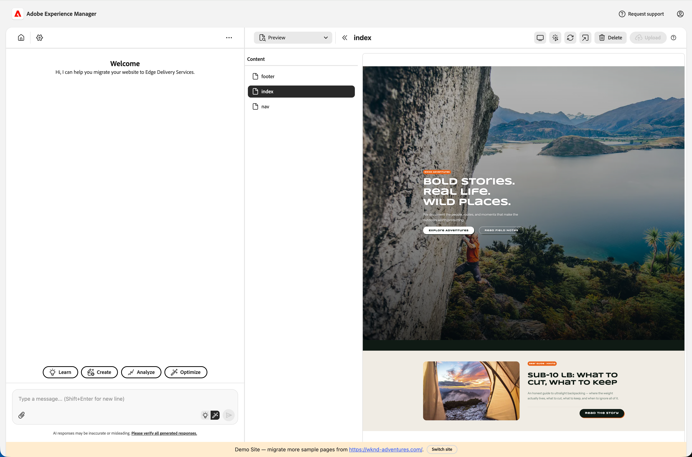

## Connect Your Site {#connect-repo}

Connect the site that you created from the boilerplate, transferred with **Make it yours**, or already had. If your console workspace has changes you want to keep, upload the content and push the code before you replace it.

1. Select **Demo site** in the header and then **Switch site**, or use **Switch site** in [Settings](console.md#settings-page).
1. This prompts you to authorize the AEM Code Connector app using your GitHub credentials. Select **Authorize AEM Code Connector**.
   * For GitHub Enterprise, or when OAuth sign-in isn't available, open **More ways to connect** and select **Sign in with a token** instead. Enter the **GitHub Host** and a **Personal Access Token**. A fine-grained token limited to the repositories you need is recommended. The token must be able to read your user account and push to the repository; with a token, the console lists only repositories that you can push to.
1. Back in the console, specify the preview URL of the site. Preview URLs follow the pattern `https://{branch}--{site}--{organization}.aem.page`, where `{site}` is the GitHub repository name and `{organization}` is the GitHub organization or user that owns it. You can copy one by previewing any page of the site, or construct it from those names. Older projects and documentation may show the earlier `hlx.page` domain. The console finds the associated GitHub repository automatically. Alternatively, you can search through your authorized GitHub projects to find a site.
   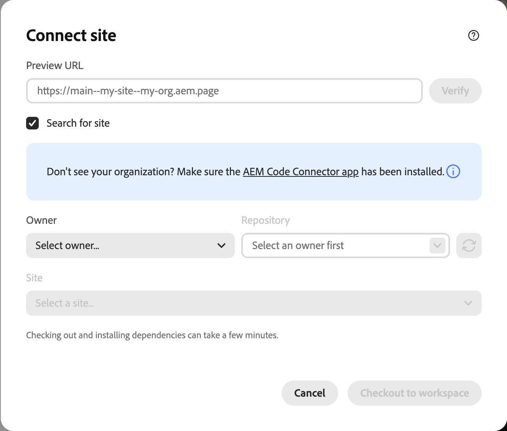
1. Select **Checkout to workspace** once the site has been verified. This copies the project into your console workspace.
1. When prompted to **Replace existing workspace**, verify that the current work is saved elsewhere, then select **Replace workspace**.
   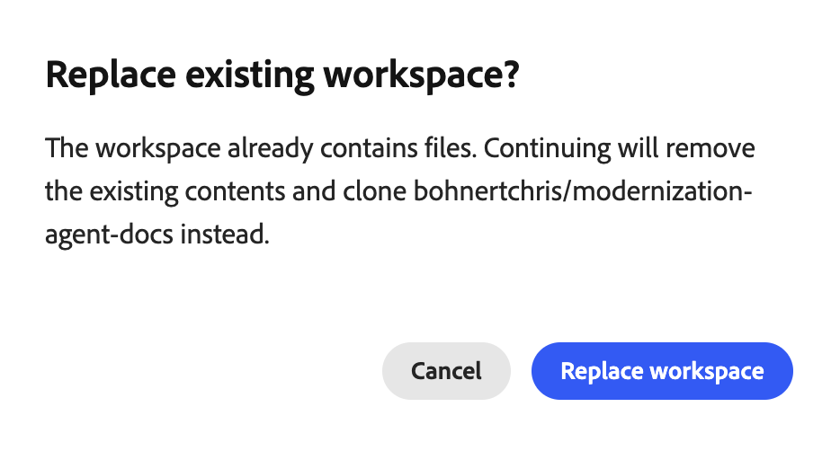

Your site and its GitHub repository are now connected to the console.

Confirm the connected repository, branch, and content destination before requesting changes. You need write access to the repository to connect it. If your organization or repository isn't listed, or the console can't verify the preview URL, see [Git Connection Problems](troubleshooting.md#git-connection).

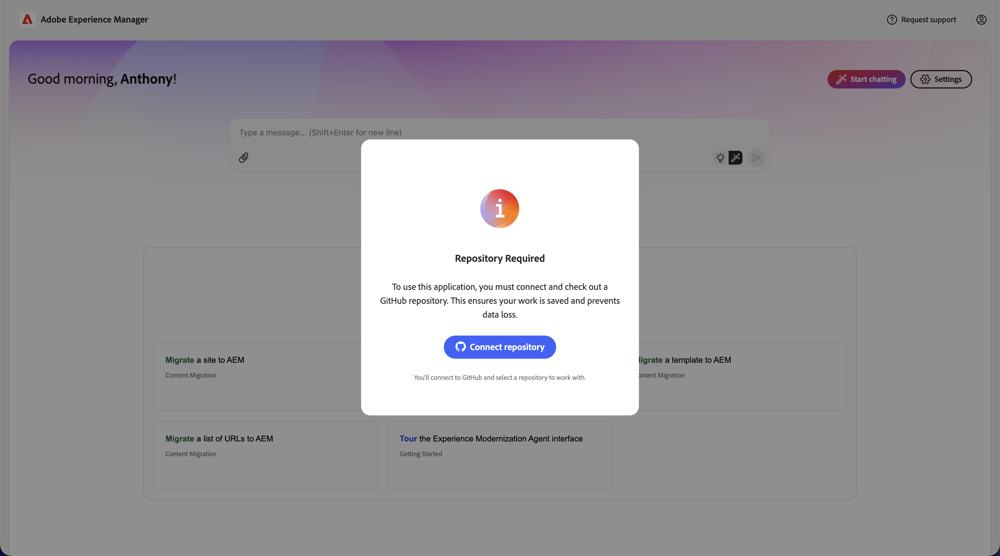

## Console Home {#console-home}

The console opens on its **Home** page until you start a conversation. Type a request in the prompt box, or select one of the suggested prompts, which are grouped by task, such as migrating, developing, and debugging. A request that you type runs in Execute mode: the agent carries it out. Most suggested prompts run in [Plan mode](console.md#prompt-input) instead: the agent first proposes the steps without changing any files, and you select **Execute plan** to carry them out. **Start chatting** opens the chat page, and **Settings** opens your [project settings](console.md#settings-page).

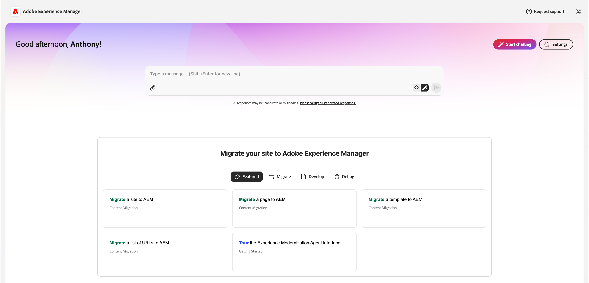

## Start Prompting {#start-prompting}

Once your site is connected, describe what you want in plain language. Say what result you expect and on which page, rather than how to write the code. The agent knows Edge Delivery Services, so you can also ask it how a part of your site works or what a platform term means. To learn how a page is built from sections, blocks, and default content, see [Markup, Sections, Blocks, and Auto Blocking](https://www.aem.live/developer/markup-sections-blocks).

>[!CAUTION]
>
>Never type, paste, or attach passwords, API keys, tokens, or other secrets in the chat. Everything in the chat reaches the AI model, and the agent can copy it into your project's files. Enter credentials in the console's **Settings**. See [Keep Secrets Out of the Chat](prompting-guide.md#secrets).

Where to start depends on your site:

* **A new site from the boilerplate:** [import a page step by step](#guided-import), optionally after scoping the source site.
* **After Make it yours:** import further pages in the same way, or compare and fix the pages that the run migrated. See [Prompts to Start With](#first-prompts).
* **Your existing site:** ask the agent to explain the project, then [make a visual change with Inspect mode](#inspect-mode).

### Import a Page Step by Step {#guided-import}

Importing pages from an existing website is the most common way to start. In the guided workflow, the agent stops after each step so that you can check it: first the page's content, then its design. Save each result as soon as you have checked it: upload the content after the content step, and push the code after the design step.

1. Optionally, scope the source site first. Ask "scope site `https://www.example.com`". The agent finds the site's pages and groups the pages that share a layout into templates. Review the result in the **Planning** view; you can start before scoping finishes. Then choose your first page from a template that covers many pages, because the blocks that it creates can be reused on all of them. Scoping also prepares importing the rest of the site template by template. See [Site Catalog](site-catalog.md).
1. Start with one authorized source page. Replace the example URL and destination in this prompt:
   * "Migrate only `https://www.example.com/about` to `/about` in this project. Target document-based content. Preserve its text, images, and links. Reuse existing blocks and default content. Do not upload, push, or publish."
   * For Experience Manager authoring, specify JCR persistence and follow the [target-specific checks](getting-started-aem-authoring.md#validate-content).
1. Review the imported page, its destination path, and any reported gaps.
   * In this guided flow, the agent imports content first; you request styling in a later step.
   * Import duration depends on the source and requested scope.
   * The console presents you with ongoing feedback as it begins its work, including an overview of its planned steps.
   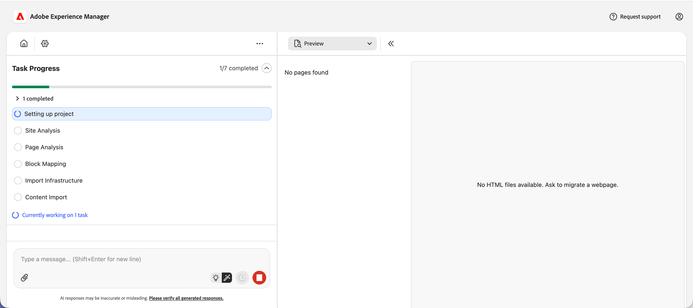
1. Once the page is imported, the **Workspace** panel shows it. Select the page to render it in the console's preview panel on the right. This preview shows the working copy in the console workspace, not the preview site on `aem.page`.
   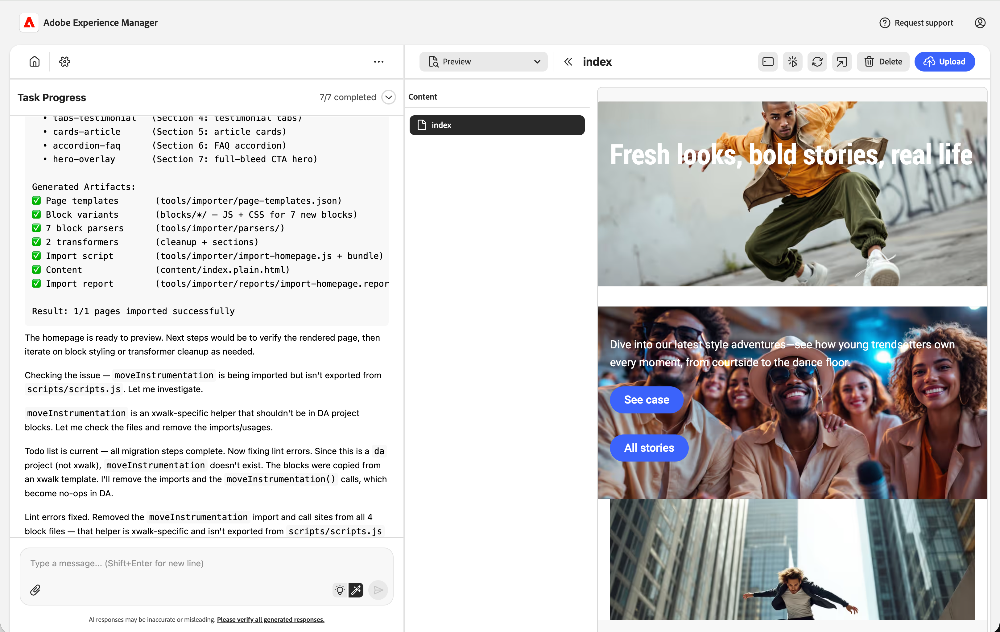
1. Check the page's structure as well as its text. The **Document view** of the preview panel shows how the content is split into sections, blocks, and default content; see [Content Views](console.md#content-view). Headings, text, images, and links should be default content. A block is needed only where authors must mark which content forms a component, such as a set of cards; CSS and JavaScript can lay out default content however the design needs. Authors will edit this structure, so ask the agent to simplify it now, before more pages reuse it. See [Shape the Content Structure](production-migration.md#content-structure).
1. Upload the content, so that it is saved and authors can edit it. Until you upload it, the imported page exists only in the console workspace, and pushing code doesn't save it.
   * For document-based content, see [Upload Content](#upload-content). You can then open the page and edit it.
   * For Experience Manager authoring, see [Upload Content](getting-started-aem-authoring.md#upload-content) in the guide for that setup.
1. Now that you have content, request faithful source styling, or explicitly choose a [new target design](restyling.md). Styling changes only the project's CSS and JavaScript; the content that you uploaded stays as it is.
   * "Import the general styles from `https://www.example.com/about`, then style the blocks used on `/about`. Preserve the imported content."
1. As with the initial content import, the import may take several minutes and the console provides feedback as it processes your request and imports the styles. Once the task is complete, select **Refresh preview** in the right panel to view the styled content.
   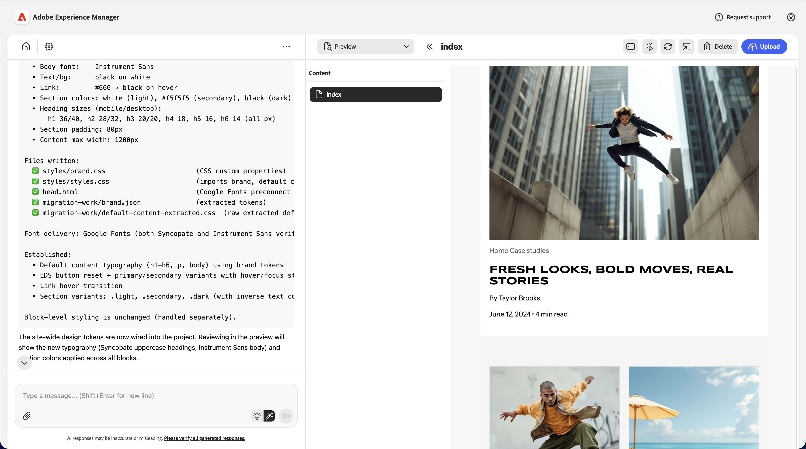
1. Review the styled page at desktop and mobile widths. Compare its text, links, images, and structure with the source page, and ask the agent to fix what differs. Describe the visual differences that remain too; complex designs can take several rounds. See [How Close the Design Gets](prompting-guide.md#design-fidelity).
1. Push the code, so that the new blocks and styles are saved in your repository and show on the site's preview. See [Push Code Changes](#push-code-changes).

Page import does not finish shared navigation and footer automatically; request those separately when needed. Next, [preview and publish](#save-work) the page. For more pages, repeat these steps and ask the agent to reuse the blocks that it has created. Once your first pages look right, ask it to document its blocks and styles for later conversations; see [Prompting Tips](#prompting-tips).

### Make a Visual Change with Inspect Mode {#inspect-mode}

On a site that already has pages, such as your existing site or a site that you transferred with **Make it yours**, a visual change is the quickest way to see a result. Point at what you want to change rather than describe where it is.

1. Open the page in the console's preview panel.
1. Turn on **Inspect mode** with the select icon in the preview panel.
1. Select the element that you want to change, such as a heading, an image, or a button. The element is added to your prompt.
1. Describe the change, for example "Make this button use the primary button style", and send the prompt.

The agent receives the selected element's HTML and its position on the page, and limits its changes to that element. Check the result at desktop and mobile widths, then [push the code](#push-code-changes) to keep it. See [Content Views](console.md#content-view).

### Prompts to Start With {#first-prompts}

Replace the example URLs and paths with your own.

**A new site from the boilerplate:**

* "scope site `https://www.example.com`", then [import a page step by step](#guided-import).
* "Explain the sections and blocks on the home page, and which files style each one."
* "Create a new page `/offers` from this Figma frame: `{Figma link}`." See [Create a New Page from Figma](prompting-guide.md#figma-new-page-from-figma).

**After Make it yours:**

* "Compare `/about` with `https://www.example.com/about` and fix the differences in layout and images."
* "Migrate `https://www.example.com/contact` to `/contact`. Reuse the existing blocks."

**Your existing site:**

* "Give me a tour of this project: list its blocks, what each one does, and which pages use them."
* Select an element with [Inspect mode](#inspect-mode) and describe how it should change.
* "Add a variant of the cards block with a dark background, and show it on `/products`."
* "Check whether this project has the `AGENTS.md` and `CLAUDE.md` files of the current AEM boilerplate, and add them if they're missing."

### Prompting Tips {#prompting-tips}

* Ask for one change at a time, and check it before you ask for the next one.
* Attach a screenshot or a design when it explains the result better than words.
* Give the agent the context that it can't know: requirements, brand rules, and links to the documentation of other systems involved. Ask it questions when you're unsure how something is done in Edge Delivery Services. See [Give the Agent Context](prompting-guide.md#context).
* Say what the agent must not do. The example prompts in these guides end with "Do not upload, push, or publish." This keeps the agent's work in your console workspace, so that you check it and then upload or push it yourself. Leave it out when you want the agent to do these steps for you and have turned on the [agent permissions](console.md#settings-page) that they need.
* To change how pages look, ask for a styling change. CSS and JavaScript can give the existing content any design, so a new look never requires restructuring or reimporting pages.
* For a change that spans several pages or shared styles, you can switch to [Plan mode](console.md#prompt-input) to review the steps before anything changes.
* If a long task stops before it finishes, ask the agent to continue.

The agent knows only what is in the current conversation and in your project's files. To make it follow your project's conventions in every conversation, write them in Markdown files in your repository. The agent loads `AGENTS.md` in every conversation and opens the other files that it lists when a task needs them. See [Use AGENTS.md as the Entry Point](project-instructions.md#agents-md). Typical topics:

* **Implementation conventions and design system:** how blocks are built and named, design tokens, typography, spacing, and brand rules. See [Organize Further Instruction Files](project-instructions.md#organize).
* **Content guidelines:** how authors fill each block, which section styles exist, and what the pages of each template contain. See [Document Content Conventions](project-instructions.md#content-conventions).

You don't need to write these files yourself. Once your first blocks exist, ask the agent to document what it created and to keep the files current:

* "Document the blocks, section styles, and design tokens that you created in short files under `project/`, and list them in `AGENTS.md` with when to read each one. Update these files whenever you change a block, style, or template."

See [Let the Agent Maintain the Files](project-instructions.md#maintain).

>[!TIP]
>
>[Check out the prompting guide](prompting-guide.md) for prompts for each task and for what the agent's skills can do.

## Save, Preview, and Publish {#save-work}

The agent's work stays in the console workspace until you save it elsewhere. Each of the next steps moves work to a different place:

* **Upload** copies content from the console workspace to its authoring destination: Experience Workspace for document-based projects, or the author instance for Experience Manager authoring. In the **Sync** menu, this is **Push** > **Content**.
* **Push** commits code to your Git repository, on the current branch or as a pull request.
* **Preview** copies saved content to the preview site, `*.aem.page`.
* **Publish** makes previewed content live on `*.aem.live`.

Upload and push separately. Edge Delivery Services stores content apart from code, so pushing code doesn't save your pages, and uploading doesn't save your code. Your first result is complete when you can reopen the page in Experience Workspace, edit it, and see the requested change on the preview site, not merely when a preview link exists. The console preview shows the copy in your workspace; authors edit the uploaded copy.

### Upload Content {#upload-content}

For document-based persistence, upload the pages to the document-based content repository, where authors edit them in Experience Workspace. Console labels and some screens still say Document Authoring. Code push does not save these documents, because content is stored separately from code. Confirm the organization, repository, destination paths, and permission to replace any existing content before uploading.

Uploads use your signed-in account's content permissions unless a configured fallback account is used. Turning on agent access doesn't grant additional write permissions. See [Content Push Permissions](evaluate.md#content-push-permissions).

1. Make sure you are in a **Content** view and then select the **Upload content** button on the top-right. Alternatively, use **Sync** > **Push** > **Content** in the workspace header to upload all pending pages.
   * By default you are in **Content** view when entering the console.
   * Your view is indicated by the selected View Picker item in the workspace area of the console.
1. The **Upload content** dialog opens with the destination **Organization** and **Site** pre-filled from your site's configuration: the repository's `fstab.yaml` file, which points to the site's content source, or, if the repository has none, the site's configuration in Edge Delivery Services.
   * Sites created from the current boilerplate have no `fstab.yaml`; their content source is set when the site is set up.
   * If the console can't determine the destination, the fields are empty. Enter the **Organization** and **Site** of your content in Experience Workspace yourself.
1. Choose the files you want to upload and select **Upload**.
   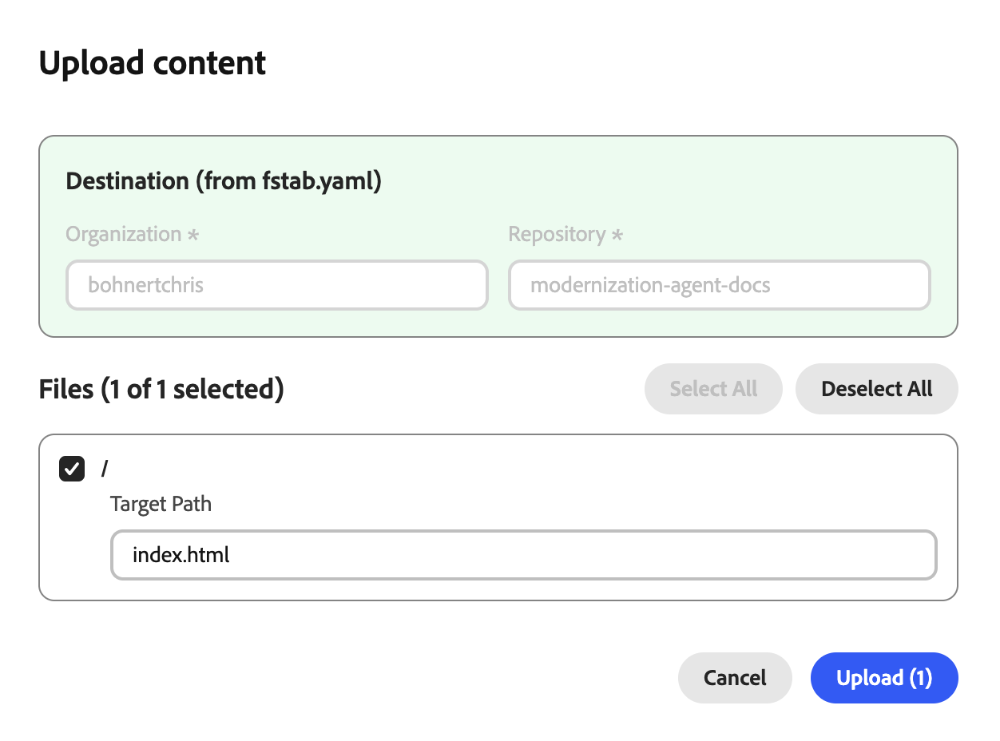
1. The console indicates upload process by disabling the **Upload** button.
1. Once complete, the dialog shows how many files were uploaded. You can then preview, or preview and publish, the uploaded pages. This runs as a tracked job that continues if you close the dialog; retry any pages that fail.
   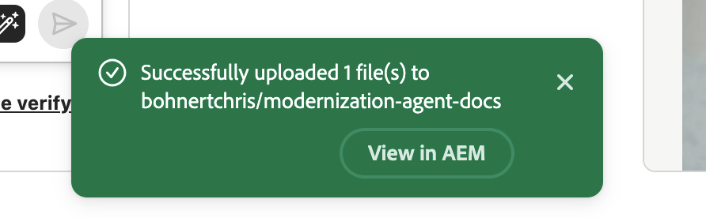

To find the uploaded content, optionally select **View in AEM** in the notification when the upload completes, which opens the site's content in Experience Workspace, or navigate to `https://da.live/#/{organization}/{repository}`.

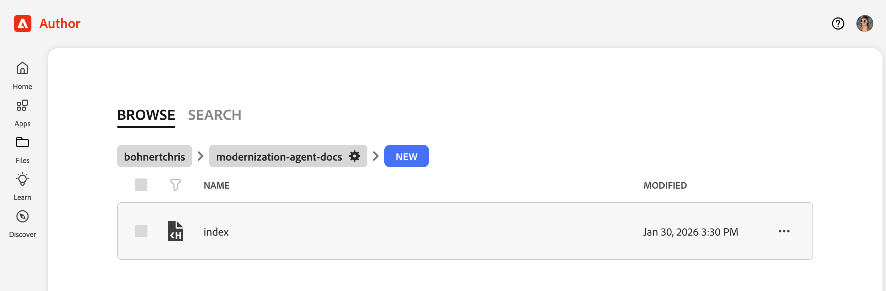

Open an uploaded document, make an edit, save, and reopen it to check authorability and persistence. Where Experience Workspace is turned on for the site, edit the page visually there; in the console, **Edit in Experience Workspace** opens the selected page in its editor. Experience Workspace is off by default and is turned on per site or organization. Review upload errors before assuming all selected pages were copied.

>[!TIP]
>
>If you are working on an Experience Manager authoring project, with JCR persistence and the Universal Editor, uploading content to the author instance works differently. Refer to [Getting Started with the Experience Modernization Agent for Experience Manager Authoring Projects](getting-started-aem-authoring.md#upload-content) for specific upload instructions.

### Push Code Changes {#push-code-changes}

Review the code diff and run the project's checks before pushing. Use a pull request for work requiring review. Branch rules are enforced by your repository's protections; the console and the optional plan mode do not enforce them. See [Control over Changes](evaluate.md#security-control).

1. Optionally, switch to **Changes** view (branch icon in the view picker) to review the diff.
   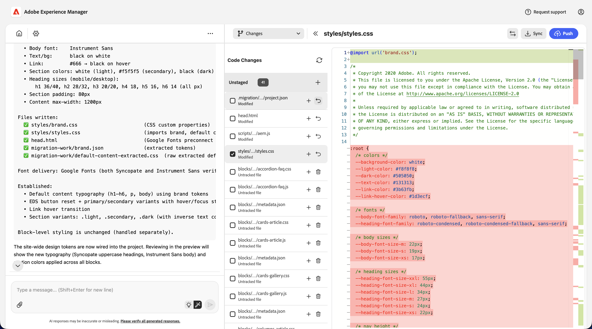
1. Open **Sync** in the workspace header and select **Push** > **Code**.
1. In the **Stage changes** dialog, stage the files you want to push and select **Continue**.
1. In the **Push changes** dialog, enter a commit message. Choose to create a new PR (default) or push to the current branch and select **Confirm** to push.
   * **Create new PR** pushes a new branch, named `aem-` followed by the date and time, and opens a pull request into the current branch. The pull request lists preview URLs of your pages on the new branch, so that reviewers can check the result. Your console workspace stays on the new branch; to continue on the original branch, switch back to it with **Switch branch** in the [Changes view](console.md#changes-actions).
   * **Push to current branch** adds the commit to the current branch, and updates its pull request if it has one. Use it only when your project's policy permits it and you intend to change that branch. A push to `main` changes the live site's code immediately.
1. Once complete, a notification appears at the bottom of the console.
   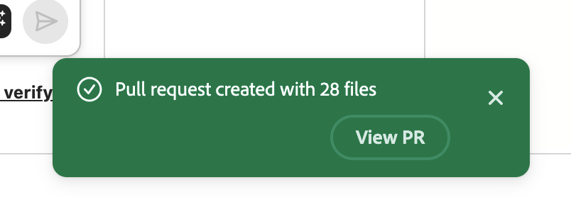

If a pull request was created, select **View PR** in the completion notification. Otherwise, verify the commit on the destination branch. For repositories connected through Cloud Manager, the console pushes the branch without opening a pull request; open it with your Git provider's tools. If the branch is protected against direct pushes, push with **Create new PR**.

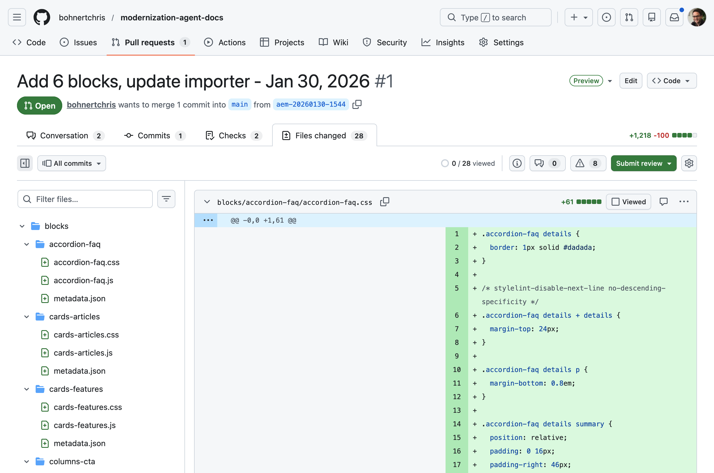

Your code is now in GitHub. It shows on that branch's preview and live URLs straight away.

#### Commit Identity {#commit-identity}

The console uses the Git commit identity configured in your console workspace: `user.name` and `user.email`. If either setting is missing, it uses a default value for that setting. Connecting your Git account authorizes the push but doesn't automatically set the commit identity. Git settings on your own computer don't automatically apply to the console workspace.

#### If Someone Else Changed the Branch {#push-conflicts}

A branch is a sequence of changes, called commits, in your Git repository. Your console workspace holds a copy of the branch as it was when you last pulled it. If someone else has pushed to the branch since, the repository has commits that your workspace doesn't.

When you select **Push to current branch**, the console handles most of these cases for you:

1. It fetches the other commits, adds your commit after them, and pushes again. If you and the other person changed different files or different lines, the push succeeds and you don't need to do anything.
1. If you both changed the same lines, Git can't decide which version to keep. This is a conflict. The console shows **Push failed: Remote has conflicting changes that cannot be merged automatically**, keeps your changes in the workspace, and switches the dialog to **Create new PR**.
1. Select **Confirm**. The console pushes your changes to a new branch and opens a pull request into the branch that you were working on.
1. Select **View PR** in the notification. GitHub shows that the pull request has conflicts that must be resolved.
1. Resolve the conflicts in the pull request:
   * If only a few lines conflict, select **Resolve conflicts** in GitHub, keep the right version of each conflicting part, and commit the result. See [Resolving a merge conflict on GitHub](https://docs.github.com/en/pull-requests/collaborating-with-pull-requests/addressing-merge-conflicts/resolving-a-merge-conflict-on-github).
   * If the conflicts are large or span many files, ask a developer to resolve them in a local copy of the repository.
1. Once the pull request is reviewed, merge it.

The console doesn't merge branches or resolve conflicts itself. **Sync** > **Pull** > **Code** works the same way: if your commits conflict with the remote changes, the console cancels the pull, leaves your work as it was, and suggests pushing your work to a new branch or asking the agent to help resolve the conflict.

To avoid conflicts, pull before you start a task, push small changes often, and agree with your team who changes which files. See [Work as a Team](production-migration.md#collaboration).

### Preview Site {#preview-site}

Previewing copies your saved content to the preview site, `*.aem.page`, where it renders with the code of the branch in the URL. This is different from the console's preview panel, which shows only the working copy in the console workspace. Publishing, a separate step, makes the content live on `*.aem.live`. To preview the uploaded pages:

1. Go back to Experience Workspace.
   * It may still be open in a browser tab you opened after selecting **View in AEM** after uploading the content.
   * Or navigate to `https://da.live/#/{organization}/{repository}`
1. Open one of the pages that you previously uploaded.
1. Select the paper plane icon (top right), then **Preview**.
   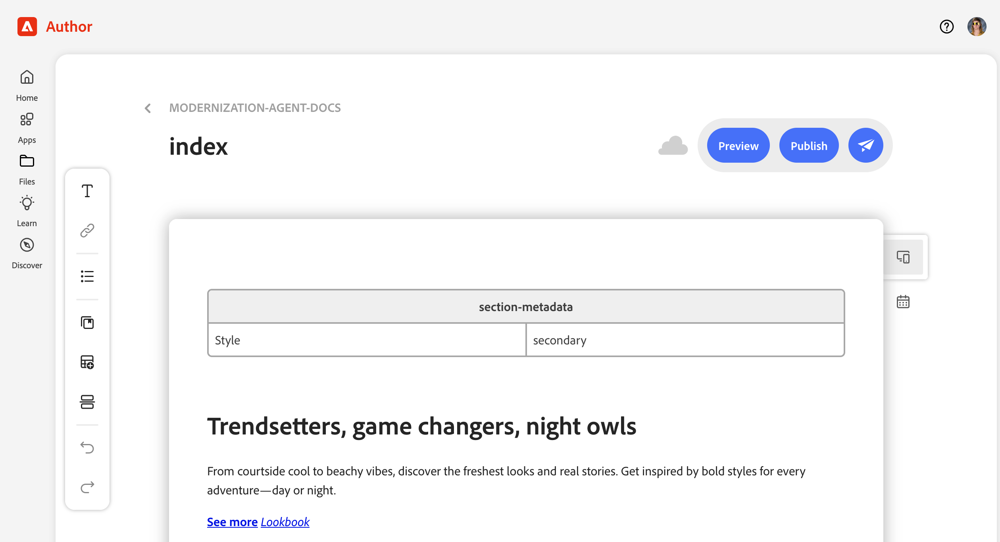

Verify that the preview contains both the saved content and the intended code version.

If your code is on a branch other than the one in the preview URL, change the preview URL to that branch. For JCR-backed content, complete [validation and preview for Experience Manager authoring](getting-started-aem-authoring.md#preview-site) instead of the Experience Workspace steps above.

### Publish {#publish}

When the preview looks right, publish the page to make it live on `*.aem.live`:

* In Experience Workspace, open the page, select the paper plane icon, then **Publish**.
* Or, after an upload in the console, choose to preview and publish the uploaded pages.

Publishing makes the page public. Who can publish is set by the site's publish role; follow your team's review process. Code doesn't need this step: it goes live as soon as it reaches `main`. See [Control over Changes](evaluate.md#security-control).

## Retain or Hand Over Your Work {#retain-work}

Record source and output URLs, code repository and branch, remote content location, accepted pages, unresolved issues, and the next useful task, so that you or a colleague can return to it. See [project handover](project-documentation.md#portable-handoff).

If you transfer an Auto mode run with [**Make it yours**](#make-it-yours), confirm the destination and overwrite choice. Transfer pushes code and copies content separately: either operation can fail independently. Verify both before leaving the source project. Transfer doesn't copy document content into JCR or provide atomic rollback.

A transferred site isn't live yet. Agree who owns each remaining step:

* Review the transfer branch and merge it into `main`. See [Make It Yours](#make-it-yours).
* Set up who can edit, preview, and publish the content. See [Permissions and security](https://www.aem.live/docs/ew/administering/permissions).
* Recreate the spreadsheets that the transfer doesn't copy, such as redirects, bulk metadata, and placeholders.
* Check the site's Experience Workspace configuration, such as its block library. See [Configs](https://www.aem.live/docs/ew/administering/configs).
* [Publish](#publish) the accepted pages.
* Switch your domain to the site. See [Release, Recover, and Hand Over](production-migration.md#handoff).

## Create a Customer Demo {#customer-demo}

1. Select authorized customer-owned or brand-owned pages and the audience's demo goal. Include representative content rather than only the easiest page.
1. Use [Auto mode](#brand-trial) if your account has access, or [import the selected pages](#guided-import). Name the exact page list; a request for one page is not a full-site migration.
1. Apply the source design, or follow [restyling during migration](restyling.md#during-migration). Complete the navigation, footer, and assets needed for the demo path.
1. Check text, imagery, links, layout, and mobile behavior. Walk the actual demo sequence. Identify mocked interactions, unavailable integrations, and pages outside scope.
1. [Retain the work](#retain-work). Hand over exact preview links, their source-page mapping, and the known gaps.

A good demo presents complete, branded pages and working demo paths. It does not require full production cutover, but it must not be described as production-ready.

## Troubleshooting {#troubleshooting}

For problems with imports, source sites that block automated access, missing changes, previews, content uploads, Git connections, the console workspace, sending messages, or removing pages, see [Troubleshoot the Experience Modernization Agent](troubleshooting.md). If that doesn't solve the problem, use **Request support** in the console, or **Get help** on the Auto mode pages, to reach the team that builds the agent. See [Request Support](console.md#request-support).

### Allowlist IP Addresses {#allowlist-ip-addresses}

Where approved by your source-site administrator, the following backend addresses can be allowlisted for source extraction:

* `34.228.136.112`
* `54.90.51.39`
* `3.224.194.242`

Network access alone does not grant authorization or satisfy login requirements, and does not provide VPN/private-network connectivity. For when to use these addresses, see [Source Sites with Bot Protection](troubleshooting.md#bot-protection).

## Additional Resources {#additional-resources}

The following documents may be useful as you continue to explore the Experience Modernization Agent and its console.

* [Experience Modernization Console](console.md) - Details on the console, its views, options, and capabilities
* [Prompting Guide for Experience Modernization Agent](prompting-guide.md) - Ideas on how to prompt the agent and what its skills can do
* [Troubleshoot the Experience Modernization Agent](troubleshooting.md) - Fixes for common problems
* [Edge Delivery Services developer tutorial](https://www.aem.live/developer/tutorial) - Useful if you are new to building these sites
* [Experience Workspace](https://www.aem.live/docs/ew/about) - The visual authoring UI for document-based content, which replaces Document Authoring
