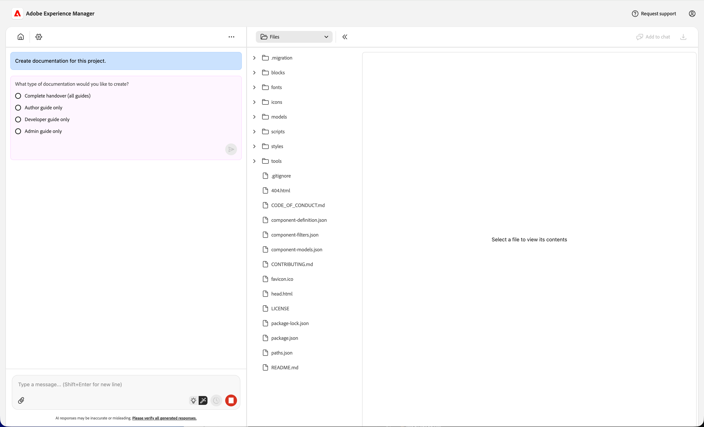
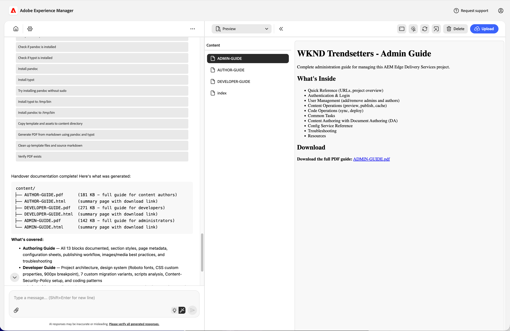
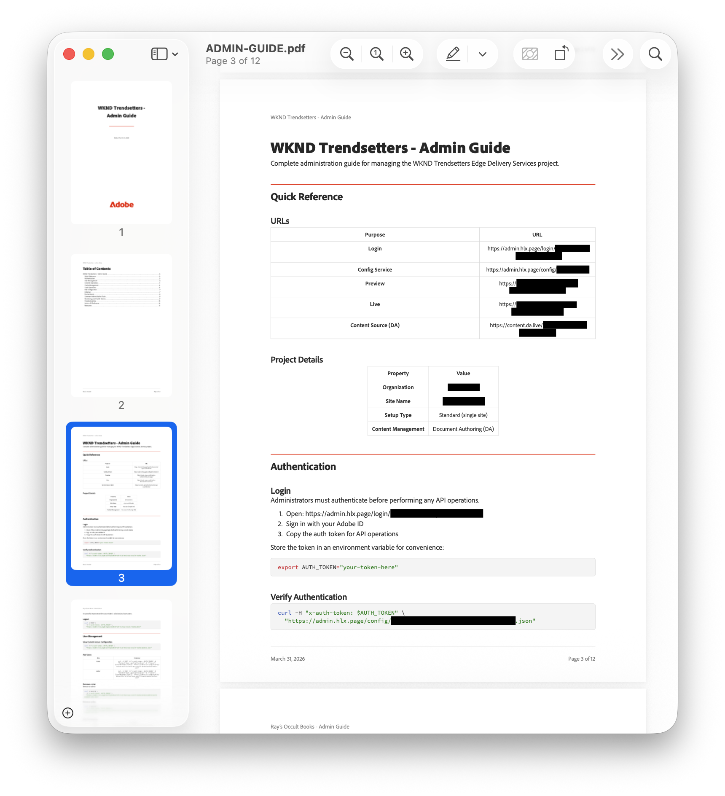

# Project Documentation Skill {#project-documentation}

Learn how the Experience Modernization Agent's documentation skill can help you accelerate project handovers.

## Accelerating Project Handovers {#project-handovers}

[The Experience Modernization Agent](/help/ai-in-aem/agents/brand-experience/modernization/overview.md) (EMA) can generate project documentation guides from accessible Edge Delivery Services (EDS) code and configuration, featuring:

* **Project walkthrough** - Explanation of the project setup, structure, and conventions
* **Module &amp; component organization** - Clear documentation of how blocks, modules, and components are organized and how they relate to each other
* **Role-based guides** - Documentation for authors, developers, and administrators

Review generated guidance against the actual authoring target and validated examples. Generation does not establish that the agent accessed every remote page, integration, or deployment setting.

## Prerequisites {#prerequisites}

Ensure the following before using this skill.

* Your project must be checked out to the workspace in the console.
* To enrich the guides with EDS configuration, you need appropriate admin access and must enable **Allow LLM to access admin.hlx.page on my behalf** in [console settings](console.md#settings-page). `admin.hlx.page` is the EDS admin API, which holds site configuration; `hlx` comes from Project Helix, an earlier name of EDS.
* Without that access, the agent can generate code-based documentation. Ask it to state which configuration and remote content it could not inspect. This permission does not establish JCR repository access.
  
## Creating Project Documentation {#creating-documentation}

Once the prerequisites are fulfilled, ask the agent to create documentation for your project.

1. In the chat ask `Create documentation for this project`. Specify the intended audience, authoring/persistence target, and known project context.
1. Provide the organization name of the project if the agent asks for it.
1. The agent will ask which documentation you would like to create. Normally, you would select **All**.

   

1. Once created, the guides are placed in your workspace. Select one to view a description and click the link to download the full PDF.

   

Review the guides for correct setup, content locations, commands, authoring steps, and known limitations before sharing. Save the PDFs for your teams; for document-based projects, you can also upload them with the other content in Experience Workspace (Document Authoring, DA). This is not a JCR package-import instruction.

>[!NOTE]
>
>If you are not authorized to access the Edge Delivery Services admin API or the option **Allow LLM to access admin.hlx.page on my behalf** in [console settings](console.md#settings-page) is not enabled, the agent generates documentation from accessible code. Label this scope rather than infer missing configuration.

## Retain Context for People and Agents {#portable-handoff}

Alongside the generated guides, maintain a concise Markdown handover in the project's agreed documentation location. This is a recommended practice, not a separate automatic export feature.

Include:

| Field | Useful detail |
|---|---|
| Project identity | Repository, branch/revision, source URLs, [content destination](overview.md#content-storage), authoring tool (Experience Workspace or the Universal Editor), and preview/live URLs. |
| Decisions | Agreed scope, design reference/version, content mappings, project conventions, and what must be preserved. |
| Validated examples | Source-to-output paths, authorable block examples, model/variant instructions, and edit/save/reopen results. |
| State | What exists only in the workspace, what was uploaded, what code was pushed, and what was previewed or published. |
| Quality and gaps | Commands/checks and results, coverage, failed/skipped pages, unfinished integrations, and acceptance owner. |
| Next step and recovery | Remaining task, permissions/dependencies, code recovery, and separate content/asset recovery process. |

For JCR-backed projects, also retain model/configuration changes, site/DAM destinations, package/import results, and Universal Editor validation. For document-based projects, record the remote document location and any transfer/overwrite decisions.

Ask a new conversation to read the named context file and relevant canonical task guide before continuing. Arbitrary project files are not necessarily loaded automatically. Never include tokens, passwords, or other secrets.

Date the handover and refresh it when the code, models, content, or deployment changes. Generated PDFs and a prior conversation can become stale; neither is proof of current release state.

## Troubleshooting {#troubleshooting}

The following are common error messages encountered when using the project documentation skill and how to solve them.

### "Access Denied" or "Unauthorized" {#unauthorized}

* **Cause:** Missing admin permissions or agent permissions not enabled
* **Solution:**
  1. Verify you have admin access to the project
  1. Enable **Allow LLM to access admin.hlx.page on my behalf** in [console settings](console.md#settings-page), if configuration-enriched documentation is required. Otherwise, continue with an explicitly code-only guide.

### "Project Not Found" {#not-found}

* **Cause:** Repository not checked out in workspace
* **Solution:**
  1. Check out the project repository
  1. Ensure you're in the correct workspace

### "Config API Error" {#api-error}

* **Cause:** Unable to access Edge Delivery Services config service API
* **Solution:**
  1. Select **Allow LLM to access admin.hlx.page on my behalf** in [console settings](console.md#settings-page).
  1. Check your network/VPN connection
  1. Confirm admin access to the project

After correcting access or project selection, regenerate the affected guide and review it. Retain the last accepted copy until the replacement is checked; documentation generation does not repair or roll back the site itself.
