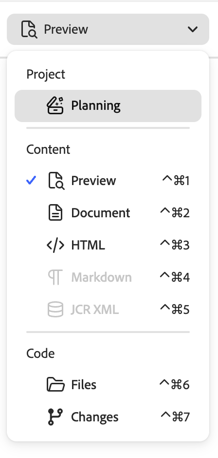
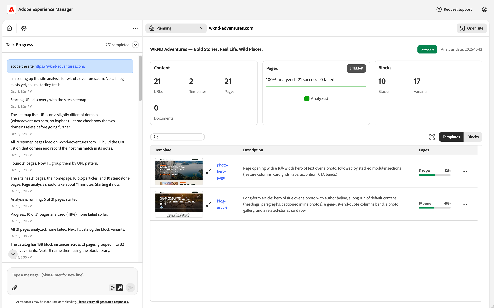
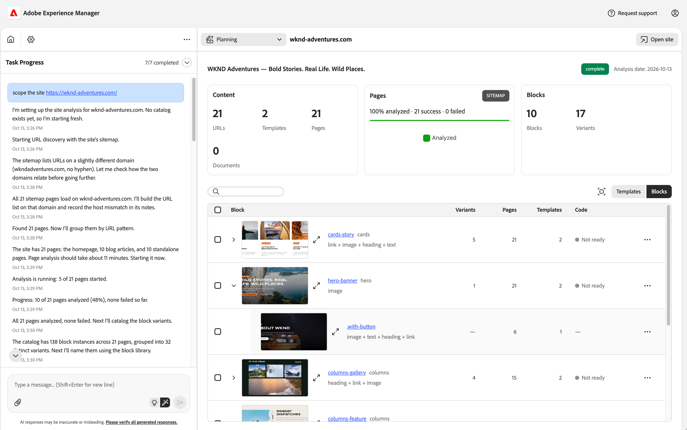
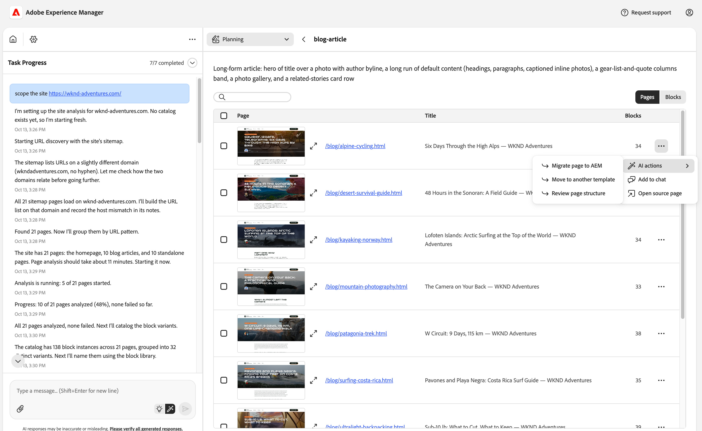
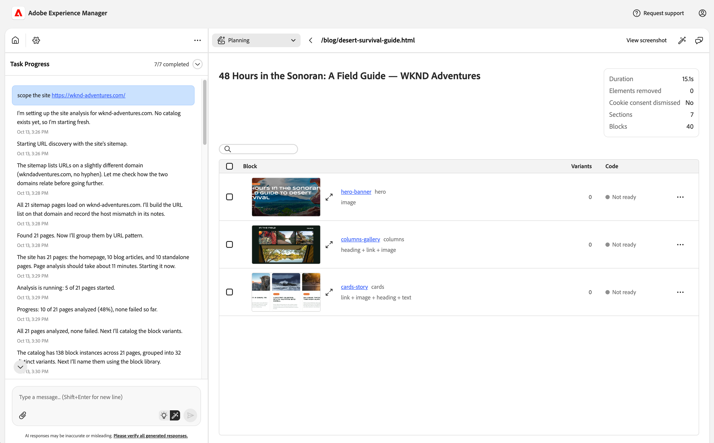
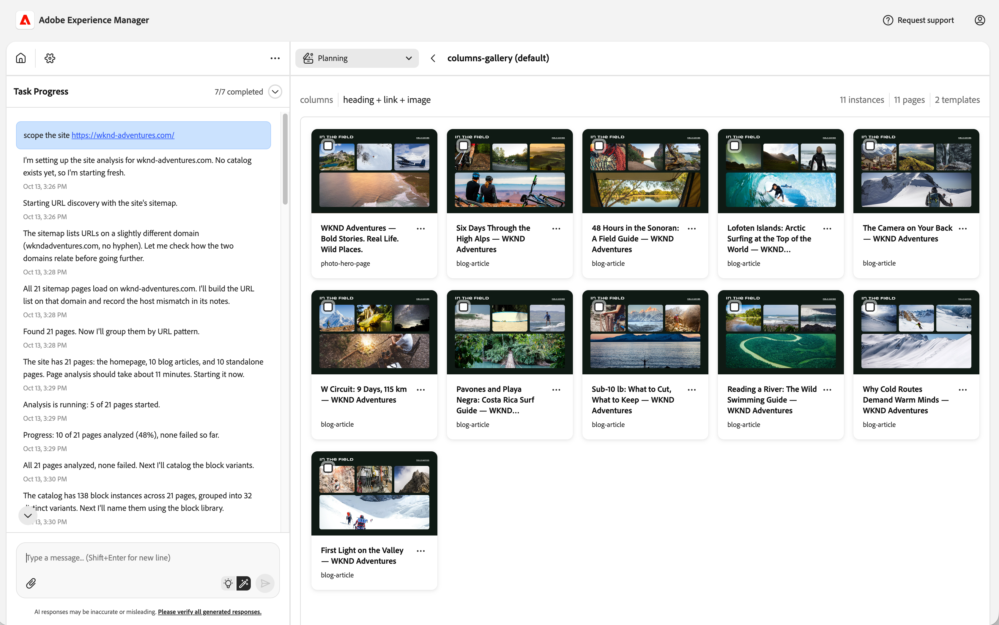

# Site Catalog Skill {#site-catalog-skill}

Learn how the Experience Modernization Agent's site catalog skill performs automated analysis of any website to support Edge Delivery Services migration planning.

## Overview {#overview}

The site catalog skill discovers every page on the site, identifies the page templates and block variants in use, captures screenshots of each, and presents the results in the [site planning UI](#planning-ui) of the Experience Modernization Console, where you can review and refine them.

The skill supports the migration of any website to Edge Delivery Services in the following ways:

* **Starting a migration project** — Run the skill before any work begins to understand the site's scale including page count, templates, block variants, and locales. It establishes the baseline inventory every downstream decision depends on.
* **Effort estimation and planning** — Get quantified metrics to support proposals, sprint planning, and resourcing.
* **Catalog review and correction** — Validate the templates and blocks the agent identified in the [site planning UI](#planning-ui) and correct them before migration begins.
* **Bulk import preparation** — See which pages share the same layout and plan [template-by-template bulk imports](#bulk-import).
* **Stakeholder reporting** — Share the results with project managers, architects, and business stakeholders.

## Invoking {#invoking}

[In the Experience Modernization Console,](/help/ai-in-aem/agents/brand-experience/modernization/console.md) ask the agent to scope your site.

`scope site https://www.example.com`

This also turns on the [site planning UI](#planning-ui) for your project.

The skill's workflow has four phases that run in sequence:

1. **Analyzing** — Each page is loaded, screenshotted, and divided into blocks based on its author-editable content.
1. **Block cataloging** — Similar blocks across pages are grouped into block variants, and each variant is mapped to a block from the block library and named.
1. **Templating** — Pages that share the same layout of blocks are grouped into template candidates.
1. **Naming** — Template candidates are reviewed, merged where they are structurally the same, and given meaningful names.

When the run completes, [review the results in the site planning UI](#planning-ui).

### Additional Prompts {#additional-prompts}

Most projects only need the prompt above. If you need to rerun a phase, for example after the site has changed, ask the agent to repeat it by name.

`repeat block cataloging`

Rerunning a phase also reruns every phase after it, while earlier phases are kept. Changes you make in the [site planning UI](#planning-ui), such as splitting or moving block instances, are kept when the catalog is regenerated.

## Output {#output}

When the run completes, the agent posts a summary in the chat with the number of pages, templates, and block variants it found, a breakdown by locale, and the overall status of the run. The full results are available to review and refine in the [site planning UI](#planning-ui).

The status of the run is shown in the chat summary and in the site planning UI.

|Status|Meaning|
|---|---|
|**complete**|All pages were analyzed successfully (or there was a 10% or lower failure rate).|
|**incomplete**|Over 10% of pages failed, or block detection failed on over 50% of pages. The results are still usable but partial.|
|**failed**|No pages were successfully analyzed.|

## Site Planning UI {#planning-ui}

The site planning UI is a view in the [workspace panel](/help/ai-in-aem/agents/brand-experience/modernization/console.md#workspace-panel) of the Experience Modernization Console where you can review the results of the site catalog skill and correct them before you begin migrating. It shows the templates, pages, and blocks the agent identified, along with screenshots, so you can confirm that they were identified correctly.

Because the accuracy of the catalog directly affects project sizing and every downstream migration step, it is recommended that you review the catalog in the site planning UI before importing pages.

### Accessing the Site Planning UI {#accessing-planning-ui}

You can open the site planning UI in any of the following ways.

* In the workspace panel header, open the view picker and select **Planning** under **Project**.
* Navigate directly to [`https://aemcoder.adobe.io/chat/project/plan`](https://aemcoder.adobe.io/chat/project/plan).
* When a site catalog run completes, select **View report** in the **Site scope complete** notification.

>[!NOTE]
>
>If you have not yet cataloged a site in the current project, the site planning UI displays **No scope report yet**. [Invoke the site catalog skill](#invoking) to analyze a site, then review the results here.

The site planning UI updates as pages are analyzed, so you can begin reviewing results before the run completes.

### Overview Dashboard {#dashboard}

The overview dashboard summarizes the cataloged site. The header shows the site title, the [report status](#output), and the analysis date. Select **Open site** in the workspace header to open the source site in a new tab.

The dashboard includes the following cards.

* **Content** — The number of URLs discovered, templates identified, pages analyzed, and documents found
* **Pages** — The progress of page analysis, showing the number of pages successfully analyzed and the number that failed, plus the URL discovery method (for example sitemap or crawl)
  * Select the failed count to open the [failed URLs list](#failed-urls).
* **Blocks** — The number of blocks and block variants identified
* **Locales** — The number of pages per locale (only shown if the site has more than one locale)

Below the cards is a table which you can switch between two views using the toggle in the table toolbar.

* **Templates** — Lists every template with its description and the number of pages that use it. Select a template name to open its [template details](#template-details).
* **Blocks** — Lists every block with its variants nested underneath. Select a variant to view its [variant instances](#variant-instances).

Both tables can be searched and sorted. Select the **Expand table** icon to hide the dashboard cards and give the table more room.

### Blocks Table {#blocks-table}

The blocks table shows one expandable row per block, with the block's variants nested underneath. For each block it shows the number of variants, pages, and templates it is found on, along with its code status.

Each block is shown with its name and the type of block from the block library that it is based on, for example a `cards-story` block of type `cards`. Its variants are listed underneath by their variant class, such as `.with-button`. A variant without a class is the block's default. Page header, footer, and default content (such as plain headings and text) are not listed as blocks.

The **Code** column shows whether code has been generated for the block.

|Status|Meaning|
|---|---|
|**Ready**|Block code has been generated.|
|**Needs update**|Block code exists but does not yet cover all of the block's variants.|
|**Not ready**|Block code has not been generated yet.|
|**Invalid name**|The block or variant name can't be used as a block folder or CSS class name. [Rename the block or variant](#planning-actions) to fix it.|
|**Unclassified**|The block type has not been identified, so no code will be generated for it. Use **Classify block type** to fix it.|

The same blocks table is also shown in template and page details, scoped to that template or page.

### Template Details {#template-details}

Selecting a template opens its details, which list every page that uses the template with the page path, title, and number of blocks. Select a page path to open its [page details](#page-details). Use the **Pages** / **Blocks** toggle to switch to the blocks used by that template.

### Page Details {#page-details}

Page details list the blocks found on the page, along with analysis details such as the number of sections and blocks. Select **View screenshot** in the header to view the full-page screenshot. Use the **Locate on page** action of a block variant to view the full-page screenshot with that block highlighted.

### Variant Instances {#variant-instances}

Selecting a block variant shows every instance of that variant found across the site side by side, along with the number of instances, pages, and templates it appears on. This makes it easy to spot an instance that has been grouped incorrectly.

The actions menu of each instance lets you view its screenshot, locate it on its page, open its page details, or open the source page.

To correct the grouping, select one or more instances and choose one of the following actions.

* **Split into a new variant** — Moves the selected instances into a new variant.
* **Move to another variant** — Moves the selected instances into an existing variant.

At least one instance must remain in the original variant. To move every instance of a variant, use **Give this variant its own block** or **Make this a variant of another block** on the variant instead. Your split and move changes are preserved when the catalog is regenerated.

### Failed URLs {#failed-urls}

The failed URLs list shows each page that could not be analyzed, along with the reason it failed and when. Non-page files such as images and documents that were skipped are counted separately and are not listed.

### Refining the Catalog {#planning-actions}

You can refine the catalog directly from the site planning UI using AI actions. Open the actions menu (**...**) of any template, page, block, or variant and select **AI actions** to see the actions available for it. You can also select multiple items (up to 20) to act on them together.

When you choose an action, the selected items are added to the chat as context along with a request for the action. The agent analyzes the request, proposes the change, and waits for you to confirm before making it. You can also choose **Add to chat** to add the selected items to the chat as context and write your own prompt.

The following actions are available.

|Item|Actions|
|---|---|
|Template|**Migrate template to AEM**, **Rename template**, **Add pages to template**, **Create a new template from a subset**, **Suggest structural refactors**|
|Page|**Migrate page to AEM**, **Move to another template**, **Review page structure**|
|Block|**Generate block code**, **Classify block type**, **Rename block**, **Make this a variant of another block**|
|Block variant|**Rename variant**, **Give this variant its own block**, **Make this a variant of another block**|
|Block on a page|**Classify block type**|
|Variant instances|**Split into a new variant**, **Move to another variant**|

Some actions are only offered when they apply. For example, **Generate block code** and **Rename block** are only available for blocks whose type has been classified, and **Give this variant its own block** is only available for variants that have a variant class.

Catalog actions only change the catalog and the block library. They never change the content of pages already imported into your project.

## Bulk Import Workflow {#bulk-import}

The site catalog skill is part of the recommended approach for migrating a full site.

1. Run the site catalog skill to get the full template catalog and block catalog.
1. Open the [site planning UI](#planning-ui) to review the templates and blocks the agent identified and correct any that were identified incorrectly.
1. For each template, open its [template details](#template-details) and use **Migrate page to AEM** on one or two representative pages. Refine the import until the output is correct.
1. Use **Migrate template to AEM** to import the remaining pages that use that template.
1. Repeat for each template until the full site is migrated.

## Catalog Files {#catalog-files}

Most users only need the [site planning UI](#planning-ui). If you want to work with the raw output, for example to share an offline report or to use the data in other tools, the skill saves its files to the `catalog/` folder of your project.

|File|Description|
|---|---|
|`template-catalog-report-bundle.zip`|An interactive HTML report with screenshots that you can download, open locally, and share with stakeholders who don't use the console|
|`summary.json`|Totals and the status of the run|
|`template-catalog.json`|Every template with the URLs that use it|
|`block-catalog.json`|Every block variant with its name, type, and screenshots|
|`urls-all.json`|Every URL discovered|
|`catalog.log`|Execution log|

The folder also contains intermediate files, including per-page analysis and screenshots in `.pages/` and per-variant metadata in `.blocks/`.

## Limitations {#limitations}

The site catalog skill has the following limitations.

* **Public sites only** — The target must be publicly accessible (no authentication, VPN, or firewall).
* **Dynamic content is not supported** — Content requiring user interaction to appear in the DOM may not be captured.

