# Generate Brand-Aware Metadata {#generate-ai-metadata-brand-aware}

[!DNL Adobe Experience Manager Assets] Brand-Aware Metadata (BAM) is an AI-powered capability that automatically generates custom metadata values for assets when they are uploaded or reprocessed. It reduces the need for manual metadata entry, helping you manage metadata consistently and make assets easier to find and use.

BAM uses a layered prompting approach to define how AI generates values for specific metadata properties. You can use brand prompts to provide reusable brand and campaign context and property prompts to define instructions for individual metadata properties. You can also provide additional context through referenced properties and restrict generated values to predefined options using controlled vocabulary. BAM also provides a Prompt Playground to preview generated metadata and a Prompt Enhancer to improve prompt instructions.

You can use Brand-Aware Metadata to generate values for metadata properties such as alt text, product attributes, asset classification, region, and language. Generated metadata is applied to assets through processing profiles.

## Before you begin {#before-you-begin}

Ensure the following:

* Access to [!DNL Adobe Experience Manager Assets as a Cloud Service].
* Administrator permissions to access AEM Assets.
* Brand-Aware Metadata enabled for your environment.
* Required permissions to access Prompt Editor and configure metadata.

## Configure Brand-Aware Metadata {#configure-brand-aware-metadata}

Before creating prompts, open **[!UICONTROL Brand-Aware Metadata]**.

1. In [!DNL Adobe Experience Manager Assets], switch to **[!UICONTROL Admin view]**, then navigate to **[!UICONTROL Assets]**.
2. Select **[!UICONTROL Brand-Aware Metadata]**
 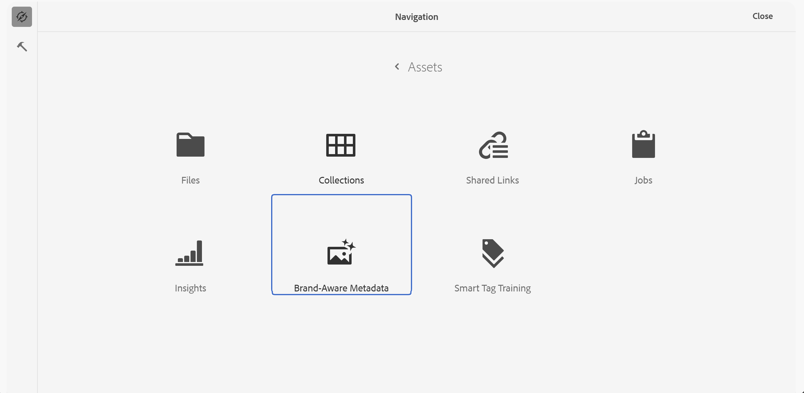

The Brand-Aware Metadata Manager displays the available property prompts, brand prompts, quality reports, and GenAI metrics.
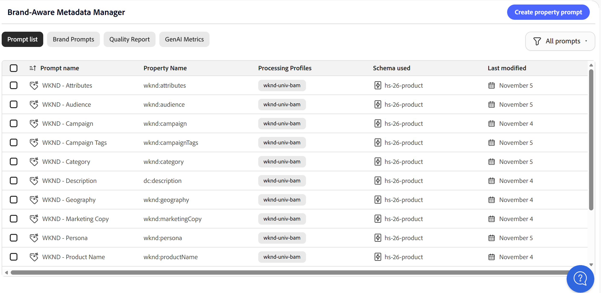

If you need to access Prompt Editor using Assets view, navigate to the following URL:

`https://experience.adobe.com/?repoId=author-<Program-ID>-<Environment ID>.adobeaemcloud.com#/@aemshowcase/assets/prompteditor`

where `aemshowcase` refers to an example organization name

## Create prompts {#create-prompts}

### Create a brand prompt (Optional) {#create-brand-prompt}

A brand prompt provides common brand and campaign context that is applied during metadata generation.

Use a brand prompt to define:

* Brand information.
* Campaign context.
* Tone requirements.
* Naming conventions.
* Content rules.

For example:

> We are Frescopa Coffee, currently running our Taste of Milan campaign with WKND; always append this campaign context to descriptions.

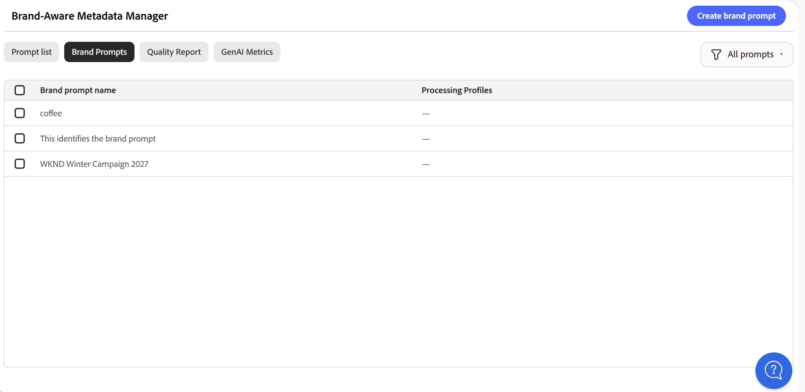

To create a brand prompt:

1. Open the **[!UICONTROL Brand Prompts]** tab.
1. Click **[!UICONTROL Create brand prompt]**.
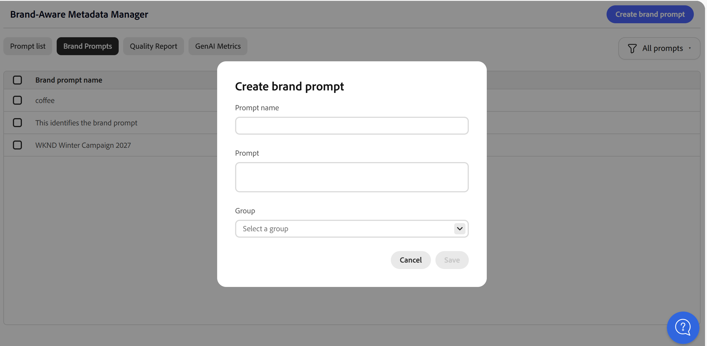

1. In the **Prompt name** field, enter a name for the brand prompt.
1. In the **Prompt** field, enter natural language instructions that describe your brand context and always-on rules.
1. Click **[!UICONTROL Save]**.

You can create multiple brand prompts and organize them into groups. Brand prompts can then be associated with different processing profiles based on your requirements.

### Create a property prompt {#create-property-prompt}

A property prompt defines instructions for generating values for a specific metadata property.

For example, you can create a property prompt to generate alt text for assets.

To create a property prompt:

1. In **[!UICONTROL Brand-Aware Metadata]**, click **[!UICONTROL Create prompt]**.
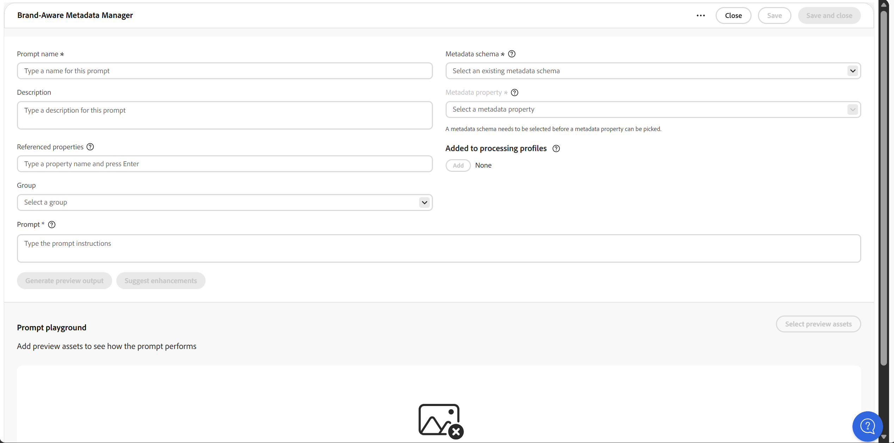

1. In the **Prompt name** field, enter a name for the prompt.
1. Optional: In the **Description** field, enter a description for the prompt.
1. Optional: In the **Referenced properties** field, specify metadata properties that can be used as input when generating values.
1. From the **Metadata Schema** list, select a metadata schema.

   Selecting a metadata schema loads the available metadata properties.
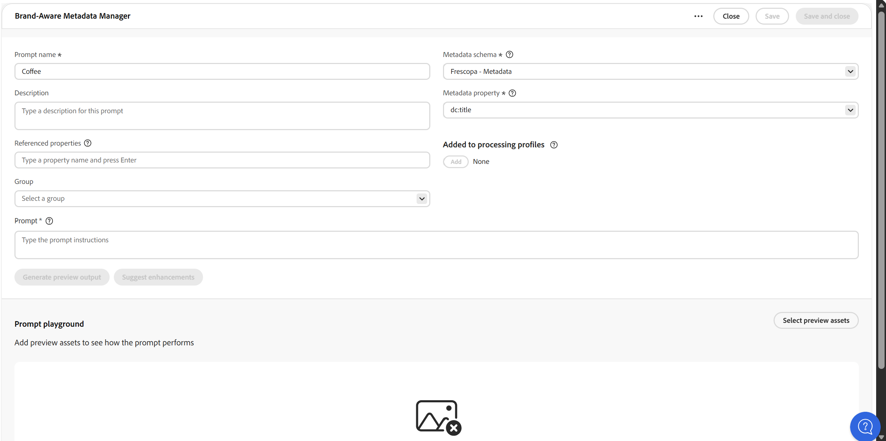

>[!NOTE]
>
>The **[!UICONTROL Metadata schema]** list is populated only with metadata schema defined in the **[!UICONTROL Admin view]**. Metadata schema defined in the **[!UICONTROL Assets view]** are not available in this list.

1. From the **Metadata property** list, select the metadata property that you want AI to populate.
1. In the **Prompt** field, enter instructions for generating the metadata value.

   For example:

   > Write concise alt text describing the main subject of the image.

1. Optional: Click **[!UICONTROL Generate preview output]** to test the prompt and review the generated output.
1. Optional: Use **[!UICONTROL Suggest enhancements]** to improve the prompt instructions.
1. In the **Prompt Playground** section, select preview assets to evaluate how the prompt performs against sample assets.
1. Click **[!UICONTROL Save]** or **[!UICONTROL Save and close]**.

You can add the property prompt to one or more processing profiles and use Prompt Playground to refine the prompt before deploying it.

## Use referenced properties (optional) {#use-referenced-properties}

Referenced properties provide additional asset metadata or file path information as context when generating metadata values. You can use existing information such as product details, campaign information, metadata values, dates, or asset file path information to provide additional context to the property prompt.

For example, if an asset contains an existing product name, you can reference that property so that AI can use the product name when generating another metadata value.

To add referenced properties:

1. In the property prompt editor, open the **[!UICONTROL Referenced properties]** field.
1. Add the metadata property or asset information that you want to provide as additional context.
1. In the **[!UICONTROL Prompt]** field, specify how AI should use the referenced information.
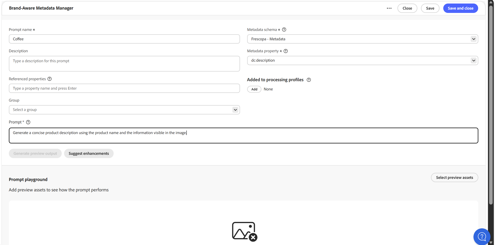
1. Use **[!UICONTROL Prompt Playground]** to preview the generated output.
1. Refine the prompt if required.
 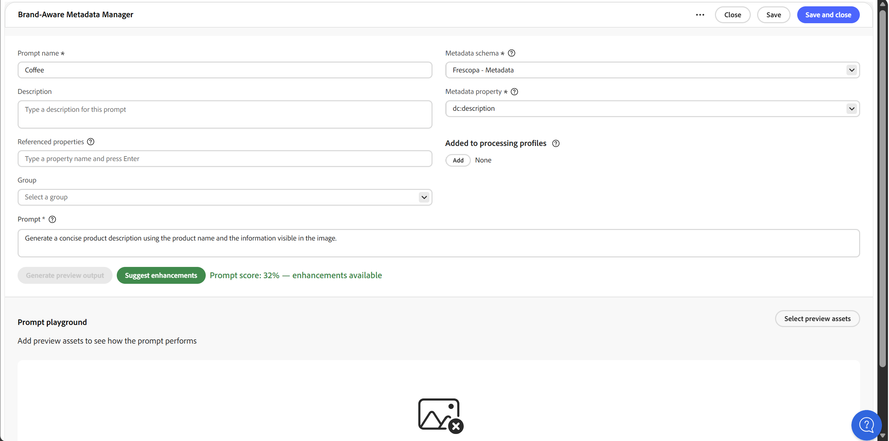

>[!NOTE]
>
>Referenced properties provide additional context to the prompt. They do not define the metadata property that AI generates.

## Configure controlled vocabulary (optional)

Controlled vocabulary restricts AI-generated metadata values to a predefined set of approved options. Use controlled vocabulary when a metadata property must use values from an established list, such as product categories, regions, asset classifications, or other brand-specific terminology.

For example, if a **Coffee Blend** metadata property supports only **House Blend**, **Espresso**, and **Morning Muse**, you can configure these values as controlled vocabulary. For each value, provide a definition that explains when the value should be selected. BAM uses these definitions to determine the appropriate value for an asset.

You can configure controlled vocabulary to return either a single value or multiple values for a metadata property.

### Add controlled vocabulary values

To configure controlled vocabulary for a metadata property:

1. In the property prompt, select the metadata property that uses controlled vocabulary in the metadata form.
1. The editor automatically displays the controlled vocabulary builder for the selected property. For a tag field, the builder displays a tag selector instead of a free-text output.
1. Select whether the property should return a **single value** or **multiple values**.

   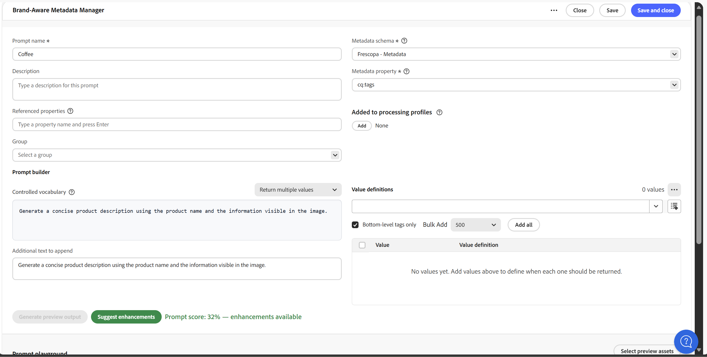

1. Add the approved values. For a tag field, select the required tags using the tag selector.
1. Optionally, provide a definition for each value to explain when it should be selected.
1. In the **[!UICONTROL Additional text to append]** field, enter instructions for selecting the appropriate value.
1. In **[!UICONTROL Prompt Playground]**, test the prompt using sample assets.
1. Review the generated values and click **[!UICONTROL Save]**.

For example, you can configure **House Blend**, **Espresso**, and **Morning Muse** as approved values for a Coffee Blend property. Define each value to explain when the AI should select it.

The value definitions provide additional context to help AI select the appropriate predefined value.                           

## Enhance prompts using Prompt Enhancer (optional) {#prompt-enhancer}

Prompt Enhancer converts simple prompts into structured prompts with suggested improvements.

To enhance a prompt:

1. Enter a prompt for the metadata property.
1. Click **[!UICONTROL Suggest Enhancements]**.
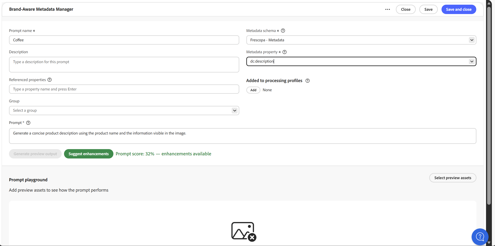

1. Review the suggested improvements and confidence metrics.
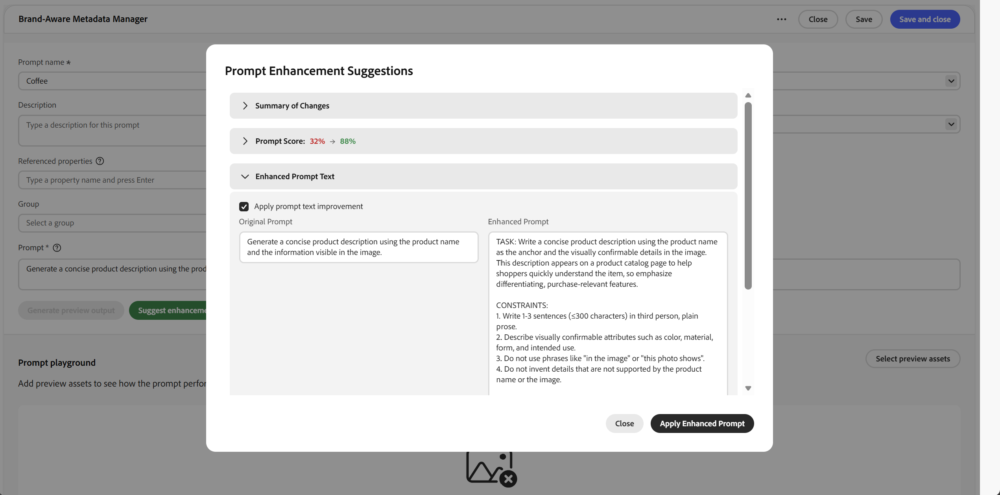

1. Apply the enhancement if required.

## Test prompts using Prompt Playground {#test-prompts-using-playground}

Prompt Playground allows you to test prompts against sample assets before applying them to your asset library.

>[!NOTE]
>
>Prompt Playground only previews generated values. Metadata is not written to assets during testing.

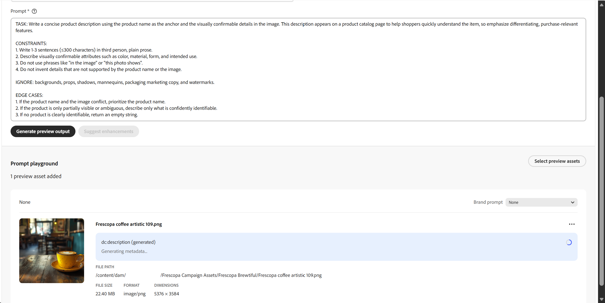

To test a prompt:

1. Scroll to **[!UICONTROL Prompt Playground]** in the property prompt editor.
1. Select one or more preview assets.
1. Click **[!UICONTROL Generate]**.
1. Review the generated values and confidence score.
1. Refine the prompt if required.

## Apply AI metadata using processing profiles {#apply-ai-metadata-at-scale}

After creating brand prompts and property prompts, associate them with a processing profile to apply AI-generated metadata during asset processing workflows.

Processing profiles determine which prompts are executed and where generated metadata is applied.

To associate a prompt with a processing profile:

1. In the **Prompt list**, select the prompt that you want to use.
1. Click **[!UICONTROL Add to Processing Profile]** from the action bar.
1. Select the processing profile where you want to use the prompt.
1. Save the configuration.
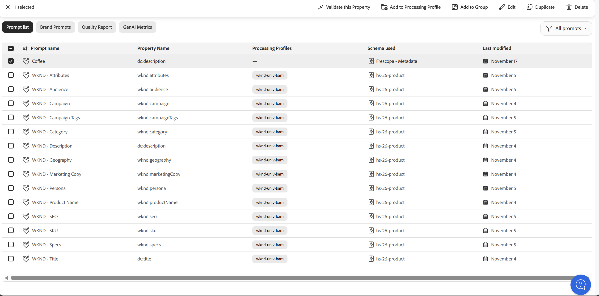

Once associated with a processing profile, the prompt can be executed when processing existing assets or automatically when new assets are uploaded to configured folders.

Brand-Aware Metadata supports the following processing workflows:

* Reprocess existing assets to populate metadata.
* Automatically process newly uploaded assets.

### Apply BAM to existing assets {#apply-bam-to-existing-assets}

Reprocess a folder to populate metadata for assets that already exist in your DAM.

To apply Brand-Aware Metadata to existing assets:

1. Navigate to the folder that contains the assets.
1. Select the folder.
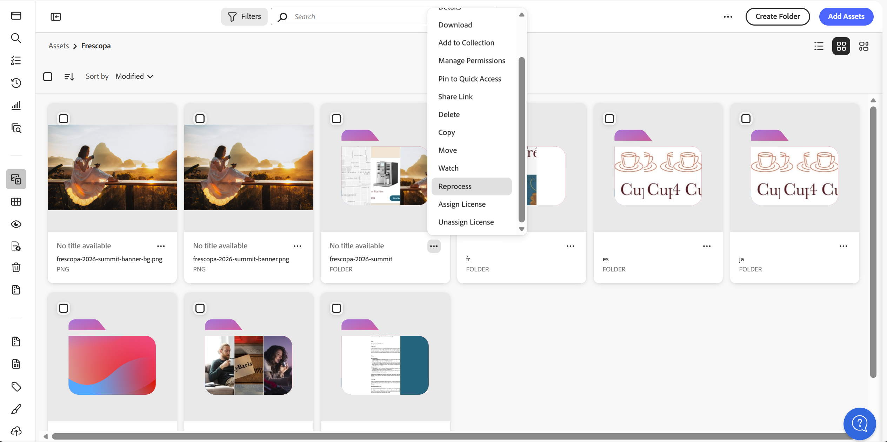

1. Apply the required processing profile.
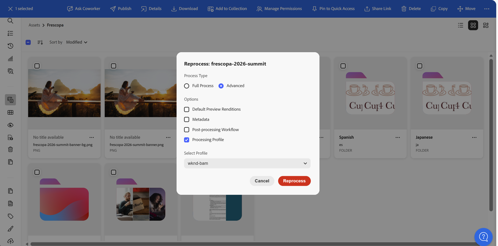

1. Start the reprocessing operation.
1. Wait for processing to complete.
1. Open an asset and verify that the configured metadata fields are populated.

### Process new assets automatically {#process-new-assets}

Configure a folder to automatically process newly uploaded assets using a Brand-Aware Metadata processing profile.

To automatically process new assets:

1. Open the folder configuration.
1. Associate the required Brand-Aware Metadata processing profile.
1. Save the configuration.
1. Upload new assets to the configured folder.
1. Verify that metadata is generated after processing completes.

## Verify generated metadata {#verify-generated-metadata}

After processing completes:

1. Open the processed asset.
1. Click **[!UICONTROL Properties]**.
1. Review the metadata fields configured in the processing profile.
1. Verify that the generated values match the expected output.

## Limitations {#limitations}

>[!NOTE]
>
>GenAI Metrics and Quality Report has significantly reduced functionality for HIPAA customers.

Keep the following considerations in mind before applying BAM at scale:

* BAM evaluates images only. To use additional information such as another metadata field value or file path information, configure referenced properties.

* Processing overwrites existing metadata values. There is currently no option to populate only empty fields.

* BAM uses a general-purpose GPT model. Highly specialized recognition, such as identifying an exact product SKU, may not always produce reliable results.

* Brand Guidelines configured in governance are not automatically applied during metadata generation. Include brand context directly in the brand prompt.

* For dropdown and taxonomy-backed fields, use controlled vocabulary to restrict generated values to existing options.

* Quality Report data is updated overnight and includes asset processing completed during the previous day. As a result, newly processed assets may not appear in the report immediately.

## Troubleshooting {#troubleshooting}

### Error when selecting a metadata property

If you experience an error when selecting a value from the **[!UICONTROL Metadata property]** list, the metadata form may contain more than 1,000 nodes.

To resolve the error:

1. Open the OSGi configuration for `org.apache.sling.servlets.get.DefaultGetServlet`.
1. Set the `json.maximumresults` property to `10000`.
1. Save the configuration.
1. Return to the property prompt and select the metadata property again.
