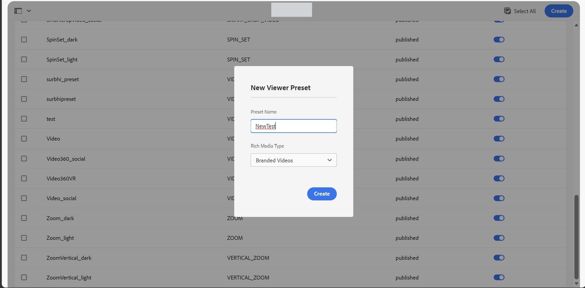
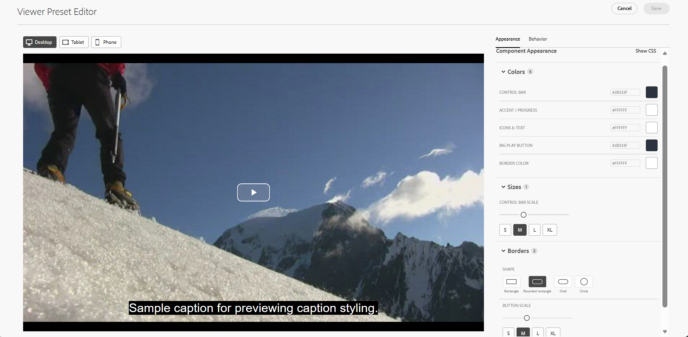
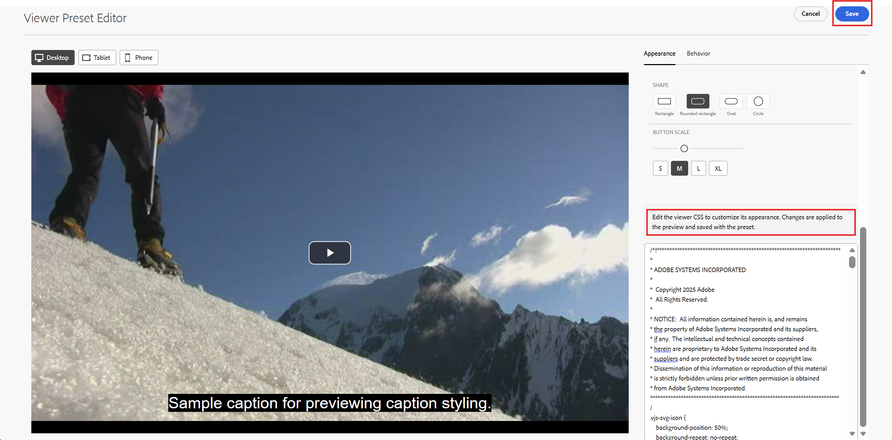
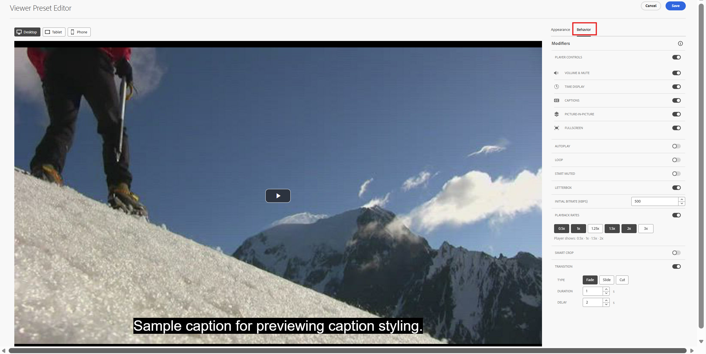
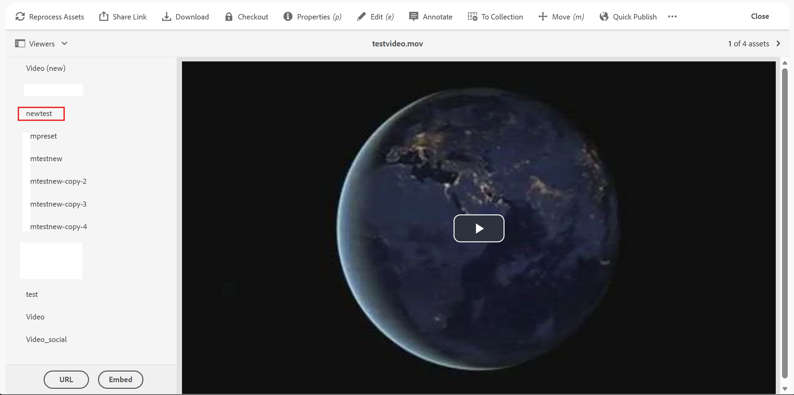
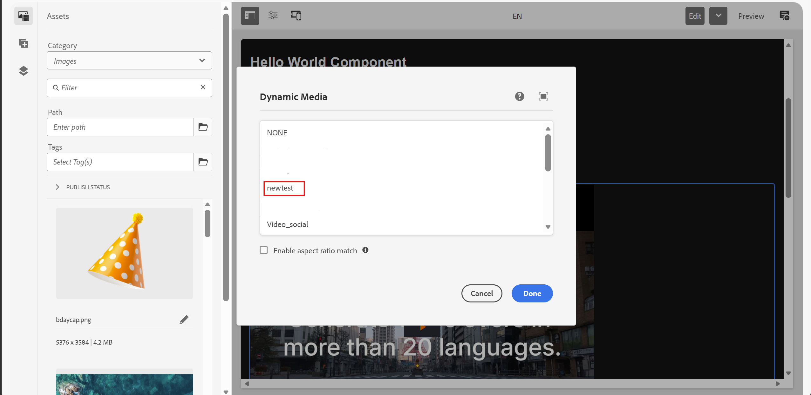

# Configure branded video viewer presets {#configure-branded-video-viewer-presets}

A branded video viewer preset is a reusable set of appearance and playback settings for the unified video viewer in Dynamic Media. Create presets to customize the video player's appearance and playback behavior, and reuse them across videos to provide a consistent viewing experience.
Presets are shared across assets in a repository. The steps to make a preset available and apply it during playback depend on your Dynamic Media environment: Dynamic Media Scene7 or Dynamic Media with OpenAPI.

## Create a branded video viewer preset {#create-branded-video-viewer-preset}

To create a branded video viewer preset:

1. In Experience Manager, navigate to **Tools** > **Assets** > **Viewer Presets**.
2. Select **Create**.
3. Enter a name for the preset.
4. For the Rich Media Type, select **Branded Videos**.

   

5. Configure the appearance and playback settings for the video viewer.
6. Save the preset.

The available settings depend on the selected viewer and the Dynamic Media environment.

## Customize the player appearance {#customize-player-appearance}

Use the **[!UICONTROL Appearance]** tab to customize the video player's colors, control bar scale, and main play button.

In the **[!UICONTROL Component Appearance]** panel, configure the following settings:

* **Colors:** Set the colors for the control bar, accent and progress, icons and text, big play button, and border.
* **Sizes:** Adjust the control bar scale using the slider or select **[!UICONTROL S]**, **[!UICONTROL M]**, **[!UICONTROL L]**, or **[!UICONTROL XL]**.
* **Borders:** Choose a shape for the main play button, such as a rectangle, rounded rectangle, oval, or circle. Adjust the button scale using the slider.

Select [!UICONTROL Show CSS] to display the CSS editor and customize the viewer's appearance. Review your changes in the preview before saving the preset.

Use the **[!UICONTROL Desktop]**, **[!UICONTROL Tablet]**, and **[!UICONTROL Phone]** previews to review the player appearance at different display sizes.

## Configure playback behavior {#configure-playback-behavior}

Use the **[!UICONTROL Behavior]** tab to configure the player controls and playback settings.

### Configure player controls {#configure-player-controls}

Configure whether the player controls are displayed. Depending on the supported options, you can also show or hide individual controls, including:

* Volume control
* Time display
* Captions control
* Playback rate control

Choose the controls that viewers need for the intended playback experience.

### Configure playback options {#configure-playback-options}

Configure the supported playback options for the preset.

| Option | Description |
| --- | --- |
| Autoplay | Starts video playback automatically when the viewer loads. |
| Loop | Restarts the video automatically after playback ends. |
| Start muted | Starts playback with audio muted. |
| Playback rates | Specifies the playback speeds available to viewers. You can also configure whether the playback rate control is displayed, where supported. |
| Transition | Configures the transition used when viewer controls appear or disappear, such as a fade or slide-down transition. |

The availability and behavior of individual options depend on the selected viewer.

### Configure video presentation and quality {#configure-video-presentation-quality}

Configure the supported options for how the video is displayed and loaded.

| Option | Description |
| --- | --- |
| Letterboxing | Configures the letterboxing behavior for the video. |
| Initial bitrate | Sets the initial bitrate for video playback. |
| Progressive bitrate | Sets the bitrate for progressive video playback. |
| Smart Crop | Enables the supported smart-cropped video presentation for the asset. |

Preview the video after changing these settings to verify the resulting playback.

## Save and make the preset available {#save-and-publish-preset}

After configuring the preset, save your changes. The steps to make the preset available depend on your Dynamic Media environment:

Dynamic Media Scene7: Return to the Viewer Presets list and manually publish the preset.

Dynamic Media with OpenAPI: Complete the required approval workflow before using the preset.

For video delivery through Dynamic Media with OpenAPI, ensure that the video asset is approved before playback.

## Apply a branded video viewer preset to a video {#apply-preset-to-video}

After the preset is available, you can select it when previewing or delivering a video, where supported.

### Apply the preset from the asset details page {#apply-preset-from-asset-details}

Execute the following steps to preview a video using an available viewer or preset:

1. Navigate to **Assets** > **Files**, and open the folder containing the video.
2. Click the video asset to open the asset details page.
3. In the left panel, click **Viewers**.
4. Select the available viewer preset to preview the video with the configured appearance and playback settings.

   

5. Copy the available delivery URL or embed code if you need to use the video elsewhere.

The available viewer options depend on the Dynamic Media environment and the preset's availability.

### Apply the preset in AEM Sites {#apply-preset-in-sites}

To use a video with a branded viewer preset on a Sites page:

1. Open the page in the **Sites editor**.
2. Add or select the **Dynamic Media** component.
3. Configure the component and select the video asset.
4. Select the appropriate viewer or preset from the available viewer settings.

   

5. Save the page and preview the video.

The selected preset controls the playback experience according to its configured settings and the capabilities of the selected viewer.

## Apply a preset using a playback URL {#apply-preset-using-playback-url}

You can apply a branded video viewer preset by passing its name in the playback URL. The parameter depends on your Dynamic Media environment:

* **Dynamic Media Scene7:** Use the `config` parameter to specify the preset name.
* **Dynamic Media with OpenAPI:** Use the `viewerPreset` parameter to specify the preset name.

For the exact playback URL and embed code, open the video asset's details page and select **[!UICONTROL Viewers]**.

The viewer applies the preset settings during playback. Explicit URL or caller parameters take precedence over the corresponding preset settings.

## Important considerations {#important-considerations}

* A branded video viewer preset is reusable across videos in the same repository.
* Changes to a preset can affect the playback experience wherever the preset is used.
* Publish the preset in Dynamic Media Scene7 or complete the required approval workflow in Dynamic Media with OpenAPI before using it.
* For Dynamic Media with OpenAPI, ensure that the video asset is approved before playback.
* Preview the video after applying a preset to verify its appearance, playback behavior, and available controls.