# Manage collections in [!DNL Content Hub] {#manage-collections}

A **collection** is a curated set of assets that can be shared among users. A collection can include assets drawn from different locations while maintaining their **referential integrity**, meaning each asset stays linked to its original source and metadata even when grouped together.

[!DNL Content Hub] enables you to create **public collections**. These collections are accessible to all entitled users, creating a shared space where multiple users can efficiently access and utilize content. [!DNL Collections] promote the collaborative use of resources, functioning as a centralized workspace that increases efficiency and convenience across teams. Within the collection browse page, you can:

* **Create**: Create one or more collections to organize related assets in a single place.
* **View**: View the assets and their properties to evaluate content before use.
* **Share**: Share assets as a link with others, enabling quick distribution without transferring files.
* **Download**: Download the assets for local use.
* **Remove**: Remove specific assets from a collection without deleting them from [!DNL Content Hub].
* **Delete**: Delete the entire collection when it is no longer needed.
* **Pin/Unpin**: Pin or unpin a collection to keep frequently used sets readily accessible.
* **Favorite**: Mark a collection as favorite for faster future retrieval.

[!DNL Collections] help users easily access and manage the diverse assets available within [!DNL Content Hub].

>[!VIDEO](https://video.tv.adobe.com/v/3435687/?learn=on){transcript=true}

## Prerequisites {#prerequisites}

Before performing the procedures in this article, ensure the appropriate access requirements are met.

**[!DNL Content Hub] users** are authorized to perform all actions described in this article. Only accounts that have been onboarded as [Content Hub users](deploy-content-hub.md#onboard-content-hub-users) have the permissions required to complete the tasks and procedures covered here. This role-based prerequisite ensures that the necessary access rights are granted before you begin, because the workflows in this article depend on the capabilities assigned to onboarded [!DNL Content Hub] users.

If you have not yet been set up with this access, complete the onboarding step first so that you can perform each of the actions that follow.

## Create collections{#create-collections}

A **collection** is a grouping of related assets that you organize and manage together, making it easier to apply consistent controls across those assets. [!DNL Collections] are a core tool for **asset governance**, because grouping assets streamlines how policies, access, and oversight are applied at scale rather than to individual items one at a time.

While managing governance, two options are available:

- **[Create a new collection](#create-new-collection)** — start a fresh collection to group related assets from the outset.
- **[Add assets to an existing collection](#add-assets-to-existing-collection)** — extend an already-defined collection with additional assets.

Choosing either option during governance management ensures assets remain organized and consistently governed. Grouping assets into collections supports clearer oversight, simplifies the application of governance policies, and reduces the effort required to manage large sets of assets.

### Create a new collection{#create-new-collection}

Follow the steps below to create a collection and set access controls that determine who can view and edit its contents. Choosing the right access level at creation time establishes clear collaboration boundaries and protects sensitive assets from unintended edits.

1. Go to the **[!DNL Collections]** tab and click **[!UICONTROL Create Collection]**. A new Collection window appears.

1. Add a **[!UICONTROL Title]** and **[!UICONTROL Description]** for the collection so it is easy to identify and organize later.

    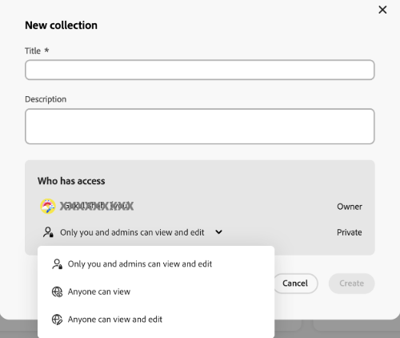

1. Under the **[!UICONTROL Who can access]** dropdown, select the access control type that matches your collaboration and security needs. The following options are available:

    |Access method | Access type | Description |
    |---|---|---|
    | **Only you and administrators can edit**| Private | Only the creator and the administrators can edit and access this collection. Choose this option to keep the collection restricted while it is being built or when its contents are confidential. |
    | **Anyone can view**| Public | Everyone can access this collection, but only the creator and administrators can edit. Choose this option to share finalized assets broadly while preserving control over changes. |
    | **Anyone can view and edit**| Public | This collection is open to everyone, with full access and editing permissions granted without restrictions. Choose this option for open, collaborative work where any user can contribute. |

    >[!NOTE]
    >
    > A [!DNL Content Hub] administrator can view all the options available under the **[!UICONTROL Who can access]** dropdown. For regular users, you must [specify and configure](configure-content-hub-ui-options.md) which options they can access.

1. Click **[!UICONTROL Create]**. Once the collection is created, [add assets to the collection](#add-assets-to-existing-collection).

>[!VIDEO](https://video.tv.adobe.com/v/3463336)

<!--
>[!NOTE]
>
>Collections governance is a limited availability feature. You can get it enabled  by creating a support ticket. Once enabled, you need to [Configure Collections in Content Hub](configure-content-hub-ui-options.md#configure-collections-content-hub).
-->

<!--
To create a new collection, navigate to the **[!UICONTROL Collections]** tab and click **[!UICONTROL Create new collection]**. Enter the **[!UICONTROL Title]** and provide an optional **[!UICONTROL Description]** for the assets. Click **[!UICONTROL Create]**.
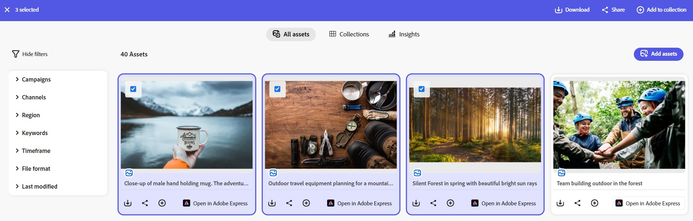          
-->

### Add assets to an existing collection{#add-assets-to-existing-collection}

Adding assets to an existing collection takes a few clear steps. Follow the numbered procedure below to move one or more selected assets into a collection you have already created:

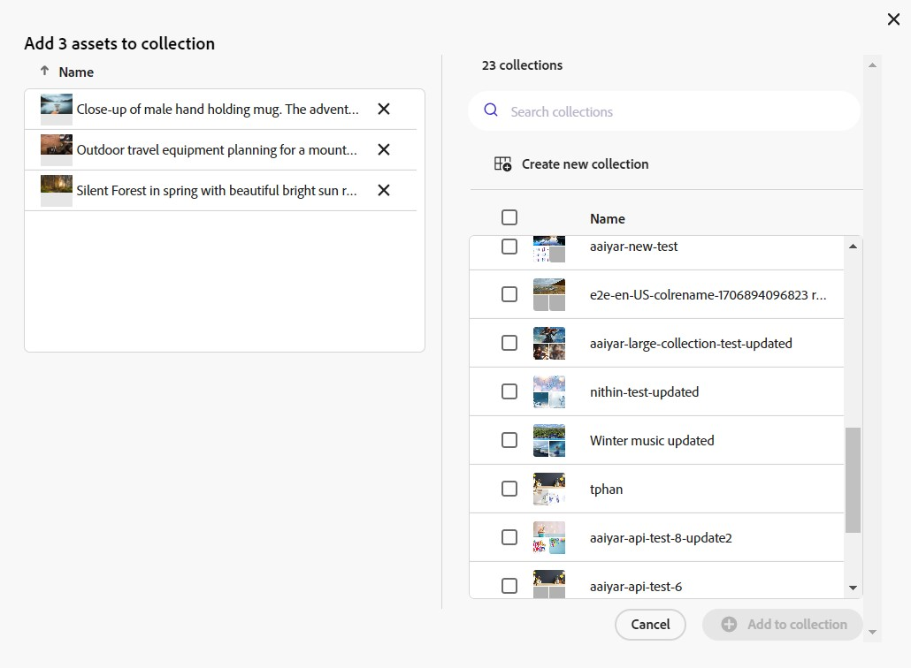

1. **Select the assets** you want to add to the collection.
2. Click **[!UICONTROL Add to collection]**. A dialog opens, prompting you to select the target collection.
3. **Choose the collection** where you want to add the assets. When you have many collections, use the **search bar** in the dialog to locate the correct collection quickly instead of scrolling through the full list.
4. **Select the collection(s)** to which you want to add the assets, then click **[!UICONTROL Add to collection]** to confirm.

Once you confirm, the selected assets are added to the chosen collection(s), and they become accessible from within each collection alongside its existing assets.

## View collections{#view-collections}

Use the **[!UICONTROL Collections]** tab to locate, open, and browse the assets grouped within a collection in [!DNL Content Hub]. [!DNL Collections] organize related assets together, so filtering and drilling into them lets you find the exact content you need without scrolling through the entire asset library.

### Find a collection {#find-a-collection}

1. Navigate to the **[!UICONTROL Collections]** tab.
2. Search for the collection by name.
3. Apply filters to refine your search results by selecting specific criteria. Filtering narrows a large set of collections to the most relevant matches, which quickly surfaces the most relevant collections.

### View assets within a collection {#view-assets-within-a-collection}

1. Click the collection name to open the list of assets available in that collection.
2. Apply filters within the collection to narrow down the asset results. Filtering inside a collection helps you locate a specific asset faster, which is especially useful when a collection contains a large number of assets.
3. Click the asset you want to view within the collection.

[!DNL Content Hub] then displays the detailed view for the selected asset, where you can review its properties. [See asset details](asset-properties-content-hub.md).

### Filter collections view {#filter-collections-view}

[!DNL Content Hub] lets you filter the collections view to quickly locate a specific collection by narrowing options based on ownership and access preferences. Filtering is especially useful when you manage a large number of collections, because it reduces the visible list to only those that match your selected ownership or permission criteria. Before you begin, ensure the [configuration of [!DNL Collections] in [!DNL Content Hub]](configure-content-hub-ui-options.md#configure-collections-content-hub) is complete.

**Filter by ownership and access level**

To filter the collections view by ownership and access level, follow these steps:

1. Go to the **[!DNL Collections]** tab.
2. Navigate to the **[!DNL Collections]** drop-down.
3. Choose one of the following options:

    * **[!UICONTROL All Collections]:** Select this option to view and edit all collections, including those that are private or shared with you. Use this when you want the broadest possible view across every collection available to you.
    * **[!UICONTROL Only me]:** Select this option to view collections that are accessible to you. Use this to focus on the collections tied to your own access without seeing broadly shared ones.
    * **[!UICONTROL Anyone can view]:** This option filters collections that are accessible to everyone but editable only by the creator. Use this to identify read-only shared collections where editing rights remain with the original creator.
    * **[!UICONTROL Anyone can edit]:** Select this option to filter collections that are both accessible and editable by everyone. Use this when you need collections that any user can open and modify.

    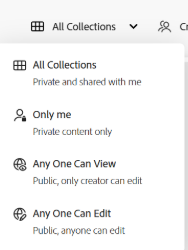

**Filter by collection creator**

To filter the collections view based on who created each collection, go to the **[!DNL Collections]** tab and navigate to one of the following options:

* **[!UICONTROL Created by anyone]:** This filter restricts the view to collections created by any user. Use this when you want to see collections regardless of their creator.
* **[!UICONTROL Created by me]:** This filter restricts the view to collections created by you. Use this to isolate only the collections you personally created.

    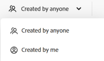

<!--
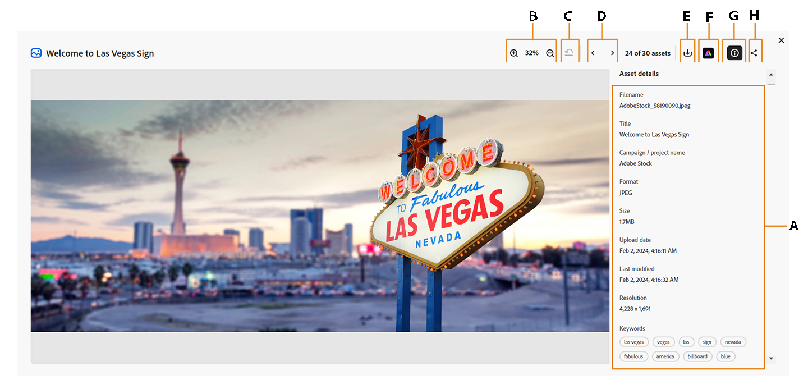

* **A**: Details and metadata of the asset 
* **B**: Zoom In or Zoom Out the asset 
* **C**: Reset Zoom view 
* **D**: View the previous or next asset 
* **E**: Download the asset 
* **F**: Open the asset in Adobe Express 
* **G**: Hide the metadata of the asset 
* **H**: Share the asset as a link 
-->

## Download assets available within a collection{#download-assets-within-collection}

[!DNL Content Hub] provides two methods to download assets stored within a collection: downloading the **entire collection at once** or downloading **individual assets** selectively. Choose the method that matches whether you need the complete set or only specific files.

### Download the entire collection

To download all assets available within a collection, navigate to the **[!UICONTROL Collections]** tab.
Click the  icon on the collection card.

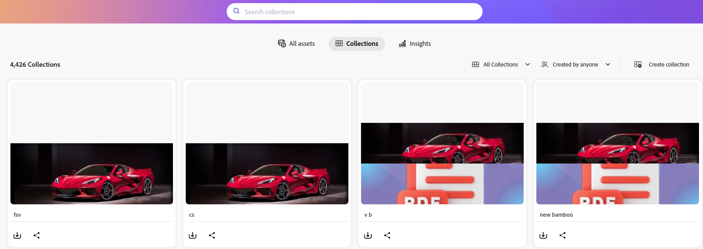

This downloads every asset in the collection in a single action, making it the fastest method when you need the complete set of files at once.

### Download individual assets from a collection

Open the collection to download specific assets individually. Unlike the bulk download method, this approach lets you select only the files you need:

1. Click the collection containing the assets that you need to download.
2. Select the assets you want to download.
3. Click **[!UICONTROL Download]**.

The selected assets are downloaded, giving you control over exactly which files are retrieved.

Learn how to [download an asset from the [!DNL Content Hub]](download-assets-content-hub.md).

## Share assets available within a collection {#share-assets-available-within-collection}

You can share the assets available within a collection directly from the collection view. Before sharing, **enable public link sharing in [!DNL Content Hub]** (see [Configure [!DNL Content Hub] UI options](configure-content-hub-ui-options.md#configure-collections-content-hub)).

To share an asset from within a collection, follow these steps:

1. Navigate to the **[!UICONTROL Collections]** tab.
2. Select the  icon on the asset card.
3. [!DNL Content Hub] copies the share link automatically.
4. Share the copied link with the intended recipient.

Learn more about [sharing assets in the [!DNL Content Hub]](share-assets-content-hub.md).

### Governance and Access Control for Shared Assets

**[!DNL Content Hub] [!DNL Collections]** provides comprehensive governance tools for effective asset management, including **customizable sharing permissions** and collaboration features that let teams control exactly who can view or modify shared assets. These permissions range from **read-only access** to **full administrative control**, supporting fine-grained governance over how assets are distributed across users and teams.

When sharing an asset—either individually or as part of a collection—the scope of access is determined by, and inherited from, the collection's current access level assigned to the user. As a result, a recipient can only access an asset within the boundaries the collection's access level already permits, ensuring that sharing never grants broader access than the collection itself allows.

You cannot share a private collection. Private collections are excluded from sharing to preserve the confidentiality of their assets, so any content you intend to distribute must reside in a collection with public link sharing enabled.

## Edit details of a collection {#edit-details-of-collection}

You can update a collection's **[!UICONTROL Title]**, **[!UICONTROL Description]**, and—depending on your configuration—its access settings from the **[!UICONTROL Collection Details]** screen. These edits let you rename a collection, refine its description for clarity, and control who can view or work with it.

To edit the details of a collection, follow these steps:

1. Click the collection name to open it.

    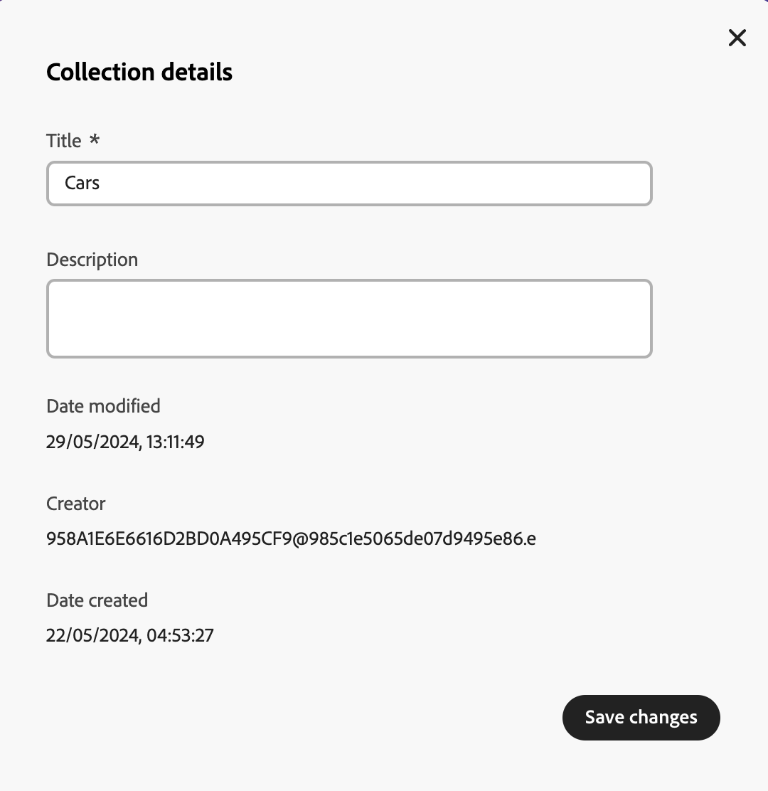

2. Click the  icon. The **[!UICONTROL Collection Details]** screen appears, allowing you to edit the **[!UICONTROL Title]** and **[!UICONTROL Description]** of the collection.
3. Update the **[!UICONTROL Title]** and **[!UICONTROL Description]** fields as needed.
4. Click **[!UICONTROL Save Changes]** to confirm the modifications. This applies and persists your edits so the updated Title and Description take effect immediately.

Moreover, you can update the access to the collection through the **Edit Collection** dialog. The access options available in this dialog depend on the configuration—that is, on how your account or administrator has set up permissions for the collection. This ensures that access-related edits are governed by the applicable configuration settings.

## Remove assets from a collection{#remove-assets-from-a-collection}

**Administrators, collection owners, and non-admin users with edit rights** can remove single or multiple assets from a collection.

### Who can remove assets

The following users have permission to remove one or more assets from a collection:

* **An administrator**
* **An owner of the collection**
* **A non-admin user with edit rights**

### Steps to remove assets from a collection

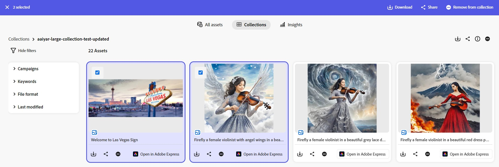

To remove assets from a collection, complete these steps:

1. **Open the collection** from which you want to remove assets by clicking it.
2. **Select the assets** you want to remove.
3. Click **[!UICONTROL Remove from collection]**.
4. A confirmation prompt appears asking you to confirm the asset removal. This confirmation step prevents accidental removal of assets.
5. Click **[!UICONTROL Remove]** to complete the action.

The selected assets are removed from the collection successfully. Removing assets from a collection does not delete the underlying assets from the repository; it only removes them from that specific collection, so the original files remain available elsewhere.

## Delete a collection{#delete-collection}

Only **administrators** and the **collection creator** can delete a collection. This permission is deliberately restricted to these roles to prevent accidental or unauthorized data loss, since deleting a collection is a significant action that removes it from the workspace.

To delete a collection, follow these steps:

1. Navigate to the **[!UICONTROL Collections]** tab.
2. Click the collection that you need to delete.
3. Click the  icon to delete the collection.

Deleting a collection is permanent, so administrators and creators should confirm the correct collection is selected before proceeding. If a confirmation prompt appears, complete it to finalize the deletion and remove the collection from the [!DNL Collections] tab.

## Pin or Unpin collection {#pin-unpin-collection}

**[!DNL Content Hub] Administrators can pin collections** in [!DNL Content Hub] to keep frequently used collections within immediate reach. Pinned collections are displayed in a dedicated **Pinned** section at the top of the [!DNL Collections] home page, which separates high-priority collections from the rest of the library and reduces the time spent searching for them. This is especially useful when an administrator returns to the same collections repeatedly, because pinning surfaces those collections first rather than requiring a manual search each time. Administrators can pin or unpin a collection at any time by executing the steps below.

**To pin a collection for quick access:**

1. Browse to the collection which you want to pin.

1. Click **[!UICONTROL More actions]**  and select **[!UICONTROL Pin to quick access]**. A confirmation box appears.

    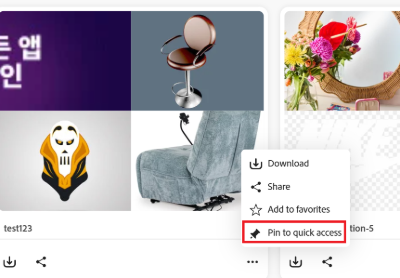

1. Click **[!UICONTROL Pin]** to confirm. When you pin a private collection, a warning message appears, so review the message before confirming to ensure the correct collection is being pinned.

    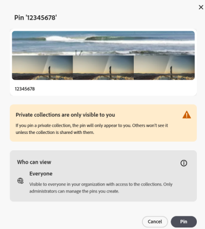

    As a result, the pinned collections appear at the top of the [!DNL Collections] home page, ensuring quick access on every visit.

    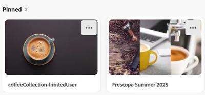

**To unpin a collection:**

Click **[!UICONTROL More actions]**  and select **[!UICONTROL Unpin]**. This removes the collection from the Pinned section and returns it to its standard position in the [!DNL Collections] library.

## Mark [!DNL Collections] as Favorite {#favorite-collection}

Marking [!DNL Collections] as Favorite in [!DNL Content Hub] lets you organize and retrieve them quickly, reducing the time spent navigating between multiple [!DNL Collections]. Once a Collection is marked as a Favorite, it appears directly in the **[!UICONTROL Favorites]** tab on the [!DNL Content Hub] home page, so frequently used [!DNL Collections] stay within immediate reach. You can also search assets within Favorite [!DNL Collections], which streamlines asset discovery by narrowing results to the [!DNL Collections] you rely on most. To mark [!DNL Collections] as Favorites, follow these steps:

1. Browse to the [!DNL Collections] you want to mark as Favorites.

1. Click **[!UICONTROL More actions]**  and select **[!UICONTROL Add to Favorites]** to mark the Collection as a Favorite.

    ![Mark [!DNL Collections] as Favorite](assets/mark-favorite-collection.png)

    [!DNL Collections] marked as Favorites now display under the **[!UICONTROL My Favorites]** tab. To remove a Collection from **[!UICONTROL My Favorites]**, click **[!UICONTROL More actions]**  and select **[!UICONTROL Remove from Favorites]**.

    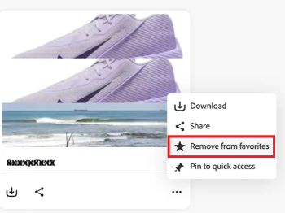

## Frequently asked questions {#faqs-manage-collections-content-hub}

### What do you refer to as collections in AEM Assets [!DNL Content Hub]?

A **collection** in Adobe Experience Manager (AEM) Assets [!DNL Content Hub] is a curated set of digital assets grouped together so they can be shared among users. [!DNL Collections] establish a **shared workspace** that lets teams efficiently locate, organize, and reuse content across a project or brand. In the broader context of digital asset management, collections function much like flexible folders or playlists — a way to assemble related content without moving or copying the underlying files.

#### Key Characteristics of [!DNL Collections]

- **Shareable across users** — a collection acts as a common access point, so multiple team members can view and work with the same grouped assets.
- **Assets from different locations** — a single collection can pull together assets stored in separate locations within the repository, uniting scattered content under one heading.
- **Referential integrity preserved** — collections reference the original assets rather than duplicating them, so each item stays linked to its source of truth. This ensures that updates to an original asset remain reflected, and it avoids the storage overhead and version confusion that duplication would cause.

#### Why [!DNL Collections] Matter

[!DNL Collections] streamline collaboration by giving users a single, organized space to access and utilize content. Because they consolidate assets from multiple locations while maintaining their referential integrity, collections support practical workflows such as assembling assets for a specific campaign, sharing a curated set with reviewers or stakeholders, and grouping frequently used materials for quick reuse. The result is faster content discovery and more consistent asset usage across teams working within AEM Assets [!DNL Content Hub].

### How can I create a new collection in AEM Assets [!DNL Content Hub]?

Creating a new collection in **Adobe Experience Manager (AEM) Assets [!DNL Content Hub]** is a straightforward process carried out within the **[!DNL Collections]** tab. A collection groups related digital assets together, making them easier to organize, locate, and share across teams.

#### Steps to create a collection

1. Go to the **[!DNL Collections]** tab.
2. Click **Create Collection**.
3. In the new Collection window, add a **Title** and a **Description**.
4. Select the access control type under the **Who can access** dropdown list. This setting determines who can view and collaborate on the collection, so choose the option that matches your intended sharing and permission needs.
5. Click **Create**.

Once the collection is created, add assets to the collection to begin populating it. This allows you to keep related assets grouped in a single, manageable location for streamlined access and reuse.

### What types of access control are available when creating a collection in AEM Assets [!DNL Content Hub]?

Adobe Experience Manager (AEM) Assets [!DNL Content Hub] provides **three access control types** when creating a collection, each defining who can view and who can edit the collection's contents. Selecting the correct access level ensures that assets are shared appropriately while protecting content from unauthorized changes.

The three access control types are:

1. **Private** — Only the creator and administrators can access and edit the collection. This is the most restrictive option, ensuring sensitive or in-progress assets remain visible only to authorized owners and administrators.

2. **Public — View only** — Everyone can view the collection, but only the creator and administrators can edit it. This setting is used to share assets broadly while keeping editing rights limited, so the collection's contents cannot be altered by general viewers.

3. **Public — View and edit** — Everyone can access and edit the collection without restrictions. This is the most open option, enabling full collaboration where any user can both view and modify the collection.

In summary, the access control types range from the most restrictive (**Private**) to the most open (**Public — View and edit**), with **Public — View only** offering a middle option that permits broad viewing while reserving editing rights for the creator and administrators.

### Who can perform actions on collections in AEM Assets [!DNL Content Hub]?

Both standard users and **administrators** can perform actions on **collections** in **Adobe Experience Manager (AEM) Assets [!DNL Content Hub]**, with administrators holding an expanded set of privileges beyond those available to standard users.

#### Actions Available to Standard Users

Standard Adobe Experience Manager (AEM) Assets [!DNL Content Hub] users can perform the following actions on **collections**:

- **Creating** new collections
- **Viewing** existing collections
- **Sharing** collections with others
- **Downloading** collections
- **Removing** items from collections
- **Deleting** collections
- **Pinning** collections
- **Marking** collections as **favorites**

These capabilities allow users to organize, access, and distribute grouped assets efficiently within the platform.

#### Additional Administrator Privileges

Unlike standard users, **Administrators** hold additional privileges over collections. In addition to all standard user actions, administrators can:

- **View all access options** for collections
- **Delete** collections

This elevated access enables administrators to manage collection permissions and oversee content governance across the AEM Assets [!DNL Content Hub] environment.

### How do I add assets to an existing collection in AEM Assets [!DNL Content Hub]?

To add assets to an existing collection in **Adobe Experience Manager (AEM) Assets [!DNL Content Hub]**, select the assets, click **Add to collection**, choose the target collection, and confirm. [!DNL Collections] group related assets so teams can locate, reuse, and distribute approved content efficiently, which makes adding assets to the correct collection a core organizational task in [!DNL Content Hub].

**Steps to add assets to an existing collection:**

1. **Select the assets** you want to add.
2. Click **Add to collection**.
3. **Choose the collection** from the list of existing collections.
4. **Search for the collection** using the search bar if you have many collections and need to find a specific one quickly.
5. Click **Add to collection** again to confirm the action.

The search bar locates any existing collection by name, so you can add assets to the intended collection without scrolling through the full list. Because collections act as curated groupings of approved assets, adding assets to the right collection ensures the content remains discoverable and available for reuse across your organization.

### Can collections be filtered and searched in AEM Assets [!DNL Content Hub]?

**See also**

* [Translate Assets](/help/assets/translate-assets.md)
* [Assets HTTP API](/help/assets/mac-api-assets.md)
* [Assets supported file formats](/help/assets/file-format-support.md)
* [Search assets](/help/assets/search-assets.md)
* [Connected assets](/help/assets/use-assets-across-connected-assets-instances.md)
* [Asset reports](/help/assets/asset-reports.md)
* [Metadata schemas](/help/assets/metadata-schemas.md)
* [Download assets](/help/assets/download-assets-from-aem.md)
* [Manage metadata](/help/assets/manage-metadata.md)
* [Manage Dynamic Media templates](/help/assets/dynamic-media/manage-dynamic-media-templates.md)
* [Manage reports in Assets view](/help/assets/manage-reports-assets-view.md)
* [Search facets](/help/assets/search-facets.md)
* [Manage collections](/help/assets/manage-collections.md)
* [Bulk metadata import](/help/assets/metadata-import-export.md)
* [Publish Assets to AEM and Dynamic Media](/help/assets/publish-assets-to-aem-and-dm.md)
