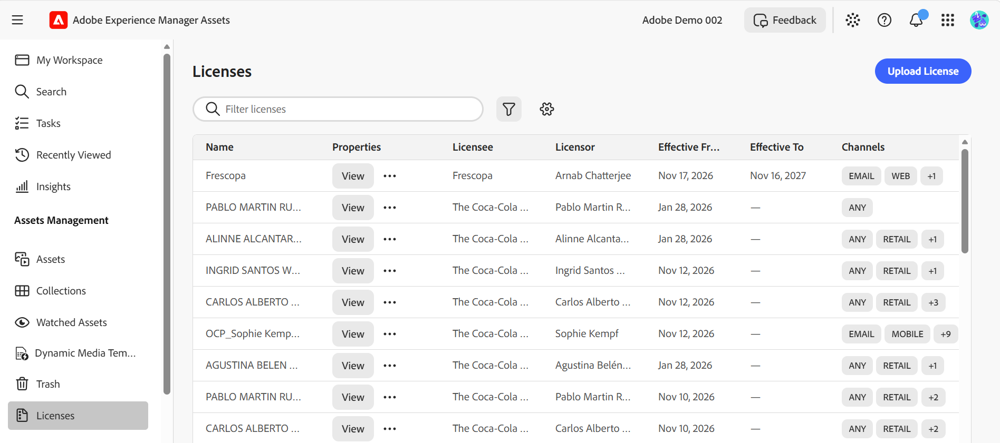
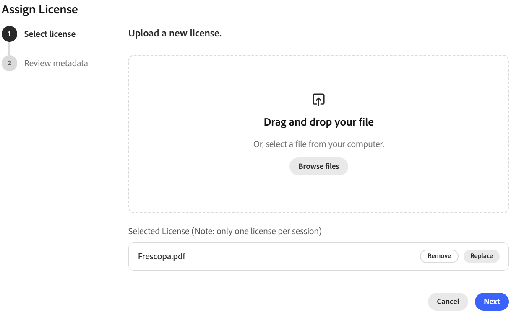
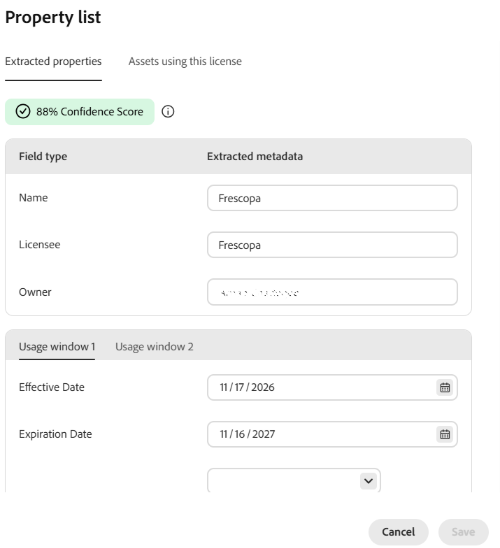
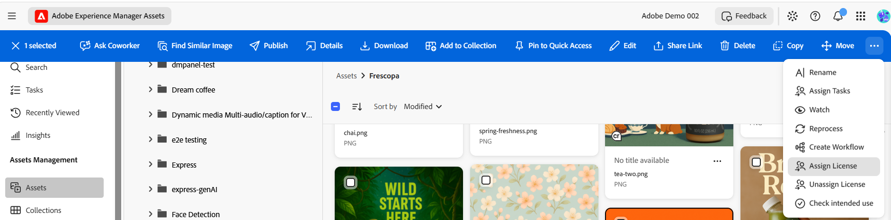
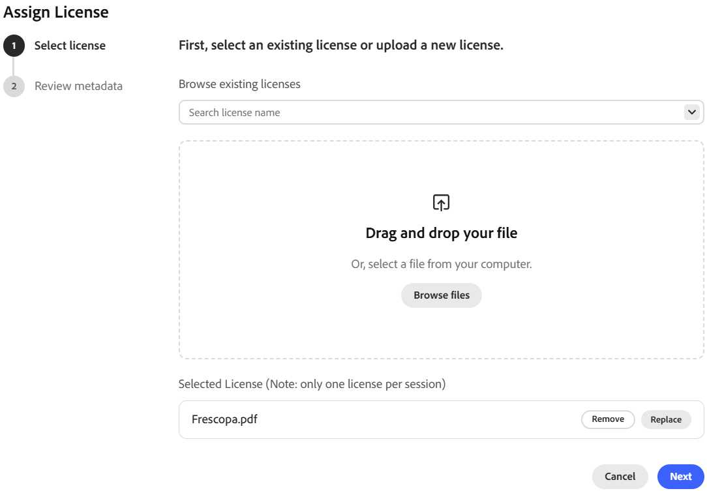
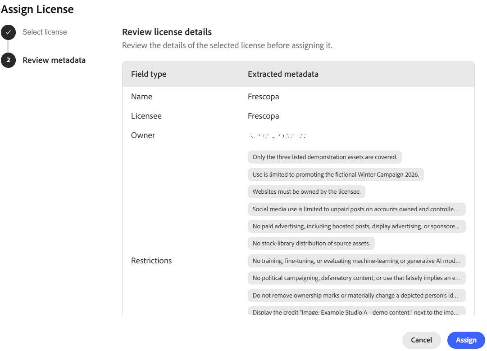
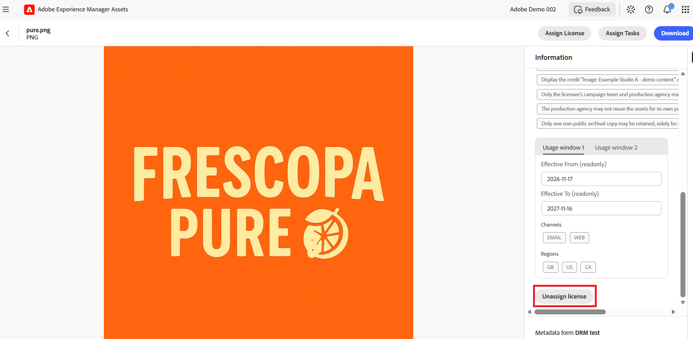
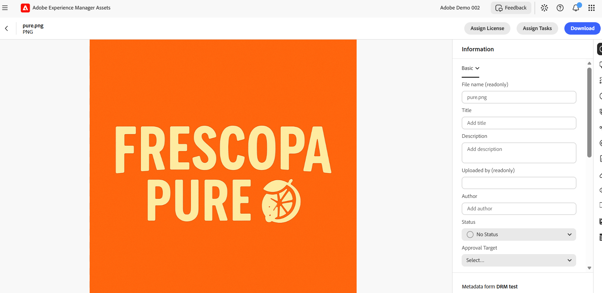
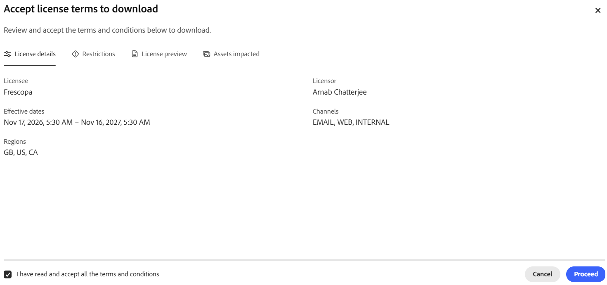

# Digital Rights Management for digital assets {#digital-rights-management-in-assets}

The Digital Rights Management (DRM) Service in Adobe Experience Manager Assets view uses artificial intelligence to extract usage-rights information from license documents and fill the metadata fields in assets. You can review the extracted information, save it as a reusable license record, and assign that license to one or more assets. License records are managed separately from assets. You can build a library of licenses before uploading assets, or assign existing licenses to assets. When you update a license, such as changing its expiration date, the change applies to all the assets associated with that license.

An asset can have multiple licenses assigned to it. Before downloading a licensed asset, you need to review the restrictions and accept the applicable license terms.

## Upload a license {#upload-and-review-license}

You can create a usage-rights record document from a license or usage-rights document. AI extracts the information from the document, but you need to review the information before saving it.

* In **[!UICONTROL Licenses]**, click **[!UICONTROL Upload license]**. This is shown in the figure below.
   
* The **[!UICONTROL Assign License]** window appears. Upload the source usage-rights document and click **[!UICONTROL Next]**.
   
* Enter a name for the license.
* Review the extracted usage-rights information including the usage dates, regions, channels, and restrictions.
* Click **[!UICONTROL Apply and Save]**.

The newly created license is now displayed in the license list.

>[!NOTE]
> 
>Creating a license is different from assigning it to assets. For example, you can create a license with its allowed regions, channels, and expiration date. You can then assign the same license to each asset rather than creating for every asset.

## View license {#view-license}

You can view the saved license under **[!UICONTROL Licenses]**. Use it to find a license, review its usage rights, and view the assets associated with it.

To view a particular license, click **[!UICONTROL View]**. In the **[!UICONTROL Property list]** window, you can review and update the license details, including the expiration date from the **[!UICONTROL Extracted properties]** tab and view the list of assets using that particular license from the **[!UICONTROL Assets using this license]** tab. 

## Assign licenses to assets {#assign-licenses}

You can assign an existing license to an asset, or upload a new license document while assigning.

* Select the asset and click . Click **[!UICONTROL Assign License]**.

Alternatively, you can open the asset details page and assign a license by clicking **[!UICONTROL Assign license]**.
* The **[!UICONTROL Assign license]** window appears. Choose an existing license from the list. Alternatively, you can upload a new license document to create a new license.

* Select **[!UICONTROL Next]** and review the metadata information.

* Click **[!UICONTROL Assign]**.
 
## Remove licenses {#remove-licenses}

An asset can have more than one license. To unassign license from an asset, follow the below steps:

* Open the asset details page. 
* If multiple licenses are assigned to an asset, click the **[!UICONTROL License]** drop-down and review each license and its restrictions.
* To remove a license, click **[!UICONTROL Unassign license]** > **[!UICONTROL Unassign]**.  

Alternatively, you can unassign a license by selecting the asset. Click  > **[!UICONTROL Unassign License]**.

## Download assets with license {#download-licensed-assets}

You can download an asset that has license. Downloading an asset requires you to review and accept the applicable license terms.

* Select the licensed asset and click  to start the download. 

Alternatively you can open the asset details page and click **[!UICONTROL Download]**.

* Review the license details information and restrictions.
* Select the **[!UICONTROL I have read and accept all the terms and conditions]** check box and click **[!UICONTROL Proceed]**.

* Click **[!UICONTROL Ok]** to procced with the download.

**See also**

* [Translate [!DNL Assets]](/help/assets/translate-assets.md)
* [Assets HTTP API](/help/assets/mac-api-assets.md)
* [Assets supported file formats](/help/assets/file-format-support.md)
* [Search assets](/help/assets/search-assets.md)
* [Connected assets](/help/assets/use-assets-across-connected-assets-instances.md)
* [Asset reports](/help/assets/asset-reports.md)
* [Metadata schemas](/help/assets/metadata-schemas.md)
* [Download assets](/help/assets/download-assets-from-aem.md)
* [Manage metadata](/help/assets/manage-metadata.md)
* [Manage Dynamic Media templates](/help/assets/dynamic-media/manage-dynamic-media-templates.md)
* [Manage reports in [!DNL Assets] view](/help/assets/manage-reports-assets-view.md)
* [Search facets](/help/assets/search-facets.md)
* [Manage collections](/help/assets/manage-collections.md)
* [Bulk metadata import](/help/assets/metadata-import-export.md)
* [Publish [!DNL Assets] to AEM and Dynamic Media](/help/assets/publish-assets-to-aem-and-dm.md)
