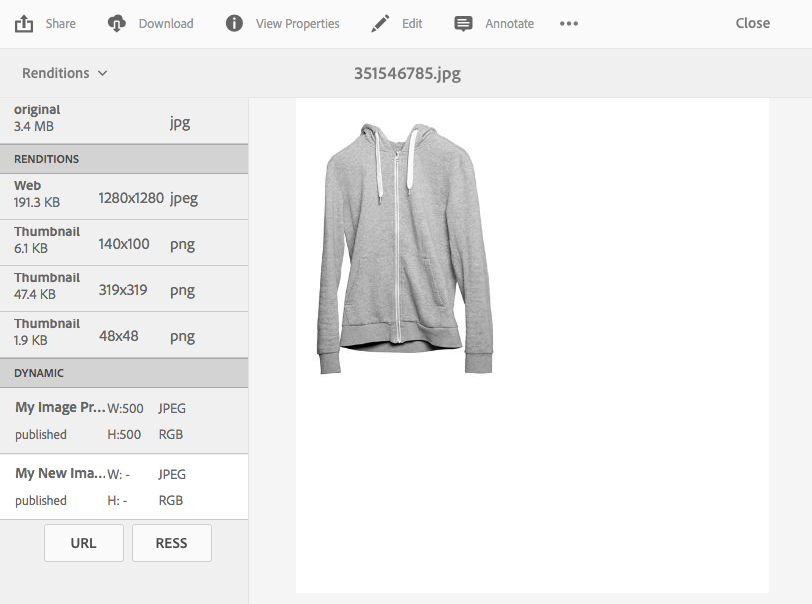

# Apply Dynamic Media Image Presets {#applying-image-presets}

Image Presets enable assets to dynamically deliver images at different sizes, in different formats, or with other image properties there are generated dynamically. You can choose a preset when you export to reformat images to specifications that your administrator has outlined.

In addition, you can choose an image preset that is responsive (designated by the **[!UICONTROL RESS]** button after you select it).

[Administrators can create and configure image presets](managing-image-presets.md).

>[!NOTE]
>
>Smart imaging works with your existing image presets. It uses intelligence at the last millisecond of delivery to further reduce image file size based on browser or network connection speed. See [Smart Imaging](imaging-faq.md) for more information.

You can apply an image preset to an image anytime you preview it.

**To apply Dynamic Media Image Presets:**

1. Open the asset and in the left rail, select the drop-down list, then select **[!UICONTROL Renditions]**.

   >[!NOTE]
   >
   >* Static renditions appear in the top half ofthepane. Dynamic renditions appear in the lower half. With dynamic renditions only, you can use the URL to display the image. The **[!UICONTROL URL]** button only appears if you select a dynamic rendition. The **[!UICONTROL RESS]** button only appears if you select a responsive image preset.
   >
   >* The system shows numerous renditions when you select **[!UICONTROL Renditions]** in an asset's Detail view. You can increase the number of presets seen. See [Increasing the number of image presets that display](managing-image-presets.md#increasing-or-decreasing-the-number-of-image-presets-that-display).

   

1. Do any of the following:

    * To preview the image preset, select a dynamic rendition.
    * To display the pop-up window, select **[!UICONTROL URL]**, **[!UICONTROL Embed]**, or **[!UICONTROL RESS]**.

   >[!NOTE]
   >
   >If the asset *and* the image preset are not yet published, the **[!UICONTROL URL]** button (or URL and RESS buttons, if applicable) is not available.
   >
   >Note also that image presets are automatically published on a Dynamic Media S7 server.

## Delivery mechanism and URL format {#delivery-mechanism-and-URL-format}

Adobe Experience Manager (AEM) as a cloud service generates more than one image or asset URL format for the same asset, depending on which delivery mechanism produced it. These formats are not interchangeable and are each tied to specific consuming channels.

| Delivery mechanism       | URL pattern   | Typical consuming channels |
|---------------------|----------------|-----------------|
| Dynamic Media with OpenAPI  | **[!UICONTROL /adobe/assets/...]** | AEM Assets UI, custom components using the Delivery API. |
| Web-Optimized Image Delivery | **[!UICONTROL /adobe/dynamicmedia/deliver/...]** | GraphQL, custom components not using the OpenAPI Delivery API. |
| Dynamic Media Classic (Scene7) viewer or embed URLs | Scene7 hosted viewer or player page URLs. | Direct embedding through viewer or embed code. It is not a raw file reference. |

Seeing different URL formats returned for the same logical asset across different integration points (for example, Page Editor versus Content Fragment Editor versus GraphQL) is expected, documented behavior driven by which mechanism served the request; it is not a defect or misconfiguration. GraphQL does not currently return OpenAPI (**[!UICONTROL /adobe/assets/]**) URLs. To standardize on a single URL format across all channels, the channels that does not natively produce it, for example, GraphQL need their own integration pattern to construct or substitute the desired format, since there is no built-in automatic standardization.

Separately, Dynamic Media (Scene7) delivery URLs are generated from internal asset IDs, not from the AEM or DAM folder path. Two different Dynamic Media accounts can therefore produce differently shaped URLs (for example, one shorter or folderless, one with a path-like structure) for assets that live in comparable folder structures in AEM. This is intentional, so that published URLs remain stable even if an asset is later moved within AEM, and is not something a ruleset change alters.

## Viewer URLs versus direct file URLs {#viewer-URLs-direct-file-URLs}

A Dynamic Media (Scene7) viewer or player URL, for example, an HTML5 video viewer page is a hosted page, not a direct link to a media file, and it does not end in a recognized file extension. Systems that validate URLs by file extension, for example, Adobe ACOM's video field validation, which only accepts direct file URLs ending in *.mp4*, *.webm*, *.ogv*, or recognized YouTube and Vimeo links reject a Dynamic Media viewer URL even though it plays correctly in a browser. To supply a URL to such a system, retrieve the direct rendition URL for the desired video file or rendition from Dynamic Media Classic (not the viewer or player embed URL) and use that instead.

## Determining real-time publish or exists state through URL or API is unreliable for some checks {#determining-real-time-publish-or-exists-state}

The **[!UICONTROL /is/image]** endpoint's lightweight query parameters (**[!UICONTROL ?req=exists]**, **[!UICONTROL ?req=props]**) only confirm that a catalog record exists in Dynamic Media; they do not reflect the asset's actual current publish or unpublish state. Because of CDN caching and asynchronous publish jobs, an asset can continue to be served successfully for a period after being unpublished, and the Dynamic Media Classic **[!UICONTROL published]** indicator or timestamp also lags behind the true state. To reliably determine publish status, use one of:

* The **[!UICONTROL dam:scene7FileStatus]** metadata property on the asset in AEM.
* The Dynamic Media IPS (Scene7) SOAP API, querying **[!UICONTROL publishState]** directly.
* HTTP status codes returned by the actual Dynamic Media delivery URL itself, rather than the lightweight catalog-check endpoints.

## CDN and caching behavior for Dynamic Media asset URLs {#CDN-and-caching-behavior}

* Dynamic Media (Scene7) asset requests are routed directly from the browser to Adobe's own managed CDN, that is, Akamai and bypass any customer-configured CDN layer (for example, TATA CDN, Fastly, Cloudflare) sitting in front of the rest of the site. This is architectural, not a misconfiguration to fix on the customer's CDN.
* Dynamic Media sets cache lifetime using the **[!UICONTROL Expires]** header, not **[!UICONTROL Cache-Control: max-age]**. A downstream CDN or performance tool that only inspects Cache-Control may report no caching even though Akamai is actively caching the asset that is visible through an Akamai-Cache-Status **[!UICONTROL Hit response]** header with a TTL on the order of nearly 12 hours by default. If a customer-managed CDN in front of Dynamic Media needs to cache these assets, configure it to respect the **[!UICONTROL Expires]** header, or set a fixed Edge TTL explicitly.
* Unexpected white space around an image delivered with **[!UICONTROL dpr]** and **[!UICONTROL wid/hei]** parameters (particularly **[!UICONTROL dpr=1]**) occurs when the requested dimensions exceed the original asset's dimensions and upscaling is not enabled. Dynamic Media pads rather than stretches by default. Add **[!UICONTROL fit=fit.1]** to allow upscaling to fill the requested dimensions, or **[!UICONTROL fit=constrain]** to keep the image at its natural size without padding or stretching.
* For legacy Scene7 cache header configuration, see [Cache-Control and CDN/Dispatcher caching configuration issues in AEM](https://experienceleague.adobe.com/en/docs/experience-cloud-kcs/kbarticles/ka-36981).

## Dynamic Media is independent of Adobe Commerce {#dynamic-media-is-independent}

Dynamic Media is not exclusive or specific to Adobe Commerce, it is a general-purpose optimized delivery layer for AEM Assets (on-the-fly transformations, CDN delivery, video streaming) that can be used by any consumer of AEM Assets, including Commerce, Sites, or headless/authoring-only use cases. If Dynamic Media delivery URLs are used anywhere in an implementation, Dynamic Media remains a required dependency regardless of whether Commerce is also a part of the architecture. Removing Commerce does not remove the need for Dynamic Media if its URLs or features are in use elsewhere.