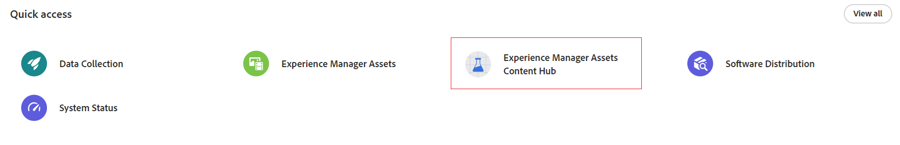

# Enable UI extensibility in [!DNL Content Hub] {#content-hub-ui-extensibility}

[!DNL Content Hub] supports UI extensibility, enabling organizations to integrate custom business workflows directly into the Content Hub experience. Using Adobe App Builder, developers can add custom panels that enable users to perform business-specific actions without leaving Content Hub.

You can add custom extensions to the **Asset Details** page. The added extension appears as a dedicated panel where users can perform custom workflows on the selected asset.

>[!IMPORTANT]
>
>* Adobe App Builder is required to build and deploy UI extensions for Content Hub.
>* You can provide documentation feedback by expanding **[!UICONTROL Detailed Feedback options]** and selecting **[!UICONTROL Report an issue]**.

## Access Content Hub {#access-content-hub}

Follow the steps shown in the following image to access [!DNL Content Hub].

## View UI extensions in [!DNL Content Hub] {#view-ui-extensions}

Within [!DNL Content Hub], open an asset and navigate to the **[!UICONTROL Asset Details]** page. If a UI extension is installed and configured, it appears as a dedicated panel within the Asset Details interface.

## Prerequisites for adding the extensibility component {#content-hub-prerequisites}

Fulfil the following requirements before building UI extensions for [!DNL Content Hub]:

* Access to [!DNL Content Hub].
* Access to Adobe App Builder.
* Entitlement to Developer or System Administrator role within the organization.
* Adobe I/O command line tool (AIO CLI) installed on your local machine. This tool is essential for creating and deploying extension projects.
* Good understanding of JavaScript, Node.js, and React technologies.

## Add the UI extensibility component to [!DNL Content Hub] {#add-ui-extensibility-content-hub}

1. See **Getting Started** for an introduction to Adobe App Builder and the UI extensibility framework.

1. See **Guides** for information about local environment setup, local preview, publishing, and extension management.

1. See **Common concepts** to understand the fundamentals required to build UI extensions for Content Hub.

1. Add a custom panel to the **Asset Details** page. The custom panel enables users to perform business-specific actions directly within Content Hub. For implementation details, API references, code examples, and extension architecture, see the developer documentation.

1. Set up your local development environment and build your first Content Hub extension using Adobe App Builder.

1. Deploy the extension to your target workspace and verify that it is available within Content Hub.

## Extend business workflows in Content Hub {#extend-business-workflows}

UI extensibility enables organizations to bring business workflows directly into Content Hub. Instead of switching between multiple applications, users can complete workflow-specific actions while working with assets.

For example, organizations can implement an **Extend Expiry** workflow that enables users to request an extension for assets approaching expiration. Users submit the request from the extension panel, while the configured backend processes the request and routes it through the organization's workflow.

After the request is submitted, Content Hub displays a confirmation message.

>[!NOTE]
>
>For implementation details, including architecture, APIs, local development, deployment, and troubleshooting, see the Content Hub UI extensibility developer documentation.