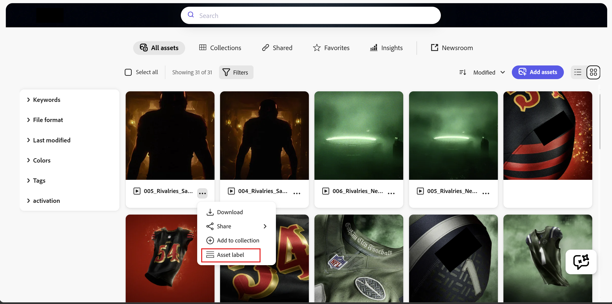
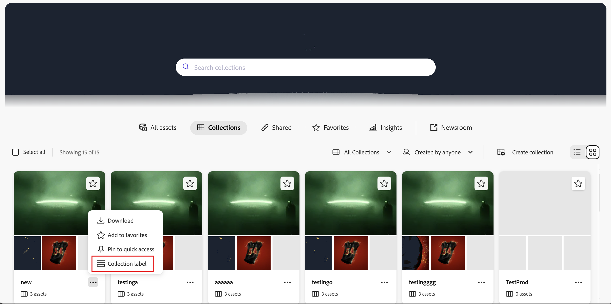
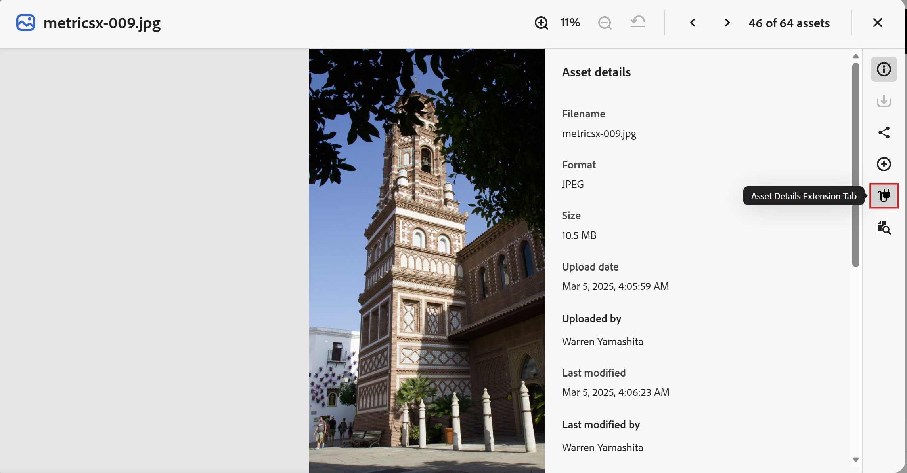
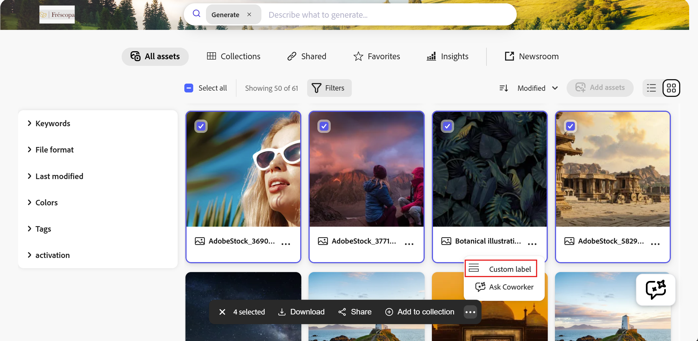
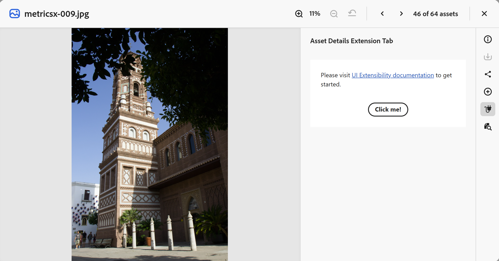
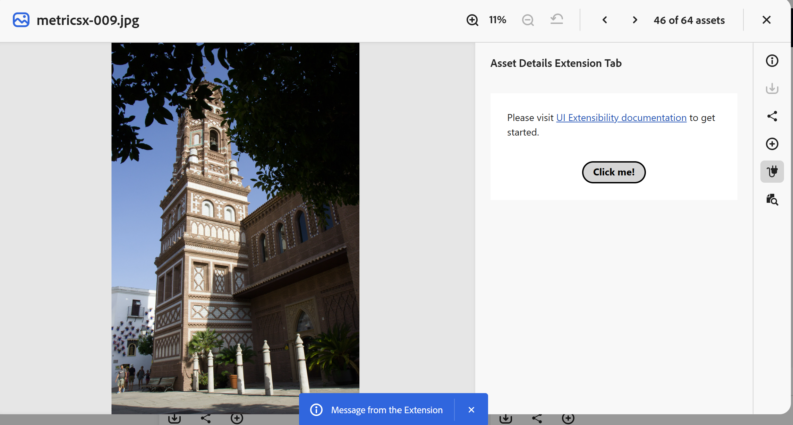

# Enable UI extensibility in [!DNL Content Hub] {#content-hub-ui-extensibility}

[!DNL Content Hub] supports UI extensibility, enabling organizations to integrate custom business workflows directly into the Content Hub experience. Using Adobe App Builder, developers can add custom UI components that enable users to perform business-specific actions without leaving Content Hub.

You can add custom extensions to different areas of the [!DNL Content Hub] interface. [!DNL Content Hub] supports the following extension points:

* **Asset Card**
* **Collection Card**
* **Asset Details**
* **Bulk Action Bar**

>[!IMPORTANT]
>
>* Adobe App Builder is required to build and deploy UI extensions for Content Hub.
>* [!DNL Content Hub] UI extensibility is currently available under **Limited Availability**. To enable this capability, contact the Content Hub team and request access to the feature and the related technical documentation.
>* You can provide documentation feedback by expanding **[!UICONTROL Detailed Feedback options]** and selecting **[!UICONTROL Report an issue]**.

## View UI extensions in [!DNL Content Hub] {#view-ui-extensions}

Within [!DNL Content Hub], UI extensions can be added to the following extension points.

### Asset Card

Open the **[!UICONTROL More]** menu on an asset card and select **[!UICONTROL Asset label]** to open the custom dialog.

The custom dialog displays the resource type and resource ID for the selected asset.

### Collection Card

Open the **[!UICONTROL More]** menu on a collection card and select **[!UICONTROL Collection label]** to open the UI extension.

### Asset Details

Open an asset and navigate to the Asset Details page. Select the **Asset Details Extension Tab** icon to open the UI extension.

### Bulk Action Bar

Select one or more assets to display the **Bulk Action Bar**. Select **[!UICONTROL Custom label]** to open the custom dialog.

The custom dialog displays the selected asset or assets and their resource IDs.

## Prerequisites for adding the extensibility component {#content-hub-prerequisites}

Fulfil the following requirements before building UI extensions for [!DNL Content Hub]:

* Access to [!DNL Content Hub].
* Access to Adobe App Builder.
* Entitlement to Developer or System Administrator role within the organization.
* Adobe I/O command line tool (AIO CLI) installed on your local machine. This tool is essential for creating and deploying extension projects.
* Good understanding of JavaScript, Node.js, and React technologies.

## Add the UI extensibility component to [!DNL Content Hub] {#add-ui-extensibility-content-hub}

>[!IMPORTANT]
>
>Detailed technical documentation for [!DNL Content Hub] UI extensibility is currently available through the Content Hub team because the capability is under **Limited Availability**. Contact the Content Hub team to request access to the documentation.

## Extend business workflows in Content Hub {#extend-business-workflows}

UI extensibility enables organizations to bring business workflows directly into Content Hub. Instead of switching between multiple applications, users can complete workflow-specific actions while working with assets.

For example, organizations can implement an **Extend Expiry** workflow that enables users to request an extension for assets approaching expiration. Users submit the request from the extension panel, while the configured backend processes the request and routes it through the organization's workflow.

After the request is submitted, Content Hub displays a confirmation message.

