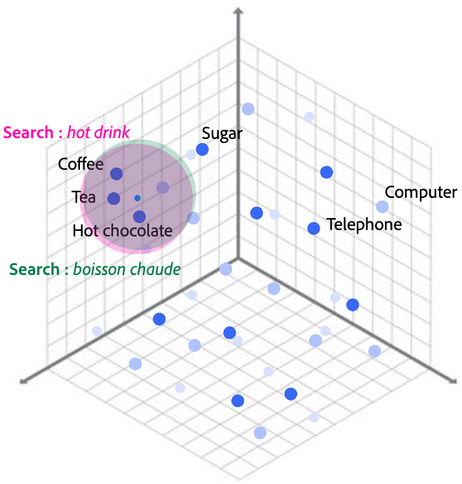
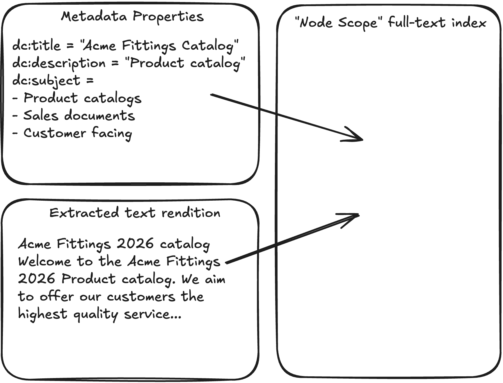

# Overview of full-text search {#overview-of-full-text-search}

When you perform a search using the **[!UICONTROL Omnisearch]** bar in Admin view or the search box in Assets view, you are performing a full-text search for assets. The filters in the search form can be used to add property restrictions (matching on specific properties such as `approved = true`, `last modified` before a specific date) and searches can contain a full-text restriction, property restrictions, or a combination of both. 

While AEM Assets provides advanced filtering options in the search form, many searches can be performed more conveniently by entering property values directly into the full-text search box. As such, it is helpful to understand the concepts used in full-text search in order to ensure that you see the expected results and have the best experience when searching for assets in AEM Assets. The underlying behaviour and configuration of AEM Assets Search and its application in both the Author Assets view and Admin view have been described here. Content Hub has slightly different characteristics. For more information, see [Search Assets in Content Hub](search-assets-content-hub.md).

The capabilities of full-text search have been recently enhanced by the addition of **AI Search**:

* When **AI Search** is disabled, full-text searches are executed as lexical searches. This involves breaking down the provided search string into individual words or tokens and matching them against the search index. This keyword-based approach relies on exact or patterned text matches, rather than semantic meaning.
* When **AI Search** is enabled, AEM executes a hybrid search which augments the lexical search with an additional vector-based semantic search. The semantic search identifies the context and ideas behind words instead of just hunting for exact word matches. This adds additional results to those returned by the lexical search, so enabling **AI Search** never decreases the number of results returned for a particular search.

Each type of search has its own benefits.

* The **lexical** search provides precise matching, and it useful when searching for assets matching specific identifiers such as SKUs or filenames. The **lexical** search is highly configurable.
* The **semantic** search is useful for handling descriptive searches, which can be matched based on concepts and meaning, rather than exact terms. For example, a search for **pretty flowers** might match an asset containing the descriptive metadata **a beautiful bunch of flowers**.
   * The characteristics mean that semantic searches typically match synonyms and is agnostic of morphological variations of words such as plurals and tenses; things which require specific index configuration to support in **lexical** search.
   * Semantic matching is multi-lingual and typically hand introduces a degree of typo tolerance.

You can perform a combination of both kinds of searches.

>[!CAUTION]
> 
>Identifier-based searches and **AI Search**
>
>If you are searching with an identifier such as a SKU or filename, you can typically expect precise results. Such searches are better suited to lexical-only execution since the sematic search might see similar SKUs or filenames as matches. When **AI Search** is enabled, if AEM detects that a search is based on an identifier rather than a descriptive string, it reverts to perform only the lexical search, ensuring that you see the expected matches.


## Optimizing semantic search results {#optimizing-semantic-search-results}

**Semantic** search is driven by an indexed set of vectors or embeddings which are generated from a subset of asset metadata fields and it describes the semantic meaning of those metadata fields in a language-agnostic way.

* **At indexing time**: A background process runs against the search index, identifying recently created or updated documents representing new or updated assets. The values of certain metadata fields are combined and passed to an embedding model to produce a language agnostic representation of the intent or meaning of the passed metadata known as embeddings.
* **At search time**: Embeddings are generated from the provided full-text search terms and AEM matches assets with similar embeddings where similarity is defined as **proximity in vector-space**. This is shown in the figure below. It shows the proximity of terms in a 3 dimensional vector space. In reality, the vector embeddings used by AEM have hundreds of dimensions.



For improved results from the semantic part of the hybrid search, ensure that the asset has good descriptive metadata, such that the generated embeddings represent the asset's content. This descriptive metadata can be in any of the 50+ languages supported by the embedding model.

### Metadata fields used to generate embeddings {#metadata-fields-used-to-generate-embeddings}

The embeddings used in the semantic part of the hybrid search are generated by passing a combination of a number of metadata fields to an embedding model. Fields which typically describe the content of an asset have been chosen and the most descriptive metadata values is used first. 

* AEM automatically generates AI-generated metadata (`autogen:title`, `autogen:description`, and `autogen:subject`) on an asset upload. This metadata is automatically used in enrichment and is very well suited to the generation of embeddings.
* Additionally, the `dc:title`, `dc:description`, and `dc:subject` metadata fields can be used to provide human curated descriptive metadata for the asset.
* As a fallback, AEM generates embeddings from the asset filename and Smart Tags.

>[!CAUTION]
> 
>Applying AI-generated metadata to existing assets
>
>Unless explicitly disabled, AI-generated metadata should be present on all the uploaded assets. Since AI-generated metadata is applied during asset processing, it is possible to apply AI-generated metadata to older assets by performing a metadata-only reprocess of those assets.
>
>This also re-executes metadata-extraction, so any metadata values included in the asset's XMP headers replaces those currently held in AEM (potentially reverting end user changes to these metadata values since the metadata was previously extracted).
>
>Contact [Adobe Customer Support](https://helpx.adobe.com/enterprise/using/support-for-experience-cloud.html) if metadata reprocessing is required for a large volume of assets (>100,000). 

### Multi-lingual search {#multi-lingual-search}

The embedding model used to generate embedddings at indexing and search time are multi-lingual. As such the semantic part of the hybrid search matches results across languages. For example, an asset containing **A cup of coffee sits on a table** in its metadata might be matched by a search for **boisson chaude**, because the embeddings generated closes in **vector space**.

Since the **AI Search** performs a hybrid of both the **lexical** and **semantic** search, it is not uncommon for a search in the same language as the metadata to return a larger result set than a search for the equivalent translated term (in a language other than that of the asset metadata). This occurs when the same language search contains some results which only appears in the **lexical** part of the **hybrid** search, since this part of the query is not multi-lingual. Ensuring that terms and concepts requried for multi-lingual search appear prominently in the asset metadata fields which are used for generating embeddings at indexing time is the best way to improve the quality of multi-lingual search.

### Typo-tolerance {#typo-tolerance}

The semantic part of the hybrid search introduces a degree of typo **o**.

## Optimizing lexical search results {#optimizing-lexical-search-results}

On both AEM Author and Publish, the lexical full-text search for assets matches the provided terms against: 

* the **node scope** full-text index - a field consisting of the combined contents of all the asset metadata properties which are marked for inclusion in the **node-scope** full-text index.
* property specific full-text indexes for any boosted properties. For more information, see [Boosting fields](#boosting-fields).



By default, a property value is included in the **node scope** full-text index if either of the following criteria are met: 

* The property sits beneath the configured aggregates in the index definition and does not have a specific property index configuration (beneath `indexRules/dam:Asset/properties` in the index definition).
* The property has a specific property index configuration, and this is also marked as `nodeScopeIndex=true` in the index definition.

### Boosting fields {#boosting-fields}

By default, AEM Assets orders full-text search results in descending order of score or relevance, effectively showing the most relevant results first. When a field is boosted, a multiplier is applied to the search score from values within that field which typically causes it to appear higher in the search results.

To allow you more control over this, AEM Assets allows matches from specific fields to be boosted in the search results. In the default, index

* `jcr:content/metadata/dam:search_promote (boost = 100.0)`
* `jcr:content/metadata/dc:title (boost = 2.0)`
* `jcr:content/jcr:title (boost = 2.0)`

A side effect of the implementation of boosting is the creation of a separate full-text index for the property that is similar to marking a property as `analyzed = true`, which is included in full-text searches against the `dam:Asset` node type (in-addition to the **node scope** full-text index). This impacts the behaviour of boolean operations in full-text search strings since the boolean operations can only be applied within the specific field in the index.

For more information on boosting properties, see [Oak Docs](https://jackrabbit.apache.org/oak/docs/query/lucene.html#boost).

### Analysis {#analysis}

By default, full-text searching in AEM Assets works by matching complete tokens which are mostly words and phrases. Similar to the commonly used internet search engines like Google, a full-text search for **car** does not return assets containing the word **carrot** in their metadata. Note that such results are returned by use of wildcards in the search term, for example, **car**. 

Within the index definition:

* The **analyzer** is responsible for converting text into indexable or searchable tokens known as tokenization and ensuring that these are normalized using the token filters into the expected format. 
* The **tokenizer** receives the stream of characters and breaks it into individual tokens.
These tokens are then passed to the **token filters** for processing; each filter changes or removes the passed token or removes it from the stream completely. 

The configured analyzer is applied:
* at indexing time to
   * all terms in the **nodescope** full-text index, including values from the metadata fields and the asset filename.
   * all terms in any property level full-text indexes that are configured through boosting or marking a field as `analyzed = true`.
* at query time to your full-text search terms. 

By default `damAssetLucene` uses `OakAnalyzer` which combines the Lucene `StandardTokenizer` with `LowerCaseFilter` and `WordDelimiterFilter`.
* `StandardTokenizer` splits words at whitespace and punctuation characters by removing them.
* `LowerCaseFilter` converts the tokens to lowercase.
* `WordDelimiterFilter` removes the English possessives. It can be configured to split tokens based on more complex rules including letter case transitions, letter-number transitions.

The default behaviour for the `damAssetLucene` index is described in the table below. 

| Input string|Tokens|Description|
|---|---|---|
| the customer's content|the, customer, content|Terms split at whitespace by `StandardTokenizer`. English possessive is removed by `WordDelimiterFilter` and normalized to lowercase by `LowerCaseFilter`.|
| Red house|red, house|Terms split at whitespace by `StandardTokenizer` and normalized to lowercase by `LowerCaseFilter`.|
| PRODUCT-AC12345_FRONT|product, ac12345, front|Terms split at whitespace and punctuation by `StandardTokenizer` and normalized to lowercase by `LowerCaseFilter`.|
| climbing shoes|climbing, shoes||

#### Multi-token searches {#multi-token-searches}

When a search term splits into more than one token, there are a number of ways in which they match against the content. By default, each of the extracted tokens must exist in the **nodescope** full-text index of the asset (logical AND operator). However you (or the code programmatically performing searches) can also apply different logic.

| Input string|Tokens|Matches|
|---|---|---|
| Red house|red, house|Assets containing both the tokens in their **nodescope** full-text index.|
| red AND house|red, house|Assets containing both the tokens in their **nodescope** full-text index.|
| red OR house|red, house|Assets containing either or both of the tokens in their **nodescope** full-text index.|
| red-house|red, house|Assets containing the term red, but not the term house in their **nodescope** full-text index.|
| red house|red, house|Assets containing the exact phrase in their **nodescope** full-text index.|

>[!NOTE]
>
>The presence of boosted fields can alter the behaviour of some operators, since each field which is boosted in the index definition is given its own full-text index, separate from the main **nodescope** full-text index.

#### Configuring Analysis {#configuring-analysis}

By default, the `damAssetLucene` index implicitly uses `OakAnalyzer` for analysis at both the query and indexing time. This offers a standard set of capabilities based on the combination of the **Standard** tokenizer with **LowerCase** and **WordDelimiter** filters.

#### Configuring Analyzer by class name {#configuring-analyzer-by-class-name}

Apache Lucene and ElasticSearch provides standard analzyer configurations for a number of languages. These contain language specific stopwords and stemmer configurations which works well for descriptive search purposes, although by default lack some of the tokenization capabilities of the **ootb** Oak analyzer.
For example, the default **EnglishAnalzyer** can be configured by specifying the following node in the root of the index definition:

```text
"analyzers": {
      "jcr:primaryType": "nt:unstructured",
        "default": {
         "jcr:primaryType": nt:unstructured",
          "class": "org.apache.lucene.analysis.en.EnglishAnalyzer"
      }
   }
```

This combines the **Standard** tokenizer with the following filters:

* `EnglishPossessiveFilter`
* `LowerCase filter`
* `English stop words filter`
* `English keywords filter`
* `English stemmer`

The behaviour of the **EnglishAnalzyer** can be contrasted with that of the strings shown in the table below.

| Input string|Tokens generated by OakAnalyer|Tokens generated by EnglishAnalzer|Description|
|---|---|---|---|
| the customer's content|the, customer, content|custom, content|**the** is removed by English stopwords. **customer's** is reduced to stem **custom**.|
| Red house|red, house|red, house|Terms split at whitespace by **StandardTokenizer** and normalized to lowercase by `LowerCaseFilter`.|
| PRODUCT-AC12345_FRONT|product, ac12345, front|product, ac12345_front|No longer tokenize on `_`, since `WordDelimiterFilter` is not part of the standard **EnglishAnalzyer**.|
| climbing shoes|climbing, shoes|climb, shoe|**climbing** is reduced to stem **climb** by English stemmer. **shoes** is reduced to stem **shoe** by English stemmer.|

The following are some of the Example classes:
* `org.apache.lucene.analysis.en.EnglishAnalyzer`
* `org.apache.lucene.analysis.fr.FrenchAnalyzer`
* `org.apache.lucene.analysis.de.GermanAnalyzer`
* `org.apache.lucene.analysis.it.ItalianAnalyzer`
* `etc`

For more details on the internal configuration of these analyzers, see [english analyzer](https://www.elastic.co/docs/reference/text-analysis/analysis-lang-analyzer#english-analyzer). 


#### Configuring Analyzer by composition {#configuring-analyzer-by-composition}

For greater flexibility, the entire analyzer configuration including both tokenizer and filters can be provided beneath a node **analyzers** in the index definition. A good starting point is to explicitly reproduce the configuration of `OakAnalyzer` in the index definition, by creating the following structure of nodes beneath `/oak:index/damAssetLucene-x-custom-x`.

```text
"analyzers" : {
  "jcr:primaryType": "nt:unstructured",
  "default": {
    "jcr:primaryType": "nt:unstructured",
    "tokenizer": {
      "jcr:primaryType": "nt:unstructured",
      "name": "Standard"
      },
    "filters": {
      "jcr:primaryType": "nt:unstructured",
      "LowerCase": {"jcr:primaryType": "nt:unstructured"},
      "WordDelimiter": {
        "jcr:primaryType": "nt:unstructured",
        "generateNumberParts": 1,
        "generateWordParts": 1,
        "stemEnglishPossessive": 1,
        "preserveOriginal": 0,
        "splitOnCaseChange": 0,
        "splitOnNumerics": 0
        }
      }
    }
  }

```

The above configuration should result in the same behaviour as the implicitly configured `OakAnalyzer`, providing a baseline for configuring the additional capabilities described below.

#### Filters {#filters}

The following filters are described in detail below.

* [Word delimiter filter](#word-delimiter-filter)
* [Lower case filter](#lower-case-filter) 
* [Ascii folding filter](#ascii-folding-filter)
* [Synonyms filter](#synonyms-filter)
* [Stop filter](#stop-filter)
* [Elision filter](#elision-filter)
* [Stemming](#stemming)

##### Word delimiter filter (WordDelimiter) {#word-delimiter-filter} 

Adjusting the configuration of `WordDelimiterFilter` can be particularly useful when dealing with text such as asset filenames which contain many pieces of information such as the product number, SKU, variant since these can be split into mutliple tokens.

The default configuration of `WordDelimiterFilter` in `OakAnalyzer` has been described in the table below.

| Configuration property|Behaviour|Default value|
|---|---|---|
| `generateNumberParts`|Whether to allow tokens consisting solely of numbers.|`1` (`true`)|
| `generateWordParts`|Whether to allow tokens consisting solely of letters.|`1` (`true`)|
| `stemEnglishPossessive`|Whether to remove the English possessives.|`1` (`true`)|
| `preserveOriginal`|Whether to include a token consisting of the original string.|`0` (`false`)|
| `splitOnCaseChange`|Whether to split tokens on changes of case.|`0` (`false`)|
| `splitOnNumerics`|Whether to split tokens on changes between number and letters.|`0` (`false`)|
| `types.txt`|`nt:File` defining the custom character mappings.||

By adjusting the behaviour of this filter, it is possible to change how the metadata properties including asset filenames are split into tokens. This can allow searches for parts of the filename to be matched without requiring the use of wildcards in the search string.

If more complex configuration is required, it is possible to provide a list of **<INDEX_DEF>/analyzers/default/filters/WordDelimiter/types.txt** where you can map characters or Unicode code points to these type constants:

* `ALPHA` is for the alphabetical characters.
* `ALPHANUM` is for the alphanumeric characters that are treated as part of a word.
* `DIGIT` is for the numeric or digit characters.
* `LOWER` is for the lowercase alphabetical characters.
* `UPPER` is for the uppercase alphabetical characters.
* `SUBWORD_DELIM` is for a non-alphanumeric delimiter that forces a split.

For example, to disable splitting on the `_` character, configure `WordDelimiterFilter` to treat this like any other alphabetical character by providing the following in `types.txt`:

```text
- => ALPHA
```

##### Lower case filter (LowerCase) {#lower-case-filter}

This filter is used to convert tokens to lowercase during search and indexing. This is part of the default `OakAnalyzer` configuration and is used to make full-text searches case-insensitive.

##### Ascii folding filter (ASCIIFolding) {#ascii-folding-filter}

Ascii folding filter converts alphabetic, numeric, and symbolic Unicode characters which are not in the first 127 ASCII characters or the Basic Latin Unicode block into their ASCII equivalents, if one exists.  It is commonly used to make search agnostic of diacritics such as accents and ligatures such as `Æ`. For example, `à` is replaced by `a`.

This is not part of the default `OakAnalyzer` configuration, but is often configured if you use content in languages which includes diacritics and ligatures that are relatively rare in English.

| Configuration property|Behaviour|Default value|
|---|---|---|
| `preserve_original`|Whether to preserve the original token in addition to the folded tokens.|`0` (`false`)|

##### Synonyms filter (Synonym) {#synonyms-filter}

Synonyms allow searches to match terms with similar meanings, which can be useful for full-text searches. They can be configured using the Synonym filter which is configured with a property `synonyms` referencing the relative path to a text file mapping terms.

```text
plane, airplane, aircraft
ship, boat, yacht
lorry, truck, van

```

Once configured, the terms on each line should behave interchangeably in search, for example, a search for **ship** would return an asset containing **boat** in the metadata.

>[!NOTE]
>
>The AEM Assets AI Search feature also provides automatic handling of synonyms when enabled.

| Configuration property|Behaviour|Default value|
|---|---|---|
| synonyms (required)|Relative path to an `nt:File` node containing a comma separated list of terms which should be treated as synonyms on each row. A reindex is required after updating the values in the file.|N/A|


##### Stop filter (Stop) {#stop-filter}

The Stop filter allows the configuration of a set of stop words which are not indexed or used in queries. Typically this includes common words like and, or, the. These words are provided in a text file referenced by the `words` property.

```text
and
or
the
...
```

>[!NOTE]
>
>The AEM Assets AI Search feature also indirectly provides automatic tolerance of stop words when enabled.

| Configuration property|Behaviour|Default value|
|---|---|
| words (required)|Relative path to an `nt:File` node containing a list of terms which should be treated as stop words (one per row). A reindex is required after updating the values in the file.|

##### Elision filter (Elision) {#elision-filter}

The Elision filter removes leading contractions or elisions from a stream of tokens. It is most commonly used in natural language processing for French, Italian, and Irish, where articles and prepositions frequently shorten and attach to the following word using an apostrophe.

* **Input**: `l'avion`, `c'est`, `m'appelle`
* **Output**: `avion`, `est`, `appelle`

An example set of articles for French language is shown below.

```text
l
m
t
qu
n
s
j
d
c
jusqu
quoiqu
lorsqu
puisqu
```

| Configuration property|Behaviour|Default value|
|---|---|
| articles (required)|Relative path to an `nt:File` node containing a list of articles which should be removed (one per row). A reindex is required after updating the values in the file.|

#### Stemming {#stemming}

Configuring stemming causes AEM to reduce words to their root forms or word stems in the index and at search time. With stemming enabled, AEM Assets searches can be made more tolerant of morphological variations on words (tenses, plurality) which typically occur through the addition of prefixes and suffixes. There are a number of different approaches to this, most of which are language specific.

A number of stemmers are available in AEM as a Cloud Service, through configuration as filters.

* English language
   * PorterStem
   * KStem
   * english
* Other languages  
   * FrenchLightStem
   * GermanStem
   * GermanLightStem
   * GreekStem
   * RussianLightStem
   * SpanishLightStem

For more information about language specific stemmers, contact [Adobe Customer Support](https://helpx.adobe.com/enterprise/using/support-for-experience-cloud.html).


#### Alternatives to standard tokenizer {#alternatives-to-standard-tokenizer}

##### n-grams

By default the `damAssetLucene` index uses the standard tokenizer, which splits words at whitespace and punctuation characters by removing them. As such, searches without wildcards only match complete word tokens. If partial word matching is required by default (without requiring you to use wildcards in the search strings), the index can be configured to use the n-gram tokenizer as shown below.

```text
{
  "jcr:primaryType": "nt:unstructured",
  "default": {
    "jcr:primaryType": "nt:unstructured",
    "tokenizer": {
      "jcr:primaryType": "nt:unstructured",
      "name": "ngram"
      }
...
```

>[!IMPORTANT]
>
>Moving to n-gram tokenization significantly changes the behaviour of full-text search in AEM. In particular, partial words are automatically matched without wildcards, which leads to unexpected results for some queries.


### Example analyzer configurations for specific full-text search use-cases {#example-analyzer}

The configurations below demonstrate how the `damAssetLucene` index can be configured to meet specific use-cases.

#### Support partial filenames search {#support-partial-filenames-search}

##### Requirements

* The asset filenames contain several important pieces of information, including a code representing the product line.
   * For example, an asset name like **RO15500ST.00.1220ST.02 Front.jpeg** relates to the product line code **15500**.
* This value is not present in any other metadata field.
* You can perform full-text searches by product line, that is, **15500**, and to see all products for this product line.

##### Default behaviour

* The standard `damAssetLucene` configuration creates the following tokens from the string **RO15500ST.00.1220ST.02 Front.jpeg**:
   * ro15500st
   * 00
   * 1220st
   * 02
   * front
   * jpeg
* A full-text search for **15500** does not return this asset (assuming this value was not present in any other metadata fields). The asset is returned by searching with wildcards such as **15500**, but this is inconvenient and leads to spurious results.

##### Updated analyzer configuration

* By simply configuring the `WordDelimiter` filter to split the tokens on changes between the number and letter characters, you can achieve the desired behaviour.

```text
{
  "jcr:primaryType": "nt:unstructured",
  "default": {
    "jcr:primaryType": "nt:unstructured",
    "tokenizer": {
      "jcr:primaryType": "nt:unstructured",
      "name": "Standard"
      },
    "filters": {
      "jcr:primaryType": "nt:unstructured",
      "WordDelimiter": {
        "jcr:primaryType": "nt:unstructured",
        "generateNumberParts": 1,
        "generateWordParts": 1,
        "stemEnglishPossessive": 1,
        "preserveOriginal": 0,
        "splitOnCaseChange": 0,
        "splitOnNumerics": 1
        },
      "LowerCase": {"jcr:primaryType": "nt:unstructured"}
      }
    }
  }
```

* With the above configuration, the following tokens are generated:
   * **ro**
   * **15500**
   * **st**
   * **00**
   * **1220**
   * **st**
   * **02**
   * **front**
   * **jpeg**
* With the updated index definition in-place, a full-text search for **15500** returns the asset listed above (based on its filename alone) without requiring you to add wildcards to the search string.

#### Optimized for fulltext searches in French language {#optimized-for-fulltext-searches-in-french-language}

##### Requirement 

* AEM's default index definition is largely language-agnostic.
* Single language customers can tailor the `damAssetLucene` index configuration to suit their language.
* In this example, a French-language customer wished to optimise their AEM implementation for fulltext search in French, but found that the out-of-the-box Analyzer configuration `org.apache.lucene.analysis.fr.FrenchAnalyzer` did not meet all their needs.

##### Updated analyzer configuration

* The updated index definition adds:
   * Elison with French-language articles. 
   * Stop filter with French-language stop words.
   * ASCIIFolding filter to normalise diacritics and ligatures.
   * A set of customer specific synonyms.
   * French-language stemmer.

```text
{
  "jcr:primaryType": "nt:unstructured",
  "default": {
    "jcr:primaryType": "nt:unstructured",
    "tokenizer": {
      "jcr:primaryType": "nt:unstructured",
      "name": "Standard"
      },
    "filters": {
      "jcr:primaryType": "nt:unstructured",
      "Elision": {
        "jcr:primaryType": "nt:unstructured",
        "articles": "articles.txt",
        "articles.txt": {
          "jcr:primaryType": "nt:file",
          ...
        },
      "WordDelimiter": {
        "jcr:primaryType": "nt:unstructured",
        "splitOnCaseChange": 0,
        "splitOnNumerics": 0
        },
      "LowerCase": {"jcr:primaryType": "nt:unstructured"},
      "Stop": {
        "jcr:primaryType": "nt:unstructured",
        "format": "snowball",
        "words": "french_stop.txt",
        "french_stop.txt": {
          "jcr:primaryType": "nt:file",
          ...
        },
      "ASCIIFolding": {"jcr:primaryType": "nt:unstructured"},
      "Synonym": {
        "jcr:primaryType": "nt:unstructured",
        "format": "solr",
        "synonyms": "synonyms.txt",
        "synonyms.txt": {
          "jcr:primaryType": "nt:file",
          ...
          }
        },
      "FrenchLightStem": {"jcr:primaryType": "nt:unstructured"}
      }
    }
  }
```
