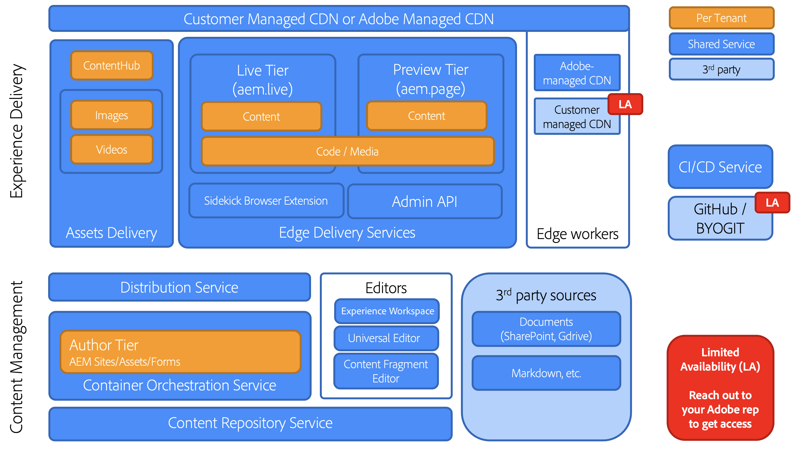
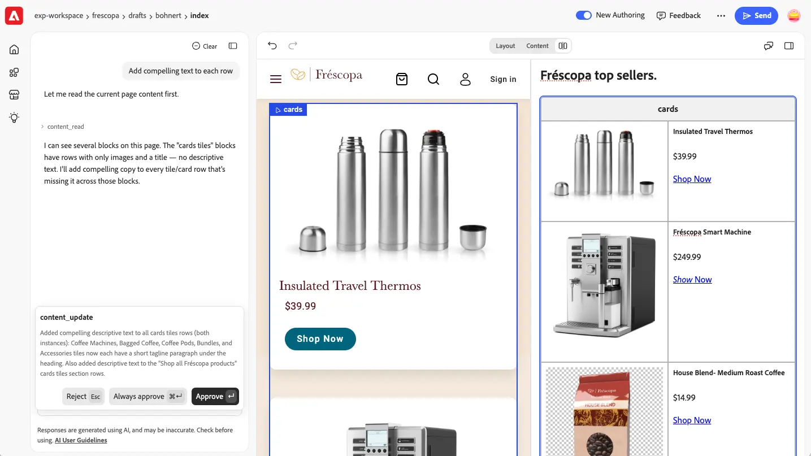
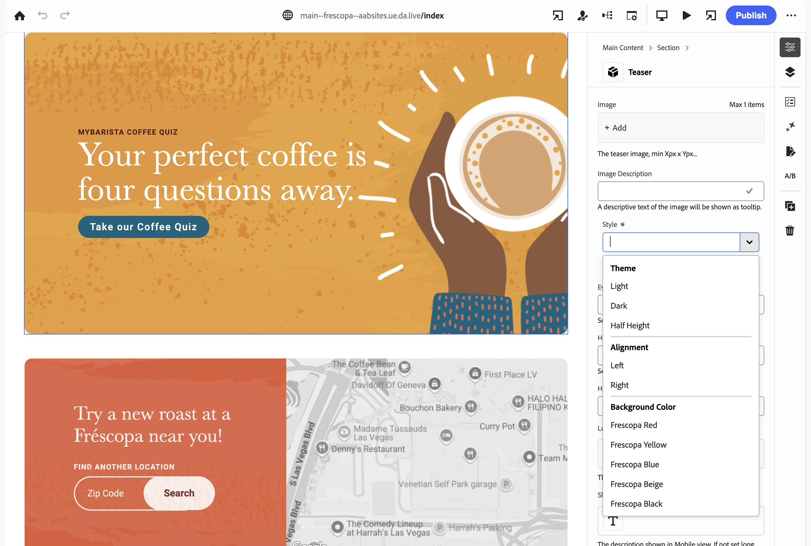

# Edge Delivery Services overview {#edge-delivery-services}

>[!TIP]
>
>**Want to get hands-on right away?**
>
>If you want to get hands-on with Edge Delivery Services right away, set up your own project in about ten minutes by [checking out the tutorial on aem.live.](https://www.aem.live/developer/tutorial)

## What is Edge Delivery Services? {#what-is-edge}

Edge Delivery Services is a modern content delivery framework that re-imagines how websites are built and delivered, optimizing for speed, simplicity, and scalability. It is a core part of Adobe Experience Manager and enables faster digital experiences by pushing rendering and delivery closer to the user, at the edge of the network.

It is not a replacement for a content delivery network (CDN), but it integrates seamlessly with your own CDN or the included [Adobe-managed CDN.](/help/implementing/dispatcher/cdn.md)

## Why Edge Delivery Services? {#why-edge}

### Increases discoverability and traffic {#increase-traffic}

Edge Delivery websites are search engines optimized (SEO) and generative engine optimized (GEO) for large language models (LLMs). This ensures high visibility and discoverability on all existing and upcoming sources for organic traffic. The **performance-first end-to-end architecture** ensures a delightful customer experience which will positively impact engagement.

### Developer efficiency {#developer-efficientcy}

Go live in days and weeks instead of months and years! Edge Delivery offers all the tools **modern web developers** love: GitHub, local development with auto-reload, performance, simplicity and none of the complications: no transpilation, no bundlers, no configurations, no overhead.

The simplicity of Edge Delivery does not require you to use complicated frameworks, tooling, or processes which is ideal for AI code creation. Use plain HTML, modern CSS, and vanilla JavaScript to create exceptional experiences faster than ever before. Focus on work and spend less time for training and learning new tools.

Edge Delivery enables every developer to achieve a 100 lighthouse score.

### Support for multiple content sources {#multiple-content-sources}

Content from various solutions can directly integrate with Edge Delivery, **including all of your existing AEM instances**. Authors can manage and **publish content from any system such as SharePoint to Edge Delivery** to gain more velocity with tools they already know.

### Composable architecture {#composable-architeture}

Whether headless or headful, you can deliver the right content in the right format and add the right decoration to make it an experience that stands out in any channel.

## How does it work? {#how-does-it-work}

Edge Delivery Services is a composable set of services that allows for a high degree of flexibility in how you author content on your website. It replaces AEM Publish / Dispatcher and the traditional way of building experiences with AEM Core Components with a multi-cloud SaaS solution and pure front-end development approach.

Edge Delivery Services uses GitHub so you can manage and deploy code directly from your GitHub repository. New content is added instantly without a rebuild process.

## Authoring {#authoring}

Edge Delivery Services offers two methods of authoring depending on the state of your project.

* [Experience Workspace](#experience-workspace) is the default for new projects.
* [Universal Editor](#universal-editor) can be leveraged for existing AEM implementations.

### Experience Workspace {#experience-workspace}

Modern content is created by agents, LLMs, automated pipelines, and authors in AEM. More than just authoring, [Experience Workspace](https://www.aem.live/docs/ew/about) is the central place where teams review, collaborate, approve, and deploy content with confidence by combining human creativity and AI capabilities.

Experience Workspace is the modern default face to AEM and is the default for all new projects.

* Works with the [Experience Modernization Agent](/help/ai-in-aem/agents/brand-experience/overview.md)
* Is GEO-optimized with semantic HTML
* Based on decoupled architecture
* Supports advanced use cases such as [of1.live](https://of1.live)

As authors expect from AEM, it also offers powerful features such as translation, multi-site management, and snapshots.

### Universal Editor {#universal-editor}

[The Universal Editor](/help/implementing/universal-editor/introduction.md) is a what-you-see-is-what-you-get (WYSIWYG), customizable, one-stop place to edit content live and in-context with a visual preview.

* With AEM authoring and the Universal Editor, you increase author efficiency whether headless or headful.
* You can take advantage of AEM's comprehensive content-management capabilities including workflow and governance.
* You can leverage numerous extension points to support your own processes and integrations.
* The functionality of your site can be developed by using CSS and JavaScript in GitHub.

### Which authoring method is right for you? {#which-authoring-method}

Experience Workspace is the new default for managing your content. If you are not certain which option is right for you, [be sure to review the authoring guide](https://www.aem.live/docs/authoring-guide) to help determine which is the best fit for your needs.

## Operational Telemetry {#telemetry}

Adobe Experience Manager uses [Operational Telemetry](https://www.aem.live/docs/operational-telemetry) to gather operations data that is strictly necessary to discover and fix functional and performance issues on Adobe Experience Manager-powered sites. Operational Telemetry data can be used to diagnose performance issues and to measure the effectiveness of experiments. Operational Telemetry preserves the privacy of visitors through [sampling](https://www.aem.live/docs/operational-telemetry#operational-telemetry-data-is-sampled) (only a small portion of all page views will be monitored) and [judicious exclusion of personally identifiable information](https://www.aem.live/docs/operational-telemetry#what-data-is-being-collected) (PII).

## Start exploring {#start-exploring}

Get started using AEM authoring with Experience Workspace and Edge Delivery Services:

* [See the developer tutorial](https://www.aem.live/developer/tutorial) to get a new project started with Experience Workspace.
* If you are working on an existing AEM project, see the [Getting Started - Universal Editor Developer Tutorial.](https://www.aem.live/developer/ue-tutorial)

## Edge Delivery Services and other Adobe Experience Cloud products {#edge-other-products}

Edge Delivery Services are part of Adobe Experience Manager. As such, Edge Delivery Services and AEM Sites can co-exist on the same domain, which is a common use case for larger websites. Additionally, your AEM Sites pages can seamlessly consume content from Edge Delivery Services, and the reverse is also true.

You can also use Edge Delivery Services with [Adobe Target](https://www.aem.live/developer/target-integration) and [Launch.](https://experienceleague.adobe.com/en/docs/experience-platform/tags/home)

## Getting help from Adobe {#getting-help}

Adobe provides three layers to help you with Edge Delivery Services:

* Engage with [community resources](#community-resources) for general inquiries.
* Access your [product collaboration channel](#collaboration-channel) for specific questions.
* [Log a support ticket](#support-ticket) to solve major and critical issues **within the contractual support service level agreement (SLA)**.

### Access community resources {#community-resources}

Adobe is committed to empowering you with the best community engagement and support for Edge Delivery Services, AEM authoring with the Universal Editor, and document-based authoring.

* Participate in the [Experience League Community](https://adobe.ly/3Q6kTKl) to ask questions, share feedback, initiate discussions, seek assistance from Adobe experts and AEM Advisors/Champs, and connect with like-minded individuals in real-time.
* Join the [Discord channel](https://discord.gg/aem-live), a more casual platform for real-time interactions and quick idea exchanges.

### Access your product collaboration channel {#collaboration-channel}

Adobe creates a dedicated Microsoft Teams or Slack channel for each Edge Delivery Services customer. In this channel, your business users, developers, and authors can ask Adobe experts about authoring and development, coordinate your launch or migration, and get help with best practices.

To request a channel for your company, or to join your company's existing channel, contact your Adobe account team or Adobe Support. For more information, see the aem.live documentation on using [Teams](https://www.aem.live/docs/teams) and [Slack](https://www.aem.live/docs/slack) for collaboration.

### Log a support ticket {#support-ticket}

{{support-ticket}}
