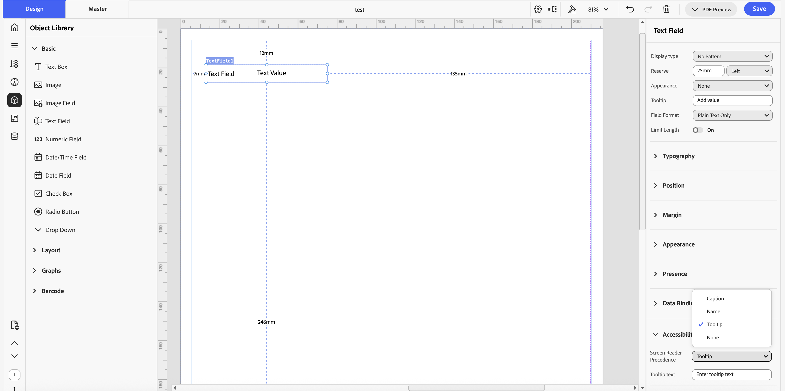
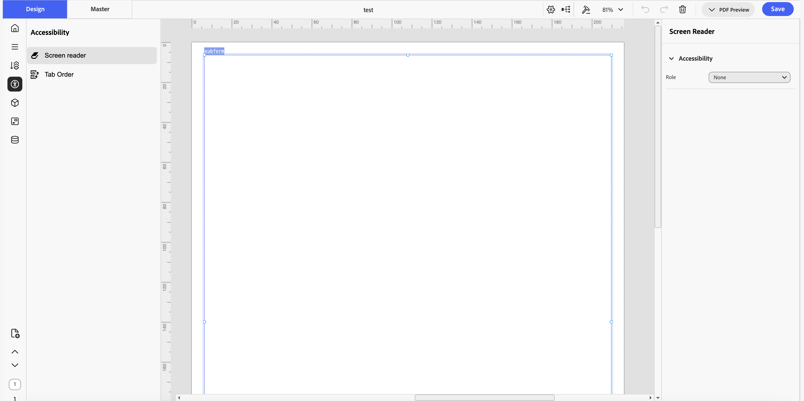
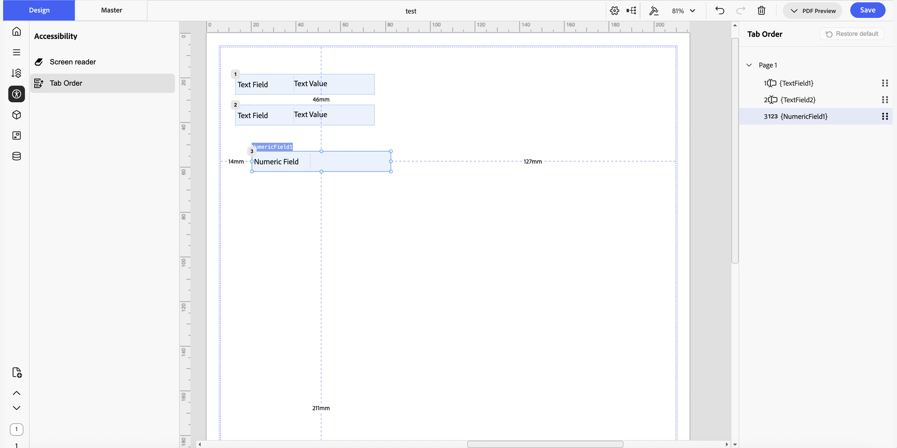
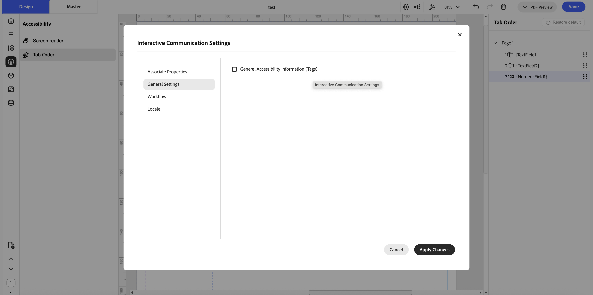

# Create accessible interactive communications in IC Editor {#accessibility-ic-editor}

## Overview

IC Editor lets you create accessible interactive communications that comply with accessibility standards such as WCAG 2.2 and PDF/UA. Accessibility support in IC Editor covers two areas:

* **Accessibility properties**: define how assistive technologies, such as screen readers (for example, NVDA or JAWS), announce a field. You set a screen reader precedence, and, for some field types, a semantic role.
* **Tab order**: control the order in which screen readers read fields and the order in which keyboard focus moves between fields when a user presses Tab.

You can set accessibility properties for a field either directly in its property sheet while you author the document, or in a dedicated accessibility view that lets you go through every field on the document, one at a time. The second option is useful when an accessibility reviewer checks a document after authoring is complete.

Once you have set the accessibility properties and tab order you want, select **General Accessibility Information (Tags)** in the document's Interactive Communication Settings so that the accessibility tags are included when IC Editor generates the PDF.

## Set accessibility properties for a field

You can set accessibility properties for text, images, interactive fields (such as text fields, numeric fields, date fields, checkboxes, radio buttons, and dropdowns), subforms, and tables. The properties available, and their behavior, depend on the field type:

* **Role**: assign a semantic role so assistive technologies understand the element's purpose in the document structure.
  * For text elements, choose a heading level (Heading Level 1 to 6), Caption, Artifact, or None.
  * For subforms, choose Table, Header Row, Body Row, Footer Row, List, TOC, or None.
  * For tables, the role is always Table. You can't change it.
  * Images and interactive fields don't have a Role option.
* **Screen Reader Precedence**: choose what a screen reader announces for the field.
  * For interactive fields (such as text fields, numeric fields, date fields, checkboxes, radio buttons, dropdowns, and exclusion groups), the options are Caption, Name, Tooltip, or None.
  * For non-interactive elements such as images and plain text, the options are Name, Helper Text, or None.
  * For tables, the options are Name, Tooltip, or None.
  * For subforms, Screen Reader Precedence isn't available until you set the subform's Role to Table. Once you do, the options are Name, Tooltip, or None.
* **Tooltip**: a general Tooltip field is available at the top of the property sheet for interactive fields. If you set Screen Reader Precedence to Tooltip, a separate Tooltip text field appears where you can set the text a screen reader announces.

For example, for an image you can set Screen Reader Precedence to Helper Text and enter text such as "This is a bank logo." When a user opens the generated PDF with a screen reader tool such as NVDA or JAWS, the tool reads this text aloud.

### Set properties from the property sheet while authoring

While you author a document, you can set accessibility properties for a field directly in its property sheet:

1. Select the field on the canvas.
1. In the property sheet, expand the **Accessibility** section.
1. If the field type has one, set the **Role**.
1. Set the **Screen Reader Precedence**.
1. If you set Screen Reader Precedence to **Tooltip** or **Helper Text**, enter the text in the field that appears.

### Set properties from the dedicated accessibility view

After you finish authoring a document, an accessibility reviewer can go through every field on the document without navigating the full canvas:

1. In the left sidebar of IC Editor, select the **Accessibility** icon.
1. Select **Screen reader**.
1. Select a field on the canvas.
1. In the panel on the right, set the field's accessibility properties.
1. Repeat for each field on the document.

## Set tab order

Tab order defines two related behaviors:

* The order in which a screen reader reads the fields on a document.
* The order in which keyboard focus moves between fields when a user presses the Tab key.

By default, IC Editor numbers fields left to right and top to bottom (1, 2, 3, 4, and so on). IC Editor displays this order as a numbered badge on each field on the canvas, so you can see the current tab order without opening the Tab Order panel.

### Set a custom tab order

1. In the left sidebar of IC Editor, select the **Accessibility** icon.
1. Select **Tab Order**.
1. In the **Tab Order** panel on the right, drag and drop fields to change their order.

### Restore the default tab order

1. In the **Tab Order** panel, select **Restore default**.

   IC Editor resets the tab order to the default left-to-right, top-to-bottom order.

## Generate a tagged, accessible PDF

After you set accessibility properties and tab order for the fields on your document, generate a tagged PDF so the accessibility tags are included in the output.

1. In the top toolbar, select the **Settings** icon to open the **Interactive Communication Settings** dialog.
1. Select the **General Settings** tab.
1. Select **General Accessibility Information (Tags)**.
1. Select **Apply Changes**.
1. Save the document.
1. Preview or download the PDF.

The generated PDF includes the accessibility tags based on the properties and tab order you set. You can confirm this by opening the downloaded PDF and inspecting its tags, for example with a PDF accessibility checker tool.