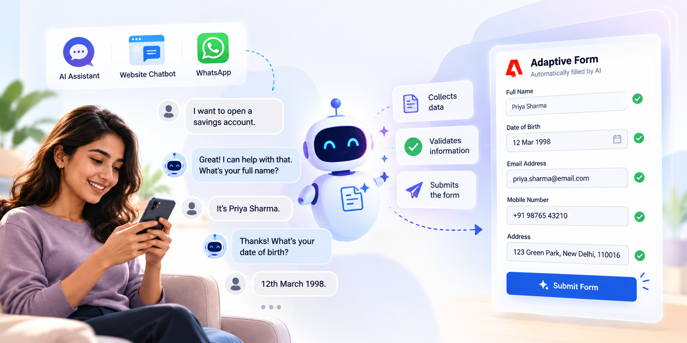
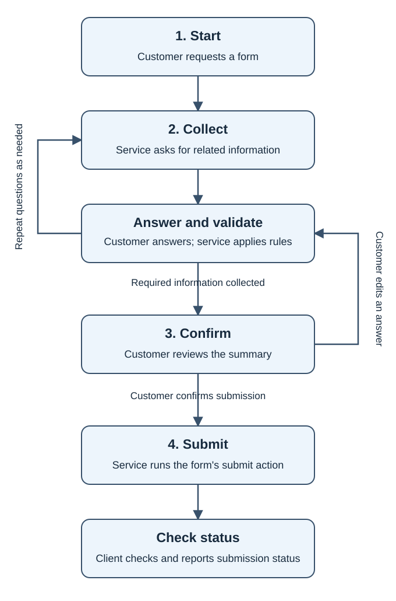

# Agentic Form Filling for Adaptive Forms

[!BADGE AEM Forms]{type=Positive tooltip="Applies to AEM Forms"}

 Agentic Form Filling is under the Early Access Program. This Early Access documentation is subject to change. You can write to [aem-forms-ea@adobe.com](mailto:aem-forms-ea@adobe.com) from your work email address to join the early access program and request access to the capability. 

Agentic Form Filling lets your customers complete an Adaptive Form in Adobe Experience Manager (AEM) Forms by chatting, instead of working through a traditional form layout. Customers answer questions in plain language, in an AI assistant, a chatbot on your website, or [!DNL WhatsApp], and an AI-powered form filling agent collects, validates, and submits their data for them.

Long or complex forms are a common point of abandonment: customers lose track of what is being asked or why, and the submissions you receive are often incomplete.

Agentic Form Filling uses your published form's supported rules and validations and its configured submit action. See the [known Early Access limitations](#limitations).

This article explains how an Agentic Form Filling conversation works, which channels and forms it supports, how the service handles customer data, and how to request Early Access.

>[!NOTE]
>
>Agentic Form Filling is different from the Conversational Forms component, which adds a chat-style form to an AEM Sites page. Agentic Form Filling brings your existing Adaptive Forms to AI assistants, chatbots, and messaging channels.

## How Agentic Form Filling works {#how-it-works}

A conversation moves through four stages:

|  |  |
| --- | --- |
|  | 1. **Start**: A client application, such as a chatbot or an AI assistant, starts a conversation for a form. If the customer describes what they want to do instead of naming a form, the service can match the request to the forms you have enabled. 2. **Collect**: The service asks for one group of related fields at a time, usually the fields in one panel of the form. Each answer is checked against the form's rules. If an answer isn't valid, the service explains why and asks again, without losing anything already collected. Rules that show or hide fields or compute values run as the conversation progresses, so customers are asked only for fields that apply to them. In this example, one message fills three fields, and the next question offers its choices as buttons:  3. **Confirm**: When all fields are collected, the service shows a summary. The customer confirms it, or changes any answer before submitting.  4. **Submit**: The service sends the collected data to the form's configured submit action. Submission runs in the background, and the client checks its status to tell the customer when it's complete. |

## Key concepts {#key-concepts}

Each conversation runs in one of the following modes:

* In *guided mode*, the chatbot asks for specific information and sends each answer to the service with its form field identified. For example, it asks “What is your email address?” and sends the answer for the email field. The service does not need AI to work out which field the answer belongs to. No AI model processes the customer's answers.
* In *natural-language mode*, customers answer in their own words and can provide several answers in one message, such as “I'm Priya Sharma, my email is priya@example.com.” An AI model extracts the form-field values from the message. The service asks again for any missing answers.

**Field groups**: Instead of asking one field at a time, the service asks for related fields together, usually all the fields in one panel of the form. A group holds at most 10 fields; a larger panel is split across several turns.

**Optional fields**: Customers can skip an optional field when it's asked. Required fields can't be skipped; the service asks for them again. A skipped field appears empty in the summary, and the customer can still fill it in before submitting. If a form rule later makes a skipped field required, the service asks for it.

**Form rules on the server**: The service runs supported Adaptive Forms rules on the server. Supported validations, rules that show or hide fields, and computed values apply during the conversation. Fields that are hidden, disabled, or read-only, and items that aren't inputs (such as text, buttons, and captcha), are never asked.

**Conversation session**: Each conversation keeps its progress on the server, so the customer can answer at their own pace. A session expires after 24 hours without activity. A conversation can be canceled before submission is initiated, and nothing is submitted. Once submission is initiated, it cannot be canceled.

## Supported channels {#channels}

The same conversation service powers every channel, so a form behaves the same way wherever your customers fill it.

| Channel | Typical use | Mode | How customers answer |
| --- | --- | --- | --- |
| AI assistants (MCP) | Customers who are already chatting with an AI assistant or agent | Natural-language | In their own words; the assistant relays each answer |
| Custom chatbots and websites (REST API) | Your own chat interface on a website or app | Guided or natural-language | Typed text, or controls that your interface displays |
| [!DNL WhatsApp] | Customers who prefer messaging | Natural-language | Typed text, buttons, and lists |

### AI assistants (MCP) {#mcp}

Agentic Form Filling provides a [Model Context Protocol (MCP)](https://modelcontextprotocol.io/) server for your organization. AI assistants and agents that support MCP connect to it and fill forms on behalf of the customer they're chatting with.

Each form you enable appears to the assistant as its own tool for starting a conversation, alongside shared tools for answering questions, editing an answer, and confirming the submission. The assistant chooses the right form from the tool list, and relays questions and answers between the customer and the service.

### Custom chatbots and websites (REST API) {#rest-api}

If you build your own chatbot or conversational interface, use the REST API to start a conversation, send the customer's answers, confirm the summary, submit, and check the submission status.

Each response includes a ready-to-display message, plus details about every field being asked, such as its label, type, whether it's required, and its allowed options.

Your interface can show the message as-is, or use the field details to display its own controls, such as a drop-down list or buttons for choices.

You can start a conversation for a form you've enabled, or directly from the URL of a published Adaptive Form.

### WhatsApp {#whatsapp}

Customers can find and fill forms in a [!DNL WhatsApp] chat with your business. They can list the available forms, or search for one by describing what they need, for example "find insurance claim."

Questions with a few choices appear as tap-to-answer buttons or lists, consent check boxes appear as agree and decline buttons, and optional fields include a Skip button.

Customers answer in their own words, review a summary, and confirm or edit before submitting.

Customers can type cancel to stop a conversation before submission is initiated, restart to start over, or help to see the available commands. Once submission is initiated, it cannot be canceled.

## Supported forms and limitations {#limitations}

Agentic Form Filling works with:

* Adaptive Forms based on Core Components.
* Adaptive Forms built with [!DNL Edge Delivery Services].

Adaptive Forms based on Foundation Components aren't supported.

The following known limitations apply during Early Access:

* **Browser-only behavior doesn't run.** The service runs your form's rules on the server, without a browser. Custom functions you've written for the form, and rules that depend on the browser (such as page navigation or captcha), don't run during a conversation.
* **Some items are never asked.** Text, buttons, captcha, and fields that are hidden, disabled, or read-only aren't presented to the customer.
* **One form per conversation.** Each conversation fills and submits a single form.

## Data handling and privacy {#data-privacy}

In natural-language mode, personal data in form answers is masked before AI field extraction. Descriptions used to find a matching form are not masked. The following details explain how the service handles form answers and submissions.

* **Personal data in form answers is masked before AI processing.** In natural-language mode, personal details in the customer's message, such as names, email addresses, phone numbers, card numbers, and national ID numbers, are replaced with placeholders before the text is sent to the AI model. The real values are restored on the server after the field values are extracted. Masking supports English and Spanish; other languages use the English detectors.
* **No masking, no AI processing.** If masking is unavailable, the service rejects the natural-language turn rather than send unmasked text to the AI model. The customer can try again. Guided mode doesn't send the customer's answers to an AI model.
* **Form matching text isn't masked.** When a customer describes what they need so the service can find a matching form, that description is sent to the AI model without masking.
* **Sessions are temporary.** Answers are stored on the server only while the conversation is active, and are deleted 24 hours after the last activity.
* **Submissions go straight to your form.** The service sends the collected data to the form's configured submit action, and doesn't keep its own copy of the submission.

## Availability and prerequisites {#prerequisites}

Agentic Form Filling is available through the [!DNL AEM Forms] Early Access Program. To request access, email [aem-forms-ea@adobe.com](mailto:aem-forms-ea@adobe.com) from your official email address with your organization ID and program details.

Before you start, make sure you have:

* An [!DNL AEM Forms] as a Cloud Service environment.
* A published Adaptive Form based on Core Components or built with [!DNL Edge Delivery Services], with a submit action configured.
* A clear title and description for each form you enable. The service uses them to match a customer's request to the right form.
* For AI assistants: an assistant or agent that supports MCP.
* For [!DNL WhatsApp]: a [!DNL WhatsApp Business Platform] account and phone number for your business.

When you join the program, Adobe provides the service endpoint and credentials, and helps you enable your forms and channels.

## Example scenarios {#example-scenarios}

The following examples illustrate how customers can fill forms across supported channels.

* **Open a bank account in [!DNL WhatsApp]**: A customer messages a bank's [!DNL WhatsApp] number and asks to open an account. The service finds the account-opening form, asks for personal details one panel at a time, offers account types as buttons, and submits after the customer confirms the summary.
* **Request a product quote through an AI assistant**: A customer asks an AI assistant about buying a coffee machine. The assistant starts the enquiry form through MCP, collects contact details and product preferences from the conversation, and submits the enquiry.
* **Complete an insurance claim on your website**: Your website's chatbot uses the REST API to guide a customer through a claim form, showing the form's own validation messages when an answer isn't valid.

## Frequently asked questions {#faq}

**Do I need to change my form?**

You can reuse your published form, including its supported rules, validations, and configured submit action. Review the [known Early Access limitations](#limitations) if your form uses custom functions or browser-dependent behavior.

**What happens if a customer gives an invalid answer?**

The service returns the form's validation message and asks for the field again. Answers already collected are kept.

**Can a customer stop and continue later?**

Yes, within 24 hours of their last answer, in the same channel. After that, the session expires and the customer starts again.

**Can customers change an answer before submitting?**

Yes. After reviewing the summary, the customer can change any answer, including fields they skipped.

**Which mode should I use?**

Use guided mode when your interface presents each field and collects structured answers. Use natural-language mode when customers type freely, as in an AI assistant or [!DNL WhatsApp].

## Related articles {#related-articles}

* [AEM Forms Early Access Program](early-access-ea-features.md)
* [Form builder: Create forms with core components](creating-adaptive-form-core-components.md)
* [Submit Actions Supported in Adaptive Forms based on Core Components](configure-submit-actions-core-components.md)
* [Introduction to Rule Editor for Adaptive Form based on Core Components](rule-editor-core-components.md)
* [Edge Delivery Services for AEM Forms](/help/edge/docs/forms/overview.md)
