# Use Google reCAPTCHA in an AEM Adaptive Form based on Core Components {#using-reCAPTCHA-in-adaptive-forms}

| Applies to | Article link |
| -------- | ---------------------------- |
|  Adaptive Form based on Core Components   | This article  |
|  Adaptive Form based on Foundation Components | [Click here](/help/forms/captcha-adaptive-forms.md) |

CAPTCHA (Completely Automated Public Turing test to tell Computers and Humans Apart) is a program commonly used in online transactions to distinguish between humans and automated programs or bots. It poses a challenge and evaluates user response to determine if it's a human or a bot interacting with the site. It prevents the user to proceed if the test fails and helps make online transactions secure by keeping bots from posting spam or malicious purposes.

AEM Forms as a Cloud Service supports the following CAPTCHA solutions: 

* [Google reCAPTCHA](#connect-your-aem-forms-environment-with-recaptcha-service-by-google)
* [hCaptcha](/help/forms/integrate-adaptive-forms-hcaptcha-core-components.md)  

## Connect your AEM Forms Core Components with reCAPTCHA service by Google {#connect-your-forms-environment-with-recaptcha-service-by-google}

Form authors can use the reCAPTCHA service by Google to implement reCAPTCHA in Adaptive Forms. It offers advance CAPTCHA capabilities to protect your site. For more information on how reCAPTCHA works, see [Google reCAPTCHA](https://developers.google.com/recaptcha/). You use it to present a CAPTCHA challenge on form submission.[!DNL AEM Forms] as a [!DNL Cloud Service] supports Google reCAPTCHA v2 and reCAPTCHA Enterprise. Any other version is not supported. Also notice, reCAPTCHA in Adaptive Forms is not supported in offline mode on AEM Forms app.
  
Based on your requirement you can configure reCAPTCHA service to enable:

* [reCAPTCHA Enterprise](#steps-to-implement-reCAPTCHA-enterprise-in-forms-core-components)
* [reCAPTCHA v2](#steps-to-implement-reCAPTCHA-v2-in-forms)

### Configure reCAPTCHA Enterprise  {#steps-to-implement-reCAPTCHA-enterprise-in-forms-core-components}

1. **Create or select a Google Cloud project and enable the reCAPTCHA Enterprise API.**

    1. Sign in to the [Google Cloud Console](https://console.cloud.google.com/).
    1. From the project selector at the top of the page, select an existing project or create a new project.
    1. Go to **APIs & Services > Library**.
    1. Search for **reCAPTCHA Enterprise API** and select it.
    1. Select **Enable** if the API is not already enabled.

    >[!NOTE]
    >
    >Ensure that you have permission to manage API keys and create reCAPTCHA Enterprise keys in the selected project. To create reCAPTCHA keys, you need the **reCAPTCHA Enterprise Admin** IAM role or equivalent permissions.

1. **Obtain the Project ID and create the API key and site key.**

    **Obtain the Project ID**

    1. With your project selected in the Google Cloud Console, open the project dashboard.
    1. Locate and copy the **Project ID**. Use the project ID, not the project name or project number, when configuring AEM Forms.

        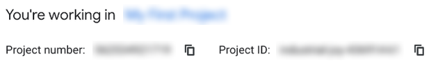{width="630"}

    **Create an API key**

    1. Go to **APIs & Services > Credentials**.
    1. Select **Create credentials > API key**.
    1. Enter a descriptive name for the API key, if prompted.
    1. Open **Select API restrictions**.

        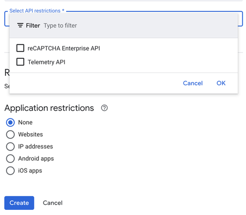{width="480"}

    1. Select **reCAPTCHA Enterprise API** and select **OK**.
    1. Select **Create**. Copy the generated API key and store it securely.

    >[!IMPORTANT]
    >
    >AEM sends assessment requests from the server, not from the form filler's browser. Do not apply a **Websites (HTTP referrers)** application restriction to this API key. If you apply an **IP addresses** restriction, it must allow the outbound IP addresses used by your AEM environment. Confirm those addresses with your environment administrator before adding the restriction. Keep the API restriction limited to **reCAPTCHA Enterprise API**.
    >
    >Do not expose the API key in publicly accessible source code, documentation screenshots, or client-side scripts.

    **Create a reCAPTCHA Enterprise site key**

    1. In the Google Cloud Console, go to **Security > Fraud Defense**.
    1. Select the **Keys** tab.

        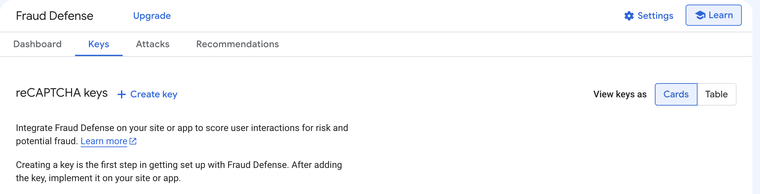{width="760"}

    1. Select **Create key**.
    1. In **Display name**, enter a descriptive name for the key.
    1. Under **Application type**, select **Web**.

        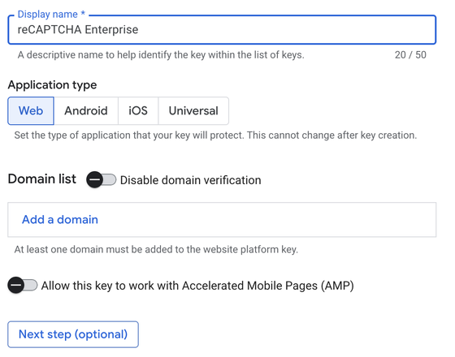{width="560"}

    1. In **Domain list**, select **Add a domain** and enter the domain where your Adaptive Form is hosted. Do not include the protocol (`https://`) or URL path. Add any additional domains where you use the form.
    1. Keep **Disable domain verification** turned off to restrict the key to the configured domains.
    1. Select **Next step (optional)** to open the additional settings.

        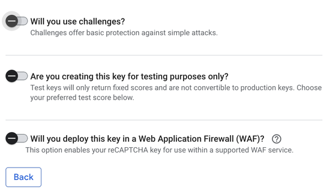{width="560"}

    1. Configure the challenge setting to match the key type you want to use in AEM Forms:

        * **Score-based site key:** Keep **Will you use challenges?** turned off. This key evaluates interactions without displaying a CAPTCHA checkbox or challenge.
        * **Checkbox site key:** Turn on **Will you use challenges?** and configure the key as a checkbox key with the appropriate challenge security settings.

    1. For non-production testing, optionally enable **Are you creating this key for testing purposes only?** and select a fixed test score between 0 and 1. Do not use a test key for production forms.

        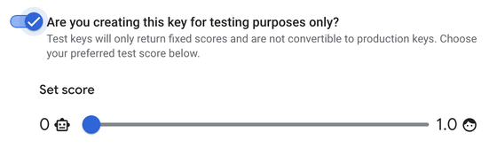{width="560"}

    1. Select **Create key**.
    1. Open the newly created key and copy the **Site Key**.

    You now have the three values required for the AEM cloud service configuration:

    * **Project ID:** Identifies your Google Cloud project.
    * **API Key:** Associates assessment requests to the reCAPTCHA Enterprise API with your Google Cloud project.
    * **Site Key:** Identifies the reCAPTCHA configuration associated with your website.

1. Create configuration container for cloud services.

    1. Go to **[!UICONTROL Tools > General > Configuration Browser]**.
    1. Select a folder or create a folder, and enable the folder for cloud configurations using following steps:
        1. In the Configuration Browser, select the folder and select **[!UICONTROL Properties]**.
        1. In the Configuration Properties dialog, enable **[!UICONTROL Cloud Configurations]**.
        1. Select **[!UICONTROL Save & Close]** to save the configuration and exit the dialog.

1. Configure the cloud service for [!DNL reCAPTCHA Enterprise].

    1. On your Experience Manager author instance, go to  &gt; **[!UICONTROL Cloud Services]**.
    1. Select **[!UICONTROL reCAPTCHA]**. The Configurations page opens. Select the configuration container that you created and select **[!UICONTROL Create]**.
    1. Select version as [!DNL reCAPTCHA Enterprise] and specify Name, Project ID, Site Key, and API key (Obtained in Step 2) for reCAPTCHA Enterprise service.
    1. Select the **[!UICONTROL Key Type]** that matches the site key created in Google Cloud:

        * **[!UICONTROL Score-based site key]:** Select this option if you created the key with **Will you use challenges?** disabled.
        * **[!UICONTROL Checkbox site key]:** Select this option if you enabled **Will you use challenges?** and configured a checkbox key.

        >[!IMPORTANT]
        >
        >The key type selected in AEM Forms must match the key type configured in Google Cloud. Selecting a different key type can cause reCAPTCHA validation to fail.

    1. Specify a **[!UICONTROL Threshold Score]** between 0 and 1. A score closer to 1 indicates a lower likelihood of bot activity; a score closer to 0 indicates a higher likelihood of bot activity. For a valid reCAPTCHA token, the interaction must have a score greater than or equal to the configured threshold to pass the score check. For example, a threshold of `0.5` accepts scores of `0.5` or higher.

        >[!NOTE]
        >
        >The threshold score configured in AEM Forms is different from the fixed score configured for a Google Cloud test key. A test key returns the configured test score; AEM compares the returned score with its threshold.

    1. Select **[!UICONTROL Create]** to create the cloud service configuration.

<!--
    1. In the Edit Component dialog, specify the name, project ID, site key, API key (obtained in steps 2 and 3), select the key type, and enter the threshold score. Select **[!UICONTROL Save Settings]** and then select **[!UICONTROL OK]** to complete the configuration.
-->

Once the reCAPTCHA Enterprise service is enabled, it is available for use in adaptive forms. See [using CAPTCHA in adaptive forms](#using-reCAPTCHA).

<!--

-->

### Configure Google reCAPTCHA v2 {#steps-to-implement-reCAPTCHA-v2-in-forms}

1. Obtain [reCAPTCHA API key pair](https://www.google.com/recaptcha/admin) from Google. It includes a **site key** and a **secret key**.

    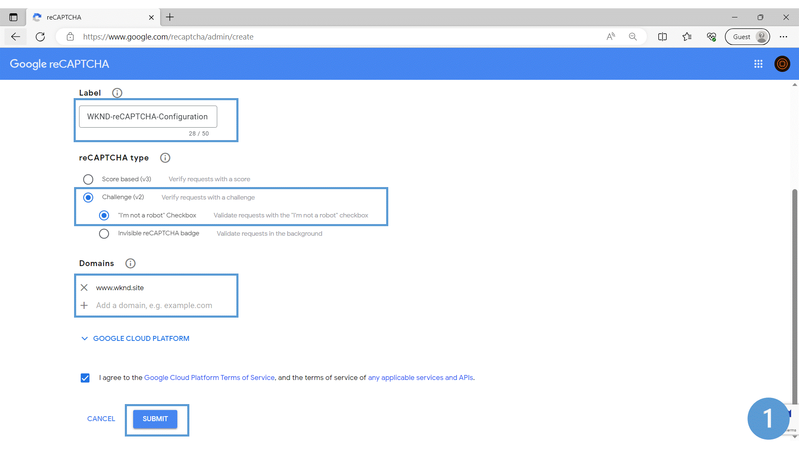
1. Create Configuration Container on your AEM Forms as a Cloud Service environment. A Configuration Container holds Cloud Configurations used to connect AEM to external services. To create and configure a Configuration Container to connect your AEM Forms environment with reCAPTCHA service by Google:   
    1. Open your AEM Forms as a Cloud Service instance. 
    1. Go to **[!UICONTROL Tools > General > Configuration Browser]**. In the Configuration Browser, you can: 
    1. Select an existing folder or create a folder. You can create a folder and enable the Cloud Configurations option for it or Enable the Cloud Configurations option for an existing folder: 

        * To create a folder and enable the Cloud Configurations option for it: 
            1. In the Configuration Browser, click **[!UICONTROL Create]**. 
            1. In the Create Configuration dialog, specify name, title, and select the **[!UICONTROL Cloud Configurations]** option. 
            1. Click **[!UICONTROL Create]**
        * To enable the Cloud Configurations option for an existing folder: 
            1. In the Configuration Browser, select the folder and select **[!UICONTROL Properties]**.
            1. In the Configuration Properties dialog, enable **[!UICONTROL Cloud Configurations]**.
            1. Select **[!UICONTROL Save & Close]** to save the configuration and exit the dialog.

1. Configure the Cloud Service: 
    1. On your AEM author instance, go to  &gt; **[!UICONTROL Cloud Services]** and select **[!UICONTROL reCAPTCHA]**.
    1. Select a Configuration Container, created or updated in previous section. Select **[!UICONTROL Create]**.
    1. Specify **[!UICONTROL Title]**, **[!UICONTROL Name]**, **[!UICONTROL Site Key]**, and **[!UICONTROL Secret Key]** for reCAPTCHA service (Obtained in Step 1). Select **[!UICONTROL Create]**.

    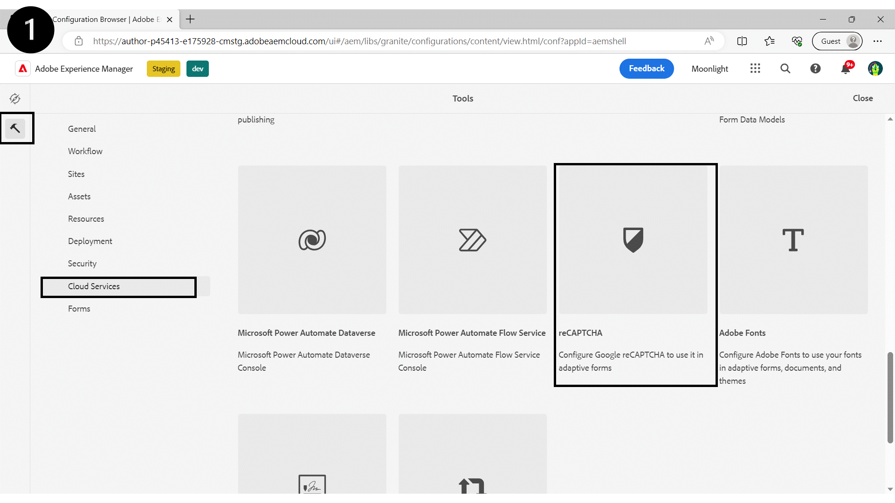
    
   Once the reCAPTCHA service is configured, it is available for use in an Adaptive Form. For more information, see [using Google reCAPTCHA in an Adaptive Form](#using-reCAPTCHA).

Use Google reCAPTCHA in adaptive forms

## Use Google reCAPTCHA in an Adaptive Form {#using-reCAPTCHA}

To use reCAPTCHA in Adaptive Forms:

1. Open your AEM Forms as a Cloud Service instance. 
1. Go to **[!UICONTROL Forms]** > **[!UICONTROL Forms and Documents]**.  
1. Select an Adaptive Forms and select **[!UICONTROL Properties]**. For the **[!UICONTROL Configuration Container]** option, select the Configuration Container that contains the Cloud Configuration that connects AEM Forms with reCAPTCHA service by Google and select **[!UICONTROL Save & Close]**. 

    If you do not have such a Configuration Container, see section [Connect your AEM Forms environment with reCAPTCHA service by Google](#connect-your-forms-environment-with-recaptcha-service-by-google) to learn how to create such a Configuration Container.

    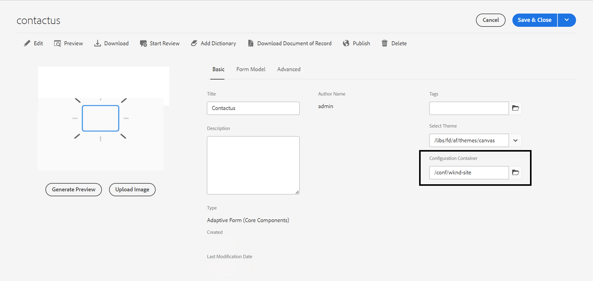

1. Select an Adaptive Forms and select **[!UICONTROL Edit]**. The Adaptive Form opens in Adaptive Forms Editor. 
1. From the component browser, drag-drop the **[!UICONTROL Adaptive Form reCAPTCHA]** component onto the Adaptive Form. 

     >[!NOTE] 
     > * Google reCAPTCHA validation is time-sensitive and expires in about a couple of minutes. Therefore, Adobe recommends placing the **[!UICONTROL Adaptive Form reCAPTCHA]** component just before the **[!UICONTROL Submit]** button.

1. Select the **[!UICONTROL Adaptive Form reCAPTCHA]** component and select the properties  icon. It opens the properties dialog. Specify the following mandatory properties: 
    * **[!UICONTROL Name]:** You can identify a form component easily with its unique name both in the form and in the rule editor, but the name must not contain spaces or special characters.
    * **[!UICONTROL Title]:** Specify a title for the CAPTCHA widget. The default value is **Captcha**. Select **Hide title** if you do not want title to appear. Select **Allow Rich Text for Title** to edit your title in rich text format. You can also mark your title as **Unbound Form Element**.
    * **[!UICONTROL CAPTCHA Configuration]:** Select a configuration from the Settings drop-down for **reCAPTCHA Enterprise** or **reCAPTCHA v2** to present the Google reCAPTCHA dialog for the form: 
        1. If you select **reCAPTCHA Enterprise** version, the key type can be of **checkbox** or **score based**, It is based on your selection when you configure [site key for websites](https://cloud.google.com/recaptcha-enterprise/docs/create-key#create-key):
            
            >[!NOTE] 
            >
            >* In the cloud configuration with **key type** as **checkbox**, the customized error message appears as an inline message if the captcha validation fails.
            >* In the cloud configuration with **key type** as **score based**,  the customized error message shows as a pop-up message if the captcha validation fails.
            
        1. You can select size as **[!UICONTROL Normal]** and **[!UICONTROL Compact]**.

        >[!NOTE] 
        >* You can have multiple Cloud Configurations in your environment for similar purpose. So, choose the service carefully. If no service is listed, see [Connect your AEM Forms environment with reCAPTCHA service by Google](#connect-your-forms-environment-with-recaptcha-service-by-google) to learn how to create a Cloud Service that connects your AEM Forms environment with reCAPTCHA service by Google.

    * **Captcha Size:** You can select the display size of Google reCAPTCHA challenge dialog. Use the **[!UICONTROL Compact]** option to display a small sized and the **[!UICONTROL Normal]** option to display a relatively large-size Google reCAPTCHA challenge dialog.
        If you select **reCAPTCHA v2** version:
         1. You can select the size as **[!UICONTROL Normal]** or **[!UICONTROL Compact]** for the reCAPTCHA widget. 
         1. You can select the **[!UICONTROL Invisible]** option to show the CAPTCHA challenge only in the case of a suspicious activity.

    The reCAPTCHA service is enabled on the adaptive form. You can preview the form and see the CAPTCHA working. The **protected by reCAPTCHA** badge, displayed below, is displayed on the protected forms.

    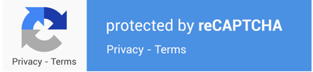

1. Select **[!UICONTROL Done]**. 

    Now, the **protected by reCAPTCHA** is displayed on your Adaptive Form. It is displayed on all the Adaptive Forms which are configured to use the Google reCAPTCHA service. 
    
    Now, only legitimate forms, in which the form filler successfully clears the challenge posed by the Google reCAPTCHA service, are allowed for submission.

<!--
### Show or hide CAPTCHA component based on rules {#show-hide-captcha}

You can select to show or hide the CAPTCHA component based on rules that you apply on a component in an Adaptive Form. Select the component, select , and select **[!UICONTROL Create]** to create a rule. For more information on creating rules, see [Rule Editor](rule-editor.md).

For example, the CAPTCHA component must display in an Adaptive Form only if the Currency Value field in the form has a value of more than 25000.

Select the **[!UICONTROL Currency Value]** field in the form and create the following rules:

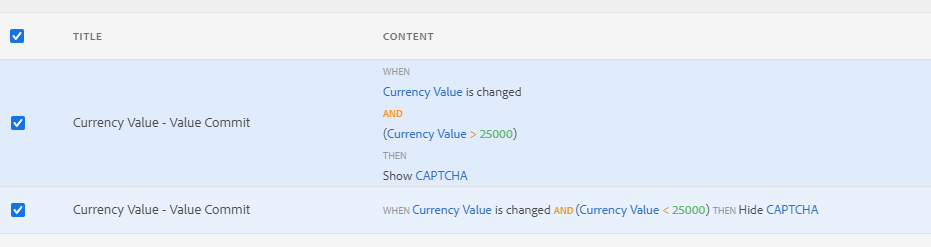

   >[!NOTE]
   >
   > When you select a reCAPTCHA v2 configuration and the size is set to [!UICONTROL Invisible], the show/hide option remains disabled.

   -->

## Frequently Asked Questions

**Q: Can I use more than one Captcha component in an Adaptive Form?**
**Ans:** Using more than one Captcha component in an Adaptive Form is not supported. Also, it is not recommended to use Captcha component in a fragment or a panel marked for lazy loading.

## See Also {#see-also}

{{see-also}}
