# Customizing Form Themes {#customizing-form-themes}

| Version | Article link |
| --- | --- |
| AEM 6.5 | [Click here](https://experienceleague.adobe.com/docs/experience-manager-65/forms/adaptive-forms-advanced-authoring/themes.html) |
| AEM as a Cloud Service | This article |

The Theme Editor in Adobe Experience Manager (AEM) Forms is a visual interface that lets you create and customize themes for your Adaptive Forms without writing code manually. A theme defines the look and feel of form components and panels, including background colors, font styles, borders, dimensions, and spacing. When you apply a theme, the specified styles reflect on the corresponding components, and you can reuse the same theme across multiple Adaptive Forms.

The Theme Editor eliminates the need for a dedicated developer persona for basic form styling. With just a working knowledge of CSS, you can style forms using the visual sidebar or write advanced CSS overrides directly within the editor.

## Prerequisites {#prerequisites}

* Author-level permissions in Adobe Experience Manager Forms.
* Basic understanding of CSS styling principles. For a complete CSS reference, see the [MDN Web Docs CSS reference](https://developer.mozilla.org/en-US/docs/Web/CSS/Reference).

## Navigate to the Themes Directory {#navigate-to-themes}

1. Log in to your AEM author instance.
1. Navigate to **[!UICONTROL Adobe Experience Manager]** > **[!UICONTROL Forms]** > **[!UICONTROL Themes]**.

   The Themes directory displays all available themes, including any standard themes provided by AEM Canvas, along with custom themes that you or your organization have created.

### Create a new theme {#create-a-new-theme}

1. In the Themes directory, select the folder where you want to store your new theme.
1. Click **[!UICONTROL Create]** > **[!UICONTROL Theme]**.

   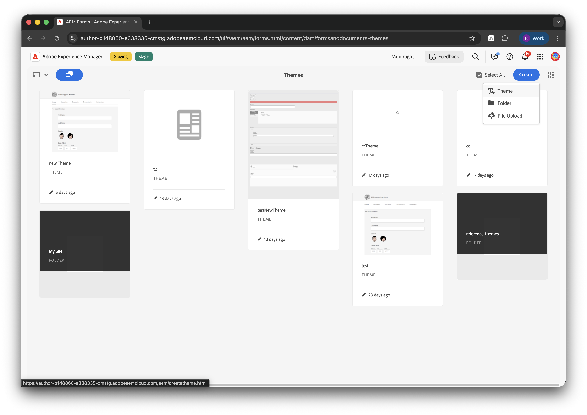

1. In the **[!UICONTROL Create Theme]** dialog, specify the following details:
   * **[!UICONTROL Title]**: A descriptive title for the theme.
   * **[!UICONTROL Name]**: The node name for the theme.
   * **[!UICONTROL Adaptive form to preview the theme]**: For a Core Component theme, select a Core Component-based Adaptive Form. **[!UICONTROL Use default adaptive form]** uses a foundation Adaptive Form, not Core Components. The selected form appears in the Theme Editor canvas for real-time preview while you edit.
   * **[!UICONTROL Description]** *(Optional)*: A brief description of the theme.
   * **[!UICONTROL Configuration Container]** *(Optional)*: The configuration container that holds Adobe Font configuration details.
   * **[!UICONTROL Tags]** *(Optional)*: Tags attached to the theme for identification and search.
1. Click **[!UICONTROL Create]**.

   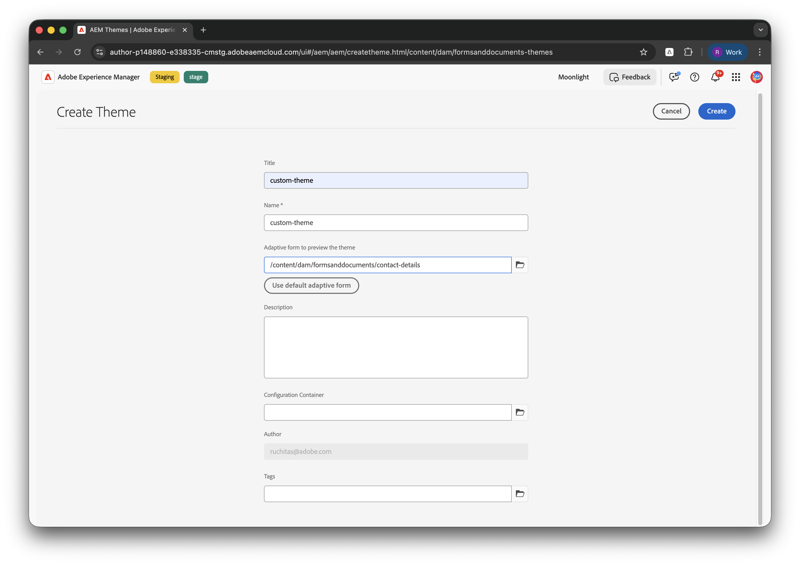

   The theme is created. You can now click **[!UICONTROL Edit]** to open it in the Theme Editor.

### Edit an existing theme {#edit-an-existing-theme}

1. In the **Themes** directory, select the theme you want to modify.
1. Click **[!UICONTROL Edit]** in the action bar to open the theme in the Theme Editor.

   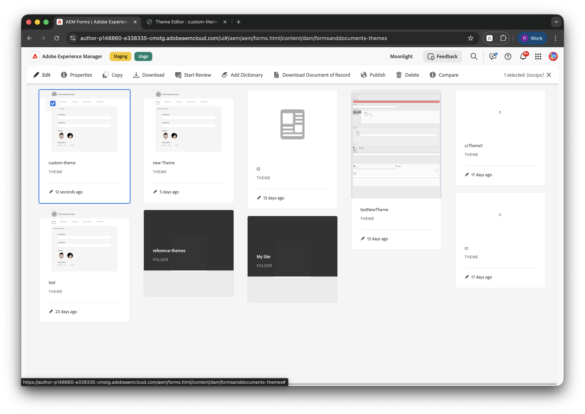

### Upload a theme {#upload-a-theme}

You can import a theme package (for example, one exported from another environment) into the Themes directory:

1. In the **Themes** directory, click **[!UICONTROL Create]** > **[!UICONTROL File Upload]**.
1. Browse to select the theme package (ZIP file) on your computer, then click **[!UICONTROL Upload]**.

   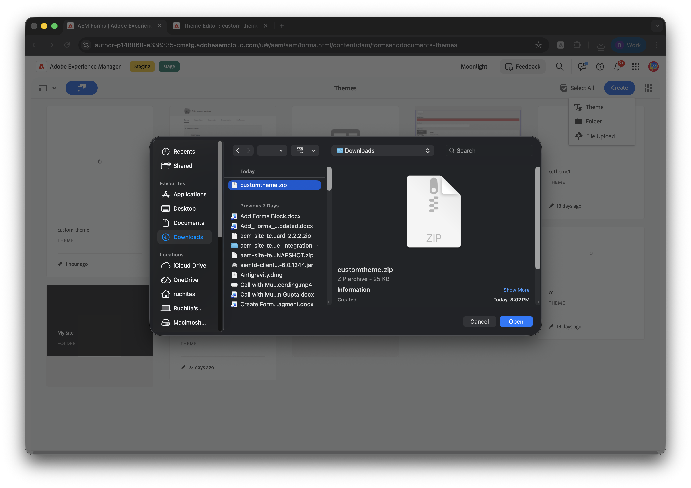

The uploaded theme appears in the Themes directory and can be edited like any other theme.

### Download a theme {#download-a-theme}

You can export a theme as a package (ZIP file) to reuse in another AEM Forms environment or to back it up:

1. In the **Themes** directory, select one or more themes (use the checkboxes on the theme cards).
1. Click **[!UICONTROL Download]** in the action bar. A dialog may appear with details of the selected theme(s).
1. Confirm or click **[!UICONTROL Download]** in the dialog. The theme package is downloaded as a ZIP file to your computer.

   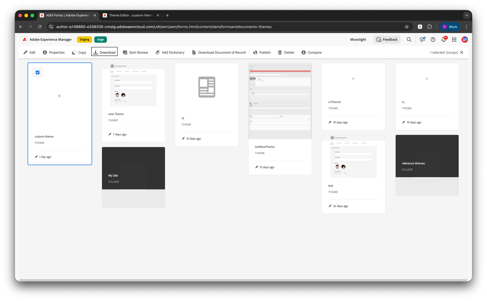

You can upload this ZIP later using [Upload a theme](#upload-a-theme) in the same or another environment.

### Manage theme properties {#manage-theme-properties}

Use the theme properties to update its title and description without changing its styles.

1. In the **Themes** directory, select the theme.
1. Click **[!UICONTROL Properties]**.
1. On the **[!UICONTROL Basic]** tab, edit the **[!UICONTROL Title]** or **[!UICONTROL Description]**.
1. Click **[!UICONTROL Save & Close]**.

Reopen **[!UICONTROL Properties]** to review the saved values. The **[!UICONTROL Basic]** tab also displays metadata such as **[!UICONTROL Type]**, **[!UICONTROL Created]**, **[!UICONTROL Last Modification Date]**, and **[!UICONTROL Author Name]**. Saving the properties updates the last modification date.

## Understand the Theme Editor interface {#understand-the-theme-editor}

When you open a theme in the Theme Editor, you see two main areas:

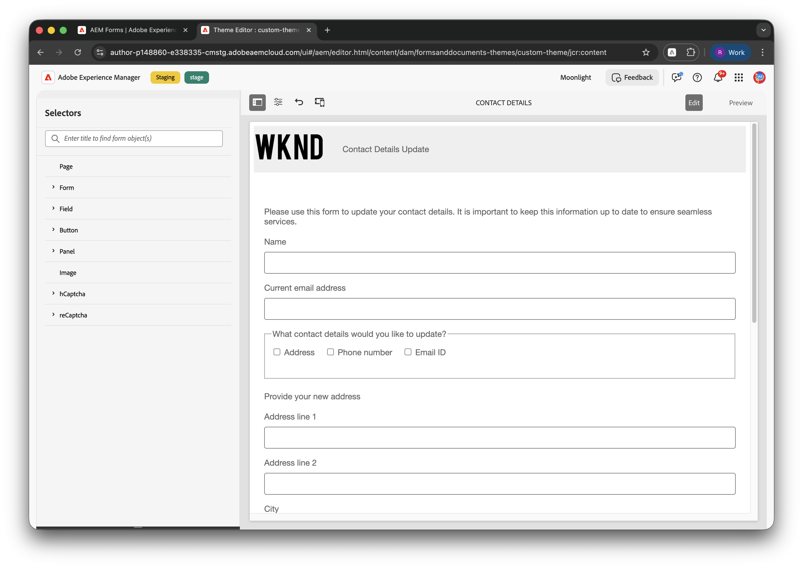

* **Canvas** (right side): Displays a preview of the Adaptive Form linked to the theme. All styling changes reflect here instantly, so you can see the impact of your edits in real time.
* **Sidebar** (left side): Contains the **Selectors** panel that lists all stylable form components in a tree structure, such as Page, Form, Field, Button, Panel, Image, hCaptcha, and reCaptcha.

### Canvas toolbar {#canvas-toolbar}

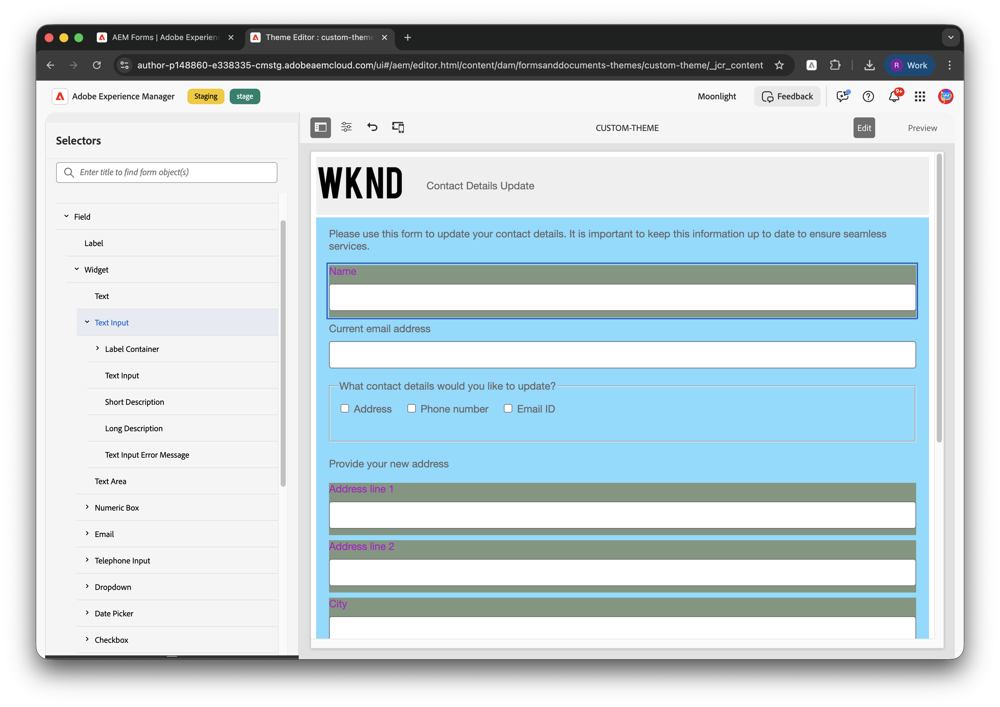

From left to right, the toolbar provides:
* **A: Toggle Side Panel**: Show or hide the Selectors sidebar. Use this to maximize the form preview area when you want to focus on the canvas, or show the sidebar again when you need to select or style components.
* **B: Theme Options** (dropdown): Opens a menu with four options. Click it when you need to change the preview form, view CSS, manage saved styles, or get in-editor help. When you open the Theme Options dropdown, you see:

   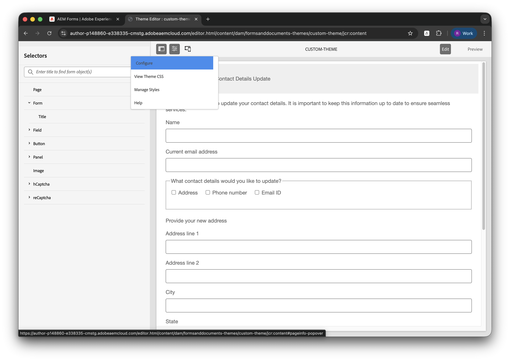

   * **[!UICONTROL Configure]**: Switch the form shown in the canvas to a different Adaptive Form. Use this to check how your theme looks on another form without leaving the editor.
      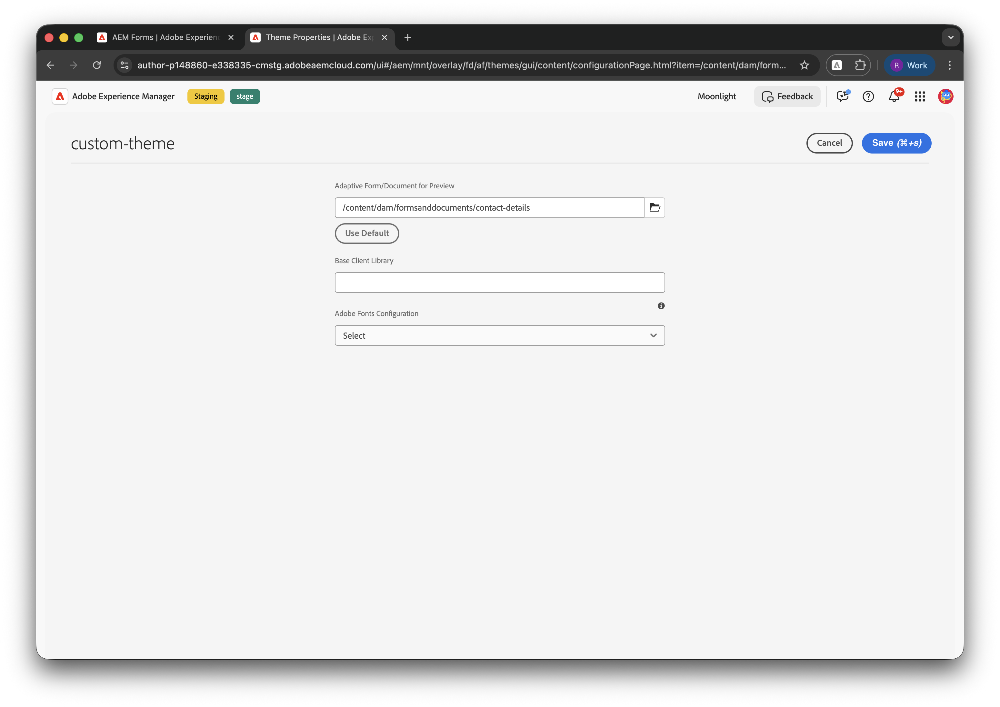
   * **[!UICONTROL View Theme CSS]**: Open a dialog with the full compiled CSS for the theme. To see CSS for only the currently selected component, use **[!UICONTROL View CSS]** in the sidebar instead (handy for debugging or copying rules).
      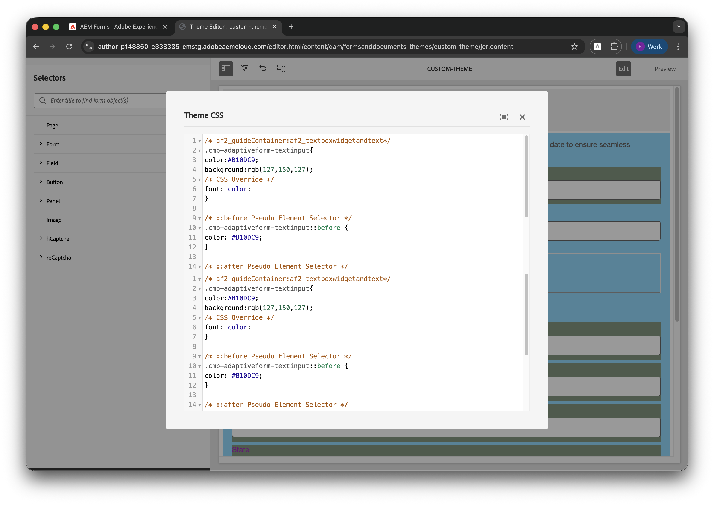
   * **[!UICONTROL Manage Styles]**: Open the dialog to save, name, and reuse text and image styles. Saved styles can be applied to other components; recently used styles may also appear for quick reuse.
   * **[!UICONTROL Help]**: Start the image-guided tour of the Theme Editor.
* **C: Undo / Redo**: Revert or reapply your last styling changes. Useful if you try a style and want to step back without losing other edits.
* **D: Emulator**: Select a device or breakpoint (for example, Desktop, Tablet, or Mobile) to preview the form at that screen size. The form preview resizes to match the selected breakpoint. Any styles you set while a breakpoint is selected apply only to that breakpoint, so you can define responsive styles. For details, see [Styling for different screen sizes](#styling-for-different-screen-sizes).
* **E: Edit / Preview**: Switch between two modes. **Edit** is the default: you can click components on the canvas to select them and change their styling in the sidebar. **Preview** shows the form as an end user would see it without selection borders, component labels, or the styling sidebar, so you can check how the themed form looks and behaves before publishing.

<!--
**3. Bottom of the sidebar: Simulate Error and Simulate Success**

When you style components by state (for example, Error or Success), you can preview that look without submitting the form. In AEM Forms as a Cloud Service, **Simulate Error** and **Simulate Success** are available at the **bottom of the left sidebar**. Scroll down in the sidebar if you don’t see them; they appear when you have a component selected and let you toggle the preview to match the Error or Success state.

* **Simulate Error**: Show the form as if a field failed validation, so you can see your **[!UICONTROL Error]** state styling.
* **Simulate Success**: Show the form as if validation passed, so you can see your **[!UICONTROL Success]** state styling.

Toggle these on or off as you adjust styles for each state. For more on styling by state, see [Style by component state](#style-by-state).
-->

### Style a Component

You can select a component to style in two ways:
* **From the Canvas**: Click directly on a component in the form, such as a text input. A floating component toolbar appears. Click **[!UICONTROL Text Input Widget]** in that toolbar to open its styling properties in the sidebar. Selecting an element on the canvas does not necessarily open its properties immediately.

   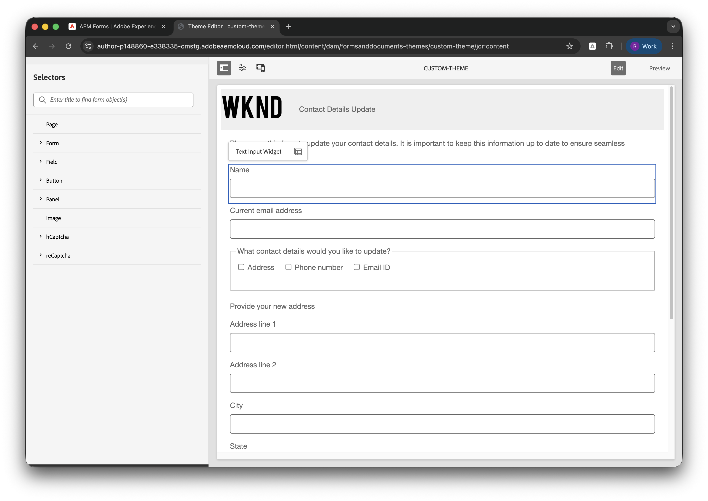

* **From the Selectors panel**: Use the tree structure in the left sidebar to drill down into specific components. For example, expand **[!UICONTROL Field]** > **[!UICONTROL Widget]** > **[!UICONTROL Text Input]** and use its edit control to open the text input widget properties.

   

#### Select related components and search selectors {#select-related-components-and-search-selectors}

The floating component toolbar lets you change the scope of the styles you edit:

* **[!UICONTROL Text Input Widget]** opens the properties for text input widgets.
* **[!UICONTROL Field Widget]** opens the properties for the generic field widget.
* The parent selection action moves the selection from the inner input to **[!UICONTROL Field]**. Click **[!UICONTROL Field]** in the toolbar to open its properties. Use this scope to style the field wrapper rather than the input interior.

To find a selector in the sidebar, enter its title in the search field with the placeholder **[!UICONTROL Enter title to find form object(s)]**. For example, search for `Text Input`. The tree expands matching paths and highlights the results; it does not replace the tree with a list containing only matches.

#### Apply styles to a component {#apply-styles-to-a-component}

Once a component is selected, the sidebar displays the available styling properties organized into the following categories:

* **[!UICONTROL Dimensions & Position]**: Control alignment, size, padding, margin, width, height, and Z-index.
* **[!UICONTROL Text]**: Configure font family, weight, color, size, line height, alignment, letter spacing, text decoration, and transform. For a complete list of supported CSS text properties, see the [MDN CSS Text documentation](https://developer.mozilla.org/en-US/docs/Web/CSS/CSS_text).
* **[!UICONTROL Background]**: Set a background color, image, or gradient. See [MDN CSS Backgrounds documentation](https://developer.mozilla.org/en-US/docs/Web/CSS/CSS_backgrounds_and_borders).
* **[!UICONTROL Border]**: Define border width, style, radius, and color.
* **[!UICONTROL Effects]**: Add opacity, blend modes, and shadows.

To apply a style:

1. Select the component from the canvas or the Selectors panel.
1. In **[!UICONTROL State]**, select **[!UICONTROL Default]**.
1. Set the desired visual properties in the sidebar. For example, for a business contact form, select **[!UICONTROL Text Input Widget]** and set **[!UICONTROL Font Color]** to `#1E293B` for dark slate text.
1. Click the checkmark icon **[!UICONTROL OK]** to confirm the property change.

Use **[!UICONTROL View CSS]** in the sidebar to inspect the CSS for the selected component. For example, the saved text input font color generates:

```css
.cmp-adaptiveform-textinput__widget {
  color: #1E293B;
}
```

#### Style by component state {#style-by-state}

Use the **[!UICONTROL State]** dropdown to edit styles for a particular component state. The available choices depend on the selected component. For **[!UICONTROL Text Input Widget]**, **[!UICONTROL Field Widget]**, and **[!UICONTROL Field]**, the menu includes **[!UICONTROL Default]**, **[!UICONTROL Focus]**, **[!UICONTROL Hover]**, **[!UICONTROL Disabled]**, and **[!UICONTROL Mandatory]**.

For example, save a blue focus border separately from the default text color. First, configure the default border width and style as described in [Component-level styling](#component-level-styling).

1. Open the **[!UICONTROL Text Input Widget]** properties.
1. In **[!UICONTROL State]**, select **[!UICONTROL Focus]**.
1. Under **[!UICONTROL Border]**, set the border color to `#1D4ED8`.
1. Click **[!UICONTROL OK]** to confirm.
1. Switch to **[!UICONTROL Preview]** in the Theme Editor toolbar.
1. Click inside a text input, such as **Full name**, to give it focus. Its border changes to `#1D4ED8`. Click outside the input to compare its default appearance.

   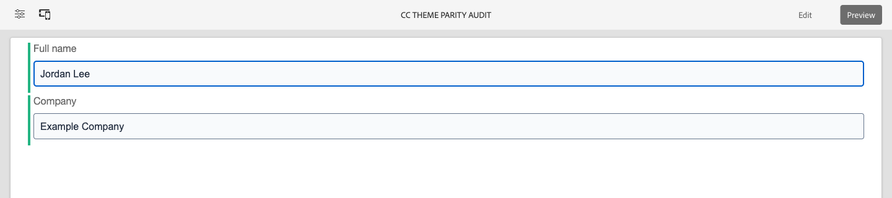

This checks the focus appearance in the Theme Editor preview form; it does not assign the theme to an Adaptive Form.

The focus border color is stored separately from properties saved for **[!UICONTROL Default]**. The generated CSS uses the `:focus` pseudo-class:

```css
.cmp-adaptiveform-textinput__widget:focus {
  border-color: #1D4ED8;
}
```

### Form-level styling {#form-level-styling}

Use a generic selector to style shared elements across field types. For example, **[!UICONTROL Field]** targets the field wrapper, not the inner text input.

**Example:** Add a light background to the field wrappers in a business contact form:

1. In the **Selectors** panel, open the **[!UICONTROL Field]** properties.
1. In **[!UICONTROL State]**, select **[!UICONTROL Default]**.
1. Set **[!UICONTROL Background Color]** to `#F8FAFC`.
1. Click **[!UICONTROL OK]**.

The light background applies to the wrappers around fields such as **Full name** and **Company**. It does not set the background color of the input interior.

### Component-level styling {#component-level-styling}

Component-level styling targets a specific component type. Selecting **[!UICONTROL Text Input]** styles text input widgets such as **Full name** and **Company**, not just the individual field you clicked in the preview.

**Example:** Give text inputs a light background, a consistent border, and readable text:

1. In the **Selectors** panel, expand **[!UICONTROL Field]** > **[!UICONTROL Widget]** > **[!UICONTROL Text Input]** and open its properties.
1. In **[!UICONTROL State]**, select **[!UICONTROL Default]**.
1. Set **[!UICONTROL Font Color]** to `#1E293B`.
1. Under **[!UICONTROL Background]**, set **[!UICONTROL Background Color]** to `#F8FAFC`.

   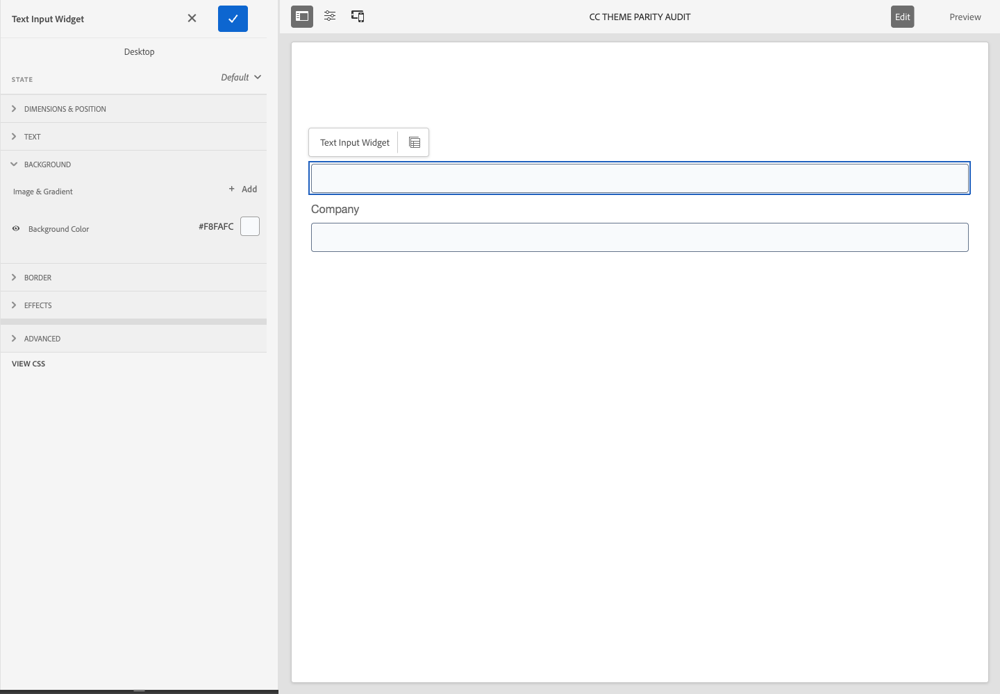

1. Under **[!UICONTROL Border]**, set a width of `1px`, a solid style, a color of `#64748B`, and a radius of `0.25rem`.

   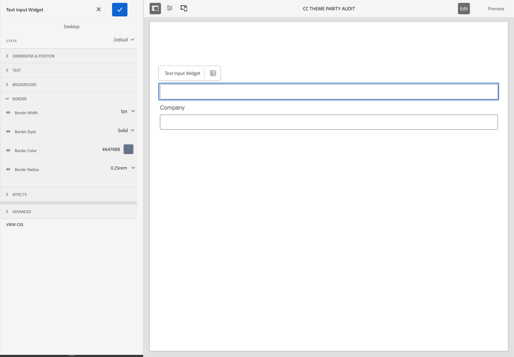

1. Click **[!UICONTROL OK]**.

These settings style the inner text input widgets, including their background. The field wrappers are styled separately, as described in [Form-level styling](#form-level-styling).

Switch to **[!UICONTROL Preview]** to inspect the saved text input appearance without the styling sidebar or selection overlays.

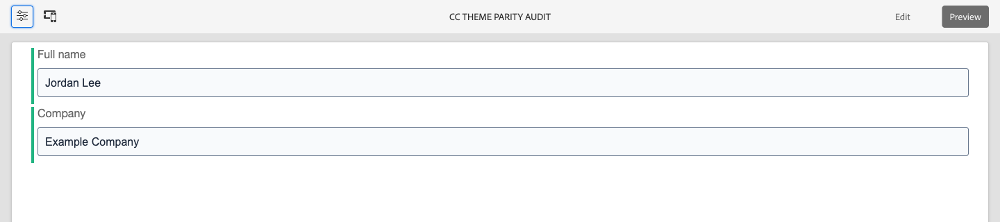

>[!NOTE]
>
> A field wrapper and its input widget are different elements. Styling one does not necessarily override the other. When multiple CSS rules target the same element and property, the CSS cascade and [specificity rules](https://developer.mozilla.org/en-US/docs/Web/CSS/Specificity) determine the result.

### Mask and restore styles {#mask-and-restore-styles}

Mask a property to stop applying its theme value without deleting the saved value. For example, you can temporarily mask the text input font color and restore it later.

The resulting color depends on the other applicable styles; masking does not set a particular replacement color.

1. In **[!UICONTROL Edit]** mode, open the **[!UICONTROL Text Input Widget]** properties and select **[!UICONTROL Default]**.
1. Expand **[!UICONTROL Text]** and click the eye icon beside **[!UICONTROL Font Color]**.
1. Click **[!UICONTROL OK]** to save the masked property.
1. Switch to **[!UICONTROL Preview]** to check that the masked theme color no longer applies.
1. Return to **[!UICONTROL Edit]** and reopen the same property.
1. Click the eye icon again to restore the saved font color.
1. Click **[!UICONTROL OK]** to save the restored property.
1. Switch to **[!UICONTROL Preview]** to check the restored appearance.

For example, masking a saved font color of `#1E293B` preserves that value. Restoring the property applies `#1E293B` again without requiring you to enter it again.

### Save and discard changes {#save-and-discard-changes}

Changes appear in the canvas while you edit. Use the checkmark **[!UICONTROL OK]** to save the property changes. Use **[!UICONTROL Cancel]** (the x icon at the top of the properties) to discard unsaved changes and retain the previously saved values.

If **[!UICONTROL Cancel or Save your changes to proceed]** appears when you change the selected component or switch to **[!UICONTROL Preview]**, save or discard the current property edits before proceeding.

For example, if the saved font color is `#1E293B`, changing it to `#0F766E` and clicking **[!UICONTROL Cancel]** leaves the saved color as `#1E293B`.

Correct invalid property values before saving. For example, entering `banana` as a font size displays a warning and **[!UICONTROL Resolve validation error to proceed]**. Confirming with the checkmark does not save that invalid value or replace the previously saved font size. Enter a valid CSS size, such as `1rem`, or cancel the change.

## Styling for different screen sizes {#styling-for-different-screen-sizes}

You can define different styles for different device sizes so your theme is responsive. The Theme Editor toolbar shows **device options** (for example, iPhone 5, iPad, Desktop, Tablet, Smaller Screen) to preview and style the form at that screen size.

1. In the canvas toolbar, use the **device emulator**: click one of the device labels (for example, **[!UICONTROL Desktop]**, **[!UICONTROL Tablet]**, **[!UICONTROL iPad]**, **[!UICONTROL Smaller Screen]**). A ruler above the form shows the pixel width for the selected device.
1. With that device selected, use the sidebar to set or adjust styles. The styles apply only for the selected device view.
1. Switch to another device and define styles for it as needed.
1. Click **[!UICONTROL OK]** and save the theme when finished.

   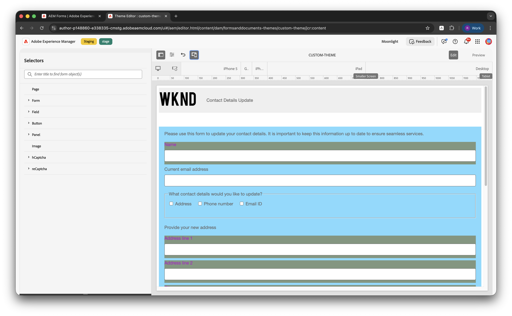

The same theme can therefore have different spacing, font sizes, or layout-related styles per device, matching the [AEM 6.5 Theme Editor behavior](https://experienceleague.adobe.com/docs/experience-manager-65/forms/adaptive-forms-advanced-authoring/themes.html) for responsive styling.

## Use advanced CSS overrides {#use-advanced-css-overrides}

For styles that are not available through the visual sidebar, you can write custom CSS directly in the editor.

1. Select the component.
1. In the sidebar, expand the **[!UICONTROL Advanced]** section.
1. Write your custom CSS rules in the **[!UICONTROL CSS Override]** area. These rules override any properties set through the visual controls if there is a conflict.

For a complete CSS property reference, see the [MDN Web Docs CSS reference](https://developer.mozilla.org/en-US/docs/Web/CSS/Reference).

### Add CSS pseudo-elements {#add-css-pseudo-elements}

The **[!UICONTROL Advanced]** section includes styling fields for CSS pseudo-elements such as `::before` and `::after`. Use these to decorate content already generated by the component's CSS. For example, `color: #64748B;` can color existing pseudo-element text, but a color declaration alone does not generate content or create a visible indicator.

The `::before` and `::after` pseudo-elements normally require a `content` declaration to generate content. They also depend on the target element: do not assume that they can display directly on an `<input>` element. For a full reference, see [MDN CSS Pseudo-elements](https://developer.mozilla.org/en-US/docs/Web/CSS/Pseudo-elements).

## Best practices {#best-practices}

* **Use the Selectors panel for precise targeting**: When styling nested elements such as a field label or a long description, use the Selectors panel on the left rather than clicking the canvas. This ensures that the correct CSS selector is generated with proper specificity.
* **Avoid assets from other themes**: When editing a theme, do not browse and add assets (such as images) from other themes. If the source theme is moved or deleted, your current theme breaks.
* **Do not change container panel layout width**: Specifying a fixed width on container panels makes them static and prevents them from adapting to different screen sizes.

## See Also {#see-also}

{{see-also}}
