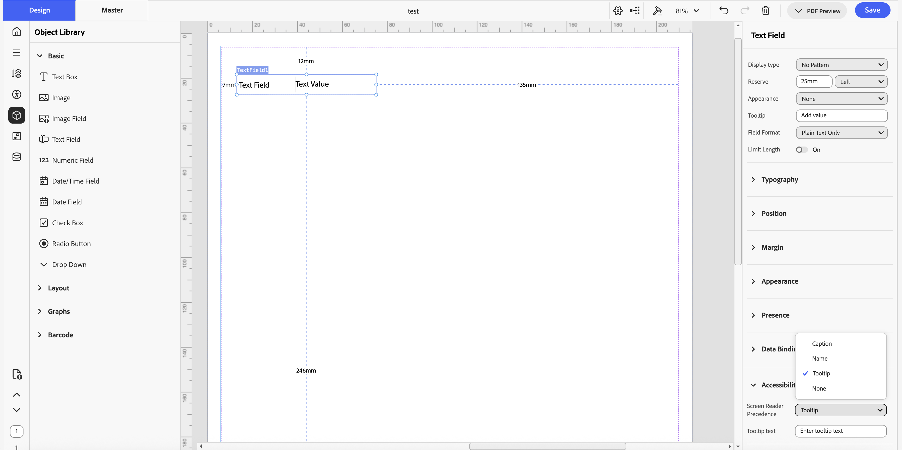
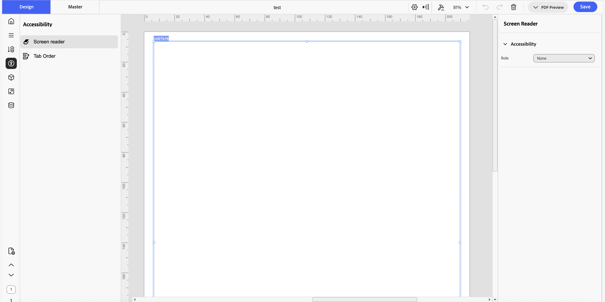
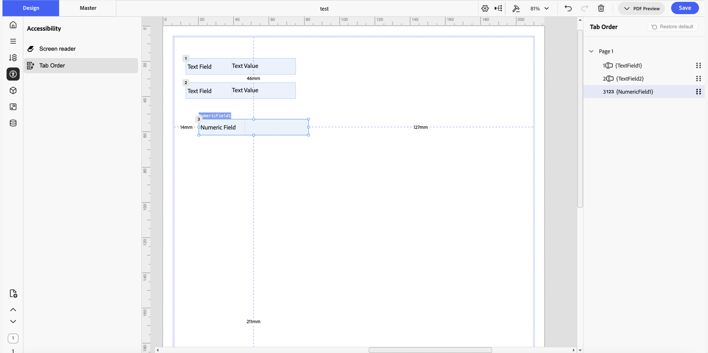
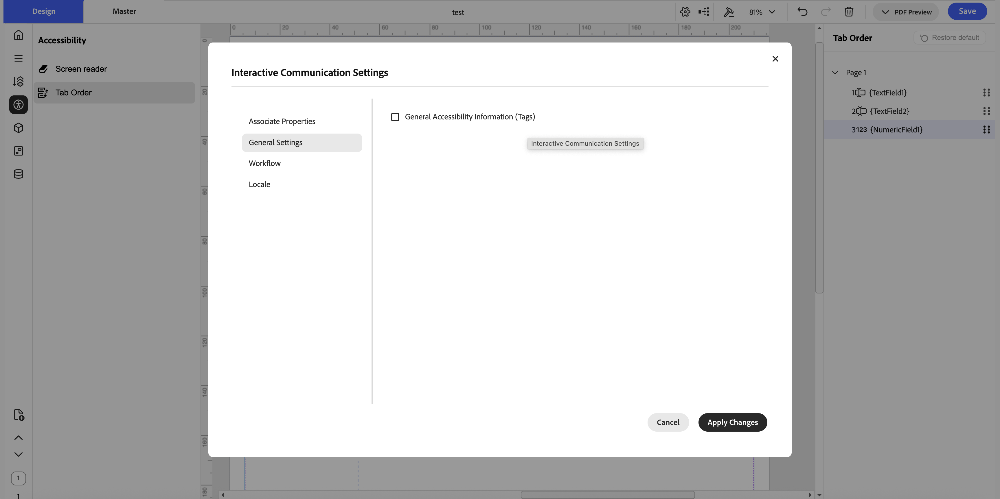

# Configure Accessibility in Interactive Communication Editor

## Overview

IC Editor (short for [Interactive Communication Editor](/help/forms/interactive-communication/introduction.md)) lets you configure how assistive technologies, such as screen readers (for example, NVDA or JAWS), interpret a document, so interactive communications comply with accessibility standards such as WCAG 2.2 (web accessibility), PDF/UA (PDF-specific accessibility), and Section 508 (U.S. federal accessibility requirements).

At design time, you set accessibility properties and tab order per field directly in IC Editor. It does not read the document aloud or let you preview the screen reader experience inside the editor. The actual screen reader experience happens later, when the generated PDF is opened and read aloud with a screen reader tool such as NVDA or JAWS, outside IC Editor. For the screen reader to announce the document correctly, the generated PDF must include accessibility tags, which you enable separately when you generate the PDF.

Accessibility support in IC Editor covers two areas:

* **Accessibility properties**: define how assistive technologies announce a field. You set a screen reader precedence, and, for some field types, a semantic role.
* **Tab order** (also called reading order): control the order in which screen readers read fields and the order in which keyboard focus moves between fields when a user presses Tab.

For a broader overview of making forms accessible, including concepts shared with other AEM Forms authoring tools, see [Creating accessible Adaptive Forms](/help/forms/creating-accessible-adaptive-forms.md).

Beyond setting properties field-by-field in the property sheet while you author a document, IC Editor's dedicated accessibility view lets you go through every field on the document one at a time, for example when an accessibility reviewer audits a government form or a customer-facing communication for compliance after authoring is complete.

Once you have set the accessibility properties and tab order you want, select **General Accessibility Information (Tags)** in the document's Interactive Communication Settings so that the accessibility tags are included when IC Editor generates the PDF.

## Set accessibility properties for a field

You can set accessibility properties for text, images, interactive fields (such as text fields, numeric fields, date fields, checkboxes, radio buttons, and dropdowns), subforms, and tables. The properties available, and their behavior, depend on the field type:

**Role**: assign a semantic role so assistive technologies understand the element's purpose in the document structure.

| Field type | Role options |
|---|---|
| Text elements | Heading Level 1 to 6, Caption, Artifact, or None |
| Subforms | Table, Header Row, Body Row, Footer Row, List, TOC, or None |
| Tables | Table (fixed; you can't change it) |
| Table cells | Heading Level 1 to 6, Caption, Artifact, or None (table cells are text boxes, so they have the same Role options as text elements) |
| Images and interactive fields | No Role option |

**Screen Reader Precedence**: controls what text a screen reader announces first for a field: its caption, name, tooltip, or helper text.

| Field type | Screen Reader Precedence options |
|---|---|
| Interactive fields (text fields, numeric fields, date fields, checkboxes, radio buttons, dropdowns, exclusion groups) | Caption, Name, Tooltip, or None |
| Non-interactive elements (images, plain text) | Name, Helper Text, or None |
| Tables | Name, Tooltip, or None |
| Subforms | Not available until Role is set to Table; once set, Name, Tooltip, or None |

If you set Screen Reader Precedence to None, the screen reader doesn't announce the field's caption, name, tooltip, or helper text. It only reads the field's value.

**Tooltip**: a general Tooltip field is available at the top of the property sheet for interactive fields. If you set Screen Reader Precedence to Tooltip, a separate Tooltip text field appears where you can set the text a screen reader announces.

For example, for an image you can set Screen Reader Precedence to Helper Text and enter text such as "This is a bank logo." When a user opens the generated PDF with a screen reader tool such as NVDA or JAWS, the tool reads this text aloud.

For a decorative image that carries no meaning, such as a background graphic, set Screen Reader Precedence to None so screen readers skip it entirely. For a text element used as a section header, such as "Payment Details," set Role to a Heading Level so the screen reader announces it as a heading rather than plain text.

### Set properties from the property sheet while authoring

While you author a document, you can set accessibility properties for a field directly in its property sheet:

1. Select the field on the canvas.
1. In the property sheet, expand the **Accessibility** section.
1. If the field type has one, set the **Role**.
1. Set the **Screen Reader Precedence**.
1. If you set Screen Reader Precedence to **Tooltip** or **Helper Text**, enter the text in the field that appears.

### Set properties from the dedicated accessibility view

After you finish authoring a document, an accessibility reviewer can go through every field on the document without navigating the full canvas:

1. In the left sidebar of IC Editor, select the **Accessibility** icon.
1. Select **Screen reader**.
1. Select a field on the canvas.
1. In the panel on the right, set the field's accessibility properties.
1. Repeat for each field on the document.

## Set tab order

Tab order defines two related behaviors:

* The order in which a screen reader reads the fields on a document.
* The order in which keyboard focus moves between fields when a user presses the Tab key.

By default, IC Editor numbers fields left to right and top to bottom (1, 2, 3, 4, and so on). IC Editor displays this order as a numbered badge on each field on the canvas, so you can see the current tab order without opening the Tab Order panel.

For example, if a document visually groups two related fields side by side, such as "City" and "State," but their default left-to-right order places an unrelated field in between, set a custom tab order so a screen reader reads "City" and "State" together, in the order a sighted user would expect.

### Set a custom tab order

1. In the left sidebar of IC Editor, select the **Accessibility** icon.
1. Select **Tab Order**.
1. In the **Tab Order** panel on the right, drag and drop fields to change their order.

### Restore the default tab order

1. In the **Tab Order** panel, select **Restore default**.

   IC Editor resets the tab order to the default left-to-right, top-to-bottom order.

## Generate a tagged, accessible PDF

After you set accessibility properties and tab order for the fields on your document, generate a tagged PDF so the accessibility tags are included in the output.

1. In the top toolbar, select the **Settings** icon to open the **Interactive Communication Settings** dialog.
1. Select the **General Settings** tab.
1. Select **General Accessibility Information (Tags)**.
1. Select **Apply Changes**.
1. Save the document.
1. Preview or download the PDF.

The generated PDF includes the accessibility tags based on the properties and tab order you set. You can confirm this by opening the downloaded PDF and inspecting its tags, for example with a PDF accessibility checker tool.

## Frequently Asked Questions: Accessibility in Interactive Communication Editor

**What is screen reader precedence?**

Screen reader precedence is the AEM Forms Interactive Communication Editor setting that controls what text a screen reader announces first for a field: its caption, name, tooltip, or helper text. Options vary by field type. Interactive fields such as text fields, checkboxes, and dropdowns support Caption, Name, Tooltip, or None. Images and plain text support Name, Helper Text, or None. Tables support Name, Tooltip, or None. Subforms only support Screen Reader Precedence once their Role is set to Table.

Setting this correctly ensures assistive technologies such as NVDA and JAWS announce accurate information for each field in a generated PDF. For the full procedure, see [Set accessibility properties for a field](#set-accessibility-properties-for-a-field).

**How are Role and Precedence different?**

In AEM Forms Interactive Communication Editor, Role assigns a semantic structural label to a field, such as a heading level, Caption, Artifact, or Table, so assistive technologies understand the field's place in the document's structure. Screen Reader Precedence controls what text is actually announced for that field, such as its caption, name, or tooltip. Role defines structure; Precedence defines announced content.

Images and interactive fields have no Role option, but every field type that has accessibility properties supports Screen Reader Precedence. See [Set accessibility properties for a field](#set-accessibility-properties-for-a-field) for the options available per field type.

**Does tab order affect appearance?**

No. Changing tab order in AEM Forms Interactive Communication Editor does not move, resize, or reposition fields on the canvas. It only changes the sequence a screen reader reads fields in and the order keyboard focus moves between fields when a user presses Tab. By default, fields are numbered left to right and top to bottom. A custom tab order lets you match the reading order to a document's visual field grouping, for example reading City and State together even if an unrelated field sits between them by default. See [Set tab order](#set-tab-order) for the procedure.

**What standards does it support?**

AEM Forms Interactive Communication Editor supports documents that comply with WCAG 2.2, PDF/UA, and Section 508 accessibility standards. Setting Role and Screen Reader Precedence for each field, defining a tab order, and enabling General Accessibility Information (Tags) when generating a PDF produces tagged output that assistive technologies such as NVDA and JAWS can read correctly, supporting compliance with all three standards. See [Generate a tagged, accessible PDF](#generate-a-tagged-accessible-pdf) for the steps.

**How do I generate a tagged PDF?**

Generate a tagged, accessible PDF in AEM Forms Interactive Communication Editor by selecting the Settings icon in the top toolbar to open the Interactive Communication Settings dialog, selecting the General Settings tab, enabling General Accessibility Information (Tags), and selecting Apply Changes. After saving the document, the previewed or downloaded PDF includes accessibility tags based on the Role, Screen Reader Precedence, and tab order configured for each field. See [Generate a tagged, accessible PDF](#generate-a-tagged-accessible-pdf) for the full procedure with screenshots.

**Which screen readers does it support?**

AEM Forms Interactive Communication Editor doesn't restrict which screen reader a reader uses. Accessibility properties and tab order configured in the editor produce standard PDF accessibility tags, which common screen reader tools such as NVDA and JAWS read correctly. Testing the generated PDF with a screen reader tool, such as NVDA or JAWS, confirms the configured Role, Screen Reader Precedence, and tab order are announced as expected. See [Set accessibility properties for a field](#set-accessibility-properties-for-a-field) and [Set tab order](#set-tab-order) for how to configure these properties.