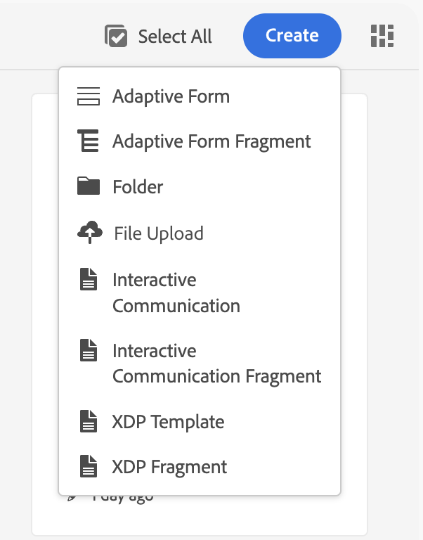
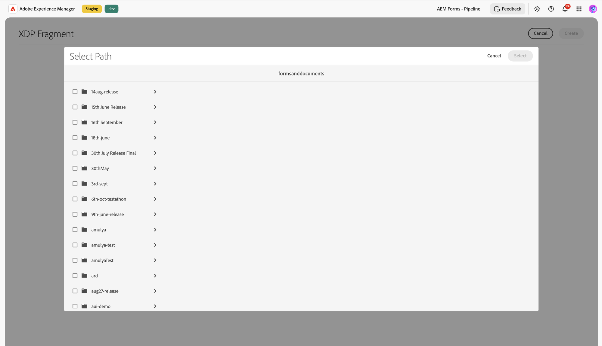
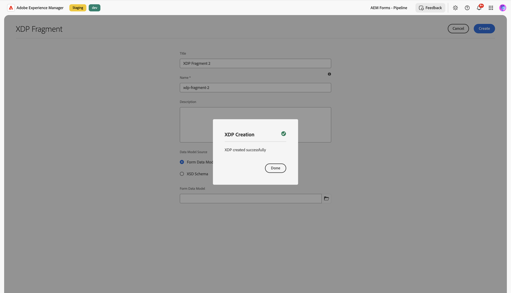
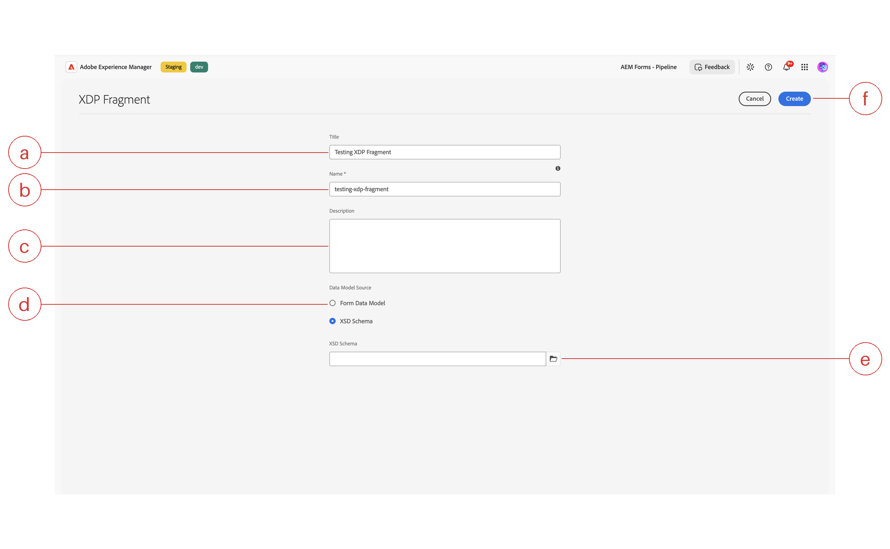

# Create an XDP Fragment in IC Editor

Forms Manager lets you create a new XDP (XML Data Package) fragment directly, instead of authoring one in Designer and uploading it. The **XDP Fragment** wizard generates a blank XDP file and hands it off to the Interactive Communication (IC) Editor, so you can start laying out fields and content the same way you'd edit any XDP today.

An XDP fragment created this way isn't an IC Communication. It's a classic Forms XDP document that's created, edited, and saved as that file, no different from an XDP you author elsewhere and then open in the editor. A fragment is a reusable block of content, such as a terms-and-conditions section, a signature block, or a standard disclosure, that one or more XDP templates or Interactive Communications can reference from the Fragments panel instead of recreating the same content in every document. A fragment's canvas always includes one designated content subform and has no independent master page, unlike a template. See [Support XDP Editing in Interactive Communication Editor](/help/forms/interactive-communication/support-xdp-editing.md) for how to reuse a fragment inside another XDP.

During creation, you can optionally bind the fragment to a data source by choosing **Form Data Model** (the default) or **XSD Schema** in the wizard:

- **[!UICONTROL Form Data Model]** (FDM) links the XDP to a schema already defined in AEM. Pick this when the fragment's own fields draw from a data structure that's already shared across other forms or communications, for example a customer address block bound to a common data model.
- **[!UICONTROL XSD Schema]** links the XDP to an uploaded `.xsd` file instead. The schema's root element is detected automatically from the file, so you don't need to type it. Pick this when the fragment's data structure is defined by a standalone schema file rather than an AEM Form Data Model.

Either way, the binding is written directly into the XDP's native data connection, the same mechanism an XDP authored in Designer already uses. A fragment doesn't need its own data binding to be useful; a purely static fragment, like a boilerplate legal paragraph, can be created with no Data Model Source selection, since its content doesn't bind to any field data.

>[!NOTE]
>
>XSD-bound XDP documents don't support the **Using Data Model** PDF preview option described in [Generate PDF Preview](/help/forms/interactive-communication/generate-pdf-preview.md). Only Form Data Model-bound XDP documents support that preview option today.

## Prerequisites

- You belong to the **forms-users** group.
- If you plan to bind the fragment to a data model, upload the **Form Data Model** or **XSD schema** to AEM beforehand, the same way you upload any other asset. The wizard lets you select from already-uploaded assets; it doesn't let you upload a new one inline.
- Decide what the fragment is meant to stand in for before you create it. Keep each fragment scoped to one reusable block of content (a signature block, a disclosure paragraph, an address section) rather than an entire document, so it stays easy to reference from multiple templates later.

## Create an XDP fragment

1. Navigate to **Forms > Forms & Documents**.
1. Select **Create**, then select **[!UICONTROL XDP Fragment]**.

   

1. Enter a **Title** (callout **a**) for the fragment. This is the display name shown in **Forms & Documents** and in the Fragments panel when you go to reuse it inside another XDP.
1. Enter a **Name** (callout **b**, required). This becomes the asset's repository node name, so keep it short, lowercase, and free of spaces; AEM uses it to build the asset's path.
1. Optionally, enter a **Description** (callout **c**) to note what the fragment contains and where it's meant to be reused, for example "Standard terms-and-conditions block for vendor agreements." This helps other authors find and reuse the right fragment later instead of creating a duplicate.
1. Under **Data Model Source** (callout **d**), choose how you want to bind data:
   - **[!UICONTROL Form Data Model]** (default) &mdash; select an existing Form Data Model asset already uploaded to AEM.
   - **[!UICONTROL XSD Schema]** &mdash; select an uploaded XSD schema file instead. The root element is detected automatically from the schema; you don't need to type it.
1. Select the folder icon next to the path field (callout **e**) to open the **Select Path** dialog, then browse to and choose the Form Data Model or XSD schema asset. The dialog is rooted at `/content/dam/formsanddocuments-fdm` when **Form Data Model** is selected, or `/content/dam/formsanddocuments` when **XSD Schema** is selected, so you only see assets of the matching type.

   

1. Review the Title, Name, Description, and Data Model Source values, then select **Create** (callout **f**).
1. In the confirmation dialog, select **Done** to open the new fragment in the IC Editor.

   

### XDP Fragment wizard field reference

The screenshot below labels each field in the **XDP Fragment** wizard with a letter, matching the callouts referenced in the steps above. Use the table underneath it to match each letter to what that field does.

| Callout | Field | What it does |
|---------|-------|---------------|
| a | **Title** | Display name shown in Forms & Documents and the Fragments panel. |
| b | **Name** | Required repository node name for the asset. |
| c | **Description** | Optional free-text notes about the fragment's content and intended reuse. |
| d | **Data Model Source** | Radio choice between **Form Data Model** and **XSD Schema** binding. |
| e | **Path picker** | Folder icon that opens the **Select Path** dialog to choose the bound asset. |
| f | **Create** | Commits the fragment; stays disabled until Name is filled in. |

## Verify

After you select **Done**, the IC Editor opens with a blank canvas for your new XDP fragment. The file also appears in **Forms & Documents**, listed alongside your other fragments, using the **Name** you entered as its repository node name and the **Title** as its display name.

Open an existing XDP template or Interactive Communication, open its Fragments panel, and confirm your new fragment appears in the list and can be inserted onto the canvas.

A new fragment's canvas includes a designated content subform for your reusable content; the editor doesn't let you delete that subform or add components outside it. A fragment also has no independent master page of its own, so the **Master** tab isn't offered while you're editing a fragment, unlike when you're editing a template.

## Frequently Asked Questions — XDP Fragment

**What is an XDP fragment?**

An XDP fragment is a reusable block of content, such as a terms-and-conditions section, a signature block, or a standard disclosure, created in AEM Forms through the XDP Fragment wizard. One or more XDP templates or Interactive Communications can reference it from the Fragments panel instead of recreating the same content in every document, and its canvas always includes a single designated content subform.

**How do I create an XDP fragment?**

Creating an XDP fragment starts in AEM Forms under Forms > Forms & Documents: select Create, then XDP Fragment, enter a Title and a required Name, optionally bind it to a Form Data Model (FDM) or XSD Schema, and select Create. Selecting Done in the confirmation dialog opens the new fragment in the Interactive Communication Editor, ready to be inserted later from another document's Fragments panel.

**Does a fragment have a Master tab?**

An XDP fragment has no independent master page, so the Master tab isn't offered while editing a fragment in the Interactive Communication Editor, unlike when editing an XDP template in AEM Forms. A fragment's canvas is limited to its single designated content subform, and the editor doesn't let you delete that subform or add components outside it.

**Does a fragment need data binding?**

A fragment may optionally bind to a **[!UICONTROL Form Data Model]** or **[!UICONTROL XSD Schema]**, but it doesn't need its own data binding to be useful. A purely static fragment, such as a boilerplate legal paragraph, can be created with no Data Model Source selection at all, since its content doesn't bind to any field data; binding is only needed when the fragment's own fields must draw from a Form Data Model (FDM) or XSD schema.

## Related tasks

- [Create an XDP Template in IC Editor](/help/forms/interactive-communication/create-xdp-template.md) &mdash; create the base layout that can reference this fragment.
- [Support XDP Editing in Interactive Communication Editor](/help/forms/interactive-communication/support-xdp-editing.md) &mdash; edit an existing XDP, and reuse XDP fragments from the Fragments panel.
- [Generate PDF Preview](/help/forms/interactive-communication/generate-pdf-preview.md) &mdash; preview an XDP document with no data, local XML data, or Form Data Model sample data.
- [Create an Interactive Communication](/help/forms/interactive-communication/create-interactive-communication.md)
