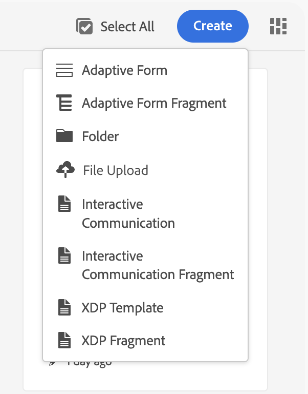
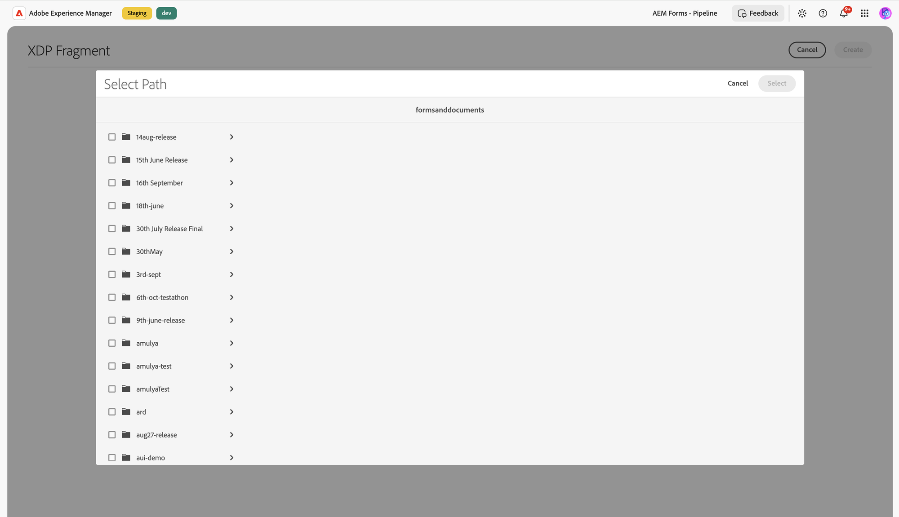
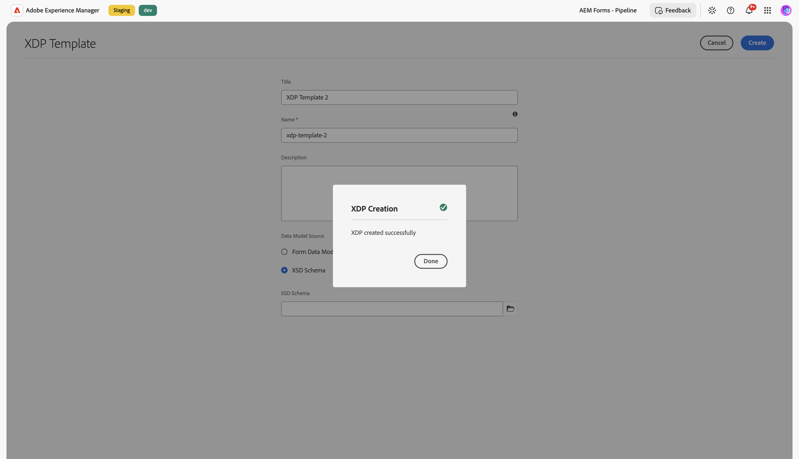
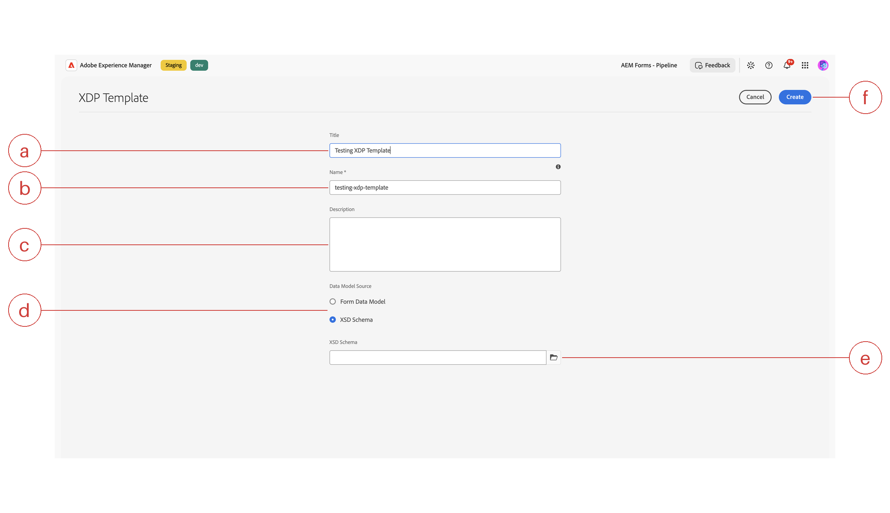

# Create an XDP Template in IC Editor

Forms Manager lets you create a new XDP (XML Data Package) template directly, instead of authoring one in Designer and uploading it. The **XDP Template** wizard generates a blank XDP file and hands it off to the Interactive Communication (IC) Editor, so you can start laying out fields, fragments, and master pages the same way you'd edit any XDP today.

An XDP template created this way isn't an IC Communication. It's a classic Forms XDP document that's created, edited, and saved as that file, no different from an XDP you author elsewhere and then open in the editor. Use it as the reusable base layout for a communication: the headers, footers, master pages, and bound fields that one or more Interactive Communications pull in as their starting XDP. This gives you a single reusable base layout that multiple Interactive Communications can share.

During creation, you can optionally bind the template to a data source by choosing **Form Data Model** (the default) or **XSD Schema** in the wizard:

- **[!UICONTROL Form Data Model]** (FDM) links the XDP to a schema already defined in AEM. Pick this when the data structure already exists as a Form Data Model asset, for example one shared across several forms or communications.
- **[!UICONTROL XSD Schema]** links the XDP to an uploaded `.xsd` file instead. The schema's root element is detected automatically from the file, so you don't need to type it. Pick this when the data structure is defined by a standalone schema file rather than an AEM Form Data Model.

Either way, the binding is written directly into the XDP's native data connection, the same mechanism an XDP authored in Designer already uses. You can also skip binding entirely and add or change the data connection later from within the IC Editor.

>[!NOTE]
>
>XSD-bound XDP documents don't support the **Using Data Model** PDF preview option described in [Generate PDF Preview](/help/forms/interactive-communication/generate-pdf-preview.md). Only Form Data Model-bound XDP documents support that preview option today.

## Prerequisites

- You belong to the **forms-users** group.
- If you plan to bind the template to a data model, upload the **Form Data Model** or **XSD schema** to AEM beforehand, the same way you upload any other asset. The wizard lets you select from already-uploaded assets; it doesn't let you upload a new one inline.
- Decide up front whether the template needs a data binding at all. If the template is purely a layout shell that a later Interactive Communication will bind to its own data, you can leave the Data Model Source selection at its default and bind the data connection afterward in the IC Editor instead.

## Create an XDP template

1. Navigate to **Forms > Forms & Documents**.
1. Select **Create**, then select **[!UICONTROL XDP Template]**.

   

1. Enter a **Title** (callout **a**) for the template. This is the display name shown in **Forms & Documents** and throughout the AEM UI.
1. Enter a **Name** (callout **b**, required). This becomes the asset's repository node name, so keep it short, lowercase, and free of spaces; AEM uses it to build the asset's path.
1. Optionally, enter a **Description** (callout **c**) to note the template's purpose, for example which communications it's meant to back or what layout it provides. This helps other authors find and reuse the right template later.
1. Under **Data Model Source** (callout **d**), choose how you want to bind data:
   - **[!UICONTROL Form Data Model]** (default) &mdash; select an existing Form Data Model asset already uploaded to AEM.
   - **[!UICONTROL XSD Schema]** &mdash; select an uploaded XSD schema file instead. The root element is detected automatically from the schema; you don't need to type it.
1. Select the folder icon next to the path field (callout **e**) to open the **Select Path** dialog, then browse to and choose the Form Data Model or XSD schema asset. The dialog is rooted at `/content/dam/formsanddocuments-fdm` when **Form Data Model** is selected, or `/content/dam/formsanddocuments` when **XSD Schema** is selected, so you only see assets of the matching type.

   

1. Review the Title, Name, Description, and Data Model Source values, then select **Create** (callout **f**).
1. In the confirmation dialog, select **Done** to open the new template in the IC Editor.

   

### XDP Template wizard field reference

The screenshot below labels each field in the **XDP Template** wizard with a letter, matching the callouts referenced in the steps above. Use the table underneath it to match each letter to what that field does.

| Callout | Field | What it does |
|---------|-------|---------------|
| a | **Title** | Display name shown in Forms & Documents and the AEM UI. |
| b | **Name** | Required repository node name for the asset. |
| c | **Description** | Optional free-text notes about the template's purpose. |
| d | **Data Model Source** | Radio choice between **Form Data Model** and **XSD Schema** binding. |
| e | **Path picker** | Folder icon that opens the **Select Path** dialog to choose the bound asset. |
| f | **Create** | Commits the template; stays disabled until Name is filled in. |

## Verify

After you select **Done**, the IC Editor opens with a blank canvas for your new XDP template. The file also appears in **Forms & Documents**, listed alongside your other templates, using the **Name** you entered as its repository node name and the **Title** as its display name.

If you bound the template to a Form Data Model or XSD schema, open the Data Model panel in the IC Editor and confirm the schema's fields appear there, ready to drag onto the canvas.

## Frequently Asked Questions — XDP Template

**What is an XDP template?**

An XDP template is a classic Forms XDP document created directly through the XDP Template wizard in AEM Forms, without authoring it in Designer first. It is not an Interactive Communication; it serves as the reusable base layout — headers, footers, master pages, and bound fields — that one or more Interactive Communications pull in as their starting XDP in the Interactive Communication Editor.

**How do I create an XDP template?**

Creating an XDP template starts in AEM Forms under Forms > Forms & Documents: select Create, then XDP Template, enter a Title and a required Name, optionally bind the template to a Form Data Model (FDM) or XSD Schema, and select Create. Selecting Done in the confirmation dialog opens the new template in the Interactive Communication Editor with a blank canvas, ready for layout work.

**What does Form Data Model binding do?**

Form Data Model (FDM) binding links an XDP template to a schema already defined and uploaded in AEM Forms, writing that connection directly into the XDP's native data connection. Form Data Model, the wizard's default option, is the right choice when the template's data structure already exists as an FDM asset shared across other forms or communications, rather than as a standalone XSD schema file.

**Can I create a template without data binding?**

An XDP template in AEM Forms doesn't require a data binding at creation. Leaving the Data Model Source selection at its default and skipping the binding step keeps the template as a pure layout shell; the data connection can be added or changed later from inside the Interactive Communication Editor, once a specific Interactive Communication determines what data the template should bind to.

## Related tasks

- [Create an XDP Fragment in IC Editor](/help/forms/interactive-communication/create-xdp-fragment.md) &mdash; create a reusable content block that a template can reference.
- [Support XDP Editing in Interactive Communication Editor](/help/forms/interactive-communication/support-xdp-editing.md) &mdash; edit an existing XDP, and reuse XDP fragments from the Fragments panel.
- [Generate PDF Preview](/help/forms/interactive-communication/generate-pdf-preview.md) &mdash; preview an XDP document with no data, local XML data, or Form Data Model sample data.
- [Create an Interactive Communication](/help/forms/interactive-communication/create-interactive-communication.md)
