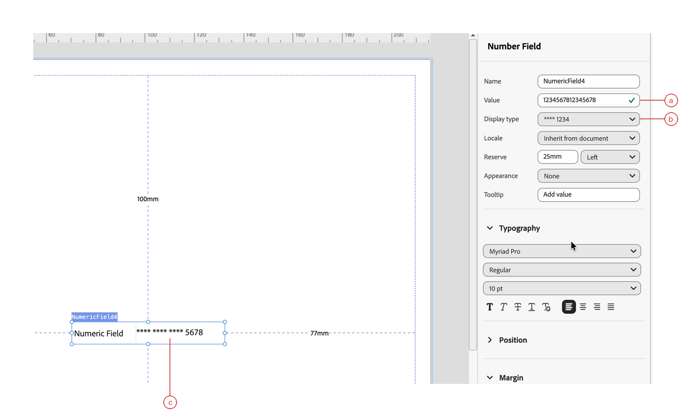
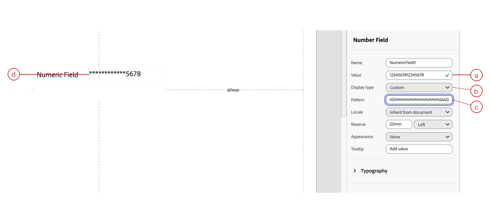
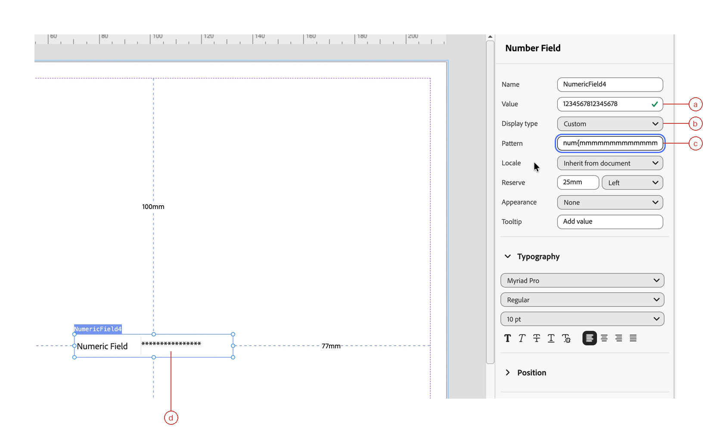

# Mask numeric values in AEM Forms {#mask-numeric-values}

Numeric display masking in the Interactive Communication Editor in Adobe Experience Manager (AEM) Forms replaces selected digits with asterisks (`*`) on the design canvas. It changes the displayed presentation, not the underlying numeric value. Apply a display pattern to a Numeric Field to keep selected trailing digits visible or mask all significant digits.

This is useful for communications that contain numeric identifiers, such as credit card numbers, account numbers, or numeric policy references. For example, a customer with multiple cards can recognize the relevant card from its last four digits without seeing the full card number. An account statement can use the same approach to identify the account associated with a balance or transaction.

The following examples use the synthetic value `1234567812345678`:

| Example | Displayed value | What it shows |
|---------|-----------------|---------------|
| Credit card reference with grouped masking | `**** **** **** 5678` | The last four digits remain visible, with spaces separating the groups. |
| Numeric account reference with custom partial masking | `************5678` | The first 12 digits are replaced with asterisks, and the last four remain visible. |
| Numeric identifier with full masking | `****************` | All 16 digits are replaced with asterisks. |

You configure masking through the Numeric Field's display type. The predefined masking option provides a grouped format with trailing digits visible. A custom pattern lets you specify which digit positions to mask or display. Check the canvas result against your intended output, especially when your data contains values of different lengths.

Display masking is not encryption and does not protect stored or transmitted data. This article shows how to apply the predefined option, create custom partial and full masks, and verify the results using synthetic values.

## 1. Prerequisites {#prerequisites}

Before you begin, make sure you have:

* Access to an Interactive Communication Editor build that includes numeric masking.
* An Interactive Communication containing a [Numeric Field component](/help/forms/interactive-communication/numeric-field.md).
* A synthetic numeric value in the field, entered through its **[!UICONTROL Value]** property or supplied through data binding.

Use synthetic test data rather than real credit card details.

## 2. Apply numeric masking {#apply-the-masking-pattern}

Choose the predefined pattern for its default masked presentation, or use a custom pattern to control which digit positions remain visible.

### 2.1 Select the predefined pattern {#select-the-predefined-pattern}

Use the predefined option to apply a masking pattern without entering a picture clause.

1. Select the Numeric Field on the design canvas.
1. Open **[!UICONTROL Properties]**.
1. In **[!UICONTROL Display type]**, select **[!UICONTROL \*\*\*\* 1234]**.
1. Check the masked value on the canvas.

| Label | Description |
|-------|-------------|
| **a** | **[!UICONTROL Value]:** The numeric value to format, shown as `1234567812345678`. |
| **b** | **[!UICONTROL Display type]:** The predefined masking option, `**** 1234`. |
| **c** | **Canvas result:** The masked value, `**** **** **** 5678`, with the last four digits visible. |

### 2.2 Enter a custom pattern {#enter-a-custom-pattern}

Use a custom numeric display pattern (picture clause) to leave selected trailing digits visible or mask all significant digits.

1. Select the Numeric Field on the design canvas.
1. Open **[!UICONTROL Properties]**.
1. In **[!UICONTROL Display type]**, select **[!UICONTROL Custom]**.
1. In **[!UICONTROL Pattern]**, enter a numeric picture clause from the examples below. Enter only the expression, without surrounding backticks or quotation marks.
1. Check the masked value on the canvas.

For a 16-digit value, use `num{mmmmmmmmmmmmzzzz}` to show only the last four digits. For example, `1234567812345678` displays as `************5678`.

The following table compares custom patterns for the same synthetic value:

| Pattern | Result |
|---------|--------|
| `num{mmmmmmmmmmmmzzzz}` | `************5678` |
| `num{mmmmmmmmmmmmmmm9}` | `***************8` |
| `num{mmmmmmmmmmmmmmmm}` | `****************` |

**Custom partial masking**

The **[!UICONTROL Pattern]** field is horizontally scrolled in this screenshot. The complete expression is `num{mmmmmmmmmmmmzzzz}`.

| Label | Description |
|-------|-------------|
| **a** | **[!UICONTROL Value]:** The numeric value to format. |
| **b** | **[!UICONTROL Display type]:** Select **[!UICONTROL Custom]** to enter your own masking pattern. |
| **c** | **[!UICONTROL Pattern]:** Enter `num{mmmmmmmmmmmmzzzz}` to mask the first 12 digits and display the last four. |
| **d** | **Canvas result:** The partially masked value, `************5678`. |

**Custom full masking**

| Label | Description |
|-------|-------------|
| **a** | **[!UICONTROL Value]:** The numeric value to format. |
| **b** | **[!UICONTROL Display type]:** Select **[!UICONTROL Custom]** to enter your own masking pattern. |
| **c** | **[!UICONTROL Pattern]:** Enter `num{mmmmmmmmmmmmmmmm}` to mask all 16 digits. |
| **d** | **Canvas result:** The fully masked value, `****************`. |

## 3. Verify the masked value {#verify-the-masked-value}

Compare the canvas value with the expected result for your custom pattern. For the predefined pattern `num{mmmm mmmm mmmm mmmm zzz9}`, the synthetic value `1234567812345678` displays as `**** **** **** 5678`.

Check representative values from your data, including the shortest and longest values, before using the pattern.

## 4. Numeric masking symbols and limits {#pattern-considerations}

The symbols in a numeric picture clause determine which digit positions are masked or displayed. In `num{mmmmmmmmmmmmzzzz}`, the 12 `m` positions mask the first 12 digits of a 16-digit value, and the four `z` positions display the last four digits once a significant digit has been reached.

The `z` positions are optional and suppress leading zeros until a significant or required digit is reached. Use `9` when a digit position must always be displayed, as in the last-digit example `num{mmmmmmmmmmmmmmm9}`. The predefined pattern, `num{mmmm mmmm mmmm mmmm zzz9}`, uses both symbols.

| Symbol | Meaning |
|--------|---------|
| `m` | Masks an integer digit with `*`; suppresses leading zeros until the first significant or required digit |
| `9` | Displays a required digit |
| `z` | Displays a digit while suppressing leading zeros |

Keep these considerations in mind when choosing a pattern:

* Include enough digit positions for the longest value. Values exceeding the pattern's capacity display unchanged in the canvas.
* Leading zeros can be suppressed. The result for an all-zero value depends on required digit positions and literal separators. For example, `num{mmmmmmmmmmmmzzzz}` displays `0`, while a pattern with four required digit positions, `num{mmmmmmmmmmmm9999}`, displays `0000`.
* Spaces and hyphens in a pattern remain in the displayed result.
* If the preset is unavailable for the [selected locale](/help/forms/interactive-communication/support-localization.md), enter its picture clause using **[!UICONTROL Custom]**.
* These examples mask integer values, not decimal digits.

>[!IMPORTANT]
>
> Do not rely on display masking to protect stored or transmitted payment information.

## 5. Numeric masking FAQs {#numeric-masking-faqs}

These answers clarify custom pattern entry and common masking checks.

### 5.1 Where do custom patterns go? {#where-do-custom-patterns-go}

Enter the complete numeric picture clause in the **[!UICONTROL Pattern]** field after selecting **[!UICONTROL Custom]** in **[!UICONTROL Display type]**. See [Enter a custom pattern](#enter-a-custom-pattern) for instructions and examples.

### 5.2 Why is the value unmasked? {#why-is-the-value-unmasked}

Check that the pattern contains only the intended expression, without copied backticks or quotation marks. Enter the complete expression, for example `num{mmmmmmmmmmmmzzzz}`. Values exceeding the pattern's digit capacity display unchanged. Check the input length against the available digit positions. See [Numeric masking symbols and limits](#pattern-considerations).

### 5.3 How do I mask every digit? {#how-do-i-mask-every-digit}

Use a custom pattern with an `m` position for each integer digit you want to mask. Match the pattern to the expected input length and check the canvas result. See the full-masking example in [Enter a custom pattern](#enter-a-custom-pattern).

### 5.4 Does masking change the stored value? {#does-masking-change-the-stored-value}

No. Numeric display masking changes the displayed presentation, not the underlying numeric value. It is not encryption and does not protect stored or transmitted data.

## 6. Related tasks {#related-tasks}

For related field configuration tasks, see:

* [Numeric Field component](/help/forms/interactive-communication/numeric-field.md)
* [Configure the locale](/help/forms/interactive-communication/support-localization.md)
* [Configure data binding](/help/forms/interactive-communication/configure-data-binding.md)
