# Use Dynamic Media images in AEM Forms

Use images your team has already approved without copying them to each AEM instance. Dynamic Media with OpenAPI capabilities connects Adobe Experience Manager (AEM) Forms to AEM Assets, so you can browse approved images and add them to your forms.

For example, you can use the same approved product photo in several forms while keeping the original image in one place. AEM Forms saves a reference that points to the original image, instead of a separate copy.

>[!NOTE]
>
> Dynamic Media image integration is available through the Early Access program. For Foundation and Core Components, request feature toggle activation by emailing [aem-forms-ea@adobe.com](mailto:aem-forms-ea@adobe.com). Edge Delivery Services (EDS) forms do not require separate activation. Keep Foundation and Core activation enabled while forms use remote images; deactivation can prevent saved remote images from loading.

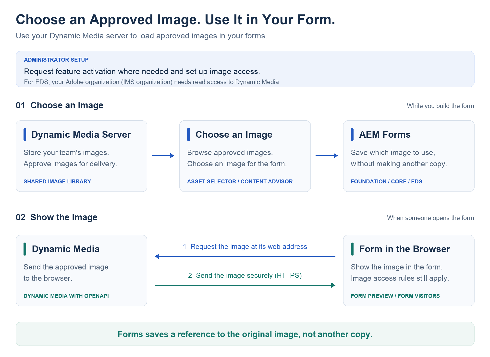

*First, choose an approved image for your form. When someone opens the form, their browser requests the image and Dynamic Media sends it back. The arrows explain this flow; they are not extra steps for the form author.*

To learn more about how Dynamic Media manages and delivers images, see the [Dynamic Media with OpenAPI capabilities overview](https://experienceleague.adobe.com/en/docs/experience-manager-cloud-service/content/assets/dynamicmedia/dynamic-media-open-apis/dynamic-media-open-apis-overview).

This guide covers administrator configuration and authoring with Foundation Components, Core Components, and Edge Delivery Services forms in **AEM Forms as a Cloud Service**. It does not cover AEM 6.5 LTS.

## Before you begin {#before-you-begin}

Before you start, check that:

- Your AEM Forms as a Cloud Service environment uses Forms release **29001** or above.
- Dynamic Media with OpenAPI capabilities is enabled in the AEM Assets environment that stores your images.
- Your team has approved the images for **Delivery**, not only for Content Hub. See [Approve assets in Experience Manager](https://experienceleague.adobe.com/en/docs/experience-manager-cloud-service/content/assets/dynamicmedia/dynamic-media-open-apis/approve-assets).
- Form authors have permission to access that AEM Assets environment.
- The AEM Forms editor uses HTTPS.

## Configure the integration as an administrator {#configure-the-integration-as-an-administrator}

For Foundation and Core Components, configure the Dynamic Media connection by setting Cloud Manager environment variables in your Forms environment.

To add or update environment variables, you need the **Deployment Manager** role in Cloud Manager. The [Cloud Manager environment-variable procedure](https://experienceleague.adobe.com/en/docs/experience-manager-cloud-service/content/implementing/using-cloud-manager/environment-variables#add-variables) explains the permissions and configuration steps.

1. Find the Dynamic Media delivery hostname for the source AEM Assets environment that stores your images. Use the Assets environment's hostname, not the hostname of the Forms environment.
2. Request the Adobe Identity Management System (IMS) client ID through Adobe Support, as described in the [remote Assets integration guide](https://experienceleague.adobe.com/en/docs/experience-manager-cloud-service/content/assets/dynamicmedia/dynamic-media-open-apis/integrate-remote-approved-assets-with-sites).
3. In Cloud Manager, open the program and environment that run your forms. Select **[!UICONTROL Configuration]**, then **[!UICONTROL Add / Update]**. If no variables are configured yet, select **[!UICONTROL Add Configuration]**.
4. In the **[!UICONTROL Environment Configuration]** dialog, add the following variables.

   | Variable | Value |
   | --- | --- |
   | `ASSET_DELIVERY_REPOSITORY_ID` | The Dynamic Media delivery hostname, without `https://`. For example: `delivery-p<program-id>-e<environment-id>.adobeaemcloud.com`. Replace the placeholders with the program and environment IDs of the source AEM Assets environment. |
   | `ASSET_DELIVERY_IMS_CLIENT` | The IMS client ID provided for this connection. |

5. For each variable, set **[!UICONTROL Step Applied]** to the service scope (**Author**, **Publish**, **Preview**, or **All**) that your Forms deployment uses. Select **[!UICONTROL Save]** and wait for the environment update to finish.
6. Open a Foundation or Core Components form and check that **[!UICONTROL Pick]** > **[!UICONTROL Remote]** is available in the Image component settings.

Both access and approval matter. Setting up the connection does not grant access or approve images automatically. An approved image can still have delivery restrictions. Ask your Assets administrator to check that the intended form audience can access it. See [Restrict delivery of assets](https://experienceleague.adobe.com/en/docs/experience-manager-cloud-service/content/assets/dynamicmedia/dynamic-media-open-apis/restrict-assets-delivery).

For EDS forms, ask your Dynamic Media administrator to grant the IMS organization used in Universal Editor read access to the Dynamic Media server.

## Use approved images as a form author

Complete [administrator configuration](#configure-the-integration-as-an-administrator), then follow the section that matches your form:

| Form type | Editor | Choose an image | Saved value |
| --- | --- | --- | --- |
| Foundation Components | Adaptive Forms editor | **[!UICONTROL Pick]** > **[!UICONTROL Remote]** | Remote asset reference |
| Core Components | Adaptive Forms editor | **[!UICONTROL Pick]** > **[!UICONTROL Remote]** | Remote asset reference |
| EDS forms | Universal Editor | **[!UICONTROL Image]** > **[!UICONTROL Add]**, then select **[!UICONTROL Repository]** in Content Advisor | Dynamic Media delivery URL |

If the Image component is unavailable, ask a template administrator to allow it in the Core Components template's [Allowed Components](https://experienceleague.adobe.com/en/docs/experience-manager-core-components/using/adaptive-forms/adaptive-forms-components/form-container#allowed-components-tab). For Foundation Components, enable it in [Design mode](https://experienceleague.adobe.com/en/docs/experience-manager-cloud-service/content/forms/adaptive-forms-authoring/authoring-adaptive-forms-foundation-components/create-an-adaptive-form-on-forms-cs/introduction-forms-authoring#page-toolbar). These component-availability settings do not apply to Universal Editor.

### Foundation Components

Use the Image component settings to choose an approved image.

1. Open an Adaptive Form that uses Foundation Components.
2. Add an Image component, or select one already in the form. Open its settings.
3. Select **[!UICONTROL Pick]** > **[!UICONTROL Remote]**. The Asset Selector opens so you can browse images in AEM Assets.

   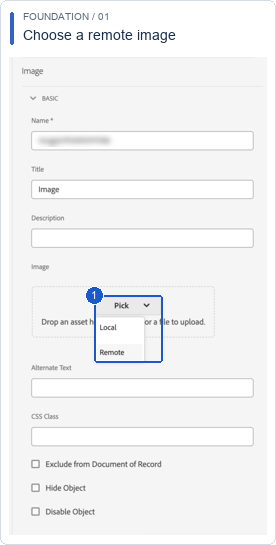

   *Choose Remote from the highlighted source menu (1).*

4. If asked, sign in with the Adobe account that has access to your images.
5. Choose an image marked **[!UICONTROL Approved]**, then select **[!UICONTROL Select]**.

   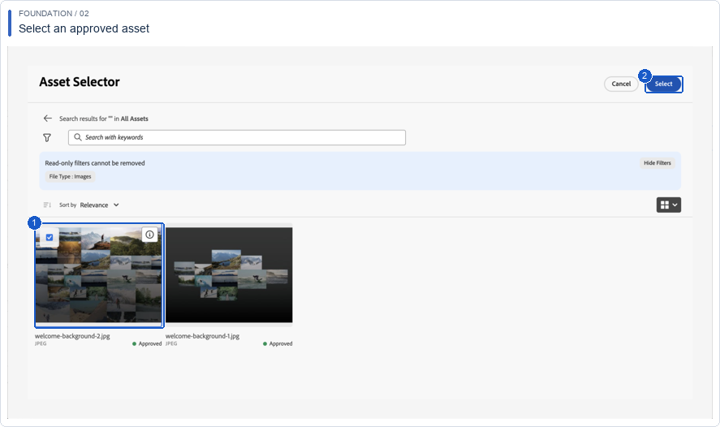

   *Choose an approved image (1), then confirm with Select (2).*

6. Back in the Image component settings, enter **[!UICONTROL Alternate Text]** that describes what the image shows or why it matters.
7. Save the Image component settings, then preview the form to see the image.

   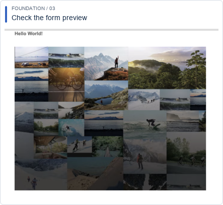

   *The selected image is visible in the Foundation form preview.*

### Core Components

Use the Image dialog to choose an approved image and add alternate text for screen readers.

1. Open an Adaptive Form that uses Core Components.
2. Add an Image component (v2), or select one already in the form. Open its settings.
3. Select **[!UICONTROL Pick]** > **[!UICONTROL Remote]** to browse images in AEM Assets.

   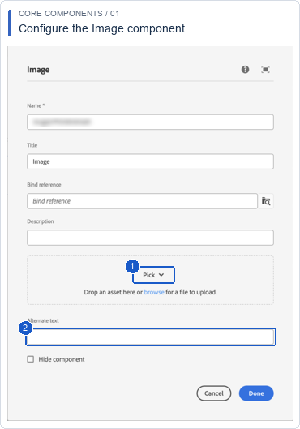

   *Choose where to get the image with Pick (1). Describe the image in Alternate text (2).*

   >[!NOTE]
   >To upload an image from your device instead of selecting an approved repository image, select **[!UICONTROL Browse]**. See [Image Core Component configuration options](https://experienceleague.adobe.com/en/docs/experience-manager-core-components/using/adaptive-forms/adaptive-forms-components/image#configure-dialog).

4. If asked, sign in with your Adobe account. Choose an image marked **[!UICONTROL Approved]**, then select **[!UICONTROL Select]**.

   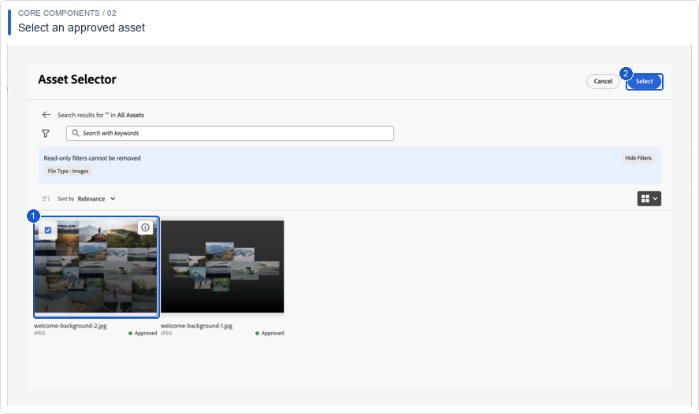

   *Choose the approved image (1), then confirm with Select (2).*

5. Back in the Image component dialog, enter **[!UICONTROL Alternate text]** that describes what the image shows or why it matters.
6. Select **[!UICONTROL Done]** to save your changes.

   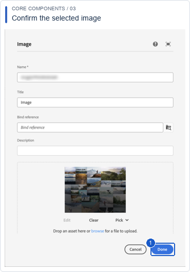

   *Confirm the selected image with Done (1).*

7. Preview the form to see the image.

   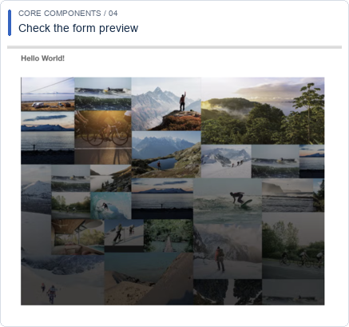

   *The selected image is visible in the Core Component-based form preview.*

### Edge Delivery Services forms

Use Content Advisor in Universal Editor to choose an image from the Dynamic Media repository configured by your administrator.

1. Open your EDS form in Universal Editor.
2. Add or select an Image component. In the properties panel, select **[!UICONTROL Add]** under **[!UICONTROL Image]**. Content Advisor opens.

   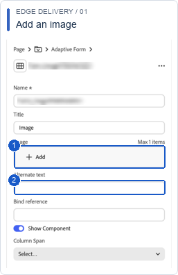

   *Select Add to choose an image (1). Describe it in Alternate text (2).*

3. In **[!UICONTROL Repository]**, select the Dynamic Media server configured by your administrator.

   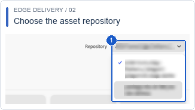

   *Choose where your images are stored in Repository (1). The names depend on your setup.*

4. Browse or search for an image marked **[!UICONTROL Approved]**.
5. Choose the image, then select **[!UICONTROL Select]** to return to your form.

   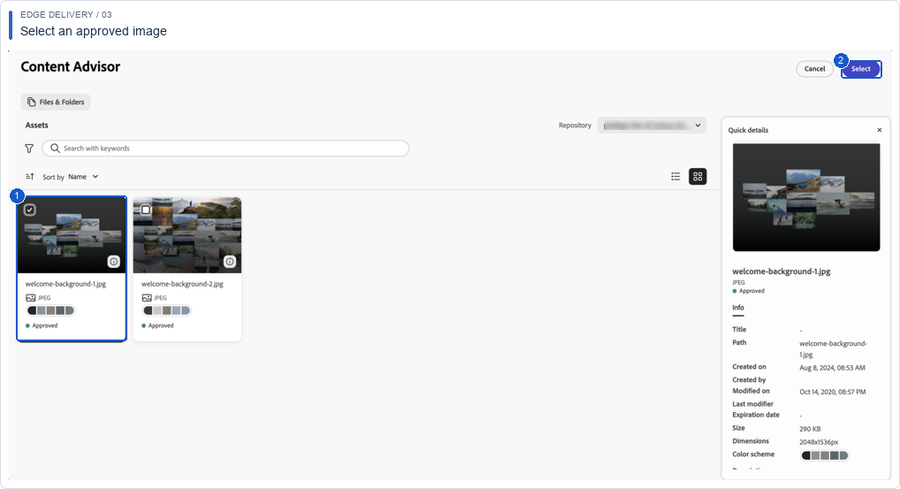

   *Select an approved image (1), then confirm with Select (2).*

6. In **[!UICONTROL Alternate text]**, describe what the image shows or why it matters.

   The selected image appears under **[!UICONTROL Image]** and in the form.

   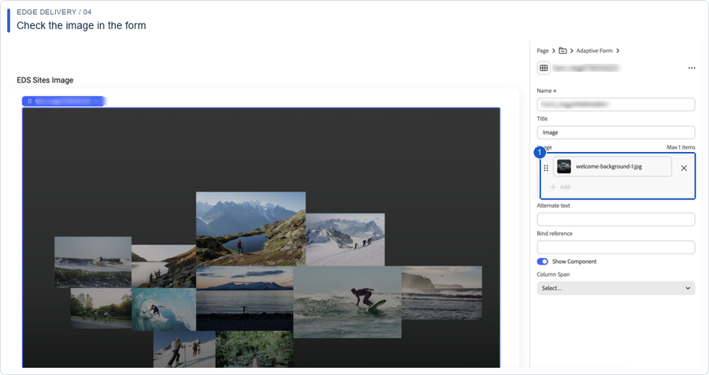

   *The image listed under Image (1) also appears in the form.*

## Verify the result {#verify-the-result}

Check both the authoring experience and the deployed form. A successful author preview does not prove that the intended audience can load the image.

1. Save the Image component settings, then reopen them. Check that your selected image is still there.
2. Preview the form and check that the image appears.
3. Check the alternate text and how the image looks on the screen sizes your audience uses.
4. Publish the form to a non-production environment using the publishing workflow for your form type.
5. Open the published form URL separately from your authoring session. For a public form, use a signed-out private browser window. For a restricted form, use an account with the access intended for its audience.
6. As an administrator or developer, inspect the image request in the browser's Network tab. Confirm that the request succeeds, uses the intended Dynamic Media delivery hostname, and displays the image.

For Foundation and Core Components, also check that an existing local image still displays as expected.

If something does not work, use the symptom to choose the next action:

| What you see | What to do |
| --- | --- |
| **[!UICONTROL Remote]** is missing | Check the Forms release in [Before you begin](#before-you-begin), then ask the Forms administrator to verify the [Dynamic Media connection configuration](#configure-the-integration-as-an-administrator). |
| The image selector opens, but your image is missing | Confirm that you selected the correct repository and that your account can access it. Ask the Assets administrator to check approval for **Delivery**, not only Content Hub. |
| A Foundation or Core image works in the author editor but not on the published form | Check the image request in a browser session with the intended audience's access. Ask the Forms administrator to verify the connection configuration on the service serving the form. |
| An EDS image request points to the form website instead of Dynamic Media | Ask the project developer to verify that the deployed renderer preserves the full external delivery URL, including responsive image URLs. |
| The Dynamic Media image request returns `404` | Ask the Assets administrator to check delivery approval, access restrictions, and any scheduled availability. A `404` can indicate restricted access, not only a missing asset. |

## Related resources

- [Dynamic Media with OpenAPI capabilities overview](https://experienceleague.adobe.com/en/docs/experience-manager-cloud-service/content/assets/dynamicmedia/dynamic-media-open-apis/dynamic-media-open-apis-overview)
- [Integrate remote AEM Assets with AEM Sites](https://experienceleague.adobe.com/en/docs/experience-manager-cloud-service/content/assets/dynamicmedia/dynamic-media-open-apis/integrate-remote-approved-assets-with-sites)
- [Environment variables in Cloud Manager](https://experienceleague.adobe.com/en/docs/experience-manager-cloud-service/content/implementing/using-cloud-manager/environment-variables#add-variables)
- [Approve assets in Experience Manager](https://experienceleague.adobe.com/en/docs/experience-manager-cloud-service/content/assets/dynamicmedia/dynamic-media-open-apis/approve-assets)
- [Restrict delivery of assets](https://experienceleague.adobe.com/en/docs/experience-manager-cloud-service/content/assets/dynamicmedia/dynamic-media-open-apis/restrict-assets-delivery)
- [Adaptive Forms Image Core Component](https://experienceleague.adobe.com/en/docs/experience-manager-core-components/using/adaptive-forms/adaptive-forms-components/image)
