# Generating Access Tokens for Server-Side APIs {#generating-access-tokens-for-server-side-apis}

>[!NOTE]
>
>OAuth Server-to-Server credentials in the AEM Developer Console are available starting November 4, 2026.

>[!IMPORTANT]
>
>Use OAuth Server-to-Server credentials for server-side integrations. Service Account (JWT) credentials are deprecated in favor of OAuth Server-to-Server. For existing JWT-based integrations, see [Generating Access Tokens for Server-Side APIs - JWT (Legacy)](generating-access-tokens-for-server-side-apis-jwt-legacy.md).

Some architectures rely on making calls to Adobe Experience Manager (AEM) as a Cloud Service from an application hosted on a server outside of AEM infrastructure. For example, a mobile application calls a server, which then makes API requests to AEM as a Cloud Service.

Use the AEM as a Cloud Service [Developer Console](development-guidelines.md#crxde-lite-and-developer-console) to create an OAuth Server-to-Server technical account. Your application exchanges its client ID and client secret for an access token using the Adobe Identity Management Services (IMS) `client_credentials` grant. No signed JWT, private key, or certificate is required.

>[!NOTE]
>
>The **AEM** Developer Console manages access to your AEM environment. It is different from the **Adobe** Developer Console at `developer.adobe.com/console`. Create and manage the technical account described here in the AEM Developer Console.

## The Server-to-server Flow {#the-server-to-server-flow}

Users with an IMS organization administrator role who are also members of the **AEM Users** or **AEM Administrators** product profile on AEM Author can create a technical account. The client secret is shown only to the user who creates it, at creation time. A user with the AEM as a Cloud Service Environment administrator role can view the account's details, which do not include the client secret.

The server-to-server flow involves these steps:

1. Create an OAuth Server-to-Server technical account and save its credentials, including the client secret shown at creation.
1. Store the credentials securely on the server that makes requests to AEM.
1. Request an access token from IMS using the client ID, client secret, and scopes.
1. Configure the technical account's product profile and AEM permissions.
1. Call the AEM API with the access token as a bearer token.

### Create a Technical Account and Retrieve Its Credentials {#fetch-the-aem-as-a-cloud-service-credentials}

>[!IMPORTANT]
>
>The AEM Developer Console shows an OAuth Server-to-Server client secret only once, when it is created. The AEM Developer Console does not store the secret value. It keeps only the secret ID and its status. IMS stores the secret as a one-way hash. Save the secret securely when it is shown. If you lose it, create a new secret using another active secret, or create a new technical account.

1. **Open Integrations.** Open the AEM Developer Console for the environment that your application accesses, then select **Integrations**. Select **Create new technical account**.

   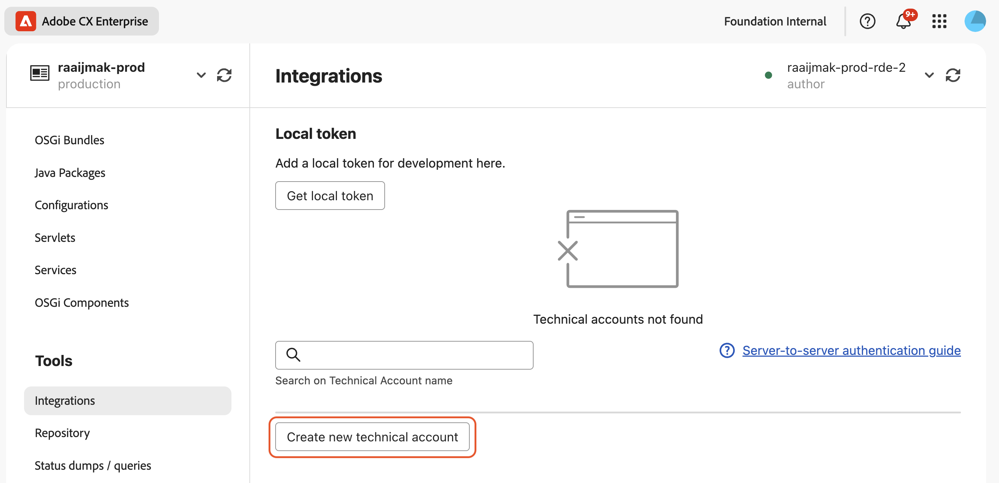

1. **Create the technical account.** In the dialog, select **OAuth Server-to-Server (S2S)** as the **Credential type**, then select **Create**.

   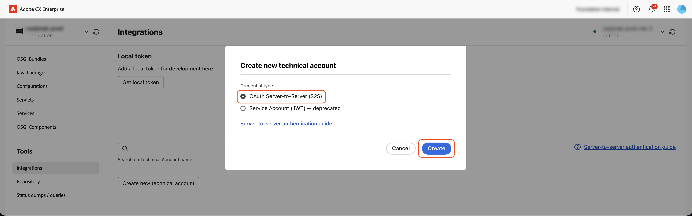

1. **Save the client secret.** The **Save your client secret** dialog shows the credentials, including `technicalAccount.clientSecret`. Select **Download credentials** to save them as `aem-s2s-credentials.json`, or select **Copy to clipboard**. Store the credentials in a secret manager or another access-controlled location for your application.

   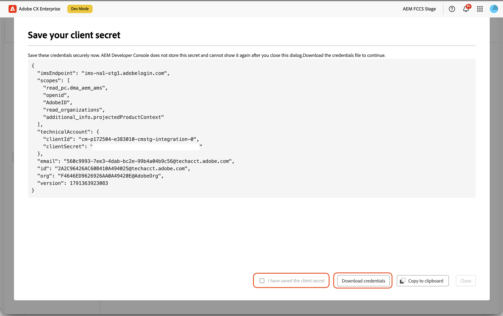

   Select **Close**. In the **Close without further access to your secret** confirmation dialog, select **Close** only after saving the secret securely. After the dialog is closed, the secret cannot be shown again.

   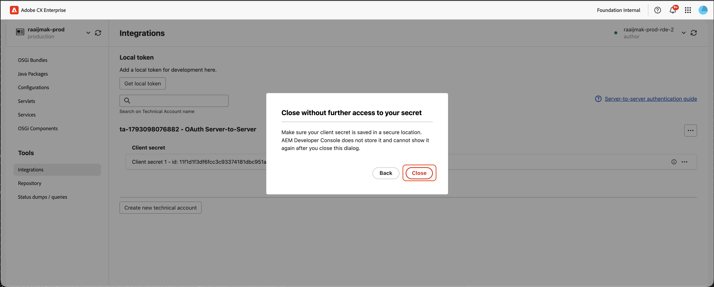

1. **Review the technical account.** The new OAuth Server-to-Server account is listed with its **Active** client secret. The secret ID displayed in the list identifies a secret. It is not the secret value and cannot be used as `client_secret` in a token request.

   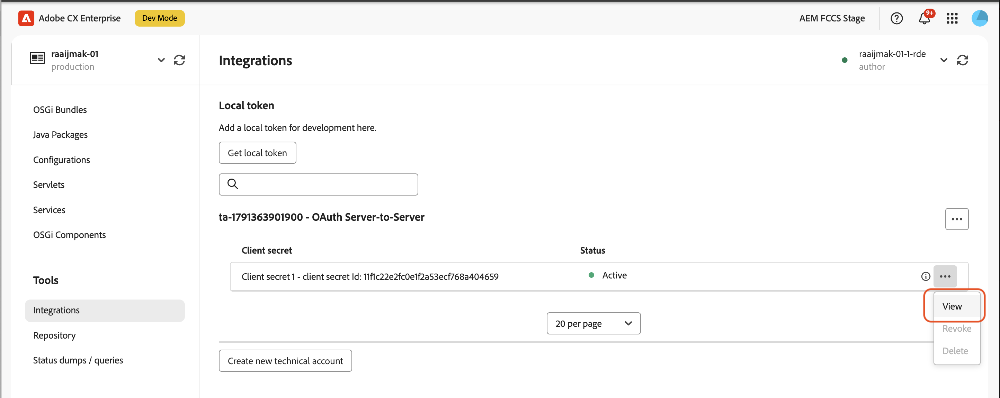

To review a secret's details later, open the client secret's row menu and select **View**. The credentials dialog shows the IMS endpoint, scopes, client ID, technical account email, secret ID, and revocation status. It does not show the client secret value.

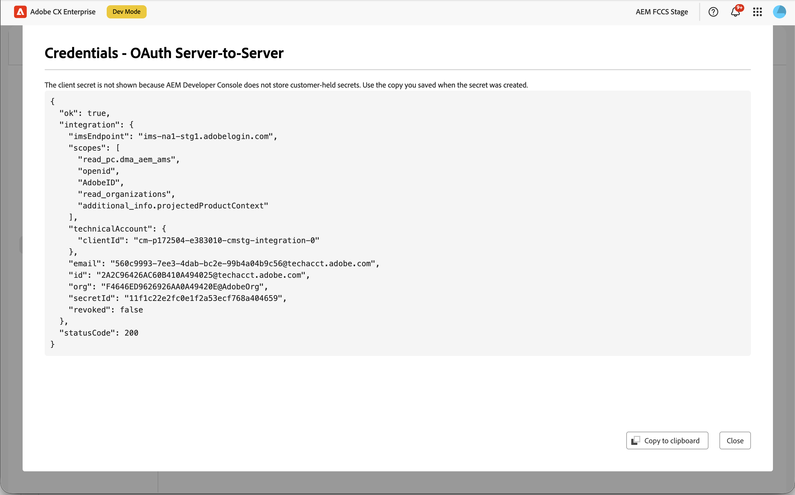

>[!NOTE]
>
>Customers can create up to 20 technical accounts. Deleted accounts count toward this limit.

>[!IMPORTANT]
>
>An IMS organization administrator who is also a member of the **AEM Users** or **AEM Administrators** product profile on AEM Author must create the technical account. Because the client secret is shown only once, the user who creates the account is responsible for passing the credentials to the application owner through a secure channel.

### Install the AEM Service Credentials on a Non-AEM Server {#install-the-aem-service-credentials-on-a-non-aem-server}

Make the credentials available only to the server-side application that calls AEM. Use a secret manager or another access-controlled storage mechanism.

Do not put a client secret in browser-side code, mobile applications, source control, or logs. Treat access tokens as secrets as well.

### Request an OAuth Access Token {#request-an-oauth-access-token}

Send an HTTPS `POST` request to `https://<imsEndpoint>/ims/token/v3`. The `imsEndpoint` in your credential JSON is an IMS hostname. For example, `ims-na1.adobelogin.com` uses `https://ims-na1.adobelogin.com/ims/token/v3`. Use the hostname supplied in your credentials, including the stage hostname when using stage credentials.

Use `Content-Type: application/x-www-form-urlencoded` and include these form fields in the request body:

| Parameter | Value |
| --- | --- |
| `grant_type` | `client_credentials` |
| `client_id` | The `technicalAccount.clientId` from your credentials. |
| `client_secret` | The `technicalAccount.clientSecret` that you saved when the secret was created. |
| `scope` | The values in `scopes`, joined with commas. |

URL-encode each form value. Send secrets in the request body, not in the URL or query string.

The response includes `access_token`, `token_type`, and `expires_in`. Use `access_token` to call AEM. The `expires_in` value is the token lifetime in seconds. Use that value rather than assuming a fixed expiration time.

Cache and reuse the access token until it approaches expiration, then request a new token with the same client credentials. This grant does not require a JWT exchange or a refresh token.

>[!NOTE]
>
>Use credentials for the AEM environment that you are calling. A valid IMS access token does not grant additional AEM permissions. Configure the technical account's permissions as described below.

### Node.js Authentication Example {#nodejs-authentication-example}

For a minimal OAuth Server-to-Server implementation, see the [AEM-CS API Client Library example](https://github.com/adobe/aemcs-api-client-lib/blob/main/README.md). It uses built-in Node.js APIs and requires Node.js 18 or newer, with no additional dependencies.

The example expects the credentials inside an `integration` object. The `aem-s2s-credentials.json` file downloaded from the AEM Developer Console contains the credentials without this wrapper. Wrap its content before using it with the example, for example with [jq](https://jqlang.org/):

```bash
jq '{integration: .}' aem-s2s-credentials.json > downloaded_integration.json
```

Alternatively, edit the file so that its complete content becomes the value of a top-level `integration` field. From a checkout of the example repository, run:

```bash
node oauth-s2s-cli.js downloaded_integration.json
```

For programmatic usage, the [OAuth helper](https://github.com/adobe/aemcs-api-client-lib/blob/main/oauth-s2s.js) accepts the wrapped object as `requestAccessToken(credentials)`. It uses the IMS hostname, client ID, client secret, and scopes inside `integration`.

Keep the credential file private. The CLI prints an access token. Do not send its output to shared logs or publish it. The example's README also shows how to use the token in an AEM API request.

### Calling the AEM API {#calling-the-aem-api}

Include the access token in the `Authorization` header of requests to your AEM as a Cloud Service environment, using the value `Bearer <access_token>`.

```bash
curl --header "Authorization: Bearer ${ACCESS_TOKEN}" \
  "https://author-p<program-id>-e<environment-id>.adobeaemcloud.com/content/dam.json"
```

Use the hostname for the environment and tier that your application accesses. Only call resources that the technical account is authorized to access.

### Set the Appropriate Permissions for the Technical Account User in AEM {#set-the-appropriate-permissions-for-the-technical-account-user-in-aem}

1. Open the [Adobe Admin Console](https://adminconsole.adobe.com/).
1. Select **AEM as a Cloud Service** under **Products and Services**.
1. Create a product profile for the integration, or select an appropriate existing profile.
1. Select **Add User** and add the technical account using the `email` from its credentials.
1. Allow time for product-profile changes to propagate. Make an API call to AEM with an access token generated for the technical account. The product profile is synchronized as an AEM group, with the technical account as a member.
1. On the appropriate AEM author instance, open **Tools** > **Security** > **Groups**. Find the product-profile group and verify that the technical account appears under **Members**. You can also check its group membership under **Tools** > **Security** > **Users**.
1. Open **Settings** > **Security** > **Permissions**. Select the group corresponding to the product profile and configure the permissions required by your API calls.
1. Verify the required API calls against each tier that the application accesses. Grant only the permissions needed by the integration.

>[!NOTE]
>
>When replacing a JWT technical account with an OAuth Server-to-Server account, assign the new account to the required product profiles and verify its AEM permissions. Permissions on the old technical account are not automatically transferred to the new account.

For more information about IMS and AEM users and groups, see [IMS support](/help/security/ims-support.md).

## Developer Flow {#developer-flow}

For local testing, developers can generate a development access token directly in the AEM Developer Console without creating an OAuth Server-to-Server technical account. The token can be used to call AEM environments that the developer can access. Use OAuth Server-to-Server credentials, rather than a local development token, for unattended server-side applications.

See the [Developer Guidelines](development-guidelines.md#crxde-lite-and-developer-console) for the permissions required to use the AEM Developer Console.

>[!NOTE]
>
>A local development access token is valid for a maximum of 24 hours. After expiration, generate another token using the same method.

### Generating the Access Token {#generating-the-access-token}

1. In the AEM Developer Console, go to **Integrations** > **Local token**.
1. Select **Get Local Development Token**.

### Call the AEM Application with an Access Token {#call-the-aem-application-with-an-access-token}

Use the local development access token as a bearer token in the `Authorization` header, as described in [Calling the AEM API](#calling-the-aem-api).

For an AEM project running on your local machine, an IMS access token is not needed.

## Rotate Client Secrets {#refresh-credentials}

OAuth Server-to-Server credentials do not require annual certificate renewal. Rotate client secrets periodically and whenever a secret is exposed. Create a new secret, switch your applications to it, and only then revoke the old secret.

Creating and revoking secrets requires the secret values that you saved. The AEM Developer Console uses an entered secret only to authenticate the request with IMS and does not store it.

>[!IMPORTANT]
>
>IMS requires at least one active secret. Create and verify a new secret before revoking the last active secret. To stop using the technical account entirely, delete the account instead.

1. **Create a new secret.** In **Integrations**, open the action menu beside the OAuth Server-to-Server account's name and select **Create new Secret**. This is the account-level menu, not a client secret's row menu.

   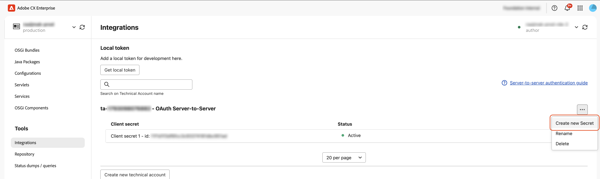

1. **Authenticate with an active secret.** In the **Create new Secret** dialog, enter the value of an active client secret for the account, then select **Create new Secret**.

   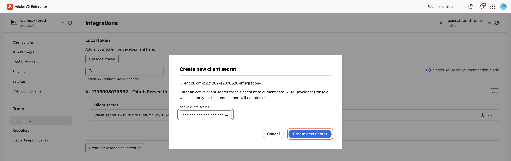

1. **Save the new secret.** The dialog shows the new secret once, with its `clientId`, `secretId`, `clientSecret`, and `scopes`. Download or copy it, store it securely, and close the dialog. Confirm that you want to close it only after saving the secret securely. After the dialog is closed, the new secret cannot be shown again.

   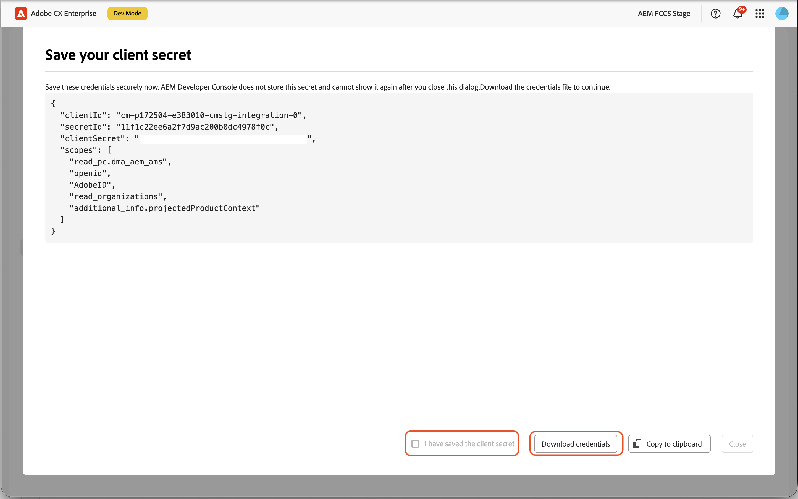

1. **Switch applications to the new secret.** Replace the `technicalAccount.clientSecret` value in the credentials that every application instance and deployment uses with the new `clientSecret`. The other credential values do not change.

   Request a new access token with the new secret and verify the required AEM API calls before proceeding. Both secrets remain active during the application cutover. Reusing a previously issued access token does not verify the new secret.

1. **Select the old secret for revocation.** After all applications use the new secret, open the old secret's row menu and select **Revoke**. Check the secret ID to make sure that you have selected the old secret.

   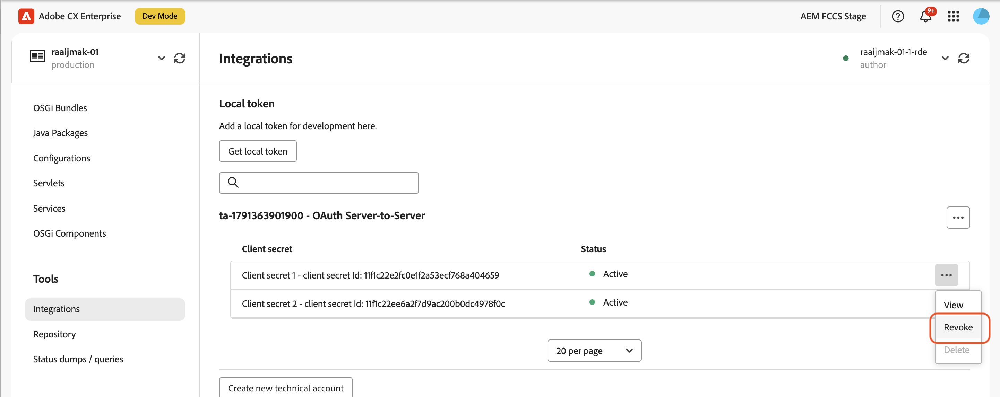

1. **Confirm revocation.** In the **Revoke client secret** dialog, check the client secret ID to revoke, enter the value of that secret, and select **Revoke**. If you no longer have the secret value, contact Adobe support. Once revocation propagates through IMS, applications cannot use that secret to request new tokens. Existing access tokens might remain valid.

   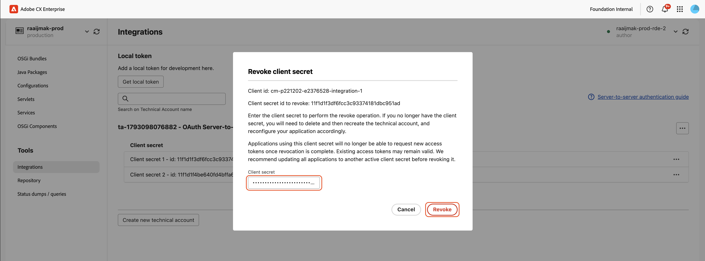

1. **Verify the result.** The old secret is listed as **Revoked**, while the new secret remains **Active**.

   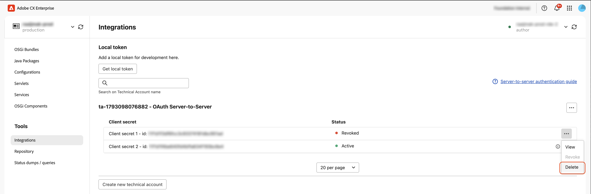

   After revocation takes effect, verify that the old secret cannot issue new access tokens and that the new secret can. Checking the displayed status alone does not verify IMS propagation.

1. **Remove the revoked secret if no longer needed.** To remove the revoked secret from the list, open its row menu, select **Delete**, and confirm.

## Credentials Revocation {#credentials-revocation}

**Revoke** disables a selected secret for new token requests. It requires the value of the secret being revoked. Revocation can take time to propagate. Do not assume that revoking a secret immediately invalidates access tokens that were already issued.

**Delete** on a revoked secret removes its metadata, such as the secret ID and revocation status, from the AEM Developer Console. It does not perform a separate IMS revocation and is not available for active secrets.

### Delete a Technical Account {#delete-a-technical-account}

Deleting a technical account revokes the account and all of its client secrets in IMS immediately. No new access tokens are issued for any credential under the account, and integrations that use it stop working once their current tokens expire. To restore access, you must create a new technical account, update your applications with its credentials, and assign the required permissions in AEM again.

Account deletion cannot be undone. Confirm only after checking which applications depend on the account, and do not use it as an individual-secret rotation step.

1. In **Integrations**, open the action menu beside the technical account's name and select **Delete**.

   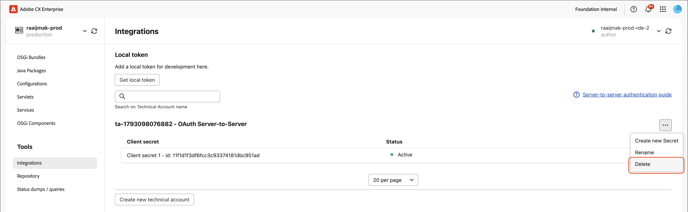

1. Review the **Delete technical account** dialog, then select **Delete**.

   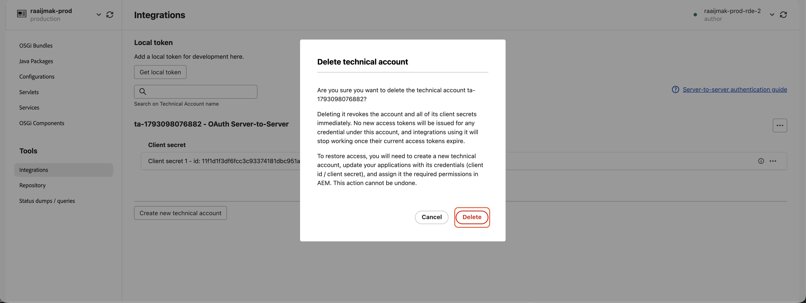

## Migrate a JWT-Based Integration {#migrate-a-jwt-based-integration}

1. Create a new OAuth Server-to-Server technical account in the AEM Developer Console.
1. Assign the new technical account to the required product profiles and configure its AEM permissions.
1. Update the server-side application to request tokens using `client_credentials` instead of signing and exchanging a JWT.
1. Verify new token generation and the required API calls using the new account.
1. After all application instances use OAuth Server-to-Server, retire the old JWT credentials and delete the old technical account.

For certificate and private-key operations on the old account, refer to the [JWT legacy guide](generating-access-tokens-for-server-side-apis-jwt-legacy.md). Do not remove the old account before the replacement integration is verified.
