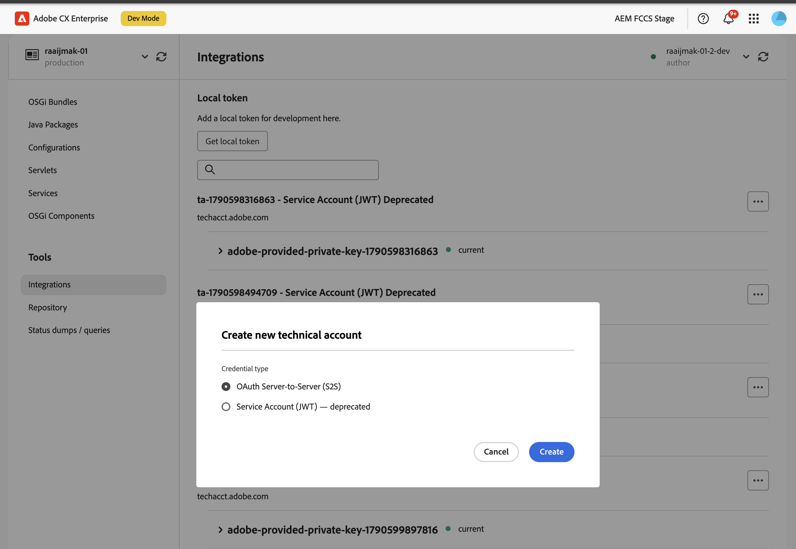
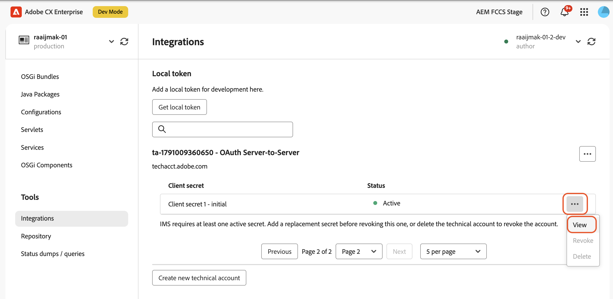
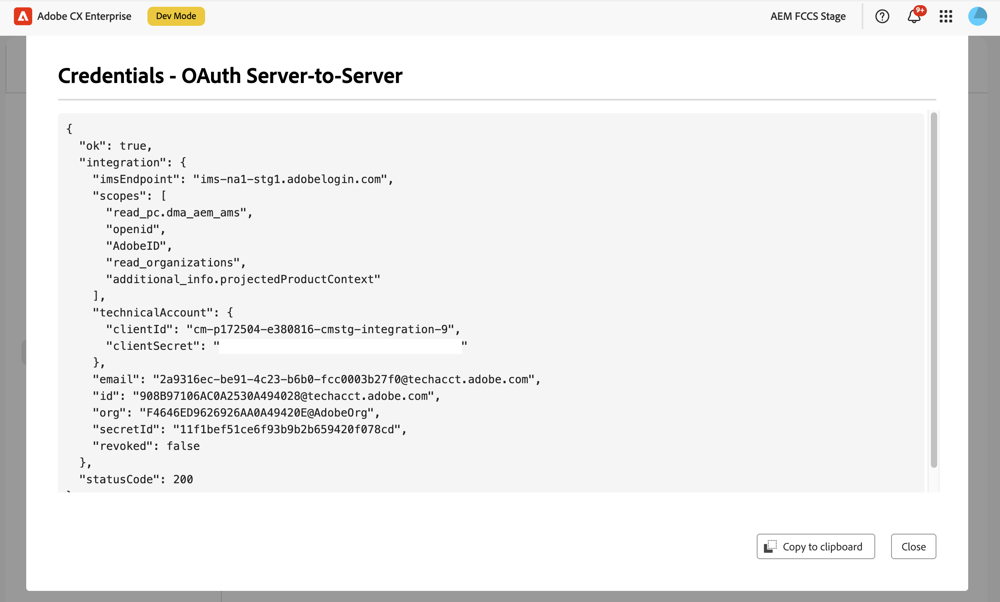
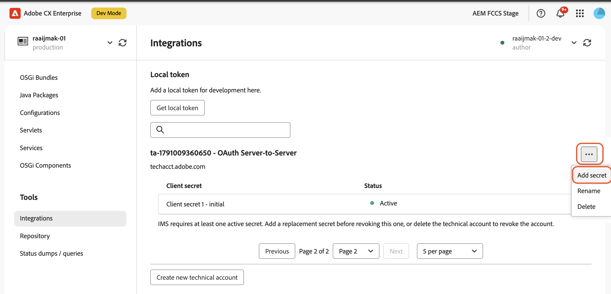
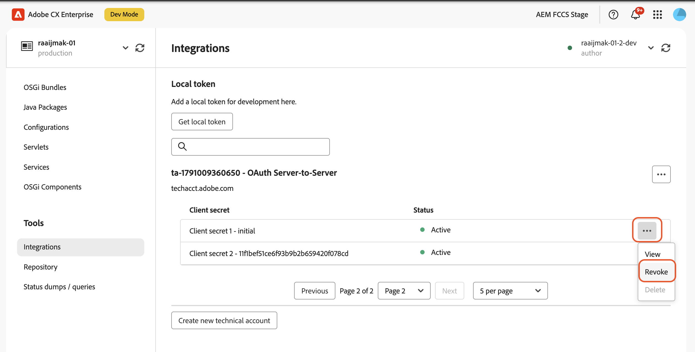
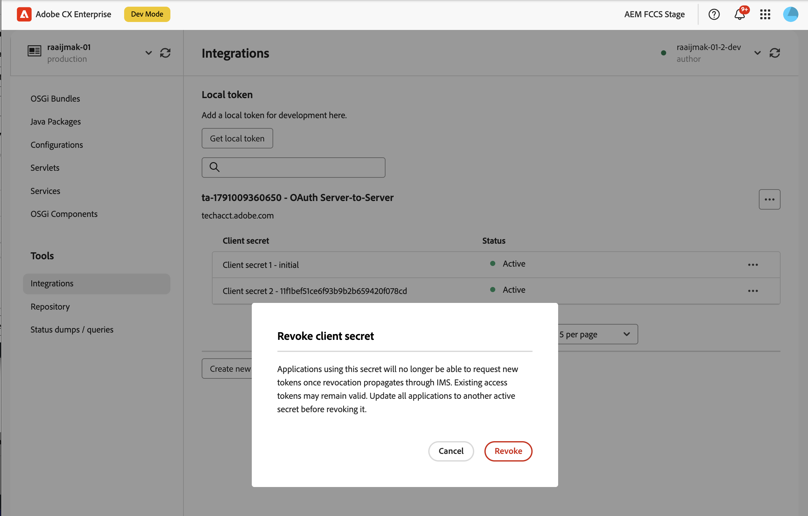
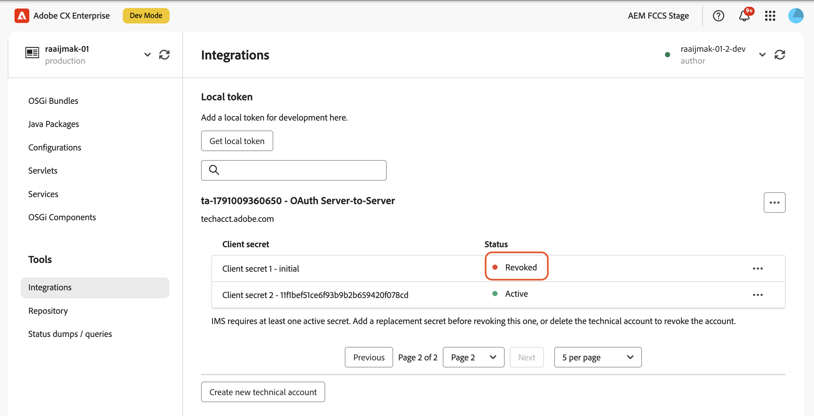

# Generating Access Tokens for Server-Side APIs {#generating-access-tokens-for-server-side-apis}

>[!IMPORTANT]
>
>Use OAuth Server-to-Server credentials for server-side integrations. Service Account (JWT) credentials are deprecated in favor of OAuth Server-to-Server. For existing JWT-based integrations, see [Generating Access Tokens for Server-Side APIs - JWT (Legacy)](generating-access-tokens-for-server-side-apis-jwt-legacy.md).

Some architectures rely on making calls to Adobe Experience Manager (AEM) as a Cloud Service from an application hosted on a server outside of AEM infrastructure. For example, a mobile application calls a server, which then makes API requests to AEM as a Cloud Service.

Use the AEM as a Cloud Service [Developer Console](development-guidelines.md#crxde-lite-and-developer-console) to create an OAuth Server-to-Server technical account. Your application exchanges its client ID and client secret for an access token using the Adobe Identity Management Services (IMS) `client_credentials` grant. No signed JWT, private key, or certificate is required.

>[!NOTE]
>
>The **AEM** Developer Console manages access to your AEM environment. It is different from the **Adobe** Developer Console at `developer.adobe.com/console`. Create and manage the technical account described here in the AEM Developer Console.

## The Server-to-server Flow {#the-server-to-server-flow}

Users with an IMS organization administrator role, who are also members of the **AEM Users** or **AEM Administrators** product profile on AEM Author, can create a technical account. A user with the AEM as a Cloud Service Environment administrator role can retrieve its credentials.

The server-to-server flow involves these steps:

1. Create an OAuth Server-to-Server technical account and retrieve its credentials.
1. Store the credentials securely on the server that makes requests to AEM.
1. Request an access token from IMS using the client ID, client secret, and scopes.
1. Configure the technical account's product profile and AEM permissions.
1. Call the AEM API with the access token as a bearer token.

### Create a Technical Account and Retrieve Its Credentials {#fetch-the-aem-as-a-cloud-service-credentials}

1. **Open Integrations.** Open the AEM Developer Console for the environment that your application accesses, then select **Integrations**.

1. **Create the technical account.** Select **Create new technical account**. In the dialog, select **OAuth Server-to-Server (S2S)** as the **Credential type**, then select **Create**.

   
   The secret ID displayed in the account's secret list identifies a credential. It is not the secret value and cannot be used as `client_secret` in a token request. Use **View** on the selected secret to retrieve its value.

1. **View the client secret.** After provisioning completes, find the new OAuth Server-to-Server account and its **Active** client secret. Open the action menu on the client secret's row and select **View**.

   
1. **Store the credentials securely.** Copy the credential JSON from the credentials dialog and save it in a secret manager or another access-controlled location for your application.
   


>[!NOTE]
>
>Customers can create up to twenty technical accounts, including those accounts that have already been deleted.

>[!IMPORTANT]
>
>An IMS organization administrator who is also a member of the **AEM Users** or **AEM Administrators** product profile on AEM Author must create the technical account before an environment administrator can retrieve its credentials.

### Install the AEM Service Credentials on a Non-AEM Server {#install-the-aem-service-credentials-on-a-non-aem-server}

Make the credentials available only to the server-side application that calls AEM. Use a secret manager or another access-controlled storage mechanism.

Do not put a client secret in browser-side code, mobile applications, source control, or logs. Treat access tokens as secrets as well.

### Request an OAuth Access Token {#request-an-oauth-access-token}

Send an HTTPS `POST` request to the `token/v3` path of the `imsEndpoint` in your credentials. For example, an `imsEndpoint` of `https://ims-na1.adobelogin.com/ims` uses `https://ims-na1.adobelogin.com/ims/token/v3`.

Use `Content-Type: application/x-www-form-urlencoded` and include these form fields in the request body:

| Parameter | Value |
| --- | --- |
| `grant_type` | `client_credentials` |
| `client_id` | The `technicalAccount.clientId` from your credentials. |
| `client_secret` | The `technicalAccount.clientSecret` from the selected active secret. |
| `scope` | The values in `scopes`, joined with commas. |

URL-encode each form value. Send secrets in the request body, not in the URL or query string.

The response includes `access_token`, `token_type`, and `expires_in`. Use `access_token` to call AEM. The `expires_in` value is the token lifetime in seconds; use that value rather than assuming a fixed expiration time.

Cache and reuse the access token until it approaches expiration, then request a new token with the same client credentials. This grant does not require a JWT exchange or a refresh token.

>[!NOTE]
>
>Use credentials for the AEM environment that you are calling. A valid IMS access token does not grant additional AEM permissions. Configure the technical account's permissions as described below.

### Calling the AEM API {#calling-the-aem-api}

Include the access token in the `Authorization` header of requests to your AEM as a Cloud Service environment, using the value `Bearer <access_token>`.

```bash
curl --header "Authorization: Bearer ${ACCESS_TOKEN}" \
  "https://author-p<program-id>-e<environment-id>.adobeaemcloud.com/content/dam.json"
```

Use the hostname for the environment and tier that your application accesses. Only call resources that the technical account is authorized to access.

### Set the Appropriate Permissions for the Technical Account User in AEM {#set-the-appropriate-permissions-for-the-technical-account-user-in-aem}

1. Open the [Adobe Admin Console](https://adminconsole.adobe.com/).
1. Select **AEM as a Cloud Service** under **Products and Services**.
1. Create a product profile for the integration, or select an appropriate existing profile.
1. Select **Add User** and add the technical account using the `email` from its credentials.
1. Allow time for product-profile changes to propagate. Make an API call to AEM with an access token generated for the technical account. The product profile is synchronized as an AEM group, with the technical account as a member.
1. On the appropriate AEM author instance, open **Tools** > **Security** > **Groups**. Find the product-profile group and verify that the technical account appears under **Members**. You can also check its group membership under **Tools** > **Security** > **Users**.
1. Open **Settings** > **Security** > **Permissions**. Select the group corresponding to the product profile and configure the permissions required by your API calls.
1. Verify the required API calls against each tier that the application accesses. Grant only the permissions needed by the integration.

>[!NOTE]
>
>When replacing a JWT technical account with an OAuth Server-to-Server account, assign the new account to the required product profiles and verify its AEM permissions. Permissions on the old technical account are not automatically transferred to the new account.

For more information about IMS and AEM users and groups, see [IMS support](/help/security/ims-support.md).

## Developer Flow {#developer-flow}

For local testing, developers can generate a development access token directly in the AEM Developer Console without creating an OAuth Server-to-Server technical account. The token can be used to call AEM environments that the developer can access. Use OAuth Server-to-Server credentials, rather than a local development token, for unattended server-side applications.

See the [Developer Guidelines](development-guidelines.md#crxde-lite-and-developer-console) for the permissions required to use the AEM Developer Console.

>[!NOTE]
>
>A local development access token is valid for a maximum of 24 hours. After expiration, generate another token using the same method.

### Generating the Access Token {#generating-the-access-token}

1. In the AEM Developer Console, go to **Integrations** > **Local token**.
1. Select **Get Local Development Token**.

### Call the AEM Application with an Access Token {#call-the-aem-application-with-an-access-token}

Use the local development access token as a bearer token in the `Authorization` header, as described in [Calling the AEM API](#calling-the-aem-api).

For an AEM project running on your local machine, an IMS access token is not needed.

## Rotate Client Secrets {#refresh-credentials}

OAuth Server-to-Server credentials do not require annual certificate renewal. Rotate client secrets periodically and whenever a secret is exposed. Add a replacement, switch your applications to it, and only then revoke the old secret.

>[!IMPORTANT]
>
>IMS requires at least one active secret. Add and verify a replacement before revoking the last active secret. To stop using the technical account entirely, delete the account instead.

1. **Add a replacement secret.** In **Integrations**, open the action menu beside the OAuth Server-to-Server account's name and select **Add secret**. This is the account-level menu, not a client secret's row menu.

   

1. **Switch applications to the replacement.** Find the new **Active** secret, open its row's action menu, and select **View**. Store the new secret value securely and update every application instance and deployment that uses the account.

   Request a new access token with the replacement secret and verify the required AEM API calls before proceeding. Both secrets remain active during the application cutover. Reusing a previously issued access token does not verify the replacement secret.

1. **Select the old secret for revocation.** After all applications use the replacement, open the old secret's row menu and select **Revoke**. Check that you have selected the old secret, not its replacement.

   

1. **Confirm revocation.** Review the **Revoke client secret** dialog, then select **Revoke**. Once revocation propagates through IMS, applications cannot use that secret to request new tokens. Existing access tokens may remain valid.

   

1. **Verify the result.** The old secret is listed as **Revoked**, while the replacement remains **Active**.

   

   After revocation takes effect, verify that the old secret cannot issue new access tokens and that the replacement secret can. Checking the displayed status alone does not verify IMS propagation.

1. **Remove the revoked secret if no longer needed.** To remove its value and entry from the AEM Developer Console's stored credentials, open the revoked secret's row menu, select **Delete**, and confirm.

## Credentials Revocation {#credentials-revocation}

**Revoke** disables a selected secret for new token requests. Revocation can take time to propagate. Do not assume that revoking a secret immediately invalidates access tokens that were already issued.

**Delete** on a revoked secret removes its value and entry from the current stored credentials. It does not perform a separate IMS revocation and is not available for active secrets.

To revoke the entire technical account, open the account's action menu and select **Delete**. Confirm only after checking which applications depend on the account. Account deletion is irreversible; do not treat it as an individual-secret rotation step.

## Migrate a JWT-Based Integration {#migrate-a-jwt-based-integration}

1. Create a new OAuth Server-to-Server technical account in the AEM Developer Console.
1. Assign the new technical account to the required product profiles and configure its AEM permissions.
1. Update the server-side application to request tokens using `client_credentials` instead of signing and exchanging a JWT.
1. Verify new token generation and the required API calls using the new account.
1. After all application instances use OAuth Server-to-Server, retire the old JWT credentials and delete the old technical account.

For certificate and private-key operations on the old account, refer to the [JWT legacy guide](generating-access-tokens-for-server-side-apis-jwt-legacy.md). Do not remove the old account before the replacement integration is verified.
