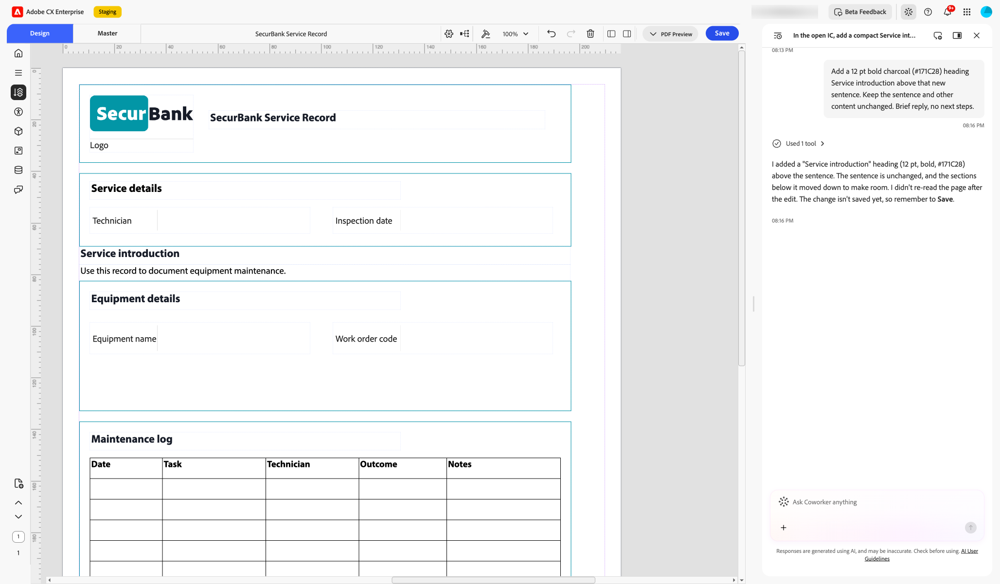
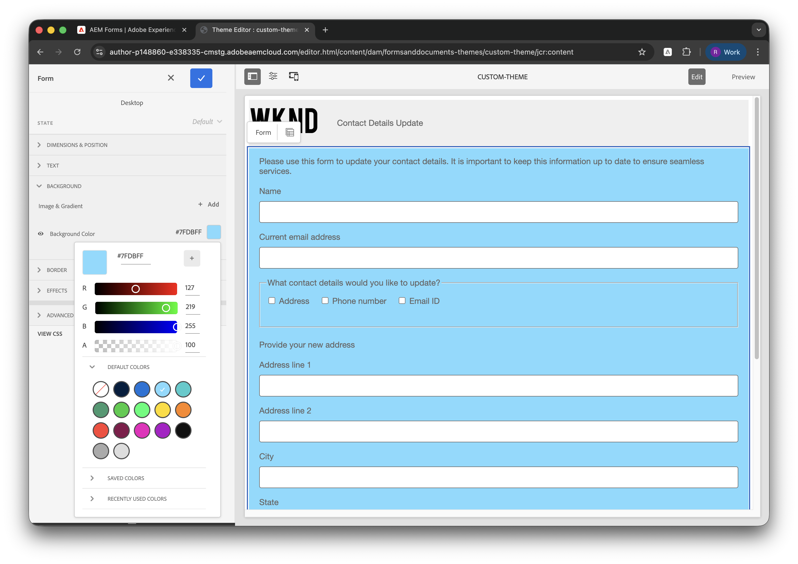

# Current Release Notes for [!DNL Adobe Experience Manager] as a Cloud Service {#release-notes}

The following section outlines the feature release notes for the current (latest) version of [!DNL Experience Manager] as a Cloud Service.

>[!NOTE]
>
>From here, you can navigate to release notes of previous versions such as 2024 or 2025.
>
>Have a look at the [Experience Manager Releases Roadmap](https://experienceleague.adobe.com/en/docs/experience-manager-release-information/aem-release-updates/update-releases-roadmap) to learn about the upcoming feature activations for [!DNL Experience Manager] as a Cloud Service.

>[!NOTE]
>
>To receive a monthly email notification about updates to Experience Cloud release notes, subscribe to the [Adobe Priority Product Update](https://www.adobe.com/subscription/priority-product-update.html).

## Release Date {#release-date}

The release date of [!DNL Adobe Experience Manager] as a [!DNL Cloud Service] current feature release (2026.11.0) is November 19, 2026. The next feature release (2026.12.0) is planned for December 10, 2026.

## Maintenance Release Notes {#maintenance}

You can find the latest maintenance release notes [here](/help/release-notes/maintenance/latest.md).

<!-- 

## Release Video {#release-video}

Have a look at the May 2026 Release Overview video for a summary of the features added in the 2026.5.0 release:

>[!VIDEO](https://video.tv.adobe.com/v/3491490/?quality=12)

-->

## Release Overview {#overview}

The 2026.11.0 release of [!DNL Experience Manager] as a [!DNL Cloud Service] highlights new and recently available capabilities across Sites, Assets, Forms, and Foundation, alongside updates to developer tools and platform guidance.

## AEM Beta Programs {#aem-beta-programs}

Adobe Experience Manager (AEM) beta programs are a way for customers to get access to prerelease features and code, provide feedback, and guide the future of AEM.

>[!IMPORTANT]
>
>Beta releases may contain defects and are provided "AS IS" without warranty of any kind. Adobe has no obligation to maintain, correct, update, change, modify or otherwise support (by way of Adobe Support Services or otherwise) the beta releases. Adobe advises customers to use caution and not rely on the correct functioning or performance of beta releases, or on any accompanying documentation or materials. Features and APIs in beta are subject to change without notice. Accordingly, any use of the beta releases is entirely at the customer's own risk.

**Benefits of participating**

Getting early access to features that Adobe is developing lets customers and partners provide feedback and shape product development. It also helps them prepare to adopt new capabilities before general availability.

**Current beta programs**

The following sections list active beta programs.

### Agents in AEM {#agents-in-aem}

If you would like to explore the powerful, new AEM agentic capabilities across production, governance, optimization, discovery, and development, [please learn about how you can access them here.](/help/ai-in-aem/agents/overview.md)

<!--
### Agents in AEM (Explorer program) {#agents-in-aem-beta-program}

Gain early access to powerful, new AEM agentic capabilities across production, governance, optimization, discovery, and development. Your feedback directly shapes Adobe's roadmap and final features. See [Overview of Agents in AEM](/help/ai-in-aem/agents/overview.md) to learn more.

This program typically lasts 4-6 weeks, but can be tailored to be flexible around your ability to actively participate. 

To opt in to participate in this program, email [aemagentsteam@adobe.com](mailto:aemagentsteam@adobe.com) and include the following details to the extent possible:

* Names and Adobe ID's of team members who will actively use agents.
* List Specific agents that you or your team will want to use. Or simply say "All Agents."

Customers selected for participation will be notified directly by Adobe. Participation is subject to eligibility considerations, including customer licensing and limited program capacity. While not all requests can be accommodated initially, additional customers may be considered in future beta waves.
-->

### AEM Foundation (Beta programs) {#aem-foundation-beta-programs}

See [AEM Foundation beta programs](#foundation-early-adopter).

### Cloud Manager (Beta programs) {#cloud-manager-beta-programs}

See [Cloud Manager beta programs](/help/implementing/cloud-manager/release-notes/current.md).

### AEM Assets (Beta programs) {#aem-assets-beta-programs}

See [AEM Assets beta programs](#assets-beta-program-features).

## [!DNL Experience Manager Sites] as a [!DNL Cloud Service] {#sites}

### Adobe LLM Apps {#llm-apps}

Adobe LLM Apps, a new capability in Experience Manager Sites, lets brands bring their own experience into LLM conversations and turn LLMs into a measurable marketing channel. Authors enter their brand’s domain, and within about 15 minutes LLM Apps suggests an app generated from the existing website, with no custom build or new backend required. Each app is made of actions, which carry out tasks such as checking stock or building a cart, and widgets, which show the results as interactive, visual experiences inside the chat, with real product images, pricing, and availability. Brands build once and publish to ChatGPT and Claude, with Gemini to follow, and manage the app with the same content, workflows, and governance as the rest of their AEM Sites experiences. App events flow to Adobe Analytics and Customer Journey Analytics, so brands can see the intent behind consumer prompts and track the journey from first prompt to conversion, whether it happens in the chat or on the brand’s own site.

>[!IMPORTANT]
>
>LLM Apps is available to all AEM Sites Cloud Service customers to develop and manage their own apps. Once metering begins, each app invocation will count toward the customer’s AEM Sites Content Requests. Adobe will announce the metering rate and start date before metering takes effect.

### New features in Experience Manager Sites Prerelease {#prerelease-sites}

#### Composite data type for Content Fragments

Content Fragment models can now use the Composite data type to group related fields and repeat them as a list inside a fragment. Composite content is stored in the fragment itself, so GraphQL and the OpenAPIs deliver it in one response without resolving references. See [Composite Data](/help/sites-cloud/administering/content-fragments/content-fragment-models.md#composite-data) for more information.

## [!DNL Experience Manager Assets] as a [!DNL Cloud Service] {#assets}

This section highlights new and recently available capabilities for [!DNL Experience Manager Assets]. It includes features that became Generally Available (GA) in the current release, as well as features that are currently in Limited Availability (LA) or Beta. LA and Beta features remain listed in this section until they become generally available.

### [!DNL Experience Manager] as a [!DNL Cloud Service] Assets General Availability Features {#assets-general-availability-features}

#### Frame.io integration {#frame-io-integration}

Users in [Frame.io](https://frame.io/) can export assets or folders from [!DNL Frame.io] directly to [!DNL Experience Manager Assets]. The integration improves users' efficiency and shortens the time from approved assets in [!DNL Frame.io] to content ready to be activated from AEM Assets. The prerequisite is Frame.io V4 managed in Adobe Admin Console. For more details, see [this article](https://help.frame.io/en/articles/15647440-export-frame-io-assets-to-adobe-experience-manager-assets). 

#### Content Automation by Firefly Services {#content-automation-by-ffs}

[Content Automation by Firefly Services](/help/assets/cc-api-integration.md) offers AEM Assets customers access to automated content transformation and creation based on selected operations from the Adobe Firefly Services APIs, specifically from the [Photoshop API V2](https://developer.adobe.com/firefly-services/docs/photoshop/). These operations include background removal (cutout), image masks, Photoshop smart object replacement, Photoshop actions, Lightroom presets, auto-tone and auto-straighten for images.

This release updates all the supported API operations to be executed against the latest Photoshop API V2, which includes auto-tone, auto-straighten, and applying Lightroom presets which were formerly leveraging the now-deprecated Lightroom API. The name of the add-on to [!DNL Assets] in [!DNL Cloud Manager] is updated to [!DNL Content Automation by Firefly Services], from the previous [!DNL Content Automation]; customers who deployed the previous [!DNL Content Automation] add-on retain access to these capabilities. 

#### Dynamic Media with OpenAPI capabilities: Multi-caption and multi-audio track support for videos {#multi-caption-multi-audio}

Dynamic Media with OpenAPI capabilities now support [multiple captions and multiple audio tracks for video assets](/help/assets/multi-audio-multi-caption.md). It enables organizations to deliver localized and accessible video experiences to global audiences by associating multiple language-specific caption and audio tracks with a single primary video. Authors can efficiently manage these tracks from a unified interface, simplifying multilingual content delivery and supporting regional accessibility requirements.

#### Dynamic Media with OpenAPI capabilities: AI-generated video captions {#ai-generated-video-captions} 

AI-generated video captions in Dynamic Media with OpenAPI capabilities [use artificial intelligence to generate captions automatically for video content](/help/assets/generate-translate-captions.md). This feature is designed to improve accessibility and enhance the user experience by providing accurate, real-time captions. The AI analyzes the video's audio track to transcribe speech and create captions, which can be edited for accuracy or customization. These captions help meet accessibility requirements and improve video engagement for audiences who rely on or prefer text-based video support.

#### Dynamic Media: GIF-based countdown timer {#gif-based-countdown-timer}

AEM Dynamic Media now brings a [GIF-based countdown timer to email templates, creating urgency at the moment of open and driving click-through on time-sensitive offers](https://experienceleague.adobe.com/en/docs/experience-manager-learn/assets/dynamic-media/images/dynamic-media-templates). Administrators can configure a Days/Hours/Mins/Secs display, a custom suffix, post-expiry fallback text, and a clickable destination URL.

#### Dynamic Media: Branded video viewer and customizable presets {#new-video-viewer-presets}

Dynamic Media [Branded video viewer delivers a performant, accessible, and fully customizable playback experience](/help/assets/dynamic-media/new-video-viewer.md). Configurable playback modifiers, including autoplay, loop, and muted, give you complete control over viewer behavior. Custom CSS support and reusable [branded video viewer presets](/help/assets/dynamic-media/branded-video-viewer-presets.md) let you customize player colors, controls, button styles, playback speeds, and video presentation settings for a consistent, on-brand experience across desktop, tablet, and phone layouts. Apply presets to videos in asset details, AEM Sites components, or playback URLs. Actionable analytics track views, watch time, completion rate, and engagement score, providing meaningful insights into video performance.

#### Content Hub: AI Search {#ai-search-content-hub}

AEM Assets Content Hub now includes [AI Search, an advanced search capability that understands the meaning and intent behind user queries instead of relying only on exact keyword matches](/help/assets/search-assets-content-hub.md#ai-search-aem-assets-content-hub). AI Search delivers more accurate and context relevant results by recognizing relationships between words, concepts, and user intent. It supports multilingual queries, handles misspellings and typos, understands synonyms, and surfaces relevant assets even when users do not use exact metadata terms. 

For example, a search for `Woman drinking coffee` can also return assets tagged with related terms such as `Lady`, `Girl`, `Latte`, or `Cappuccino`. 

Administrators can enable or disable AI Search in Content Hub using the Configurations menu by selecting either AI Search or traditional keyword search.

#### Content Hub: Custom Sorting options {#custom-sorting-options-content-hub}

Content Hub now allows administrators to [enable custom metadata fields as sorting options on the Content Hub home page](/help/assets/search-assets-content-hub.md#configure-sorting-aem-assets-content-hub). In addition to the default sorting options, Size, Modified, Name, and Relevance, administrators can configure business-specific metadata fields such as Channel, Region, SKU, or Campaign to help users organize search results more effectively.

#### Content Hub: Smart Collections {#smart-collections}

Smart Collections enable you to [automatically organize assets based on defined search criteria](/help/assets/smart-collection-content-hub.md).
When you create a Smart Collection, the collection stores the search query and filter criteria instead of storing individual assets. Assets that match the configured criteria are automatically displayed in the collection.

Smart Collections automatically remain up to date. When newly approved assets satisfy the configured search criteria, they are automatically added to the collection.

>[!VIDEO](https://video.tv.adobe.com/v/3503809)

### [!DNL Experience Manager] as a [!DNL Cloud Service] Assets Limited Availability Features {#assets-limited-availability-features}

#### Native Dynamic Media Template component in Adobe Journey Optimizer {#dynamic-media-component-ajo}

The native Dynamic Media Template component lets marketers add and personalize AEM Dynamic Media templates directly in the Adobe Journey Optimizer email editor. Marketers can select existing templates or import layered PSD files, edit individual layers such as countdown timers, and configure text, CTAs, positioning, and timing without leaving the email editor. This enables governed, personalized, and dynamic email experiences, including open-time countdowns and personalized product content.

#### Dynamic Media with OpenAPI capabilities: Secure Delivery with Attribute-based Access Control {#secure-delivery-attribute-based-access-control}

Attribute-based access control lets admins govern access to Dynamic Media with OpenAPI capabilities assets using metadata-driven rules defined for each user group. IMS-based restrictions allow DAM admins and brand managers to restrict delivery of specific assets to designated Adobe IMS users or groups. Users outside the permitted list receive a 404 response, and the asset is not delivered. This provides a secure way to manage asset delivery for campaigns, product launches, and other controlled distribution scenarios.

#### Dynamic Media with OpenAPI capabilities: Barcode and QR Code delivery {#barcode-qr-code}

Dynamic Media with OpenAPI capabilities can now generate barcode and QR code images on demand and deliver them through hosted image URLs, which is useful for channels such as campaign emails. Request parameter locking protects selected values, such as the barcode value and type, so a changed value can not produce a different barcode with the same lock. 

To request enablement, open an Adobe Customer Support ticket.

#### Content Hub: Enhanced public link sharing and governance {#enhanced-public-link-sharing}

Content Hub lets you [share multiple assets and collections through public links and update existing links by adding or removing assets and collections at any time](/help/assets/share-assets-content-hub.md). Administrators can manage shared links with controls for password protection, expiration, and link revocation to help govern external access. Branded recipient experiences help maintain brand consistency when sharing assets with external stakeholders.

### [!DNL Experience Manager] as a [!DNL Cloud Service] Assets Beta Features {#assets-beta-program-features}

#### Content Automation agentic skills: Background removal {#agentic-content-automation-bg-removal}

Get access to content automation skills interactively, using natural language prompts in [Coworker Chat](https://experienceleague.adobe.com/en/docs/cx-enterprise-ai/experience-cloud-ai/coworker/chat/overview), powered by [Adobe Firefly Services APIs](https://developer.adobe.com/firefly-services/docs/guides/). This gives users additional ways to adapt and create content based on approved assets in AEM and increases users' efficiency and productivity. 

The first content operation available as an agentic skill is background removal (a.k.a., cutout). Customers interested in accessing the beta would have to have CX Coworker enabled and have access to the Firefly Services [Photoshop API](https://developer.adobe.com/firefly-services/docs/photoshop/), e.g., via Assets [Content Automation](/help/assets/cc-api-integration.md) add-on. 

To participate or learn more, send an email to `aem-agent-content-optimization-feedback@adobe.com`.

#### Content Advisor browser extension {#content-advisor-browser-extension}

Use the power of AEM Content Advisor for AEM Assets, in the application of your choice with the browser extension available [here](https://chromewebstore.google.com/detail/aem-content-advisor/hgagfaikdinmneghfgjjocmfidmnadga).

**Why you will love it?**

* **Zero setup, zero code.** Install it, sign in, and start working. No integration, no custom connectors, no developer tickets.

* **Smarter suggestions, on your terms.** Recommendations come from the whole page, or narrow them by selecting a region, highlighting text, or choosing an image. The more precisely you point, the sharper the results.

* **Pick exactly what you need.** Choose any asset or any Dynamic Media rendition (the right size, format, or crop) and send it straight to your editor. Insert, drag and drop, or copy URL to the clipboard.

* **Works where you author.** AEM (Cloud Service, Adobe Managed Services, or On-premise), other Adobe CX Enterprise products (where AEM Assets native integration does not exist), and third-party tools such as Google Docs/WordPress/Microsoft Powerpoint, and any other web application.

For more information, see [Use AEM Content Advisor with the browser extension](/help/assets/content-advisor-browser-extension.md).

To send feedback, participate or learn more, send an email to `aem-content-advisor-feedback@adobe.com`.

#### Dynamic Media with OpenAPI capabilities: Video Interactivity {#video-interactivity}

Video Interactivity lets authors add chapters and text, image, and card overlays to videos in Dynamic Media with OpenAPI capabilities. Authors configure them in the Video Interactivity editor. The configuration is saved on the asset and delivered with the approved video metadata for playback in the new Video Viewer. 

To participate or learn more, send an email to `dm-beta-feedback@adobe.com`.

#### Dynamic Media: Video Engagement Report {#video-engagement-report}

Turn video playback into actionable insight by providing per-video engagement metrics for the New Video Viewer, including views, impressions, watch time, completion rate, and engagement score, delivered as a monthly CSV to help teams measure content performance.

To participate or learn more, send an email to `dm-beta-feedback@adobe.com`.

#### Dynamic Media: Operations and Error Report {#operations-and-error-report}

Give teams visibility into delivery health by reporting operational activity such as delivery request counts, smart crops, video encodes, and templates created, while surfacing failed delivery URLs with their referrer and failure count so issues can be pinpointed and fixed.

To participate or learn more, send an email to `dm-beta-feedback@adobe.com`.

#### Dynamic Media Template: Auto Translate {#auto-translate}

Eliminate repetitive manual localization by using AI to automatically translate text and turn a single master template into variants across multiple locales, while preserving the visual integrity of your designs.

To participate or learn more, send an email to `dm-beta-feedback@adobe.com`.

#### Multi-portal Content Hub {#multi-portal-content-hub}

Deliver tailored Content Hub experiences for each brand or business unit, while managing content centrally from a single source of truth.

To participate or learn more, send an email to `aemcontenthubbeta@adobe.com`.

#### AI-powered content onboarding and content supply chain automation {#ai-powered-content-onboarding-content-supply-chain-automation}

The Content Supply Chain Agent provides two cooperating AI-powered agents:

* **CSC Blueprint Agent** maps your end-to-end content supply chain, identifies gaps and anti-patterns, and helps define an agreed future state and prioritized action plan.
* **CSC Integration Agent** implements governed content and metadata movement between systems through configured connections, supporting both one-time migrations and recurring synchronization.

To participate or learn more, send an email to `aem-assets-coinnovation-interest@adobe.com`.

#### UI Extensibility for Assets View {#ui-extensibility-assets-view-beta}

Assets View supports UI Extensibility, a developer-first capability that empowers customers to tailor the out-of-the-box experience to meet their specific business requirements.
Customers can leverage existing stable extension points by following Adobe's developer documentation to build and deploy extensions with minimal effort. For use cases where a required extension point is not yet available, Adobe works directly with customers to explore the requirements and assess the technical feasibility of delivering new extensibility APIs tailored to their needs, and may deliver such new APIs as **Beta Releases**.
Additionally, Adobe has developed a **GenAI-powered extension generation tool** currently available in an internal early adoption phase. This tool can significantly accelerate extension development time. Customers participating in this beta program will receive access to the tool and are encouraged to share feedback to help shape its evolution.
To participate or learn more, send an email to `ASSETSVIEWUIEXTENSIBILITY@adobe.com`.

#### Brand Aware Metadata (BAM) {#brand-aware-metadata-beta}

AEM Assets now supports Brand Aware Metadata, an AI-powered capability that automatically generates custom metadata for assets when uploaded or re-processed. This reduces the need for manual entry by orders of magnitude, helping teams find assets and deliver new experiences much faster. Customers maintain a library of prompts that define how AI should populate any given metadata field, tailored to their own brand vocabulary and taxonomy. This prompt library includes a playground to preview results and a prompt optimizer that automatically drafts suggested improvements.

Adobe is actively expanding BAM's capabilities through direct co-innovation with customers. Where a specific use case is not yet supported, Adobe works with participating customers to understand their needs and may deliver expanded capabilities as the beta progresses. Customers in this program gain early access to new features as they ship and are encouraged to share feedback that directly shapes the roadmap.

To participate or learn more, send an email to `AEM-ASSETS-BRANDAWAREMETADATA@adobe.com`.

<!--

#### Assets Onboarding Agent {#assets-onboarding-agent-beta}

If your organization is new to Experience Manager Assets, you can opt in to the **Assets Onboarding Agent Beta program**, which gives you access to the following AEM Brand Experience AI skills for onboarding:

* Guides users through DAM setup and migration planning by using a conversational workflow to capture business needs and recommend how an AEM Assets deployment should be structured.

* Creates core AEM Assets configuration artifacts such as folder hierarchies, tag taxonomies, metadata forms, and can help execute bulk import jobs to accelerate onboarding.

**Why participate?**

* Go live faster with a ready-to-use DAM environment by eliminating repetitive, manual steps with AI assistance.

* Lower operational overhead with automated configuration and preparation of folders, tags, metadata and asset imports.

* Improve consistency, governance, and ensure adherence to best practices through a curated setup experience with intelligent recommendations tailor-made for your business.

To participate or learn more, send an email to `GRP-AEM-ONBOARDING-AGENT@adobe.com`.

-->

#### Assets Sourcing portal for AEM Assets {#asset-sourcing-aem-assets}

[The Assets Sourcing Portal](/help/assets/asset-sourcing-portal-for-aem-assets.md) provides a secure, self-service experience for collecting assets from external contributors without granting them access to Adobe Experience Manager Assets. Contributors can upload assets, provide the required metadata, and submit content directly to a designated intake location while administrators maintain control over asset organization and governance.

Adobe works with participating customers to understand their needs and may deliver expanded capabilities as the limited availability program progresses. Customers in this program gain early access to new features as they ship and are encouraged to share feedback that directly shapes the roadmap.

To participate or learn more, send an email to `AEM-Assets-Sourcing-Portal@adobe.com`.

#### Support for additional asset types in Adobe Express integration {#assets-express-integration-asset-types-beta}

Adobe Express integration with Assets helps all users create and edit on-brand content and increase content reuse. We have worked on supporting a growing list of asset / file types to be supported by the integration, and some of them are available early to customers  interested in using them:

**Asset view UI - "Open in Express"** to import an asset into a new Express document in the embedded Express editor:

* **.mp4** video assets

**Assets plugin in Adobe Express** to import an asset into the current Express document:

* **.ai** Adobe Illustrator assets
* **.indd** Adobe InDesign assets
* **.mov** video assets
* **.mp3** audio assets
* **.gif** animated assets

To participate or learn more, send an email to `aem-assets-express@adobe.com`.

## [!DNL Experience Manager Forms] as a [!DNL Cloud Service] {#forms}

### New features in AEM Forms {#forms-new-features}

#### Interactive Communications authoring in CX Coworker {#ic-authoring-coworker}

Create and refine customer communications such as account statements, renewal notices, and service records through **natural-language requests** in Adobe CX Enterprise Coworker. Communication authors and template authors can describe the changes they need instead of configuring each document component manually.

* **Create communications:** Start from a brief, an enabled template, an image, or a PDF.
* **Edit document content:** Add sections and tables, rename or remove fields, and update layout and appearance in the open communication.
* **Connect existing data:** Bind supported nonrepeating fields to an attached data model.

For details, see [Interactive Communications agentic capabilities](/help/ai-in-aem/agentic-capabilities/brand-experience/experience-production/forms/interactive-communication-use-cases.md).

#### Exclude file attachments from the Submission PDF {#exclude-attachments-submission-pdf}

Authors can exclude uploaded file attachments from the Submission PDF (Document of Record) for Adaptive Forms based on Core Components. This option can reduce the size of the Submission PDF when files are delivered separately through the configured submit action. For details, see [Exclude file attachments from the Submission PDF](/help/forms/generate-document-of-record-core-components.md#exclude-file-attachments).

#### XDP templates and fragments in the Interactive Communication Editor {#xdp-templates-fragments-ic-editor}

Authors can now create XML Data Package (XDP) templates and fragments in Forms Manager and edit them directly in the Interactive Communication (IC) Editor, without first authoring them in Designer. Teams can build shared layouts and reusable content in one place:

* **Create reusable base layouts:** Create XDP templates with headers, footers, master pages, and bound fields that multiple Interactive Communications can share.
* **Reuse common content:** Create XDP fragments for content such as signature blocks or standard disclosures, and reference them across templates instead of recreating the content.
* **Bind data during creation:** Optionally bind a template or fragment to a Form Data Model or an XML Schema Definition (XSD) file, or add the data connection later in the editor.
* **Preview PDF output:** Preview generated PDF output with no data, local XML data, or Form Data Model sample data.

For details, see [Create an XDP template](/help/forms/interactive-communication/create-xdp-template.md) and [Create an XDP fragment](/help/forms/interactive-communication/create-xdp-fragment.md).

<!--

### Early Adopter Features in AEM Forms

The following capabilities are available through the AEM Forms Early Adopter program. To request access, email [aem-forms-ea@adobe.com](mailto:aem-forms-ea@adobe.com) from your official address and include your organization ID, program details, and the capabilities you want to use.

#### Theme Editor for Core Components based Adaptive Forms {#theme-editor-core-components}

Style Core Components based Adaptive Forms visually in the Theme Editor and preview changes as you work. Customize colors, typography, borders, and spacing, then reuse themes across forms to maintain a consistent appearance. For details, see [Customizing Adaptive Form themes using the Theme Editor](/help/forms/customizing-themes-using-theme-editor.md).

-->

## [!DNL Experience Manager] as a [!DNL Cloud Service] Foundation {#foundation}

### [!DNL Experience Manager] as a [!DNL Cloud Service] Foundation New Features {#foundation-new}

#### Vulnerability assessment with AEM Governance Agent {#vulnerability}

The AEM Governance Agent can list known vulnerabilities across one or more AEM instances, including their severity and affected components. You can filter findings by CVE, severity, environment, or component to prioritize remediation. See [AEM Governance Agent use cases](/help/ai-in-aem/agentic-capabilities/brand-governance/use-cases.md).

#### Java 25 {#java25-sdk}

AEM Cloud Service now supports Java 25, both for build and runtime so you can take advantage of performance improvements and modern Java features. Use the AEM Cloud Service SDK to validate your code for Java 25. Your AEM license entitles you to download Oracle Java 25 from the [Software Distribution portal](https://experience.adobe.com/#/downloads/content/software-distribution/en/general.html?fulltext=java*+25*&orderby=%40jcr%3Acontent%2Fjcr%3AlastModified&orderby.sort=desc&layout=list&p.offset=0&p.limit=8).

Starting in January, lower environments will be upgraded to the Java 25 runtime so you can validate that your applications work as expected. Staging and production environments will be upgraded in May 2027. Adobe recommends validating proactively and as early as possible by configuring the opt-in Cloud Manager [environment variable](/help/implementing/cloud-manager/getting-access-to-aem-in-cloud/build-environment-details.md#java-25-runtime-opt-in). Report any issues early, while you can still temporarily revert to the Java 21 runtime.

The Java 25 **runtime** will be applied to all environments by May 2027, but **building** with Java 25 remains optional. Learn more about [Java 25 support](/help/implementing/cloud-manager/getting-access-to-aem-in-cloud/build-environment-details.md#java-25-support).

#### CDN-level OpenID Connect (OIDC) Authentication for Edge Delivery Services {#cdn-level-authentication}

Generally Available in **early December** for Edge Delivery Services using the Adobe-managed CDN, CDN-level OIDC authentication lets you require sign-in with your identity provider (IdP) before selected pages are served. Authentication is enforced at the CDN, so unauthenticated requests are redirected to the IdP and never reach your content. Restricting access by user group is not supported.

Learn more in the [CDN OIDC authentication documentation](https://www.aem.live/developer/byo-cdn-adobe-managed-cdn-config#cdn-oidc-authentication) and the thorough step-by-step [tutorial](https://experienceleague.adobe.com/en/docs/experience-manager-learn/sites/edge-delivery-services/authentication/cdn-oidc-authentication).

AEM as a Cloud Service implementations that serve content from the Publish tier should use the separate [OIDC on Publish Tier](https://experienceleague.adobe.com/en/docs/experience-manager-cloud-service/content/security/open-id-connect-support-for-aem-as-a-cloud-service-on-publish-tier) feature, which supports user groups. 

#### OpenTelemetry for Application Performance Monitoring (APM) (Limited Availability) {#otel}

Now in Limited Availability (see note below for access), AEM as a Cloud Service supports [OpenTelemetry](/help/implementing/developing/introduction/opentelemetry-apm-integration.md). OTel is an open, industry-standard way to get traces, metrics, and logs together, sent to the APM provider of your choice. Also see advanced [custom instrumentation](/help/implementing/developing/introduction/opentelemetry-custom-instrumentation.md) documentation and [tutorials](https://experienceleague.adobe.com/en/docs/experience-manager-learn/cloud-service/observability-via-opentelemetry/opentelemetry-in-aem).

To get on the list for access, email [aemcs-otel-access@adobe.com](mailto:aemcs-otel-access@adobe.com), describing where you intend to ingest the data.

### [!DNL Experience Manager] as a [!DNL Cloud Service] Foundation Important Notices {#foundation-notices}

#### Update your Allowlists with Additional Adobe-managed CDN IP Addresses {#cdn-ips}

If you restrict inbound connections to your systems by IP address, you may have allowlisted the IP addresses of the Adobe-managed CDN. This is common for destinations that receive CDN data directly, such as log ingestion endpoints.

New egress IP addresses are being added on January 11, 2027, at 00:00 UTC. If your allowlist doesn't include them, valid traffic from the CDN, including log data, may be rejected.

**What to do before January 11, 2027:**

1. Update your allowlist to include every IPv4 and IPv6 range in [this public IP list](https://api.fastly.com/public-ip-list). The list already includes the new addresses.
2. To avoid this in the future, automate the update by monitoring the [public IP list API](https://www.fastly.com/documentation/reference/api/utils/public-ip-list/) for changes, or by subscribing to [this status page](https://fastlystatus.com/) for "IP address announcements."

If you don't allowlist the CDN's IP addresses, no action is required.

#### Mandatory migration from Adobe's built-in APM integration (New Relic) to OpenTelemetry {#otel-migration}

OpenTelemetry (OTel) is replacing Adobe's built-in APM integration (New Relic), which will be disabled at the end of **November 2026**. If your organization is using the built-in New Relic APM integration, see the [FAQ](/help/implementing/developing/introduction/opentelemetry-apm-integration.md#faq) or [tutorial](https://experienceleague.adobe.com/en/docs/experience-manager-learn/cloud-service/observability-via-opentelemetry/opentelemetry-in-aem) for more information.

#### Deprecation of Domain-specific AEM MCP Server {#domain-mcp-deprecation}

The [AEM MCP Server](/help/ai-in-aem/mcp-support/using-mcp-with-aem-as-a-cloud-service.md#aem-mcp-server) has reached parity with the [domain-specific MCP servers](/help/ai-in-aem/mcp-support/using-mcp-with-aem-as-a-cloud-service.md#mcp-servers-provided-by-aem), which are now deprecated. Switch your MCP clients to the AEM MCP Server, which provides the same capabilities in a single endpoint.

#### IMS Authentication Rich Errors {#ims-auth-rich-errors}

To help troubleshoot IMS integrations, `imsauth` has added support for *rich errors*.

Instead of returning only an HTTP status code, these errors provide additional context to help diagnose and resolve issues that can block authentication and access.

#### Winter 2027 Removal of Deprecated Java APIs {#java-api-deprecation}

On **March 31, 2027**, a set of deprecated Java APIs will be removed, and it is critical to take action in order to achieve security compliance. Applications that have not removed APIs will not receive new features or bug fixes, and application stability and uptime may be negatively affected, and security risk exposure may increase.

See the [deprecation article](/help/release-notes/deprecated-removed-features.md#aem-apis) for full details, but for convenience, these APIs are listed below:

+++ Expand to see the Java API deprecations

* `com.day.cq.wcm.commons.util`
* `com.day.cq.xss`
* `com.github.jknack.handlebars`
* `org.apache.jackrabbit.webdav.client.methods`
* `org.bson`
* `org.apache.tika`
* `org.apache.commons.fileupload`
* `opennlp.tools`
* `com.day.cq.commons.predicate`

+++

#### Preparing for Java 25: AEM Cloud Service Runtime Upgrade Timeline {#java25-announcement}

Java 25 is the next long-term support (LTS) release after Java 21, delivering improvements across performance, developer productivity, and security:

- **Performance** — Reduced memory footprint, more efficient garbage collection, and faster JVM warm-up benefit cloud-native deployments.
- **Developer productivity** — Cleaner object initialization, more expressive pattern matching, and simplified concurrent task management reduce boilerplate and improve code clarity.
- **Security** — Modernized cryptographic key derivation API to simplify common security workflows.

To help organizations plan testing and validation ahead of the necessary Java 25 runtime upgrade, Adobe is providing the following target dates. Any updates to this timeline will be communicated via release notes.

| Timeframe | Milestone |
|---|---|
| **October 29, 2026** | AEM Cloud Service SDK supports Java 25 runtime. The Java 25 JDK is available for download from the Adobe Software Distribution portal. |
| **November 20, 2026** | Customers are encouraged to optionally enable the Java 25 runtime in their Cloud environments to validate behavior. Early adoption maximizes time to surface and resolve issues. |
| **January – April 2027** | Adobe will gradually migrate sandboxes and lower environments (RDE, Dev) to the Java 25 runtime. Customers should validate behavior and report unexpected issues, and are encouraged to enable staging and production environments as well. A temporary rollback to Java 21 is available while resolving any problems. |
| **May 2027** | All environment runtimes (including staging and production) migrate to Java 25. Java 21 runtime is decommissioned. The AEM Cloud Service SDK will no longer support Java 21. |

AEM Cloud Service continues to support compiling customer code with Java 11, Java 17, and Java 21. However, Adobe recommends building with Java 25 (once available in AEM) to take full advantage of the latest language features and performance improvements.

### [!DNL Experience Manager] as a [!DNL Cloud Service] Foundation Early Adopter Features {#foundation-early-adopter}

#### CDN Log Forwarding to Amazon S3, Dynatrace, and New Relic (Beta Program) {#cdn-logforwarding}

While logs can be downloaded from Cloud Manager, many organizations prefer to stream them to a logging destination of their choice. AEM supports forwarding AEM logs (including Apache/Dispatcher) and CDN logs to various destinations. 

You can now forward CDN logs to **Amazon S3, Dynatrace, and New Relic**. Log forwarding is configured in a self-serve manner and deployed using the Cloud Manager config pipeline. Please email [aemcs-logforwarding-beta@adobe.com](mailto:aemcs-logforwarding-beta@adobe.com) to join the beta program, and learn more in the [Log Forwarding documentation](/help/implementing/developing/introduction/log-forwarding.md).

#### mTLS Authentication for Log Forwarding (Beta Program) {#mtls-log-forwarding-beta}

Log Forwarding now supports mutual TLS (mTLS) client certificate authentication for Splunk, Elasticsearch/OpenSearch, and HTTPS destinations, for both AEM logs (including Apache/Dispatcher) and CDN logs. AEM as a Cloud Service presents a client certificate when it connects to your logging destination, so the destination can verify that the logs come from your environment.

mTLS for Log Forwarding is in beta. To join the Beta Program, email [aemcs-logforwarding-beta@adobe.com](mailto:aemcs-logforwarding-beta@adobe.com) with your program ID and environment IDs. Learn more in the [log forwarding documentation](/help/implementing/developing/introduction/log-forwarding.md#mtls).

#### CAPTCHAs and Bot Category WAF Flags at the Origin (Beta Program) {#captcha-beta}

Customers licensing Extended Security can configure traffic filter rules with CAPTCHA challenges – at the origin – to block unwanted bots. In addition, you can log or block requests at the origin that match specific types of bots using a new set of WAF Flags.

To participate in the beta, email [aemcs-waf-adopter@adobe.com](mailto:aemcs-waf-adopter@adobe.com).

#### CX Enterprise Coworker: Developer-Focused Capabilities (Beta Program) {#coworker-ai-troubleshooting-beta}

Today for developers, Coworker supports AI prompts to drive Cloud Manager. We're further expanding agentic AI support for developer use cases — troubleshooting, insights, and productivity — in areas including:

* **CDN** (e.g., *Did my site experience any traffic spikes?*, *What's my cache hit ratio?*)
* **Replication** (e.g., *Why is my replication queue blocked?*)
* **Code modernization** (e.g., *Propose a patch to replace deprecated APIs*)

To join the Beta Program, email [aem-devagent@adobe.com](mailto:aem-devagent@adobe.com) describing your interest.

## [!DNL Experience Manager] Guides {#guides}

You can find a complete list of new and enhanced features of the latest release of Adobe Experience Manager Guides [here](https://experienceleague.adobe.com/en/docs/experience-manager-guides/using/release-info/aem-guides-releases-roadmap).

## Cloud Manager {#cloud-manager}

You can find a complete list of Cloud Manager monthly releases [here](/help/implementing/cloud-manager/release-notes/current.md).

## Migration Tools {#migration-tools}

You can find a complete list of Migration Tools releases [here](/help/journey-migration/release-notes/release-notes-migration-tools-current.md).

## Universal Editor {#universal-editor}

You can find a complete list of Universal Editor releases [here](/help/release-notes/universal-editor/current.md).

## Generate Variations {#generate-variations}

You can find a complete list of Generate Variations releases [here](/help/generative-ai/release-notes-generate-variations.md).

## Experience Cloud Release Notes {#experience-cloud}

You can find information about releases of other Experience Cloud applications [here](https://experienceleague.adobe.com/en/docs/release-notes/experience-cloud/current).
